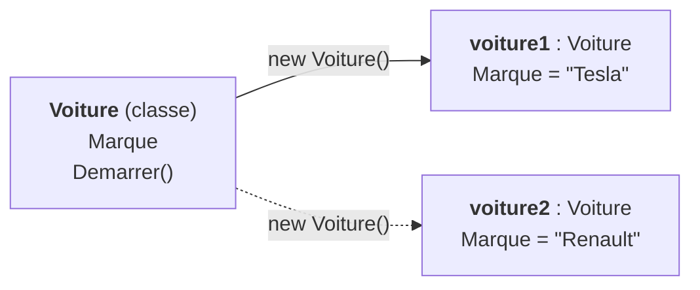

# 1. Classe et Objet

> 🎯 **À la fin de cette fiche, vous savez expliquer :**
> * la différence entre une classe (le plan) et un objet (une instance construite à partir de ce plan) ;
> * ce que fait le mot-clé `new` ;
> * pourquoi deux objets d’une même classe ont chacun leurs propres données.
>
> ⏱️ 15 min · Prérequis : [Introduction du chapitre 1](<../Chapitre 1 — Introduction à la Programmation Orientée Objet.md>)

---

## Objectif

Comprendre les notions fondamentales de **classe** et d’**objet**, et en quoi elles constituent la base de la programmation orientée objet en C#.

---

## Définition et explication

La **classe** est l’unité de base de la programmation orientée objet.
Elle définit la **structure** (les données) et le **comportement** (les fonctions) d’un type d’objet.

Une classe décrit :

* **Les attributs** (ou champs) : les variables qui représentent l’état ou les caractéristiques de l’objet.
* **Les méthodes** : les fonctions qui décrivent ce que l’objet peut faire, c’est-à-dire ses actions ou comportements.

La **classe** joue le rôle de **modèle** ou de **plan de conception**.
À partir de ce modèle, on peut créer plusieurs **objets** : chaque objet est une **instance concrète** de la classe, possédant ses propres valeurs pour les attributs.

En C#, une classe se déclare à l’aide du mot-clé `class`.
Lorsqu’un objet est créé, il est instancié en mémoire à l’aide du mot-clé `new`.

Chaque objet ainsi créé a :

* ses **propres données** (valeurs d’attributs distinctes),
* et **accède aux mêmes méthodes** que les autres objets issus de la même classe.

Ce principe d’**instanciation** permet de représenter des entités du monde réel de manière logique et cohérente.
Par exemple, un jeu vidéo peut définir une classe `Joueur`, et chaque joueur dans le jeu sera une instance distincte avec ses propres statistiques (vie, score, position, etc.).

---

## Analogie

Une **classe** peut être comparée à un **plan d’architecte** : elle décrit la structure d’un bâtiment, mais ce plan n’est pas une maison.
Chaque **maison construite à partir de ce plan** est une **instance** : elle suit la même conception générale, mais possède ses propres caractéristiques (couleur, mobilier, etc.).

De même, en programmation, une classe définit la forme générale d’un objet, tandis que chaque instance possède ses propres données.

---

## Exemple minimal en C#

```csharp
public class Voiture
{
    public string Marque;
    public void Demarrer()
    {
        Console.WriteLine($"{Marque} démarre.");
    }
}

class Program
{
    static void Main()
    {
        var voiture1 = new Voiture();
        voiture1.Marque = "Tesla";
        voiture1.Demarrer();
    }
}
```

**Sortie :**

```
Tesla démarre.
```

Dans cet exemple :

* `Voiture` est la **classe** (le modèle).
* `voiture1` est un **objet** (une instance concrète).
* L’attribut `Marque` contient une donnée propre à chaque voiture.
* La méthode `Demarrer()` définit une action commune à toutes les voitures.

Le schéma ci-dessous résume la relation entre une classe et ses instances : la classe décrit les membres, chaque objet porte ses propres valeurs.



*`voiture2` (en pointillés) ne figure pas dans le code ci-dessus : il montre qu’une seconde instance aurait sa propre valeur de `Marque`, tout en partageant la méthode `Demarrer()`.*

---

## Lien avec Unity

Dans Unity, chaque script dérivé de `MonoBehaviour` agit comme une **classe**.
Quand ce script est attaché à un **GameObject**, Unity crée automatiquement une **instance** de cette classe au moment de l’exécution.

Par exemple :

* Le script `ControleurJoueur.cs` définit le modèle du comportement d’un joueur.
* Le GameObject “Joueur” dans la scène est une **instance** de ce modèle.
* Si plusieurs ennemis utilisent le script `IAEnnemi.cs`, chacun sera une **instance distincte** de la classe `IAEnnemi`, avec ses propres paramètres (vitesse, points de vie, etc.).

Ce mécanisme d’instanciation est au cœur de l’architecture Unity : chaque objet dans la scène est un **objet orienté objet** au sens C# du terme.

---

## ⚠️ Pièges courants

* **Utiliser une variable déclarée mais jamais instanciée.** `Voiture v;` puis `v.Demarrer();` ne compile pas (variable non assignée), et `Voiture v = null;` compile mais lève une `NullReferenceException` à l’exécution. Un objet n’existe qu’après `new`.
* **Confondre la classe et l’objet dans le code.** On appelle une méthode d’instance sur un objet (`voiture1.Demarrer()`), pas sur la classe (`Voiture.Demarrer()` ne compile pas, sauf pour un membre `static`).
* **Croire que deux variables désignent deux objets.** `var v2 = v1;` ne crée pas de deuxième voiture : les deux variables désignent le même objet (voir [12. Types valeur et types référence](<../Partie IV — Les outils du langage/12. Types valeur et types référence.md>)).

## 🔀 À ne pas confondre

* **Classe** (le plan, écrit une fois dans le code) et **objet** (une instance, créée autant de fois qu’on veut à l’exécution).
* **Objet C#** et **GameObject Unity** : un GameObject est lui-même un objet C#, mais c’est surtout un conteneur de composants. Les scripts `MonoBehaviour` attachés sont d’autres objets.

---

## 🧪 Exercice : le gecko

Écrivez une classe `Gecko` avec :

* deux champs publics, `Nom` (`string`) et `Age` (`int`) ;
* une méthode `SePresenter()` qui affiche `Bonjour, je suis <Nom> et j’ai <Age> ans.` ;
* une méthode `Vieillir()` qui augmente l’âge d’un an.

**Test attendu :**

```csharp
var kevin = new Gecko();
kevin.Nom = "Kevin";
kevin.Age = 2;

var lea = new Gecko();
lea.Nom = "Léa";
lea.Age = 5;

kevin.SePresenter();
lea.SePresenter();

kevin.Vieillir();
kevin.SePresenter();
lea.SePresenter();
```

```
Bonjour, je suis Kevin et j’ai 2 ans.
Bonjour, je suis Léa et j’ai 5 ans.
Bonjour, je suis Kevin et j’ai 3 ans.
Bonjour, je suis Léa et j’ai 5 ans.
```

**Question :** pourquoi l’âge de Léa n’a-t-il pas changé quand Kevin a vieilli ?

<details>
<summary>Voir la solution</summary>

```csharp
public class Gecko
{
    public string Nom;
    public int Age;

    public void SePresenter()
    {
        Console.WriteLine($"Bonjour, je suis {Nom} et j’ai {Age} ans.");
    }

    public void Vieillir()
    {
        Age++;
    }
}
```

Chaque objet possède **ses propres** valeurs de `Nom` et `Age`. `Vieillir()` modifie l’objet sur lequel elle est appelée (`kevin`), et seulement lui.

Les champs publics sont utilisés ici pour simplifier : la fiche [4. Encapsulation](<../Partie II — Les 4 piliers de la POO/4. Encapsulation.md>) montre comment les protéger.

</details>

---

## Références utiles

* [Microsoft Learn — Classes et objets (C#)](https://learn.microsoft.com/fr-fr/dotnet/csharp/fundamentals/types/classes)
* [Unity Manual — Créer et utiliser des scripts](https://docs.unity3d.com/Manual/creating-scripts.html)
* [Microsoft Learn — Programmation orientée objet (C#)](https://learn.microsoft.com/fr-fr/dotnet/csharp/fundamentals/tutorials/oop)
* Troelsen, Andrew & Japikse, Philip. *Pro C# 9 with .NET 5*, Apress, 2021.

---

[← Précédent : Introduction du chapitre 1](<../Chapitre 1 — Introduction à la Programmation Orientée Objet.md>) · [Sommaire](<../../README.md>) · [Suivant : 2. Attributs et Méthodes →](<2. Attributs et Méthodes.md>)
