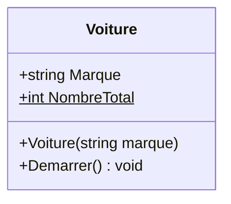
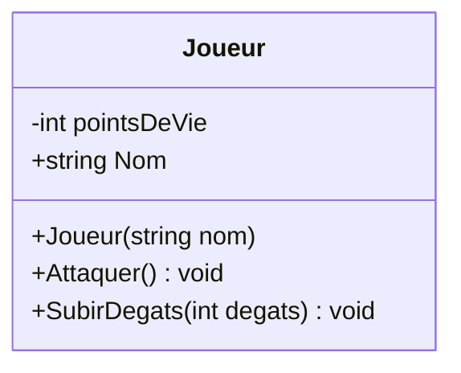

# 2. Attributs et Méthodes

> 🎯 **À la fin de cette fiche, vous savez expliquer :**
> * ce qui distingue un attribut (l’état) d’une méthode (le comportement) ;
> * la différence entre un membre d’instance et un membre `static` ;
> * comment une méthode garantit que l’état d’un objet reste valide.
>
> ⏱️ 20 min · Prérequis : [1. Classe et Objet](<1. Classe et Objet.md>)

---

## Objectif

Comprendre le rôle des **attributs** et des **méthodes** dans une classe, leur portée, et comment ils définissent l’état et le comportement d’un objet.

---

## Définition et explication

Une classe se compose généralement de deux éléments fondamentaux :

* **Les attributs** (ou *champs*) : ils décrivent les **données internes** d’un objet, c’est-à-dire son **état**.
* **Les méthodes** : elles définissent les **actions** ou **comportements** que l’objet peut exécuter.

Les **attributs** sont comparables à des variables propres à chaque instance de la classe.
Chaque objet possède ses propres copies de ces valeurs, indépendantes des autres objets du même type.

Les **méthodes**, quant à elles, sont des fonctions définies à l’intérieur de la classe. Elles peuvent manipuler les attributs ou exécuter une logique spécifique à cet objet.
Une méthode peut également retourner une valeur, recevoir des paramètres, ou modifier l’état de l’objet.

---

### Membres d’instance et de classe

En C#, on distingue deux types de membres :

* **Membres d’instance** : chaque objet possède sa propre version (ex. : `voiture1.Couleur` ≠ `voiture2.Couleur`).
* **Membres de classe (statique)** : partagés entre toutes les instances, déclarés avec le mot-clé `static`.

Un membre `static` appartient à la classe elle-même, et non à un objet particulier.

Exemple : un compteur statique pour suivre le nombre d’instances créées.

```csharp
public class Voiture
{
    public string Marque;           // Attribut d’instance
    public static int NombreTotal;  // Attribut de classe

    public Voiture(string marque)
    {
        Marque = marque;
        NombreTotal++; // Incrémente pour chaque nouvelle voiture
    }

    public void Demarrer()
    {
        Console.WriteLine($"{Marque} démarre.");
    }
}
```

Ici, chaque `Voiture` possède sa propre `Marque`, mais toutes partagent la même variable `NombreTotal`.

En notation UML, un membre statique est **souligné** (Mermaid l’écrit avec un `$`) :



---

### Portée et visibilité des membres

Les attributs et méthodes d’une classe peuvent avoir différents **modificateurs d’accès**, qui déterminent leur visibilité depuis d’autres parties du code.

| Modificateur         | Portée                                               | Description                                          |
| -------------------- | ---------------------------------------------------- | ---------------------------------------------------- |
| `public`             | Accessible partout                                   | Utilisé pour exposer des membres depuis l’extérieur. |
| `private`            | Accessible uniquement à l’intérieur de la classe     | Protège les données internes.                        |
| `protected`          | Accessible dans la classe et ses dérivées            | Utilisé pour l’héritage.                             |
| `internal`           | Accessible dans le même assembly (projet)            | Souvent utilisé dans les bibliothèques internes.     |
| `protected internal` | Accessible dans le même assembly ou classes dérivées | Combinaison des deux précédents.                     |

Bonnes pratiques :

* Rendre les attributs **privés** par défaut et utiliser des **propriétés** (`get` / `set`) pour y accéder.
* Rendre publiques uniquement les méthodes nécessaires à l’extérieur.
* Éviter d’exposer directement les champs publics pour préserver l’intégrité de l’objet.

---

### Différence entre attribut et méthode

| Élément      | Rôle                               | Exemple                                    |
| ------------ | ---------------------------------- | ------------------------------------------ |
| **Attribut** | Donnée, caractéristique de l’objet | `vitesse`, `couleur`, `pointsDeVie`        |
| **Méthode**  | Action ou comportement de l’objet  | `Accélérer()`, `Freiner()`, `SubirDegat()` |

Les deux sont complémentaires : les attributs décrivent **ce que l’objet est**, les méthodes définissent **ce que l’objet fait**.

---

## Exemple minimal en C#

```csharp
public class Joueur
{
    private int pointsDeVie = 100;  // Attribut privé, initialisé
    public string Nom { get; }      // Propriété en lecture seule

    public Joueur(string nom)
    {
        Nom = nom;
    }

    public void Attaquer()
    {
        Console.WriteLine($"{Nom} attaque !");
    }

    public void SubirDegats(int degats)
    {
        pointsDeVie = Math.Max(0, pointsDeVie - degats); // jamais négatif
        Console.WriteLine($"{Nom} a {pointsDeVie} points de vie restants.");
    }
}
```

Dans cet exemple :

* `pointsDeVie` est un **attribut** (champ privé) et `Nom` une **propriété** en lecture seule : ensemble, ils représentent l’état du joueur. Les propriétés sont détaillées dans la fiche [4. Encapsulation](<../Partie II — Les 4 piliers de la POO/4. Encapsulation.md>).
* `Attaquer()` et `SubirDegats()` sont des **méthodes** décrivant ses comportements.

Chaque instance de `Joueur` aura ses propres valeurs et réagira indépendamment des autres.

Dans un **diagramme de classes**, une classe est une boîte à trois compartiments : son nom, ses attributs (l’état), puis ses méthodes (le comportement). Le symbole `-` signale un membre privé, `+` un membre public :



---

## Lien avec Unity

Dans Unity, les **attributs** d’une classe dérivée de `MonoBehaviour` apparaissent dans l’**Inspecteur** lorsqu’ils sont publics ou marqués `[SerializeField]`.
Ils permettent de définir les propriétés d’un GameObject (par exemple, sa vitesse, sa vie ou son type d’arme).

Les **méthodes** sont quant à elles utilisées pour définir le comportement du GameObject, comme :

* `Start()` → appelée au démarrage,
* `Update()` → exécutée à chaque frame,
* ou des méthodes personnalisées (`Attaquer()`, `SeDeplacer()`, etc.).

Ainsi, chaque composant Unity est une classe possédant des **attributs (données)** et des **méthodes (actions)**.

---

## ⚠️ Pièges courants

* **Laisser un attribut sans valeur initiale cohérente.** Un `int` vaut `0` par défaut, une `string` vaut `null` : un joueur peut ainsi « naître » mort ou sans nom. Initialisez les champs, ou passez par un constructeur (fiche suivante).
* **Exposer les attributs en `public`** et laisser le code extérieur les modifier sans contrôle. Les règles (énergie entre 0 et 100, PV jamais négatifs) doivent vivre **dans les méthodes** de la classe.
* **Rendre `static` un attribut qui devrait être propre à chaque objet.** Si `pointsDeVie` était `static`, tous les joueurs partageraient les mêmes PV.

## 🔀 À ne pas confondre

* **Attribut** (champ : une donnée stockée) et **propriété** (`get`/`set` : un accès contrôlé à une donnée). Les propriétés sont détaillées dans la fiche [4. Encapsulation](<../Partie II — Les 4 piliers de la POO/4. Encapsulation.md>).
* **Membre d’instance** (un exemplaire par objet) et **membre statique** (un seul exemplaire pour toute la classe). Voir aussi la fiche [13. Membres statiques](<../Partie IV — Les outils du langage/13. Membres statiques, énumérations et namespaces.md>).

---

## 🧪 Exercice : le gecko travailleur

Faites évoluer le gecko :

* un champ **privé** `energie`, qui vaut 100 au départ ;
* un constructeur `Gecko(string nom)` ;
* `Manger()` : ajoute 10 d’énergie, **sans dépasser 100**, puis affiche `<Nom> mange. Énergie : <energie>` ;
* `Travailler()` : si l’énergie est inférieure à 25, affiche `<Nom> est trop fatigué pour travailler.` ; sinon, retire 9 d’énergie et affiche `<Nom> travaille. Énergie : <energie>` ;
* un champ **statique** `NombreDeGeckos`, qui compte les geckos créés.

**Test attendu :**

```csharp
var kevin = new Gecko("Kevin");
for (int i = 0; i < 10; i++)
    kevin.Travailler();

kevin.Manger();
kevin.Travailler();

var lea = new Gecko("Léa");
Console.WriteLine($"Geckos créés : {Gecko.NombreDeGeckos}");
```

```
Kevin travaille. Énergie : 91
Kevin travaille. Énergie : 82
Kevin travaille. Énergie : 73
Kevin travaille. Énergie : 64
Kevin travaille. Énergie : 55
Kevin travaille. Énergie : 46
Kevin travaille. Énergie : 37
Kevin travaille. Énergie : 28
Kevin travaille. Énergie : 19
Kevin est trop fatigué pour travailler.
Kevin mange. Énergie : 29
Kevin travaille. Énergie : 20
Geckos créés : 2
```

<details>
<summary>Voir la solution</summary>

```csharp
public class Gecko
{
    public static int NombreDeGeckos;

    private int energie = 100;
    public string Nom;

    public Gecko(string nom)
    {
        Nom = nom;
        NombreDeGeckos++;
    }

    public void Manger()
    {
        energie = Math.Min(100, energie + 10);
        Console.WriteLine($"{Nom} mange. Énergie : {energie}");
    }

    public void Travailler()
    {
        if (energie < 25)
        {
            Console.WriteLine($"{Nom} est trop fatigué pour travailler.");
            return;
        }

        energie -= 9;
        Console.WriteLine($"{Nom} travaille. Énergie : {energie}");
    }
}
```

`energie` est privé : le seul moyen de la modifier passe par `Manger()` et `Travailler()`, qui font respecter les règles. `NombreDeGeckos` est partagé par tous les geckos, et on y accède par le nom de la classe.

</details>

---

## Références utiles

* [Microsoft Learn — Membres et méthodes en C#](https://learn.microsoft.com/fr-fr/dotnet/csharp/programming-guide/classes-and-structs/methods)
* [Microsoft Learn — Modificateurs d’accès (C#)](https://learn.microsoft.com/fr-fr/dotnet/csharp/programming-guide/classes-and-structs/access-modifiers)
* [Unity Learn — Variables and Functions](https://learn.unity.com/tutorial/variables-and-functions)
* Albahari, J. & Albahari, B. *C# 12 in a Nutshell*, O’Reilly Media, 2024.

---

[← Précédent : 1. Classe et Objet](<1. Classe et Objet.md>) · [Sommaire](<../../README.md>) · [Suivant : 3. Constructeurs →](<3. Constructeurs.md>)
