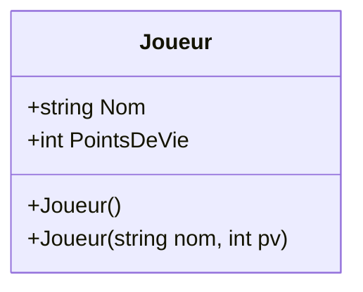
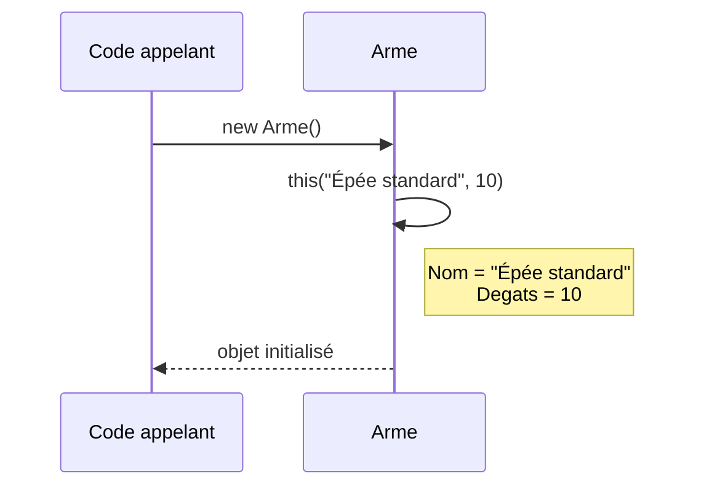

# 3. Constructeurs

> 🎯 **À la fin de cette fiche, vous savez expliquer :**
> * le rôle d’un constructeur et le moment où il est appelé ;
> * pourquoi le constructeur par défaut « disparaît » dès qu’on en écrit un ;
> * comment éviter de dupliquer du code entre plusieurs constructeurs avec `this(...)`.
>
> ⏱️ 20 min · Prérequis : [2. Attributs et Méthodes](<2. Attributs et Méthodes.md>)

---

## Objectif

Comprendre le rôle et la syntaxe des **constructeurs** en C#, leur utilisation pour initialiser les objets, et les différentes formes qu’ils peuvent prendre (par défaut, paramétrés, surchargés).

---

## Définition et explication

Un **constructeur** est une **méthode spéciale** d’une classe, utilisée pour **initialiser un objet** au moment de sa création.
Il porte **le même nom que la classe** et **n’a pas de type de retour** (pas même `void`).

Lorsqu’on crée un objet avec le mot-clé `new`, le constructeur est **automatiquement appelé** pour définir l’état initial de cet objet.

Exemple général :

```csharp
var joueur = new Joueur("Arthur", 100);
```

Ici, l’instruction `new Joueur(...)` appelle un constructeur de la classe `Joueur`, qui initialise l’objet avec les valeurs fournies.

Les constructeurs sont essentiels pour garantir que chaque objet commence dans un **état cohérent et valide**, en évitant les erreurs liées à des champs non initialisés.

---

## Constructeur par défaut

Si aucune définition explicite de constructeur n’est fournie, le compilateur C# crée automatiquement un **constructeur par défaut sans paramètre**.
Ce constructeur initialise simplement les attributs avec leurs valeurs par défaut (par exemple `0`, `false`, ou `null`).

Exemple :

```csharp
public class Arme
{
    public string Nom;
    public int Degats;
}
```

On peut alors écrire :

```csharp
var epee = new Arme();  // constructeur implicite par défaut
```

Dans ce cas, `Nom` sera `null` et `Degats` sera `0` jusqu’à ce qu’on leur assigne des valeurs.

---

## Constructeur explicite

Il est possible de définir soi-même un constructeur pour contrôler la manière dont les objets sont créés.

```csharp
public class Arme
{
    public string Nom;
    public int Degats;

    public Arme(string nom, int degats)
    {
        Nom = nom;
        Degats = degats;
    }
}
```

Ici, le constructeur exige que `Nom` et `Degats` soient fournis dès la création de l’objet :

```csharp
var arc = new Arme("Arc long", 25);
```

Ainsi, chaque objet `Arme` créé via ce constructeur aura des valeurs cohérentes dès le départ.

> [!WARNING]
> Dès que vous déclarez **au moins un constructeur**, le compilateur **ne génère plus** le constructeur par défaut implicite. Avec la classe ci-dessus, `new Arme()` provoque une erreur de compilation (CS7036). Si vous en avez besoin, il faut déclarer explicitement un constructeur sans paramètre (voir la surcharge ci-dessous).

---

## Surcharge de constructeurs

Une classe peut définir **plusieurs constructeurs** avec des signatures différentes (nombres ou types de paramètres distincts).
Ce mécanisme est appelé **surcharge** (*constructor overloading*).

```csharp
public class Joueur
{
    public string Nom;
    public int PointsDeVie;

    // Constructeur par défaut
    public Joueur()
    {
        Nom = "Inconnu";
        PointsDeVie = 100;
    }

    // Constructeur avec paramètres
    public Joueur(string nom, int pv)
    {
        Nom = nom;
        PointsDeVie = pv;
    }
}
```

On peut alors créer un joueur de deux façons :

```csharp
var j1 = new Joueur();              // Nom = "Inconnu", PointsDeVie = 100
var j2 = new Joueur("Arthur", 150); // Nom = "Arthur", PointsDeVie = 150
```

Cela permet d’offrir **plusieurs options d’initialisation** selon le contexte d’utilisation.

Dans un diagramme de classes, les constructeurs surchargés apparaissent avec les méthodes, sans type de retour :



---

## Initialisation par propriétés

En C#, on peut aussi initialiser les champs ou propriétés d’un objet directement lors de sa création, sans définir de constructeur, grâce à la **syntaxe d’initialisation d’objets**.

```csharp
var joueur = new Joueur
{
    Nom = "Lancelot",
    PointsDeVie = 120
};
```

Cette approche est utile pour des objets simples ou des scénarios de configuration, mais **n’offre pas de contrôle logique** (comme des vérifications ou calculs) qu’un constructeur pourrait effectuer.

---

## Appel de constructeurs en chaîne

Un constructeur peut appeler un autre constructeur de la même classe à l’aide du mot-clé `this`, afin d’éviter la duplication de code.

```csharp
public class Arme
{
    public string Nom;
    public int Degats;

    public Arme() : this("Épée standard", 10) { }

    public Arme(string nom, int degats)
    {
        Nom = nom;
        Degats = degats;
    }
}
```

Ici, le constructeur sans paramètre réutilise la logique du constructeur complet, assurant une initialisation uniforme.

L’ordre d’exécution lors d’un `new Arme()` :



---

## Constructeur statique

Un **constructeur statique** est un constructeur spécial utilisé pour initialiser les **membres statiques** d’une classe.
Il est appelé **automatiquement une seule fois** avant la première utilisation de la classe.

```csharp
public class Configuration
{
    public static string Version;

    static Configuration()
    {
        Version = "1.0.0";
        Console.WriteLine("Configuration initialisée.");
    }
}
```

Ce type de constructeur n’a ni modificateur d’accès ni paramètres.

---

## Exemple complet minimal

```csharp
public class Voiture
{
    public string Marque;
    public int VitesseMax;

    public Voiture(string marque, int vitesse)
    {
        Marque = marque;
        VitesseMax = vitesse;
    }

    public void AfficherInfo()
    {
        Console.WriteLine($"{Marque} atteint {VitesseMax} km/h.");
    }
}
```

```csharp
// Program.cs — les instructions de premier niveau doivent précéder
// toute déclaration de type dans un fichier (sinon erreur CS8803)
var v = new Voiture("Tesla", 250);
v.AfficherInfo();
```

**Sortie :**

```
Tesla atteint 250 km/h.
```

---

## Lien avec Unity

Dans Unity, les constructeurs personnalisés ne sont **pas utilisés directement** pour les scripts dérivés de `MonoBehaviour`.
Les objets Unity sont créés via le moteur lui-même (par instanciation de `GameObject` ou duplication de *prefabs*).

Toutefois, l’idée d’initialisation existe sous d’autres formes :

* `Awake()` et `Start()` remplissent un rôle similaire à un constructeur : ils préparent les données avant l’utilisation de l’objet.
* Pour les classes C# « pures » (qui ne dérivent pas de `UnityEngine.Object` : systèmes de gestion, modèles de données, etc.), les constructeurs sont pleinement applicables.
* En revanche, un **ScriptableObject** ne se crée **jamais** avec `new` : on utilise `ScriptableObject.CreateInstance<T>()` (ou un asset créé dans l’éditeur), et l’initialisation se fait dans `OnEnable()` ou via une méthode `Init(...)` dédiée.

Ainsi, le concept reste fondamental même si son usage diffère selon le type d’objet dans Unity.

---

## ⚠️ Pièges courants

* **Dupliquer la logique d’initialisation** dans chaque constructeur surchargé : un oubli dans l’un d’eux crée des objets incohérents. Chaînez-les avec `this(...)` vers un seul constructeur complet.
* **Appeler une méthode `virtual` depuis un constructeur** : si une classe dérivée la redéfinit, sa version s’exécute alors que le constructeur de la classe dérivée n’a pas encore initialisé ses propres champs.
* **Faire trop de travail dans un constructeur** (chargement de fichier, accès réseau) : la simple création de l’objet devient lente et peut échouer. Un constructeur doit surtout mettre l’objet dans un état valide.
* **Écrire un constructeur dans un `MonoBehaviour`** : Unity crée lui-même ces objets, parfois plusieurs fois et hors du thread principal. On utilise `Awake()` et `Start()` à la place.

## 🔀 À ne pas confondre

* **Constructeur** (initialise *chaque nouvel objet*) et **constructeur statique** (initialise *la classe*, une seule fois).
* **Constructeur** (logique et validation possibles) et **initialiseur d’objet** `new Joueur { Nom = "…" }` (simple affectation de propriétés, *après* l’exécution du constructeur).

---

## 🧪 Exercice : un gecko bien né

Écrivez trois constructeurs pour `Gecko` (champs `Nom` et `Age`) :

* `Gecko()` : nom `"Inconnu"`, âge 0 ;
* `Gecko(string nom)` : âge 0 ;
* `Gecko(string nom, int age)` : un âge négatif est ramené à 0.

À sa naissance, chaque gecko affiche `Bonjour <Nom> !`.

**Contrainte :** le message `Bonjour` et la règle sur l’âge ne doivent être écrits qu’**une seule fois** dans la classe.

**Test attendu :**

```csharp
var g1 = new Gecko();
var g2 = new Gecko("Kevin");
var g3 = new Gecko("Léa", 5);
var g4 = new Gecko("Bug", -3);

g1.Decrire();
g2.Decrire();
g3.Decrire();
g4.Decrire();
```

```
Bonjour Inconnu !
Bonjour Kevin !
Bonjour Léa !
Bonjour Bug !
Inconnu a 0 ans.
Kevin a 0 ans.
Léa a 5 ans.
Bug a 0 ans.
```

<details>
<summary>Voir la solution</summary>

```csharp
public class Gecko
{
    public string Nom;
    public int Age;

    public Gecko() : this("Inconnu") { }

    public Gecko(string nom) : this(nom, 0) { }

    public Gecko(string nom, int age)
    {
        Nom = nom;
        Age = Math.Max(0, age);
        Console.WriteLine($"Bonjour {Nom} !");   // le seul endroit qui affiche ce message
    }

    public void Decrire() => Console.WriteLine($"{Nom} a {Age} ans.");
}
```

Les deux constructeurs courts délèguent au constructeur complet avec `this(...)` : toute la logique est centralisée.

</details>

---

## Références utiles

* [Microsoft Learn — Constructeurs (C#)](https://learn.microsoft.com/fr-fr/dotnet/csharp/programming-guide/classes-and-structs/constructors)
* [Microsoft Learn — Constructeurs statiques](https://learn.microsoft.com/fr-fr/dotnet/csharp/programming-guide/classes-and-structs/static-constructors)
* [Unity Manual — Order of Execution for Event Functions](https://docs.unity3d.com/Manual/ExecutionOrder.html)
* Skeet, Jon. *C# in Depth*, Manning Publications, 2019.

---

[← Précédent : 2. Attributs et Méthodes](<2. Attributs et Méthodes.md>) · [Sommaire](<../../README.md>) · [Suivant : 4. Encapsulation →](<../Partie II — Les 4 piliers de la POO/4. Encapsulation.md>)
