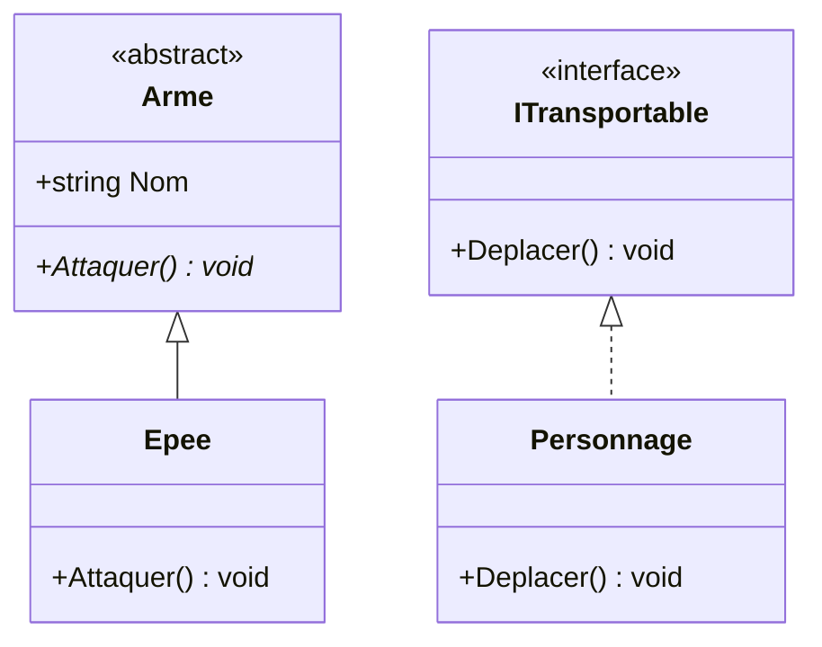
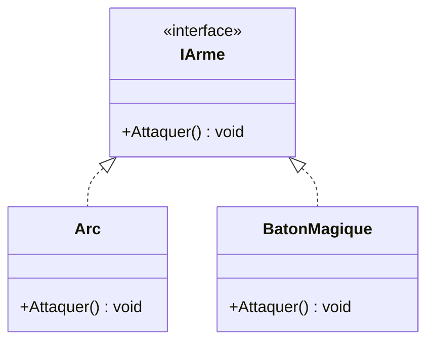

# 5. Abstraction

> 🎯 **À la fin de cette fiche, vous savez expliquer :**
> * ce que signifie « masquer les détails pour ne montrer que l’essentiel » ;
> * la différence entre une classe abstraite et une interface, et comment choisir ;
> * pourquoi on ne peut pas instancier une classe abstraite.
>
> ⏱️ 25 min · Prérequis : [4. Encapsulation](<4. Encapsulation.md>)

---

## Objectif

Comprendre le principe d’**abstraction** en programmation orientée objet, son rôle dans la simplification du code, et comment l’implémenter en C# à l’aide des **classes abstraites** et des **interfaces**.

---

## Définition et explication

L’**abstraction** consiste à **masquer les détails d’implémentation** pour ne montrer que **l’essentiel** d’un objet ou d’un système.
Elle permet de **se concentrer sur ce que fait un objet** plutôt que sur **la manière dont il le fait**.

Autrement dit, l’abstraction définit **une interface claire** pour interagir avec un objet, tout en cachant la complexité technique qui se trouve derrière.
Ce principe favorise la **clarté**, la **modularité** et la **réutilisabilité** du code.

### Exemple conceptuel

Un utilisateur peut conduire une voiture sans connaître le fonctionnement interne du moteur.
De même, un développeur peut utiliser une méthode `LireFichier()` sans savoir comment le système de fichiers est manipulé en mémoire.
L’important est **le résultat attendu**, pas les détails internes.

---

## Abstraction vs Encapsulation

| Concept           | Objectif principal                                          | Métaphore                                               |
| ----------------- | ----------------------------------------------------------- | ------------------------------------------------------- |
| **Encapsulation** | Cacher les données internes et les protéger                 | Coffre-fort : les valeurs sont protégées à l’intérieur. |
| **Abstraction**   | Cacher les détails techniques et ne montrer que l’essentiel | Tableau de bord : on interagit sans voir le moteur.     |

Les deux principes sont complémentaires :

* **L’encapsulation** protège l’état interne de l’objet.
* **L’abstraction** simplifie son utilisation en ne révélant qu’une interface claire.

---

## Les outils d’abstraction en C#

En C#, l’abstraction s’exprime principalement à travers **les classes abstraites** et **les interfaces**.

### 1. Les classes abstraites

Une **classe abstraite** est un modèle général dont on ne peut pas créer directement d’instance.
Elle définit des **membres communs** à plusieurs classes, et peut contenir :

* des méthodes **avec implémentation** (code concret),
* et des méthodes **abstraites** (sans implémentation), que les classes dérivées devront obligatoirement définir.

```csharp
public abstract class Arme
{
    public string Nom;

    public abstract void Attaquer();
}
```

Une classe dérivée doit ensuite implémenter la méthode abstraite :

```csharp
public class Epee : Arme
{
    public override void Attaquer()
    {
        Console.WriteLine($"{Nom} tranche l’ennemi !");
    }
}
```

L’abstraction ici permet de **définir une structure commune** pour toutes les armes sans imposer leur logique interne.

---

### 2. Les interfaces

Une **interface** définit uniquement un **contrat de comportement** : un ensemble de méthodes ou propriétés qu’une classe doit implémenter.
Contrairement à une classe abstraite, une interface **ne contient pas d’état d’instance** (pas de champs) et, traditionnellement, ne fournit aucune implémentation.

> [!NOTE]
> Depuis **C# 8**, une interface peut fournir des **implémentations par défaut** de méthodes et contenir des **membres statiques**. Elle ne peut toujours pas avoir de champs d’instance ni de constructeur. Unity supporte les implémentations par défaut depuis la version 2021.2, mais elles restent à utiliser avec parcimonie : le rôle principal d’une interface est de définir un contrat.

```csharp
public interface ITransportable
{
    void Deplacer();
}
```

Une classe qui implémente cette interface s’engage à fournir une version concrète de la méthode :

```csharp
public class Personnage : ITransportable
{
    public void Deplacer()
    {
        Console.WriteLine("Le personnage se déplace.");
    }
}
```

L’interface définit **ce qu’une classe doit faire**, pas **comment elle le fait**.
C’est une **forme d’abstraction pure**.

### Classe abstraite ou interface : comment choisir ?

| Critère | Classe abstraite | Interface |
| --- | --- | --- |
| Relation exprimée | « est un » (*is a*) : une famille de types | « sait faire » (*can do*) : une capacité |
| État (champs) | Oui | Non |
| Constructeur | Oui (appelé par les classes dérivées) | Non |
| Code partagé | Oui, naturellement | Limité (méthodes par défaut, C# 8+) |
| Héritage multiple | Non : une seule classe de base | Oui : une classe peut implémenter plusieurs interfaces |
| Exemple | `Arme` : toutes les armes ont un `Nom` | `IDamageable` : des objets très différents peuvent subir des dégâts |

**Règle pratique :** commencez par une interface pour exprimer un contrat, puis ajoutez une classe abstraite quand plusieurs implémentations partagent réellement de l’état ou du code. Les deux se combinent souvent : `class Gobelin : Ennemi, IDamageable`.

Les deux outils côte à côte, avec les exemples ci-dessus. Une méthode abstraite est marquée d’un `*` (en italique dans le rendu). La flèche pleine à triangle vide signifie « hérite de », la flèche en pointillés « implémente » :



---

## Avantages de l’abstraction

1. **Réduction de la complexité**

    * Les détails internes sont cachés derrière une interface claire et stable.

2. **Flexibilité**

    * Permet de modifier l’implémentation sans impacter le code client.

3. **Réutilisabilité et extensibilité**

    * Plusieurs classes différentes peuvent partager une même interface ou classe abstraite.

4. **Interopérabilité**

    * Favorise les architectures modulaires et le polymorphisme (traitement uniforme de différents objets).

---

## Exemple minimal

```csharp
public interface IArme
{
    void Attaquer();
}

public class Arc : IArme
{
    public void Attaquer()
    {
        Console.WriteLine("L’arc tire une flèche !");
    }
}

public class BatonMagique : IArme
{
    public void Attaquer()
    {
        Console.WriteLine("Le bâton lance un sort !");
    }
}
```

Ici, `IArme` définit **le contrat** : toute arme doit pouvoir attaquer.
Mais chaque implémentation (`Arc`, `BatonMagique`, etc.) est **libre de définir sa propre manière de le faire**.
Le code qui utilise une arme n’a donc pas besoin de connaître sa nature exacte.



---

## Lien avec Unity

L’abstraction est omniprésente dans le moteur Unity :

* **MonoBehaviour** est une **classe de base** (concrète, pas abstraite) : vos scripts en héritent et profitent de ses fonctionnalités sans voir son implémentation interne.
* Le moteur fournit quelques **interfaces** à implémenter, comme `ISerializationCallbackReceiver` ou les interfaces d’événements UI (`IPointerClickHandler`, `IDragHandler`…).
* Surtout, vous définirez **vos propres interfaces** pour décrire des contrats de gameplay. `IDamageable` ou `IInteractable` **n’existent pas dans Unity** : ce sont des conventions très répandues que l’on écrit soi-même, comme ci-dessous.
* Exemple concret :

  ```csharp
  public interface IDamageable
  {
      void PrendreDegats(int montant);
  }

  public class Ennemi : MonoBehaviour, IDamageable
  {
      public void PrendreDegats(int montant)
      {
          // Implémentation spécifique à l'ennemi
      }
  }
  ```

  Cette approche permet à différents types d’objets (ennemis, joueurs, objets destructibles) de réagir uniformément à un système de dégâts, sans connaître leurs détails internes.

---

## ⚠️ Pièges courants

* **Créer une interface pour chaque classe**, « au cas où ». Une abstraction n’a de valeur que si plusieurs implémentations existent (ou existeront vraiment), ou si elle protège le code d’un détail technique.
* **Des interfaces trop grosses**, que les classes implémentent à moitié avec des méthodes vides : voir le principe de ségrégation des interfaces dans la fiche [11. Principes SOLID](<../Partie III — Concepts Avancés/11. Principes SOLID.md>).
* **Une abstraction qui laisse fuiter ses détails** : une méthode `IStockage.OuvrirFichierJson()` n’abstrait rien, puisqu’elle impose un format et un support.
* **Oublier qu’une classe abstraite ne s’instancie pas** : `new Arme()` ne compile pas si `Arme` est `abstract`.

## 🔀 À ne pas confondre

* **Classe abstraite** (une famille de types qui partagent de l’état et du code) et **interface** (une capacité, sans état). Voir le tableau « comment choisir » plus haut.
* **Méthode `abstract`** (pas de corps : les dérivées *doivent* la fournir) et **méthode `virtual`** (un corps par défaut : les dérivées *peuvent* la redéfinir).

---

## 🧪 Exercice : l’armurerie de l’arène

1. Écrivez une classe abstraite `Arme` avec `Nom`, `Degats` et `CoutEnergie` (lecture seule, fixés par un constructeur `protected`), une méthode abstraite `protected string Bruit()` et une méthode `Attaquer()` qui affiche `<Nom> : <Bruit> (<Degats> dégâts, <CoutEnergie> énergie)`.
2. Créez `FusilPlasma` (21 dégâts, 5 d’énergie, « Bzziou ! ») et `GantEnergetique` (50 dégâts, 10 d’énergie, « Vrrr… BAM ! »).
3. Seul le fusil peut être rechargé : créez une interface `IRechargeable` avec une méthode `Recharger()`, implémentée uniquement par `FusilPlasma` (3 cellules).

**Test attendu :**

```csharp
var armes = new List<Arme> { new FusilPlasma(), new GantEnergetique() };

foreach (var arme in armes)
    arme.Attaquer();

IRechargeable rechargeable = new FusilPlasma();
rechargeable.Recharger();
```

```
Fusil à plasma : Bzziou ! (21 dégâts, 5 énergie)
Gant énergétique : Vrrr… BAM ! (50 dégâts, 10 énergie)
Fusil à plasma rechargé : 3 cellules.
```

<details>
<summary>Voir la solution</summary>

```csharp
public interface IRechargeable
{
    void Recharger();
}

public abstract class Arme
{
    public string Nom { get; }
    public int Degats { get; }
    public int CoutEnergie { get; }

    protected Arme(string nom, int degats, int coutEnergie)
    {
        Nom = nom;
        Degats = degats;
        CoutEnergie = coutEnergie;
    }

    protected abstract string Bruit();

    public void Attaquer()
    {
        Console.WriteLine($"{Nom} : {Bruit()} ({Degats} dégâts, {CoutEnergie} énergie)");
    }
}

public class FusilPlasma : Arme, IRechargeable
{
    private int cellules = 3;

    public FusilPlasma() : base("Fusil à plasma", 21, 5) { }

    protected override string Bruit() => "Bzziou !";

    public void Recharger()
    {
        cellules = 3;
        Console.WriteLine($"{Nom} rechargé : {cellules} cellules.");
    }
}

public class GantEnergetique : Arme
{
    public GantEnergetique() : base("Gant énergétique", 50, 10) { }

    protected override string Bruit() => "Vrrr… BAM !";
}
```

La classe abstraite factorise ce que **toutes** les armes ont en commun ; l’interface décrit une capacité que **certaines** armes seulement possèdent.

</details>

---

## Références utiles

* [Microsoft Learn — Classes et méthodes abstraites](https://learn.microsoft.com/fr-fr/dotnet/csharp/language-reference/keywords/abstract)
* [Microsoft Learn — Interfaces (C#)](https://learn.microsoft.com/fr-fr/dotnet/csharp/programming-guide/interfaces/)
* [Unity Scripting API — Interfaces courantes](https://docs.unity3d.com/ScriptReference/)
* Larman, Craig. *Applying UML and Patterns*, 3rd ed., Prentice Hall, 2004.

---

[← Précédent : 4. Encapsulation](<4. Encapsulation.md>) · [Sommaire](<../../README.md>) · [Suivant : 6. Héritage →](<6. Héritage.md>)
