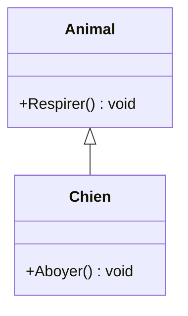
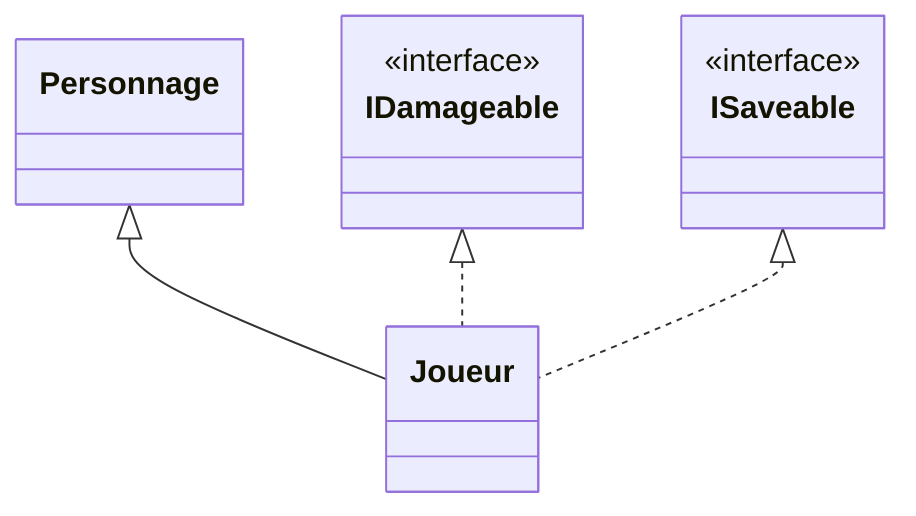

# 6. Héritage

> 🎯 **À la fin de cette fiche, vous savez expliquer :**
> * comment une classe dérivée réutilise et spécialise une classe de base ;
> * le rôle de `virtual`, `override` et `base` ;
> * le piège du masquage avec `new` ;
> * quand l’héritage est justifié (« est un ») et quand il ne l’est pas.
>
> ⏱️ 30 min · Prérequis : [5. Abstraction](<5. Abstraction.md>)

---

## Objectif

Comprendre le concept d’**héritage** en programmation orientée objet, son utilité dans la factorisation du code, et son implémentation en C# à travers les notions de classe de base, classe dérivée, et redéfinition de méthodes.

---

## Définition et explication

L’**héritage** est un mécanisme qui permet à une **classe dérivée** (ou *classe enfant*) de **réutiliser et d’étendre** le comportement d’une **classe de base** (ou *classe parent*).
Ce principe favorise la **factorisation du code** et la **spécialisation progressive** des comportements.

Une classe dérivée **hérite** :

* des **champs** (attributs) et **méthodes** publiques ou protégées de la classe de base,
* mais peut aussi **ajouter ses propres membres**, ou **modifier** certains comportements existants.

En C#, l’héritage se déclare à l’aide du symbole `:` après le nom de la classe.

---

### Exemple conceptuel

```csharp
public class Animal
{
    public void Respirer()
    {
        Console.WriteLine("L’animal respire.");
    }
}

public class Chien : Animal
{
    public void Aboyer()
    {
        Console.WriteLine("Le chien aboie !");
    }
}
```

Ici, `Chien` hérite de `Animal`.
Cela signifie que `Chien` possède automatiquement la méthode `Respirer()` en plus de sa propre méthode `Aboyer()` :

```csharp
var chien = new Chien();
chien.Respirer(); // Hérité de Animal
chien.Aboyer();   // Défini dans Chien
```



La flèche à triangle vide part de la classe dérivée et pointe vers la classe de base : « un `Chien` **est un** `Animal` ».

---

## Buts et avantages de l’héritage

1. **Réutilisation du code**
   Les classes partagent un comportement commun sans duplication.
   Exemple : `EnnemiVolant` et `EnnemiTerrestre` peuvent hériter de la même classe `Ennemi`.

2. **Spécialisation**
   Une classe dérivée peut enrichir ou adapter les comportements de la classe de base.

3. **Extensibilité**
   Il devient possible d’ajouter de nouveaux types sans modifier le code existant.

4. **Structure hiérarchique claire**
   Le code reflète la logique du domaine métier (par exemple : `Animal → Mammifère → Chien`).

---

## Héritage et modificateurs d’accès

Tous les membres d’instance de la classe de base sont hérités (ils font partie de l’objet), mais leur **accessibilité** depuis la classe dérivée dépend de leur modificateur :

| Modificateur | Hérité ?               | Accessible depuis la classe dérivée ?        |
| ------------ | ---------------------- | -------------------------------------------- |
| `public`     | Oui                    | Oui                                          |
| `protected`  | Oui                    | Oui (uniquement depuis les classes dérivées) |
| `private`    | Oui (présent dans l’objet) | **Non** : inaccessible depuis la classe dérivée |
| `internal`   | Oui                    | Oui, si la classe dérivée est dans le même assembly |

> [!NOTE]
> Un champ `private` de `Animal` existe bien dans chaque objet `Chien` : il occupe de la mémoire et garde sa valeur. Le code de `Chien` ne peut simplement pas y accéder directement ; il doit passer par les membres `public` ou `protected` de `Animal`.

Pour permettre à une classe dérivée de modifier un comportement hérité, C# utilise les mots-clés `virtual`, `override` et `base`.

---

## Redéfinition et extension de comportement

Une méthode dans la classe de base peut être déclarée comme **`virtual`** afin d’être redéfinie dans une classe dérivée à l’aide du mot-clé **`override`**.

```csharp
public class Animal
{
    public virtual void Crier()
    {
        Console.WriteLine("L’animal émet un son.");
    }
}

public class Chat : Animal
{
    public override void Crier()
    {
        Console.WriteLine("Le chat miaule.");
    }
}
```

Lorsqu’on appelle `Crier()` sur un objet `Chat`, c’est la version redéfinie qui est exécutée.

```csharp
Animal animal = new Chat();
animal.Crier(); // Affiche : "Le chat miaule."
```

> Ce comportement est la base du **polymorphisme d’exécution**, traité au point suivant.

---

### Utilisation du mot-clé `base`

Une classe dérivée peut également appeler la version d’origine d’une méthode ou d’un constructeur via le mot-clé `base`.

```csharp
public class Vehicule
{
    public Vehicule(string marque)
    {
        Console.WriteLine($"Véhicule de marque {marque}");
    }

    public virtual void Démarrer()
    {
        Console.WriteLine("Le véhicule démarre.");
    }
}

public class Voiture : Vehicule
{
    public Voiture(string marque) : base(marque)
    {
        Console.WriteLine("C’est une voiture.");
    }

    public override void Démarrer()
    {
        base.Démarrer(); // Appel à la méthode de la classe de base
        Console.WriteLine("La voiture roule !");
    }
}
```

Cet exemple illustre comment **étendre** un comportement existant au lieu de le remplacer totalement.

---

### Piège : `new` (masquage) n’est pas `override` (redéfinition)

Si une méthode de la classe dérivée porte le même nom qu’une méthode de la base **sans** `override`, elle la **masque** au lieu de la redéfinir. Le compilateur émet un avertissement (CS0108, ou CS0114 si la méthode de base est `virtual`) et propose le mot-clé `new` pour rendre l’intention explicite. La version appelée dépend alors du **type de la variable**, et non du type réel de l’objet :

```csharp
public class Animal
{
    public virtual void Crier() => Console.WriteLine("L’animal émet un son.");
    public void Dormir()        => Console.WriteLine("L’animal dort.");
}

public class Chat : Animal
{
    public override void Crier() => Console.WriteLine("Le chat miaule.");   // redéfinition
    public new void Dormir()     => Console.WriteLine("Le chat ronronne."); // masquage
}
```

```csharp
Animal a = new Chat();
a.Crier();   // "Le chat miaule."  → override : c’est le type réel de l’objet qui compte
a.Dormir();  // "L’animal dort."   → new : c’est le type de la variable (Animal) qui compte

Chat c = new Chat();
c.Dormir();  // "Le chat ronronne."
```

> [!WARNING]
> Le masquage casse le polymorphisme : c’est presque toujours une erreur. Si une classe dérivée doit changer un comportement, la méthode de base doit être `virtual` (ou `abstract`) et la classe dérivée doit utiliser `override`.

Inversement, `sealed override` permet de redéfinir une méthode tout en interdisant aux classes suivantes de la redéfinir à nouveau.

---

## Types d’héritage en C#

C# ne supporte que l’**héritage simple** entre classes (une seule classe de base par classe dérivée).
Cependant, une classe peut **implémenter plusieurs interfaces**, permettant de combiner différents comportements sans multiplier les classes parentes.

```csharp
public class Joueur : Personnage, IDamageable, ISaveable
{
    // Hérite de Personnage
    // Implémente deux interfaces
}
```

Ce modèle combine la **hiérarchie d’héritage** (classe de base) avec la **souplesse des interfaces** (multiples comportements).



Une seule flèche pleine (une seule classe de base), mais autant de flèches en pointillés que d’interfaces implémentées.

---

## Bonnes pratiques

* **Favoriser la cohérence logique** : n’utiliser l’héritage que lorsqu’il existe une relation “est un(e)” (*is a*).
  Exemple : un `Chien` **est un** `Animal`, mais une `Voiture` **a un** `Moteur` → composition préférable.
* **Ne pas abuser de l’héritage** : trop de niveaux hiérarchiques complexifient la maintenance.
* **Utiliser `sealed`** pour empêcher l’héritage d’une classe lorsqu’il n’a pas de sens.

---

## Exemple complet minimal

```csharp
public class Animal
{
    public virtual void Crier() => Console.WriteLine("L’animal crie.");
}

public class Chien : Animal
{
    public override void Crier() => Console.WriteLine("Le chien aboie !");
}

public class Chat : Animal
{
    public override void Crier() => Console.WriteLine("Le chat miaule.");
}
```

```csharp
Animal[] animaux = { new Chien(), new Chat(), new Animal() };

foreach (var a in animaux)
    a.Crier();
```

**Sortie :**

```
Le chien aboie !
Le chat miaule.
L’animal crie.
```

Ce comportement illustre à la fois l’héritage et le polymorphisme dynamique (le prochain pilier).

---

## Lien avec Unity

L’héritage est un **fondement du modèle de script Unity** :

* Tous les scripts personnalisés héritent de la classe **`MonoBehaviour`**, qui fournit les méthodes de cycle de vie (`Start()`, `Update()`, `Awake()`, etc.).
* Vous pouvez créer vos propres hiérarchies : par exemple, une classe `Ennemi` de base, puis des classes dérivées comme `Gobelin`, `Orc`, ou `Boss`.
* L’héritage permet aussi de **partager des comportements communs** entre plusieurs entités sans dupliquer le code (par exemple, gestion de la santé, des dégâts, ou des animations).

Cependant, Unity encourage souvent à préférer la **composition** (via les composants attachés aux GameObjects) lorsque la relation “a un” est plus pertinente qu’une relation “est un”.

---

## ⚠️ Pièges courants

* **Hériter pour réutiliser du code** alors que la relation « est un » n’existe pas (un `Joueur` qui hérite d’`Arme`). Préférez la composition : voir [8. Composition vs héritage](<../Partie III — Concepts Avancés/8. Composition vs héritage.md>).
* **Des hiérarchies trop profondes** (`Entite → Vivant → Creature → Humanoide → Ennemi → Gobelin → GobelinArcher`) : chaque niveau ajoute des dépendances, et une modification en haut se répercute partout.
* **Oublier `virtual`** sur la méthode de base, puis la « redéfinir » sans `override` : c’est du masquage, et le polymorphisme ne fonctionne plus.
* **Oublier `base.Methode()`** quand on veut *étendre* un comportement et non le *remplacer*.
* **Une sous-classe qui casse le contrat de sa base** (lève des exceptions inattendues, ignore des paramètres) : c’est une violation du principe de Liskov ([11. Principes SOLID](<../Partie III — Concepts Avancés/11. Principes SOLID.md>)).

## 🔀 À ne pas confondre

* **`override`** (redéfinition : c’est le type réel de l’objet qui décide) et **`new`** (masquage : c’est le type de la variable qui décide).
* **Héritage de classe** (une seule classe de base) et **implémentation d’interfaces** (autant qu’on veut).

---

## 🧪 Exercice : le zoo

1. Écrivez une classe `Animal` avec un `Nom` (public) et un `NombreDePattes` (`protected`), fixés par un constructeur `protected` qui affiche `<Nom> est né !`. Ajoutez une méthode virtuelle `SeDecrire()` qui affiche `Je suis <Nom> et j’ai <N> pattes.`, et une méthode virtuelle `PeutManger(Animal proie)` qui renvoie `false`.
2. `Chat` (4 pattes) **complète** la description de la base en ajoutant `Miaou.` sur une seconde ligne.
3. `Requin` (0 patte) peut manger n’importe quel animal… **sauf lui-même**. Sa méthode `Manger(Animal proie)` affiche `<Nom> mange <proie>.` ou `<Nom> ne peut pas manger <proie>.`.

**Contraintes :** utilisez `base(...)` dans les constructeurs et `base.SeDecrire()` dans `Chat`.

**Test attendu :**

```csharp
var felix = new Chat("Félix");
var jaws = new Requin("Jaws");

felix.SeDecrire();
jaws.SeDecrire();

jaws.Manger(felix);
jaws.Manger(jaws);
```

```
Félix est né !
Jaws est né !
Je suis Félix et j’ai 4 pattes.
Miaou.
Je suis Jaws et j’ai 0 pattes.
Jaws mange Félix.
Jaws ne peut pas manger Jaws.
```

<details>
<summary>Voir la solution</summary>

```csharp
public class Animal
{
    public string Nom { get; }
    protected int NombreDePattes { get; }

    protected Animal(string nom, int nombreDePattes)
    {
        Nom = nom;
        NombreDePattes = nombreDePattes;
        Console.WriteLine($"{Nom} est né !");
    }

    public virtual void SeDecrire()
    {
        Console.WriteLine($"Je suis {Nom} et j’ai {NombreDePattes} pattes.");
    }

    public virtual bool PeutManger(Animal proie) => false;
}

public class Chat : Animal
{
    public Chat(string nom) : base(nom, 4) { }

    public override void SeDecrire()
    {
        base.SeDecrire();          // étend le comportement au lieu de le remplacer
        Console.WriteLine("Miaou.");
    }
}

public class Requin : Animal
{
    public Requin(string nom) : base(nom, 0) { }

    public override bool PeutManger(Animal proie) => proie != this;

    public void Manger(Animal proie)
    {
        if (PeutManger(proie))
            Console.WriteLine($"{Nom} mange {proie.Nom}.");
        else
            Console.WriteLine($"{Nom} ne peut pas manger {proie.Nom}.");
    }
}
```

`proie != this` compare des **références** : le requin refuse uniquement l’objet qui est lui-même, pas un autre requin.

</details>

---

## Références utiles

* [Microsoft Learn — Héritage (C#)](https://learn.microsoft.com/fr-fr/dotnet/csharp/fundamentals/object-oriented/inheritance)
* [Microsoft Learn — virtual, override et base](https://learn.microsoft.com/fr-fr/dotnet/csharp/language-reference/keywords/override)
* [Microsoft Learn — Le modificateur new (masquage)](https://learn.microsoft.com/fr-fr/dotnet/csharp/language-reference/keywords/new-modifier)
* [Unity Manual — MonoBehaviour](https://docs.unity3d.com/Manual/class-MonoBehaviour.html)
* Gamma, Helm, Johnson & Vlissides. *Design Patterns: Elements of Reusable Object-Oriented Software*, Addison-Wesley, 1994.

---

[← Précédent : 5. Abstraction](<5. Abstraction.md>) · [Sommaire](<../../README.md>) · [Suivant : 7. Polymorphisme →](<7. Polymorphisme.md>)
