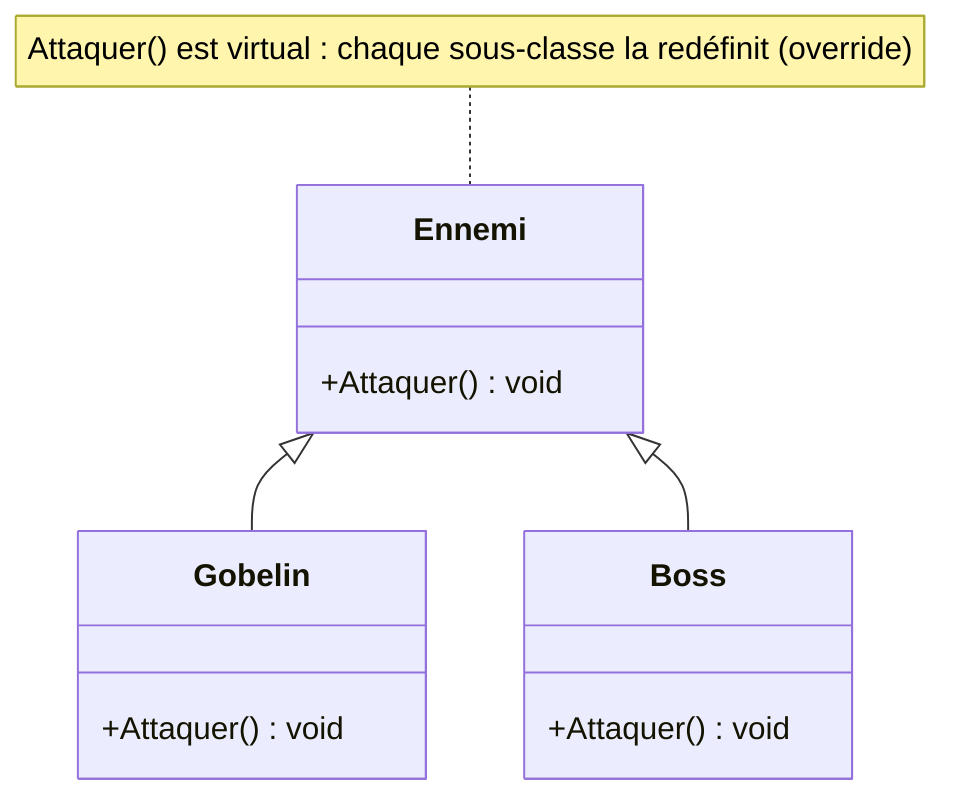
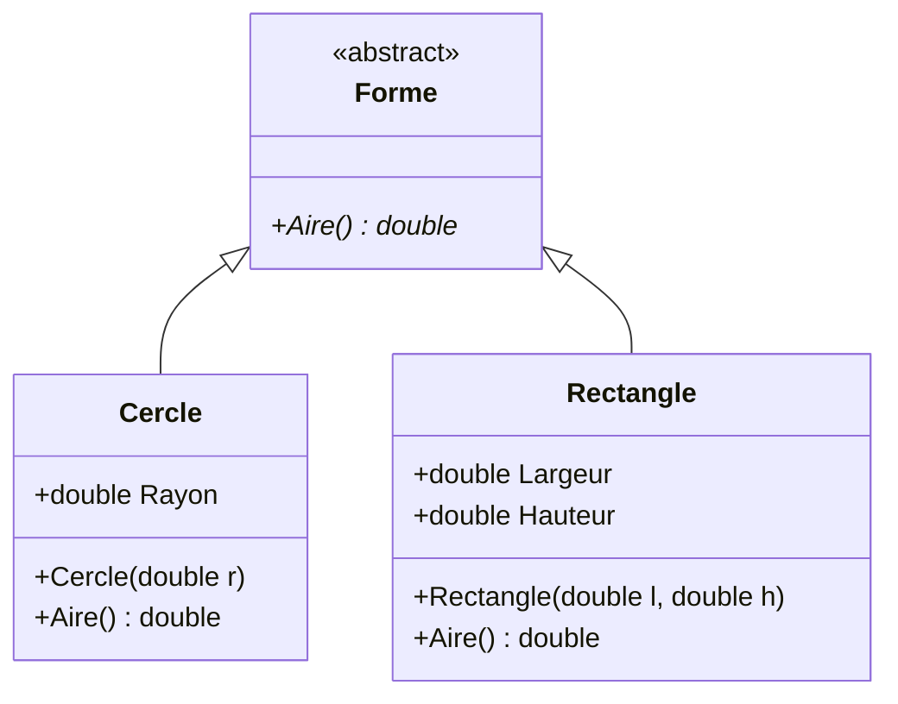

# 7. Polymorphisme

> 🎯 **À la fin de cette fiche, vous savez expliquer :**
> * comment un même appel de méthode produit des comportements différents selon l’objet ;
> * la différence entre surcharge (compilation) et redéfinition (exécution) ;
> * pourquoi le polymorphisme évite les cascades de `if` sur le type des objets.
>
> ⏱️ 30 min · Prérequis : [6. Héritage](<6. Héritage.md>)

---

## Objectif

Comprendre le principe du **polymorphisme** en programmation orientée objet, ses différentes formes (surcharge et redéfinition), et son rôle central dans la flexibilité et l’extensibilité du code orienté objet.

---

## Définition et explication

Le terme **polymorphisme** vient du grec *polymorphos*, signifiant “plusieurs formes”.
En programmation orientée objet, il désigne la **capacité d’un même symbole (méthode, référence, interface)** à **prendre plusieurs formes selon le contexte**.

Autrement dit, **un même appel de méthode** peut produire des **comportements différents** selon le type réel de l’objet sur lequel il agit.

Le polymorphisme permet d’écrire du code **générique et extensible**, capable de manipuler différents types d’objets via une **interface commune**, sans connaître leur implémentation concrète.

Exemple conceptuel :

> Un personnage du jeu peut attaquer. Qu’il s’agisse d’un `Guerrier`, d’un `Mage` ou d’un `Archer`, l’action “Attaquer” existe toujours, mais son exécution diffère selon la classe.

---

## Les deux formes principales de polymorphisme en C#

### 1. Le polymorphisme statique (ou *surcharge*)

Il se produit **à la compilation**, lorsque plusieurs méthodes partagent le même nom mais diffèrent par leur **signature** (nombre ou type de paramètres).
Le compilateur choisit la version appropriée selon les arguments passés.

```csharp
public class Calculatrice
{
    public int Addition(int a, int b) => a + b;
    public double Addition(double a, double b) => a + b;
}
```

Ici, `Addition()` existe sous deux formes : une pour les entiers, une pour les nombres à virgule.
C’est un **polymorphisme de compilation**, car la méthode utilisée est déterminée avant l’exécution.

---

### 2. Le polymorphisme dynamique (ou *par héritage*)

Ce type de polymorphisme se produit **à l’exécution**, grâce à la combinaison de l’héritage et des mots-clés `virtual`, `override` et `abstract`.
Une **référence de type parent** peut ainsi **pointer vers un objet de type enfant**, tout en appelant la version redéfinie d’une méthode.

```csharp
public class Ennemi
{
    public virtual void Attaquer()
    {
        Console.WriteLine("L’ennemi attaque !");
    }
}

public class Gobelin : Ennemi
{
    public override void Attaquer()
    {
        Console.WriteLine("Le gobelin lance une pierre !");
    }
}

public class Boss : Ennemi
{
    public override void Attaquer()
    {
        Console.WriteLine("Le boss invoque une explosion !");
    }
}
```

Et dans le programme :

```csharp
Ennemi[] ennemis = { new Gobelin(), new Boss() };

foreach (var e in ennemis)
    e.Attaquer();
```

**Sortie :**

```
Le gobelin lance une pierre !
Le boss invoque une explosion !
```

Bien que le tableau soit typé `Ennemi[]`, chaque élément réagit selon **sa classe concrète**.
C’est le **liage dynamique** (ou *late binding*).



Le code client ne voit que le type `Ennemi` : c’est l’objet réel, en bas de la hiérarchie, qui décide quelle version d’`Attaquer()` s’exécute.

---

## Polymorphisme via les interfaces

Le polymorphisme ne se limite pas à l’héritage : il fonctionne aussi avec les **interfaces**.
Une même référence d’interface peut manipuler des objets de différents types, tant qu’ils implémentent cette interface.

```csharp
public interface IArme
{
    void Attaquer();
}

public class Arc : IArme
{
    public void Attaquer() => Console.WriteLine("L’arc tire une flèche !");
}

public class Baton : IArme
{
    public void Attaquer() => Console.WriteLine("Le bâton lance un sort !");
}
```

```csharp
IArme[] armes = { new Arc(), new Baton() };

foreach (var arme in armes)
    arme.Attaquer();
```

Ce mécanisme est l’un des fondements du **principe d’inversion de dépendance** (un des principes SOLID), car il permet de travailler avec des **interfaces abstraites** plutôt qu’avec des classes concrètes.

---

## Polymorphisme paramétrique : les génériques

Une troisième forme de polymorphisme consiste à écrire **un seul code valable pour plusieurs types**, le type étant passé en paramètre. C’est le rôle des **génériques** :

```csharp
public static T Max<T>(T a, T b) where T : IComparable<T>
    => a.CompareTo(b) >= 0 ? a : b;

Console.WriteLine(Max(3, 7));              // 7
Console.WriteLine(Max("pomme", "kiwi"));   // pomme
```

Vous en utilisez déjà sans le savoir : `List<T>`, `Dictionary<TKey, TValue>` ou, dans Unity, `GetComponent<T>()`. Ils sont détaillés dans la fiche [15. Génériques](<../Partie IV — Les outils du langage/15. Génériques.md>).

---

## Conversions de type : upcast, downcast, `is` et `as`

* **Upcast** (enfant → parent) : implicite et toujours sûr. `Ennemi e = new Gobelin();`
* **Downcast** (parent → enfant) : explicite et potentiellement dangereux. `Gobelin g = (Gobelin)e;` lève une `InvalidCastException` si `e` n’est pas un `Gobelin`.

On préfère tester le type avant de convertir, grâce au *pattern matching* :

```csharp
foreach (var e in ennemis)
{
    if (e is Boss boss)          // teste ET convertit
        boss.InvoquerRenforts();
}

var gobelin = e as Gobelin;      // null si la conversion échoue
```

> [!TIP]
> Si vous multipliez les `is` ou les `switch` sur des types concrets, c’est souvent le signe qu’il manque une méthode `virtual` dans la classe de base : laissez le polymorphisme faire le travail.

---

## Avantages du polymorphisme

1. **Extensibilité**

    * De nouveaux types peuvent être ajoutés sans modifier le code existant.

2. **Réduction du couplage**

    * Le code dépend d’interfaces génériques plutôt que de classes spécifiques.

3. **Clarté et maintenance**

    * Les comportements spécifiques sont encapsulés dans les sous-classes.

4. **Réutilisabilité**

    * Une même structure de code peut s’appliquer à plusieurs types d’objets.

---

## Différence entre surcharge et redéfinition

| Type de polymorphisme        | Moment de résolution | Mécanisme                                                       | Mots-clés                         | Exemple                                           |
| ---------------------------- | -------------------- | --------------------------------------------------------------- | --------------------------------- | ------------------------------------------------- |
| **Statique (surcharge)**     | Compilation          | Plusieurs méthodes avec le même nom mais signatures différentes | Aucun mot-clé spécifique          | `Addition(int, int)` / `Addition(double, double)` |
| **Dynamique (redéfinition)** | Exécution            | Redéfinition d’une méthode héritée                              | `virtual`, `override`, `abstract` | `Attaquer()` dans `Ennemi`, `Gobelin`, `Boss`     |

---

## Exemple complet minimal

```csharp
public abstract class Forme
{
    public abstract double Aire();
}

public class Cercle : Forme
{
    public double Rayon;
    public Cercle(double r) => Rayon = r;
    public override double Aire() => Math.PI * Rayon * Rayon;
}

public class Rectangle : Forme
{
    public double Largeur, Hauteur;
    public Rectangle(double l, double h)
    {
        Largeur = l; Hauteur = h;
    }
    public override double Aire() => Largeur * Hauteur;
}
```

```csharp
Forme[] formes = { new Cercle(3), new Rectangle(4, 2) };

foreach (var f in formes)
    Console.WriteLine($"Aire : {f.Aire():0.00}");
```

**Sortie :**

```
Aire : 28.27
Aire : 8.00
```

Le polymorphisme permet ici de traiter des formes différentes (cercle, rectangle) via un même type abstrait (`Forme`), sans connaître leur nature exacte.



---

## Lien avec Unity

Le polymorphisme est omniprésent dans Unity :

* **Attention à une idée reçue :** `Start()`, `Update()` ou `OnTriggerEnter()` ne sont **pas** des méthodes `virtual` de `MonoBehaviour`, et on ne les marque jamais `override`. Unity les détecte **par réflexion** (grâce à leur nom) et les appelle comme des « messages ». Ce n’est donc *pas* du polymorphisme au sens C#. C’est aussi pour ça qu’une faute de frappe (`update()`) ne provoque aucune erreur : la méthode n’est simplement jamais appelée.
* Le vrai polymorphisme apparaît dans **vos propres hiérarchies** : une classe `Ennemi` avec une méthode `virtual Attaquer()`, redéfinie dans `Gobelin` ou `Boss`, puis appelée à travers une `List<Ennemi>`.
* Les interfaces sont souvent utilisées pour gérer des comportements communs : par exemple `IEndommageable`, `IInteractif`, ou `ISauvegardable`.
* On peut stocker différents objets implémentant une même interface dans une même collection (par exemple une liste d’objets interactifs) et les manipuler via des appels polymorphes.

Ce principe est fondamental pour concevoir des systèmes modulaires et évolutifs dans Unity.

---

## ⚠️ Pièges courants

* **Tester le type au lieu d’appeler une méthode virtuelle.** `if (e is Gobelin) … else if (e is Boss) …` doit être modifié à chaque nouveau type d’ennemi. Une méthode `virtual Attaquer()` règle le problème une fois pour toutes.
* **Confondre surcharge et redéfinition.** Deux méthodes `Attaquer(int)` et `Attaquer(string)` dans la même classe sont une *surcharge* : le choix se fait à la compilation, selon les arguments, et non selon le type réel de l’objet.
* **Le downcast forcé** `(Boss)ennemi` sans vérification : `InvalidCastException` dès que l’objet n’est pas un `Boss`.
* **Croire que `Update()` est polymorphe dans Unity** (voir *Lien avec Unity* plus haut).

## 🔀 À ne pas confondre

* **Polymorphisme par héritage** (`virtual`/`override`), **par interface** (plusieurs classes sans lien d’héritage implémentent le même contrat) et **paramétrique** (les génériques).
* **Type de la variable** (ce que le compilateur connaît : `Ennemi`) et **type de l’objet** (ce qui existe réellement en mémoire : `Gobelin`).

---

## 🧪 Exercice : l’arène

Écrivez une classe abstraite `Combattant` avec un `Nom`, une méthode abstraite `int Attaque()` et une méthode virtuelle `string Cri()` qui renvoie `"…"` par défaut. Créez :

* `Guerrier` : attaque 12, cri « Pour l’honneur ! » ;
* `Mage` : attaque 15, cri « Abracadabra ! » ;
* `Archer` : attaque 10, garde le cri par défaut.

**Contrainte :** la boucle du test ne doit contenir **aucun** `if`, `switch` ni `is`.

**Test attendu :**

```csharp
var equipe = new List<Combattant>
{
    new Guerrier("Conan"),
    new Mage("Merlin"),
    new Archer("Robin")
};

int total = 0;
foreach (var c in equipe)
{
    Console.WriteLine($"{c.Nom} crie « {c.Cri()} » et inflige {c.Attaque()} dégâts.");
    total += c.Attaque();
}

Console.WriteLine($"Dégâts totaux : {total}");
```

```
Conan crie « Pour l’honneur ! » et inflige 12 dégâts.
Merlin crie « Abracadabra ! » et inflige 15 dégâts.
Robin crie « … » et inflige 10 dégâts.
Dégâts totaux : 37
```

<details>
<summary>Voir la solution</summary>

```csharp
public abstract class Combattant
{
    public string Nom { get; }

    protected Combattant(string nom) => Nom = nom;

    public abstract int Attaque();
    public virtual string Cri() => "…";
}

public class Guerrier : Combattant
{
    public Guerrier(string nom) : base(nom) { }
    public override int Attaque() => 12;
    public override string Cri() => "Pour l’honneur !";
}

public class Mage : Combattant
{
    public Mage(string nom) : base(nom) { }
    public override int Attaque() => 15;
    public override string Cri() => "Abracadabra !";
}

public class Archer : Combattant
{
    public Archer(string nom) : base(nom) { }
    public override int Attaque() => 10;   // garde le cri par défaut
}
```

`Attaque()` est **abstraite** (chaque combattant doit la fournir) ; `Cri()` est **virtuelle** (un comportement par défaut, que l’archer conserve).

</details>

---

## Références utiles

* [Microsoft Learn — Polymorphisme (C#)](https://learn.microsoft.com/fr-fr/dotnet/csharp/fundamentals/object-oriented/polymorphism)
* [Microsoft Learn — Interfaces et héritage polymorphique](https://learn.microsoft.com/fr-fr/dotnet/csharp/programming-guide/interfaces/)
* [Unity Manual — Scripting Concepts](https://docs.unity3d.com/Manual/ScriptingSection.html)
* Gamma, Helm, Johnson & Vlissides. *Design Patterns*, Addison-Wesley, 1994 (chap. 1 : réutilisation polymorphique).

---

[← Précédent : 6. Héritage](<6. Héritage.md>) · [Sommaire](<../../README.md>) · [Suivant : 8. Composition vs héritage →](<../Partie III — Concepts Avancés/8. Composition vs héritage.md>)
