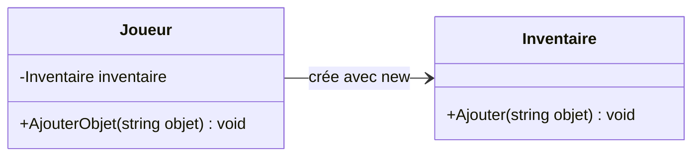
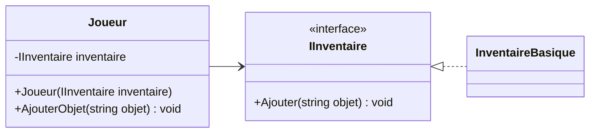
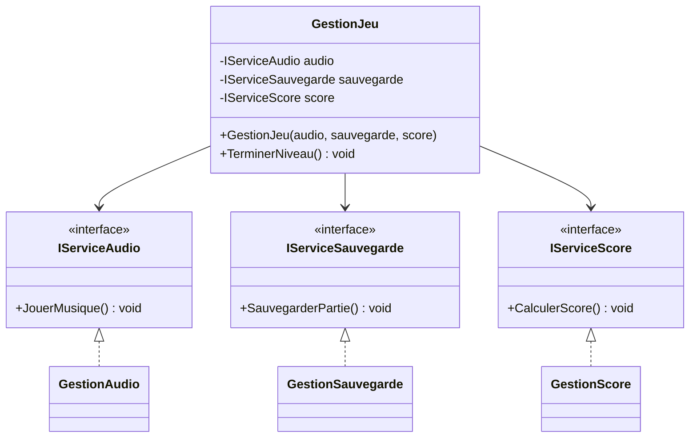

# 10. Couplage et Cohésion

> 🎯 **À la fin de cette fiche, vous savez expliquer :**
> * ce que mesurent la cohésion et le couplage ;
> * pourquoi on vise une **forte cohésion** et un **faible couplage** ;
> * comment l’injection de dépendances réduit le couplage.
>
> ⏱️ 25 min · Prérequis : [8. Composition vs héritage](<8. Composition vs héritage.md>), [9. Visibilité et portée](<9. Visibilité et portée.md>)

---

## Objectif

Comprendre les notions de **couplage** et de **cohésion**, savoir identifier un design trop dépendant ou mal structuré, et apprendre à appliquer le **principe de responsabilité unique (SRP)** pour concevoir un code modulaire, clair et maintenable.

---

## Définition et explication

En conception orientée objet, **le couplage** et **la cohésion** sont deux indicateurs essentiels de la **qualité structurelle** d’un logiciel.

* **Cohésion** : mesure à quel point les éléments d’une même classe ou d’un même module travaillent ensemble pour une **même responsabilité**.
* **Couplage** : mesure le **degré de dépendance** entre différentes classes ou modules.

Un bon design se caractérise par :

* une **forte cohésion** (chaque classe a une mission claire et bien définie),
* et un **faible couplage** (les classes communiquent entre elles sans dépendances excessives).

---

## La cohésion

Une classe cohésive se concentre sur **une seule responsabilité**.
Ses méthodes et attributs contribuent à un **même objectif fonctionnel**.

Exemple d’une classe à **faible cohésion** (mauvaise pratique) :

```csharp
public class GestionJeu
{
    public void SauvegarderPartie() { /* ... */ }
    public void CalculerScore() { /* ... */ }
    public void JouerMusique() { /* ... */ }
}
```

Ici, `GestionJeu` fait à la fois de la logique de jeu, du son et de la sauvegarde — des responsabilités sans lien direct.

Exemple d’une classe à **forte cohésion** :

```csharp
public class GestionScore
{
    public void CalculerScore() { /* ... */ }
    public void AfficherScore() { /* ... */ }
}
```

Chaque classe a une responsabilité unique et claire.

### Principe associé : SRP — *Single Responsibility Principle*

> Une classe ne devrait avoir qu’une seule raison de changer.
> (C’est le premier principe du modèle **SOLID**, défini par Robert C. Martin.)

Une forte cohésion rend le code **plus clair, plus testable** et **plus facile à faire évoluer**.

---

## Le couplage

Le **couplage** décrit à quel point une classe dépend d’autres classes pour fonctionner.
Un **couplage fort** rend le code difficile à modifier : tout changement dans une classe peut casser le comportement d’autres classes.
Un **couplage faible**, au contraire, limite les dépendances et rend les modules indépendants.

### Exemple de couplage fort :

```csharp
public class Joueur
{
    private Inventaire inventaire = new Inventaire();

    public void AjouterObjet(string objet)
    {
        inventaire.Ajouter(objet);
    }
}
```

Ici, `Joueur` crée directement une instance de `Inventaire`.
Il dépend donc de son implémentation concrète — impossible de remplacer ou de tester sans elle.



### Exemple de couplage faible (via abstraction) :

```csharp
public interface IInventaire
{
    void Ajouter(string objet);
}

public class Joueur
{
    private IInventaire inventaire;

    public Joueur(IInventaire inventaire)
    {
        this.inventaire = inventaire;
    }

    public void AjouterObjet(string objet)
    {
        inventaire.Ajouter(objet);
    }
}
```

Le joueur dépend maintenant d’une **interface**, pas d’une classe spécifique.
Cette approche permet d’injecter n’importe quelle implémentation (`InventaireBasique`, `InventaireAvancé`, etc.) et de tester plus facilement le comportement.



La flèche de `Joueur` pointe désormais vers une **interface** : on peut brancher n’importe quelle implémentation sans toucher au joueur.

---

## Relations entre couplage et cohésion

Ces deux principes sont liés :

| Type de relation                     | Description                                                        | Impact                                |
| ------------------------------------ | ------------------------------------------------------------------ | ------------------------------------- |
| **Forte cohésion / Faible couplage** | Idéal : chaque module fait une chose, et dépend peu des autres.    | Code maintenable, évolutif, testable. |
| **Faible cohésion / Fort couplage**  | Mauvais : les classes font trop de choses et sont interconnectées. | Code fragile, difficile à modifier.   |

Une architecture bien conçue vise toujours à **maximiser la cohésion** et **minimiser le couplage**.

---

## Techniques pour réduire le couplage

1. **Utiliser des interfaces** pour découpler les dépendances directes.
2. **Appliquer l’injection de dépendances (DI)** pour fournir les objets dont une classe a besoin sans les instancier elle-même.
3. **Limiter la visibilité** des membres internes (`private`, `internal`).
4. **Centraliser les communications** via des gestionnaires ou des événements (pattern *Observer*).
5. **Utiliser des événements ou délégués** pour éviter les références directes entre classes.

---

## Exemple d’application : refactorisation

### Avant (couplage fort, faible cohésion)

```csharp
public class GestionJeu
{
    public void JouerMusique() { /* ... */ }
    public void SauvegarderPartie() { /* ... */ }
    public void CalculerScore() { /* ... */ }
}
```

### Après (forte cohésion, faible couplage)

```csharp
public interface IServiceAudio      { void JouerMusique(); }
public interface IServiceSauvegarde { void SauvegarderPartie(); }
public interface IServiceScore      { void CalculerScore(); }

public class GestionAudio      : IServiceAudio      { public void JouerMusique() { /* ... */ } }
public class GestionSauvegarde : IServiceSauvegarde { public void SauvegarderPartie() { /* ... */ } }
public class GestionScore      : IServiceScore      { public void CalculerScore() { /* ... */ } }

public class GestionJeu
{
    private readonly IServiceAudio audio;
    private readonly IServiceSauvegarde sauvegarde;
    private readonly IServiceScore score;

    public GestionJeu(IServiceAudio audio, IServiceSauvegarde sauvegarde, IServiceScore score)
    {
        this.audio = audio;
        this.sauvegarde = sauvegarde;
        this.score = score;
    }

    public void TerminerNiveau()
    {
        score.CalculerScore();
        sauvegarde.SauvegarderPartie();
        audio.JouerMusique();
    }
}
```

Chaque classe se concentre sur sa propre responsabilité (**forte cohésion**), et `GestionJeu` ne dépend plus que d’**interfaces** injectées par le constructeur (**faible couplage**). On peut par exemple lui passer un faux service audio silencieux dans un test.



`GestionJeu` ne pointe vers aucune classe concrète : les trois implémentations (`GestionAudio`, `GestionSauvegarde`, `GestionScore`) peuvent être remplacées sans le modifier.

---

## Lien avec Unity

Unity repose sur une **architecture à faible couplage et forte cohésion** :

* Chaque **composant** (`Rigidbody`, `Collider`, `AudioSource`, `Script`, etc.) a une responsabilité unique.
* Les composants interagissent via des **références publiques**, des **événements** ou des **interfaces**, sans dépendre directement des implémentations internes.

Exemple :

```csharp
public interface IEndommageable
{
    void PrendreDegats(int montant);
}

public class Ennemi : MonoBehaviour, IEndommageable
{
    public void PrendreDegats(int montant)
    {
        // Logique spécifique à l’ennemi
    }
}

public class Projectile : MonoBehaviour
{
    private void OnCollisionEnter(Collision collision)
    {
        var cible = collision.gameObject.GetComponent<IEndommageable>();
        cible?.PrendreDegats(10);
    }
}
```

Ici :

* `Projectile` ne dépend pas du type concret d’objet touché (ennemi, joueur, objet destructible).
* L’interaction se fait via l’interface `IEndommageable` → couplage faible, cohésion forte.

C’est un exemple parfait de **bonne architecture orientée objet** dans Unity.

---

## ⚠️ Pièges courants

* **Le « Manager » fourre-tout** (`GestionnaireJeu` qui gère le score, l’audio, la sauvegarde, l’UI et les ennemis) : la cohésion est nulle et tout le jeu en dépend.
* **Découper à l’extrême** : des dizaines de classes d’une ligne qui s’appellent les unes les autres. La cohésion se mesure par la **responsabilité**, pas par la taille.
* **Les chaînes d’appels** du type `joueur.Inventaire.Sac.Objets[0].Prix` : le code dépend de toute la structure interne des objets traversés (c’est la *loi de Déméter* qui est violée). Demandez plutôt au joueur ce dont vous avez besoin.
* **Remplacer des dépendances directes par des Singletons** : le couplage est simplement caché, pas réduit.

## 🔀 À ne pas confondre

* **Cohésion** (à l’intérieur d’une classe : ses éléments servent-ils le même but ?) et **couplage** (entre les classes : à quel point dépendent-elles les unes des autres ?).
* **Injection de dépendances** (passer les dépendances de l’extérieur) et **inversion des dépendances** (dépendre d’abstractions plutôt que d’implémentations) : voir [11. Principes SOLID](<11. Principes SOLID.md>).

---

## 🧪 Exercice : le rapport de partie

La classe suivante calcule un score, le met en forme **et** l’affiche :

```csharp
public class RapportDePartie
{
    public void Generer(int ennemisVaincus, int pieces, int morts)
    {
        int score = ennemisVaincus * 100 + pieces * 10 - morts * 50;
        string rang = score >= 1000 ? "Or" : score >= 500 ? "Argent" : "Bronze";

        Console.WriteLine("=== Rapport de partie ===");
        Console.WriteLine($"Score : {score}");
        Console.WriteLine($"Rang : {rang}");
    }
}
```

Découpez-la en trois responsabilités :

* `CalculateurScore` : `Calculer(...)` et `Rang(score)`, **sans aucun affichage** (donc testable seul) ;
* `FormateurRapport` : renvoie les lignes du rapport sous forme de `List<string>` ;
* une interface `ISortie` (méthode `Ecrire(string ligne)`) et son implémentation `SortieConsole`.

`RapportDePartie` reçoit ces trois éléments par son constructeur et se contente de les orchestrer.

**Test attendu :**

```csharp
var rapport = new RapportDePartie(new CalculateurScore(), new FormateurRapport(), new SortieConsole());
rapport.Generer(ennemisVaincus: 12, pieces: 15, morts: 1);

var calculateur = new CalculateurScore();
Console.WriteLine(calculateur.Rang(calculateur.Calculer(3, 20, 0)));
```

```
=== Rapport de partie ===
Score : 1300
Rang : Or
Argent
```

<details>
<summary>Voir la solution</summary>

```csharp
public interface ISortie
{
    void Ecrire(string ligne);
}

public class SortieConsole : ISortie
{
    public void Ecrire(string ligne) => Console.WriteLine(ligne);
}

public class CalculateurScore
{
    public int Calculer(int ennemisVaincus, int pieces, int morts)
        => ennemisVaincus * 100 + pieces * 10 - morts * 50;

    public string Rang(int score) => score switch
    {
        >= 1000 => "Or",
        >= 500  => "Argent",
        _       => "Bronze"
    };
}

public class FormateurRapport
{
    public List<string> Formater(int score, string rang) => new()
    {
        "=== Rapport de partie ===",
        $"Score : {score}",
        $"Rang : {rang}"
    };
}

public class RapportDePartie
{
    private readonly CalculateurScore calculateur;
    private readonly FormateurRapport formateur;
    private readonly ISortie sortie;

    public RapportDePartie(CalculateurScore calculateur, FormateurRapport formateur, ISortie sortie)
    {
        this.calculateur = calculateur;
        this.formateur = formateur;
        this.sortie = sortie;
    }

    public void Generer(int ennemisVaincus, int pieces, int morts)
    {
        int score = calculateur.Calculer(ennemisVaincus, pieces, morts);
        foreach (string ligne in formateur.Formater(score, calculateur.Rang(score)))
            sortie.Ecrire(ligne);
    }
}
```

Le calcul se teste sans console (dernière ligne du test), et l’affichage peut être redirigé vers un fichier ou une zone de texte Unity en écrivant une autre implémentation d’`ISortie`.

</details>

---

## Références utiles

* [Microsoft Learn — Principes architecturaux (séparation des responsabilités, inversion des dépendances…)](https://learn.microsoft.com/fr-fr/dotnet/architecture/modern-web-apps-azure/architectural-principles)
* [Refactoring Guru — Code smells : les coupleurs](https://refactoring.guru/fr/refactoring/smells/couplers)
* [Unity Manual — Component-based Design](https://docs.unity3d.com/Manual/Components.html)
* Martin, Robert C. *Clean Architecture: A Craftsman’s Guide to Software Structure and Design*, Prentice Hall, 2017.

---

[← Précédent : 9. Visibilité et portée](<9. Visibilité et portée.md>) · [Sommaire](<../../README.md>) · [Suivant : 11. Principes SOLID →](<11. Principes SOLID.md>)
