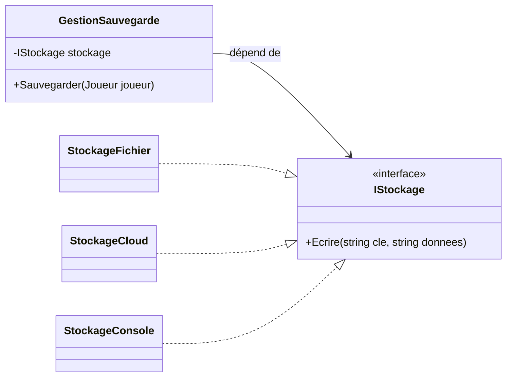

# 11. Les principes SOLID

> 🎯 **À la fin de cette fiche, tu sais expliquer :**
> * ce que signifient les cinq lettres de SOLID ;
> * reconnaître, dans un code existant, le symptôme de chaque violation ;
> * pourquoi le carré n’est pas (toujours) un rectangle ;
> * comment appliquer ces principes dans Unity sans tomber dans la sur-ingénierie.
>
> ⏱️ 30 min · Prérequis : [8. Composition vs héritage](<8. Composition vs héritage.md>), [10. Couplage et Cohésion](<10. Couplage et Cohésion.md>)

---

## Objectif

Connaître les **cinq principes SOLID**, formulés par Robert C. Martin au début des années 2000. Ce sont les critères les plus utilisés pour juger la qualité d’une conception orientée objet, et la plupart des Design Patterns du chapitre 2 en sont des applications directes.

---

## Vue d’ensemble

| Lettre | Principe | En une phrase | Symptôme quand il est violé |
| --- | --- | --- | --- |
| **S** | *Single Responsibility* | Une classe n’a qu’une seule raison de changer. | Une classe « fourre-tout » que tout le monde modifie. |
| **O** | *Open/Closed* | Ouvert à l’extension, fermé à la modification. | Chaque nouveauté oblige à rouvrir un `switch` existant. |
| **L** | *Liskov Substitution* | Une sous-classe doit pouvoir remplacer sa classe de base sans surprise. | Des `if (x is SousClasse)` ou des `NotSupportedException` dans les sous-classes. |
| **I** | *Interface Segregation* | Plusieurs petites interfaces valent mieux qu’une grosse. | Des méthodes implémentées « pour rien », vides ou qui lèvent une exception. |
| **D** | *Dependency Inversion* | Dépendre d’abstractions, pas d’implémentations concrètes. | Impossible de tester une classe sans le disque, le réseau ou la scène Unity. |

---

## S — Responsabilité unique (SRP)

> Une classe ne devrait avoir **qu’une seule raison de changer**.

Ce principe a déjà été présenté dans la fiche [10. Couplage et Cohésion](<10. Couplage et Cohésion.md>). Le mot important est *raison* : une « responsabilité », c’est un **acteur** ou un **besoin** susceptible de demander une modification.

```csharp
// ❌ Trois raisons de changer : les règles de combat, le format de sauvegarde, l’affichage
public class Joueur
{
    public int PointsDeVie;

    public void SubirDegats(int degats) { /* règles de combat */ }
    public void SauvegarderDansFichier(string chemin) { /* format JSON, accès disque */ }
    public void AfficherBarreDeVie() { /* interface graphique */ }
}
```

On découpe selon les raisons de changer :

```csharp
// ✅ Chaque classe change pour une seule raison
public class Joueur            { public void SubirDegats(int degats) { /* … */ } }
public class SauvegardeJoueur  { public void Sauvegarder(Joueur joueur) { /* … */ } }
public class BarreDeVie        { public void Afficher(Joueur joueur) { /* … */ } }
```

---

## O — Ouvert/fermé (OCP)

> Une classe doit être **ouverte à l’extension** mais **fermée à la modification**.

On doit pouvoir ajouter un comportement **sans retoucher le code qui fonctionne déjà**.

### Avant

```csharp
public class CalculateurDegats
{
    public int Calculer(string typeArme, int force)
    {
        switch (typeArme)
        {
            case "epee": return 10 + force;
            case "arc":  return 8 + force / 2;
            // Ajouter le bâton magique = modifier cette classe (et la retester)
            default: throw new ArgumentException("Arme inconnue");
        }
    }
}
```

### Après

Chaque arme porte son propre calcul. Ajouter une arme revient à **ajouter une classe**, sans toucher aux autres.

```csharp
public interface IArme
{
    string Nom { get; }
    int CalculerDegats(int force);
}

public class Epee : IArme
{
    public string Nom => "Épée";
    public int CalculerDegats(int force) => 10 + force;
}

public class Arc : IArme
{
    public string Nom => "Arc";
    public int CalculerDegats(int force) => 8 + force / 2;
}

public class BatonMagique : IArme   // nouvelle arme : aucune classe existante modifiée
{
    public string Nom => "Bâton magique";
    public int CalculerDegats(int force) => 15; // la force n’a aucun effet sur la magie
}
```

```csharp
IArme[] armes = { new Epee(), new Arc(), new BatonMagique() };

foreach (var arme in armes)
    Console.WriteLine($"{arme.Nom} : {arme.CalculerDegats(force: 6)} dégâts");
```

**Sortie :**

```
Épée : 16 dégâts
Arc : 11 dégâts
Bâton magique : 15 dégâts
```

C’est exactement le mécanisme du [polymorphisme](<../Partie II — Les 4 piliers de la POO/7. Polymorphisme.md>), et l’idée centrale des patterns *Strategy*, *Decorator* ou *Factory Method*.

---

## L — Substitution de Liskov (LSP)

> Si `B` hérite de `A`, alors partout où l’on attend un `A`, on doit pouvoir donner un `B` **sans changer le comportement attendu du programme**.

Formulé par Barbara Liskov en 1987, c’est le principe qui distingue un héritage **correct** d’un héritage qui « compile mais trompe ».

### L’exemple classique : le carré et le rectangle

En mathématiques, un carré **est un** rectangle. Il est donc tentant d’écrire :

```csharp
public class Rectangle
{
    public virtual int Largeur { get; set; }
    public virtual int Hauteur { get; set; }
    public int Aire => Largeur * Hauteur;
}

public class Carre : Rectangle
{
    // Un carré doit garder ses côtés égaux…
    public override int Largeur
    {
        get => base.Largeur;
        set { base.Largeur = value; base.Hauteur = value; }
    }

    public override int Hauteur
    {
        get => base.Hauteur;
        set { base.Largeur = value; base.Hauteur = value; }
    }
}
```

Un code client écrit pour des rectangles fait une hypothèse raisonnable : modifier la hauteur ne change pas la largeur.

```csharp
static void Agrandir(Rectangle r)
{
    r.Largeur = 5;
    r.Hauteur = 4;
    Console.WriteLine($"Aire attendue : 20, obtenue : {r.Aire}");
}

Agrandir(new Rectangle());
Agrandir(new Carre());
```

**Sortie :**

```
Aire attendue : 20, obtenue : 20
Aire attendue : 20, obtenue : 16
```

Le `Carre` compile, hérite correctement… et **casse silencieusement** le code qui l’utilise. La relation « est un » du monde réel ne suffit pas : il faut que le **comportement** soit substituable.

**Correction :** ne pas faire hériter `Carre` de `Rectangle`. Les deux peuvent implémenter une abstraction commune qui ne promet que ce qu’ils savent tenir :

```csharp
public interface IForme
{
    int Aire { get; }
}

public class Rectangle : IForme
{
    public int Largeur { get; }
    public int Hauteur { get; }
    public Rectangle(int largeur, int hauteur) { Largeur = largeur; Hauteur = hauteur; }
    public int Aire => Largeur * Hauteur;
}

public class Carre : IForme
{
    public int Cote { get; }
    public Carre(int cote) => Cote = cote;
    public int Aire => Cote * Cote;
}
```

### Version jeu vidéo

```csharp
public class Oiseau
{
    public virtual void Voler() => Console.WriteLine("L’oiseau s’envole.");
}

public class Pingouin : Oiseau
{
    // ❌ Violation de LSP : un code qui fait voler « des oiseaux » plantera
    public override void Voler() => throw new NotSupportedException("Un pingouin ne vole pas !");
}
```

> [!TIP]
> **Règles pratiques pour respecter LSP.** Une classe dérivée ne doit pas :
> * exiger **plus** que sa base (paramètres plus restrictifs, préconditions plus fortes) ;
> * garantir **moins** que sa base (résultat différent, effets de bord inattendus) ;
> * lever des exceptions que la base ne lève pas (`NotSupportedException`, `NotImplementedException`).
>
> Si c’est nécessaire, la hiérarchie est mal découpée : ici, une interface `IVolant` implémentée seulement par les oiseaux qui volent.

---

## I — Ségrégation des interfaces (ISP)

> Aucun client ne devrait dépendre de méthodes qu’il n’utilise pas.

### Avant : une interface « fourre-tout »

```csharp
public interface IEntite
{
    void SeDeplacer(Vector3 destination);
    void SubirDegats(int montant);
    void Parler(string replique);
    void Commercer(Joueur joueur);
}

// Un tonneau destructible n’a ni jambes, ni voix, ni boutique…
public class Tonneau : IEntite
{
    public void SeDeplacer(Vector3 destination) { }                       // vide
    public void SubirDegats(int montant) { /* se brise */ }
    public void Parler(string replique) => throw new NotSupportedException();
    public void Commercer(Joueur joueur) => throw new NotSupportedException();
}
```

### Après : des interfaces centrées sur un rôle

```csharp
public interface IDeplacable  { void SeDeplacer(Vector3 destination); }
public interface IDamageable  { void SubirDegats(int montant); }
public interface IParlant     { void Parler(string replique); }
public interface IMarchand    { void Commercer(Joueur joueur); }

public class Tonneau : IDamageable { public void SubirDegats(int montant) { /* se brise */ } }

public class Aubergiste : IDeplacable, IDamageable, IParlant, IMarchand
{
    // … implémente uniquement ce qui a du sens pour lui, c’est-à-dire tout
}
```

Le système de dégâts ne connaît plus que `IDamageable` : il peut frapper un tonneau, un ennemi ou un aubergiste sans rien savoir du reste.

---

## D — Inversion des dépendances (DIP)

> Les modules de haut niveau ne doivent pas dépendre des modules de bas niveau : **les deux doivent dépendre d’abstractions**.

Le module de **haut niveau** contient la logique métier (« sauvegarder la partie »). Le module de **bas niveau** contient un détail technique (« écrire dans un fichier », « envoyer sur un serveur »). Sans inversion, la logique métier dépend du détail technique, et chaque changement de stockage la casse.



Les flèches des détails techniques pointent **vers** l’abstraction : c’est cela, l’« inversion ».

```csharp
public interface IStockage
{
    void Ecrire(string cle, string donnees);
}

public class StockageConsole : IStockage   // pratique pour les tests et le débogage
{
    public void Ecrire(string cle, string donnees) => Console.WriteLine($"[Console] {cle} = {donnees}");
}

public class GestionSauvegarde
{
    private readonly IStockage stockage;

    // L’implémentation est fournie de l’extérieur : c’est l’injection de dépendances
    public GestionSauvegarde(IStockage stockage) => this.stockage = stockage;

    public void Sauvegarder(Joueur joueur)
        => stockage.Ecrire("joueur", $"{joueur.Nom};{joueur.Niveau}");
}
```

```csharp
var sauvegarde = new GestionSauvegarde(new StockageConsole());
sauvegarde.Sauvegarder(new Joueur("Arthur", 5));
```

**Sortie :**

```
[Console] joueur = Arthur;5
```

> [!NOTE]
> **Inversion des dépendances ≠ injection de dépendances.** Le DIP est un *principe de conception* (dépendre d’abstractions). L’injection de dépendances est une *technique* pour le mettre en œuvre (passer l’implémentation par le constructeur, une propriété ou un conteneur).

---

## Dans Unity

| Principe | Application typique |
| --- | --- |
| **S** | Découper le « God Player » en composants : `PlayerMovement`, `PlayerHealth`, `PlayerInput`, `PlayerAnimation`. |
| **O** | Ajouter des comportements via de nouveaux composants ou de nouveaux **ScriptableObjects** (armes, sorts, IA) plutôt qu’en modifiant un `switch`. |
| **L** | Toutes les implémentations de `IDamageable` doivent accepter les mêmes montants et réagir de façon cohérente (pas de « je ne prends pas de dégâts, je lève une exception »). |
| **I** | Préférer `IDamageable`, `IInteractable`, `IPickable` à une grosse interface `IGameEntity`. |
| **D** | Les scripts de gameplay dépendent d’abstractions (`IAudioService`, `ISaveService`) plutôt que d’un `AudioManager.Instance` concret. |

> [!WARNING]
> **Piège Unity : l’Inspector ne sait pas sérialiser un champ de type interface.** Un `[SerializeField] private IDamageable cible;` n’apparaît pas dans l’Inspector. Trois solutions courantes :
> * utiliser une **classe de base abstraite** dérivée de `MonoBehaviour` ou de `ScriptableObject` à la place de l’interface ;
> * récupérer l’interface par code : `GetComponent<IDamageable>()` ;
> * utiliser `[SerializeReference]` pour des classes C# « pures » (pas pour des composants).

---

## ⚠️ Pièges courants

* **Appliquer SOLID de façon dogmatique.** Une interface pour chaque classe, une classe pour chaque ligne : le code devient plus difficile à lire qu’avant. Les principes servent à **gérer le changement** ; là où rien ne change, ils n’apportent rien.
* **Anticiper des besoins imaginaires.** Le principe *YAGNI* (« You Aren’t Gonna Need It ») rappelle qu’on introduit une abstraction quand un **deuxième cas réel** apparaît, pas « au cas où ».
* **Confondre « est un » du monde réel et substituabilité.** Le carré *est* un rectangle en géométrie, pas forcément dans le code (LSP).
* **Croire que l’interface suffit.** Une interface qui expose 15 méthodes viole ISP, même si elle permet de respecter DIP.

## 🔀 À ne pas confondre

* **SRP** (une raison de changer) et **ISP** (des interfaces centrées sur leurs clients) : le premier découpe les *classes*, le second découpe les *contrats*.
* **OCP** et **héritage** : l’extension passe le plus souvent par la *composition* et les interfaces, pas par des sous-classes à rallonge.

---

## 🧪 Exercice

Le code suivant fonctionne, mais viole plusieurs principes SOLID.

```csharp
public class Boutique
{
    public void Acheter(Joueur joueur, string objet)
    {
        int prix = objet switch { "Potion" => 10, "Épée" => 50, _ => 0 };

        if (joueur.Or < prix)
        {
            Console.WriteLine("Pas assez d’or !");
            return;
        }

        joueur.Or -= prix;
        File.AppendAllText("achats.log", $"{joueur.Nom} a acheté {objet}\n");
        Console.WriteLine($"{joueur.Nom} achète {objet}.");
    }
}
```

1. Identifie **trois** principes violés et justifie chacun en une phrase.
2. Réécris la boutique pour que :
   * les prix viennent d’un catalogue interchangeable ;
   * la journalisation puisse être redirigée (fichier, console, rien du tout) sans modifier `Boutique` ;
   * `Acheter` renvoie `true` ou `false` au lieu d’afficher un message.

**Contrainte :** `Boutique` ne doit plus contenir ni `switch`, ni `File`, ni `Console`.

**Test attendu :**

```csharp
var boutique = new Boutique(new CatalogueFixe(), new JournalConsole());
var joueur = new Joueur("Arthur", 5) { Or = 30 };

Console.WriteLine(boutique.Acheter(joueur, "Potion"));
Console.WriteLine(boutique.Acheter(joueur, "Épée"));
Console.WriteLine($"Or restant : {joueur.Or}");
```

```
[Journal] Arthur a acheté Potion pour 10 pièces d’or.
True
False
Or restant : 20
```

<details>
<summary>Voir la solution</summary>

1. **SRP** : la classe gère à la fois les prix, le paiement, la journalisation et l’affichage. **OCP** : ajouter un objet oblige à modifier le `switch`. **DIP** : la logique métier dépend directement du système de fichiers (`File`) et de la console. (Bonus : un objet inconnu coûte 0 pièce, ce qui est un bug.)

2. Une solution possible :

```csharp
public interface ICatalogue
{
    bool TryObtenirPrix(string objet, out int prix);
}

public interface IJournal
{
    void Enregistrer(string message);
}

public class CatalogueFixe : ICatalogue
{
    private readonly Dictionary<string, int> prix = new()
    {
        ["Potion"] = 10,
        ["Épée"] = 50,
    };

    public bool TryObtenirPrix(string objet, out int prix) => this.prix.TryGetValue(objet, out prix);
}

public class JournalConsole : IJournal
{
    public void Enregistrer(string message) => Console.WriteLine($"[Journal] {message}");
}

public class Boutique
{
    private readonly ICatalogue catalogue;
    private readonly IJournal journal;

    public Boutique(ICatalogue catalogue, IJournal journal)
    {
        this.catalogue = catalogue;
        this.journal = journal;
    }

    public bool Acheter(Joueur joueur, string objet)
    {
        if (!catalogue.TryObtenirPrix(objet, out int prix) || joueur.Or < prix)
            return false;

        joueur.Or -= prix;
        journal.Enregistrer($"{joueur.Nom} a acheté {objet} pour {prix} pièces d’or.");
        return true;
    }
}
```

</details>

---

## ✅ Récap

| Lettre | Question à se poser |
| --- | --- |
| **S** | Combien de raisons différentes pourraient m’obliger à modifier cette classe ? |
| **O** | Pour ajouter un cas, dois-je modifier du code existant ou en ajouter ? |
| **L** | Puis-je passer n’importe quelle sous-classe là où la base est attendue, sans surprise ? |
| **I** | Les classes qui implémentent cette interface utilisent-elles toutes ses méthodes ? |
| **D** | Cette classe peut-elle être testée sans le disque, le réseau ou la scène ? |

---

## Références utiles

* Martin, Robert C. *Clean Architecture: A Craftsman’s Guide to Software Structure and Design*, Prentice Hall, 2017 — partie III.
* Liskov, Barbara & Wing, Jeannette. *A Behavioral Notion of Subtyping*, ACM TOPLAS, 1994.
* [Microsoft Learn — Principes architecturaux](https://learn.microsoft.com/fr-fr/dotnet/architecture/modern-web-apps-azure/architectural-principles)
* [Unity — e-book « Level up your code with design patterns and SOLID »](https://unity.com/resources/design-patterns-solid-ebook)

---

[← Précédent : 10. Couplage et Cohésion](<10. Couplage et Cohésion.md>) · [Sommaire](<../../README.md>) · [Suivant : 12. Types valeur et types référence →](<../Partie IV — Les outils du langage/12. Types valeur et types référence.md>)
