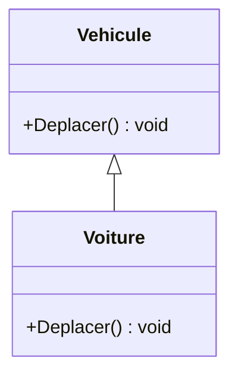
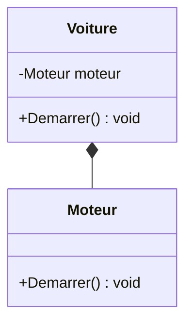
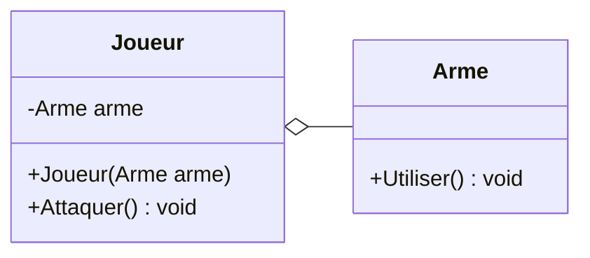

# 8. Composition vs Héritage

> 🎯 **À la fin de cette fiche, vous savez expliquer :**
> * la différence entre une relation « est un » et une relation « a un » ;
> * pourquoi la composition rend un objet modifiable à l’exécution ;
> * en quoi le modèle de composants d’Unity applique ce principe.
>
> ⏱️ 25 min · Prérequis : [7. Polymorphisme](<../Partie II — Les 4 piliers de la POO/7. Polymorphisme.md>)

---

## Objectif

Comprendre la différence entre **composition** et **héritage**, savoir quand utiliser l’un ou l’autre, et pourquoi la composition est souvent préférable pour construire des architectures flexibles et modulaires.

---

## Définition et explication

L’**héritage** et la **composition** sont deux approches permettant de réutiliser du code et de structurer des relations entre classes.

* **Héritage** : une classe dérive d’une autre pour en hériter les membres (relation “est un” — *is a*).
* **Composition** : une classe contient une instance d’une autre classe pour utiliser ses fonctionnalités (relation “a un” — *has a*).

Ces deux techniques répondent à des besoins différents :

* L’héritage favorise la **spécialisation** : créer des variantes d’un même concept.
* La composition favorise la **combinaison** : assembler des comportements indépendants.

---

## L’héritage (rappel)

L’héritage permet de créer une **hiérarchie de classes** où les classes dérivées étendent ou redéfinissent les fonctionnalités de la classe de base.

```csharp
public class Vehicule
{
    public virtual void Deplacer()
    {
        Console.WriteLine("Le véhicule se déplace.");
    }
}

public class Voiture : Vehicule
{
    public override void Deplacer()
    {
        Console.WriteLine("La voiture roule.");
    }
}
```

Relation :

> Une `Voiture` **est un** `Véhicule`.



L’héritage est donc utile lorsque les classes partagent un **comportement commun naturel** et que la hiérarchie est stable.

---

## La composition

La **composition** consiste à créer des objets complexes en **assemblant d’autres objets** qui fournissent des fonctionnalités spécifiques.
Plutôt que d’hériter d’une classe, on **l’instancie comme un champ** à l’intérieur d’une autre.

```csharp
public class Moteur
{
    public void Demarrer()
    {
        Console.WriteLine("Le moteur démarre.");
    }
}

public class Voiture
{
    private Moteur moteur = new Moteur();

    public void Demarrer()
    {
        moteur.Demarrer();
        Console.WriteLine("La voiture est en marche.");
    }
}
```

Relation :

> Une `Voiture` **a un** `Moteur`.



Le losange plein, côté `Voiture`, indique une **composition** : la voiture crée son moteur et le possède, il naît et disparaît avec elle.

Cette approche favorise la **modularité** et la **réutilisation** : un même moteur pourrait être utilisé dans une `Moto`, un `Bateau` ou un `Avion`, sans lien hiérarchique entre ces classes.

---

## Comparaison entre héritage et composition

| Critère                     | Héritage                    | Composition                       |
| --------------------------- | --------------------------- | --------------------------------- |
| Relation logique            | “Est un” (*is a*)           | “A un” (*has a*)                  |
| Type de lien                | Fortement couplé            | Faiblement couplé                 |
| Réutilisation du code       | Par extension               | Par assemblage                    |
| Flexibilité                 | Limitée (hiérarchie rigide) | Élevée (combinaisons libres)      |
| Changement d’implémentation | Difficile                   | Facile (on remplace un composant) |
| Exemple                     | `Chien` hérite de `Animal`  | `Joueur` contient une `Arme`      |

La composition est donc souvent **préférée à l’héritage** dans les architectures modernes, car elle limite le couplage et facilite l’évolution du code.

---

## Quand préférer la composition

1. **Quand la relation n’est pas une vraie spécialisation**

    * Si une classe “utilise” une autre, mais n’est pas conceptuellement une de ses variantes.
    * Exemple : un `Joueur` **a une** `Arme`, mais **n’est pas une** `Arme`.

2. **Quand on veut éviter une hiérarchie complexe**

    * Trop d’héritage conduit à des dépendances fortes et des comportements difficiles à maintenir.

3. **Quand on souhaite favoriser la réutilisation**

    * Un même composant peut être injecté dans plusieurs classes.

4. **Quand la flexibilité est primordiale**

    * On peut remplacer un composant sans modifier la classe principale (principe d’injection de dépendances).

---

## Exemple concret

### Version avec héritage (fort couplage)

```csharp
public class Joueur : Arme
{
    public void Attaquer()
    {
        Utiliser();
    }
}
```

Cette conception suppose que le joueur **est** une arme, ce qui est incohérent dans le modèle.
De plus, si l’on veut que le joueur change d’arme, il faudrait modifier la hiérarchie.

### Version avec composition (souple et réaliste)

```csharp
public class Arme
{
    public void Utiliser() => Console.WriteLine("L’arme attaque !");
}

public class Joueur
{
    private Arme arme;

    public Joueur(Arme arme)
    {
        this.arme = arme;
    }

    public void Attaquer()
    {
        arme.Utiliser();
    }
}
```

Ici, le joueur **possède** une arme, mais peut facilement en changer :

```csharp
var epee = new Arme();
var joueur = new Joueur(epee);
joueur.Attaquer();
```

Ce modèle est plus réaliste, plus flexible, et plus conforme aux bonnes pratiques d’architecture.

Les deux versions comparées en diagramme :



> [!NOTE]
> Ici le losange est **vide** : l’arme est créée à l’extérieur puis *confiée* au joueur, elle peut lui survivre ou passer à un autre joueur. En UML strict, c’est une **agrégation**. On réserve le losange plein (composition) au cas où le conteneur crée et possède seul la partie, comme la `Voiture` et son `Moteur`. Dans le langage courant, les deux sont appelés « composition » par opposition à l’héritage. Voir la fiche [Lire un diagramme UML](<../../Chapitre 2/0. Lire un diagramme UML.md>).

---

## Héritage et composition dans Unity

Unity illustre parfaitement la différence entre héritage et composition :

* Les scripts dérivent de `MonoBehaviour` → **héritage** : cela fournit un cadre de base (cycle de vie, gestion du comportement).
* Mais un GameObject est composé de **plusieurs composants indépendants** (Transform, Rigidbody, Collider, Script, etc.) → **composition**.

Ce modèle favorise la **modularité** :

> Un GameObject n’hérite pas de plusieurs comportements, il **les combine** en ajoutant des composants.

Ainsi, la conception d’Unity repose fondamentalement sur le principe de **“composition over inheritance”** :
plutôt que de créer de longues hiérarchies de classes, on assemble des comportements indépendants.

---

## Bonnes pratiques

* Utiliser l’héritage uniquement lorsque la relation “est un(e)” est **logiquement justifiée**.
* Préférer la composition pour construire des objets **modulaires et réutilisables**.
* Dans Unity, concevoir vos systèmes autour de **composants indépendants** plutôt que d’arborescences de classes.
* Coupler la composition avec des **interfaces** pour obtenir une architecture souple : la classe dépend d’une abstraction plutôt que d’une implémentation concrète (principe d’**inversion des dépendances**, le « D » de SOLID).

---

## ⚠️ Pièges courants

* **L’explosion de sous-classes** : `GuerrierAvecEpee`, `GuerrierAvecArc`, `MageVolantAvecBaton`… Chaque combinaison devient une classe. La composition remplace ce produit cartésien par des pièces interchangeables.
* **Instancier soi-même ses composants** (`private Moteur moteur = new Moteur();`) : la composition existe, mais le couplage reste fort. Recevez plutôt le composant par le constructeur, idéalement sous forme d’interface.
* **Bannir complètement l’héritage.** Quand la relation « est un » est réelle et stable (un `Cercle` est une `Forme`), l’héritage reste l’outil le plus simple.

## 🔀 À ne pas confondre

* **Composition** (le contenant possède ses parties et contrôle leur durée de vie : un personnage et sa barre de vie) et **agrégation** (le contenant référence des objets qui vivent sans lui : une équipe et ses joueurs). En UML, losange plein pour la composition, losange vide pour l’agrégation (voir [Lire un diagramme UML](<../../Chapitre 2/0. Lire un diagramme UML.md>)).
* **Composition** (la relation « a un ») et **[Composite](<../../Chapitre 2/Partie IV — Patterns complémentaires/12. Composite.md>)** (le pattern d’arborescence).

---

## 🧪 Exercice : le personnage modulable

Un jeu propose trois façons de se déplacer (marcher, voler, nager) et deux armes (épée, arc). Plutôt que six sous-classes de `Personnage`, utilisez la composition :

* une interface `IDeplacement` (méthode `string SeDeplacer()`) et ses implémentations `Marche`, `Vol`, `Nage` ;
* une interface `IArme` (méthode `string Frapper()`) et ses implémentations `Epee`, `Arc` ;
* une classe `Personnage` qui reçoit son déplacement et son arme dans son constructeur, peut en changer à l’exécution, et dont la méthode `Agir()` affiche `<Nom> <déplacement> et <frappe>.`.

**Contrainte :** aucune classe ne doit hériter de `Personnage`.

**Test attendu :**

```csharp
var heros = new Personnage("Arthur", new Marche(), new Epee());
heros.Agir();

heros.ChangerArme(new Arc());
heros.Agir();

heros.ChangerDeplacement(new Nage());
heros.Agir();

var dragon = new Personnage("Smaug", new Vol(), new Epee());
dragon.Agir();
```

```
Arthur marche et donne un coup d’épée.
Arthur marche et tire une flèche.
Arthur nage et tire une flèche.
Smaug vole et donne un coup d’épée.
```

<details>
<summary>Voir la solution</summary>

```csharp
public interface IDeplacement
{
    string SeDeplacer();
}

public class Marche : IDeplacement { public string SeDeplacer() => "marche"; }
public class Vol : IDeplacement { public string SeDeplacer() => "vole"; }
public class Nage : IDeplacement { public string SeDeplacer() => "nage"; }

public interface IArme
{
    string Frapper();
}

public class Epee : IArme { public string Frapper() => "donne un coup d’épée"; }
public class Arc : IArme { public string Frapper() => "tire une flèche"; }

public class Personnage
{
    private IDeplacement deplacement;
    private IArme arme;

    public string Nom { get; }

    public Personnage(string nom, IDeplacement deplacement, IArme arme)
    {
        Nom = nom;
        this.deplacement = deplacement;
        this.arme = arme;
    }

    public void ChangerDeplacement(IDeplacement nouveau) => deplacement = nouveau;
    public void ChangerArme(IArme nouvelle) => arme = nouvelle;

    public void Agir()
    {
        Console.WriteLine($"{Nom} {deplacement.SeDeplacer()} et {arme.Frapper()}.");
    }
}
```

Trois déplacements et deux armes donnent six combinaisons possibles, avec seulement cinq petites classes, et sans aucune sous-classe de `Personnage`. C’est exactement l’idée du pattern [Strategy](<../../Chapitre 2/Partie III — Patterns Comportementaux/8. Strategy.md>).

</details>

---

## Références utiles

* [Microsoft Learn — Héritage (C#)](https://learn.microsoft.com/fr-fr/dotnet/csharp/fundamentals/object-oriented/inheritance)
* [Unity Manual — GameObjects and Components](https://docs.unity3d.com/Manual/GameObjects.html)
* [Wikipédia — Composition over inheritance](https://en.wikipedia.org/wiki/Composition_over_inheritance)
* Fowler, Martin. *Refactoring: Improving the Design of Existing Code*, Addison-Wesley, 2018.

---

[← Précédent : 7. Polymorphisme](<../Partie II — Les 4 piliers de la POO/7. Polymorphisme.md>) · [Sommaire](<../../README.md>) · [Suivant : 9. Visibilité et portée →](<9. Visibilité et portée.md>)
