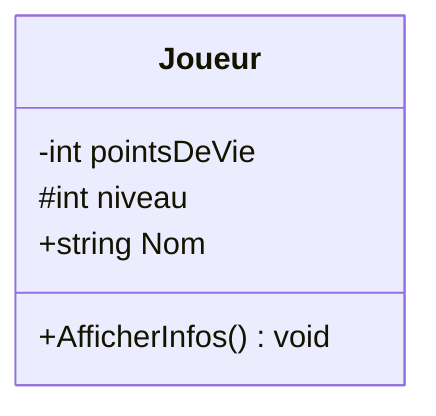
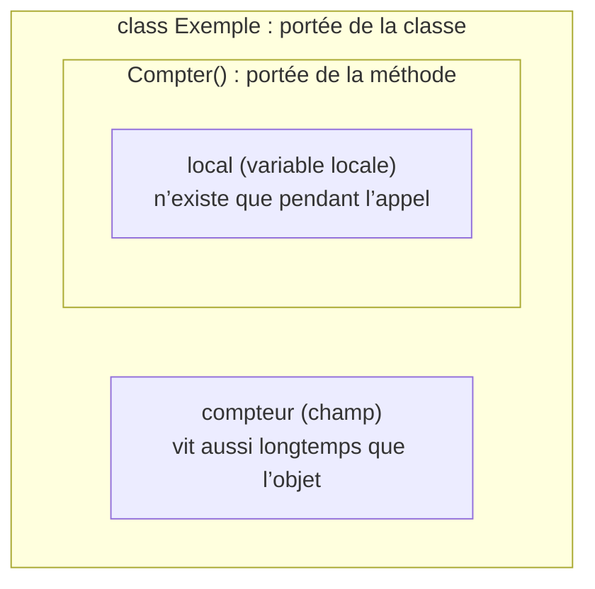

# 9. Visibilité et portée

> 🎯 **À la fin de cette fiche, vous savez expliquer :**
> * qui peut accéder à un membre selon son modificateur (`public`, `private`, `protected`, `internal`…) ;
> * où une variable est utilisable selon l’endroit où elle est déclarée ;
> * le principe du moindre privilège.
>
> ⏱️ 20 min · Prérequis : [6. Héritage](<../Partie II — Les 4 piliers de la POO/6. Héritage.md>)

---

## Objectif

Comprendre les notions de **visibilité** et de **portée** en C#, savoir utiliser correctement les modificateurs d’accès pour protéger et organiser le code, et appliquer ces principes dans une architecture orientée objet (notamment sous Unity).

---

## Définition et explication

La **visibilité** détermine **qui peut accéder à un élément** du code (classe, attribut, méthode, propriété, etc.).
La **portée** (ou *scope*) définit **où** un élément est valide et peut être utilisé dans le programme.

Ces deux notions assurent la **séparation des responsabilités**, la **protection des données**, et la **lisibilité** du code.

Bien maîtriser la visibilité et la portée permet de :

* éviter les accès involontaires à des éléments internes,
* limiter les effets de bord,
* clarifier l’architecture logicielle,
* et faciliter la maintenance du projet.

---

## Les modificateurs d’accès en C#

Les **modificateurs d’accès** contrôlent la visibilité des membres et des classes dans un programme C#.

| Modificateur         | Portée                                           | Description                                              | Exemple d’usage                             |
| -------------------- | ------------------------------------------------ | -------------------------------------------------------- | ------------------------------------------- |
| `public`             | Partout                                          | Accessible depuis n’importe quel code.                   | Méthodes d’API, points d’entrée publics.    |
| `private`            | À l’intérieur de la classe uniquement            | C’est le niveau de protection maximal.                   | Attributs internes, logique cachée.         |
| `protected`          | Dans la classe et ses dérivées                   | Permet l’accès pour l’héritage.                          | Méthodes à redéfinir dans des sous-classes. |
| `internal`           | Dans le même assembly (projet)                   | Visible à l’intérieur du projet, mais pas à l’extérieur. | Classes de service internes.                |
| `protected internal` | Dans le même assembly ou classes dérivées        | Combine `protected` et `internal`.                       | Méthodes héritables dans un même projet.    |
| `private protected`  | Classe et classes dérivées dans le même assembly | Version plus restrictive que `protected internal`.       | Contrôle fin dans des bibliothèques.        |

### Exemple d’utilisation simple :

```csharp
public class Joueur
{
    private int pointsDeVie = 100;
    protected int niveau = 1;
    public string Nom { get; set; }

    public void AfficherInfos()
    {
        Console.WriteLine($"{Nom} - Niveau {niveau} - PV : {pointsDeVie}");
    }
}
```

Ici :

* `pointsDeVie` est **privé** : accessible uniquement dans `Joueur`.
* `niveau` est **protégé** : accessible dans `Joueur` et ses sous-classes.
* `Nom` est **public** : accessible depuis n’importe quelle autre classe.

En UML, chaque niveau de visibilité a son symbole : `+` public, `-` private, `#` protected, `~` internal (« package ») :



---

## Portée des variables

En C#, la **portée** d’une variable dépend de **l’endroit où elle est déclarée**.

| Type de variable      | Portée                              | Description                                                         |
| --------------------- | ----------------------------------- | ------------------------------------------------------------------- |
| Variable locale       | Méthode ou bloc (`if`, `for`, etc.) | N’existe que dans le bloc où elle est déclarée.                     |
| Champ de classe       | Dans toute la classe                | Accessible par toutes les méthodes de la classe (selon visibilité). |
| Variable de paramètre | Méthode                             | Accessible uniquement pendant l’exécution de la méthode.            |
| Champ statique        | Toute la classe (depuis l’extérieur : `NomDeClasse.Champ`, selon visibilité) | Partagé par toutes les instances ; existe pendant toute la durée de l’application. |

Exemple :

```csharp
public class Exemple
{
    private int compteur = 0; // Champ de classe

    public void Compter()
    {
        int local = 10; // Variable locale
        compteur += local;
        Console.WriteLine(compteur);
    }
}
```

La variable `local` n’existe que pendant l’exécution de `Compter()`, tandis que `compteur` est conservée dans l’objet.

Les portées s’emboîtent : un nom déclaré dans un cadre n’est visible que dans ce cadre et dans ceux qu’il contient.



---

## Portée dans les blocs de code

Les blocs de code (`{ ... }`) délimitent la durée de vie et la visibilité des variables locales.
Une variable déclarée dans un bloc **n’est pas accessible** à l’extérieur de celui-ci.

```csharp
if (true)
{
    int x = 10;
    Console.WriteLine(x);
}
// Console.WriteLine(x);  // Erreur : x n'existe plus ici
```

Cela évite les interférences entre variables et rend le code plus lisible : une variable n’est visible que là où elle est utile.

> [!NOTE]
> **Portée ≠ durée de vie.** La portée est une notion de *compilation* : elle dit où le nom est utilisable. La durée de vie concerne l’*exécution* : un objet créé avec `new` dans un bloc peut survivre bien après la fin de ce bloc s’il est encore référencé ailleurs. Sa mémoire n’est libérée que plus tard, par le ramasse-miettes (*garbage collector*).

---

## Bonnes pratiques de visibilité et de portée

1. **Appliquer le principe du moindre privilège**

    * Toujours choisir le niveau de visibilité **le plus restrictif** possible.
    * N’exposer en `public` que ce qui est nécessaire à l’extérieur de la classe.

2. **Encapsuler les données internes**

    * Utiliser des propriétés (`get`/`set`) pour contrôler l’accès aux champs privés.

3. **Éviter l’état global**

    * C# n’a pas de variables globales à proprement parler, mais des champs `public static` modifiables en jouent le rôle : ils augmentent le couplage et rendent le débogage plus complexe.

4. **Limiter la portée des variables locales**

    * Déclarer une variable **au plus près de son utilisation**.

5. **Soigner la cohérence interne**

    * Une classe doit offrir une interface publique claire et un comportement interne cohérent.

---

## Exemple complet

```csharp
public class CompteBancaire
{
    private decimal solde; // Donnée interne protégée

    public string Titulaire { get; private set; } // Lecture publique, écriture privée

    public CompteBancaire(string titulaire, decimal soldeInitial)
    {
        Titulaire = titulaire;
        solde = soldeInitial;
    }

    public void Deposer(decimal montant)
    {
        if (montant > 0)
            solde += montant;
    }

    public decimal ConsulterSolde()
    {
        return solde;
    }
}
```

Ici :

* Le champ `solde` est **privé** → impossible à modifier directement.
* `Titulaire` a un `get` public et un `set` privé → lisible mais non modifiable.
* Les opérations (`Deposer`, `ConsulterSolde`) sont **publiques** → elles définissent l’interface autorisée.

---

## Lien avec Unity

Dans Unity, la visibilité joue un rôle essentiel dans la conception des scripts :

* Les **champs publics** apparaissent dans l’inspecteur, mais sont modifiables par d’autres scripts.
* Les **champs privés** marqués `[SerializeField]` sont visibles dans l’éditeur mais restent protégés dans le code.

  ```csharp
  [SerializeField] private float vitesse = 5f;
  public float Vitesse => vitesse;
  ```
* Les méthodes `public` (comme `PrendreDegats()` ou `SeDeplacer()`) définissent **l’interface de communication** entre composants.

L’utilisation judicieuse des modificateurs d’accès permet de **mieux structurer les interactions entre scripts** et d’éviter les dépendances non maîtrisées dans les projets Unity.

---

## ⚠️ Pièges courants

* **Oublier le niveau d’accès par défaut.** Un membre sans modificateur est `private` ; une classe de premier niveau sans modificateur est `internal`. Écrivez-le explicitement pour que l’intention soit claire.
* **Tout mettre en `public` pour que « ça compile ».** Chaque membre public est une promesse faite au reste du code, difficile à reprendre ensuite.
* **Utiliser `protected` comme un `public` « un peu moins public ».** Un membre `protected` fait partie du contrat avec *toutes* les classes dérivées, présentes et futures.
* **Déclarer une variable dans un bloc et l’utiliser après** (dans un `for`, un `if`, un `try`) : elle n’existe plus en dehors.

## 🔀 À ne pas confondre

* **Visibilité** (qui a le droit d’accéder : `public`, `private`…) et **portée** (où le nom existe : bloc, méthode, classe).
* **`protected internal`** (même assembly **OU** classe dérivée) et **`private protected`** (même assembly **ET** classe dérivée).

---

## 🧪 Exercice : le coffre

Sans compiler, trouvez **quelles lignes marquées d’une lettre ne compilent pas**, et expliquez pourquoi. Tout le code est dans le même projet (même assembly).

```csharp
public class Coffre
{
    private int pieces = 100;
    protected string Proprietaire = "Roi";
    internal bool Ouvert;

    public int Pieces => pieces;

    private void Compter() { }
}

public class CoffreMagique : Coffre
{
    public void Inspecter()
    {
        Console.WriteLine(Proprietaire);   // A
        Console.WriteLine(pieces);         // B
        Console.WriteLine(Pieces);         // C
    }
}

// Dans Program.cs
var c = new Coffre();
Console.WriteLine(c.Pieces);        // D
c.pieces = 0;                       // E
c.Ouvert = true;                    // F
Console.WriteLine(c.Proprietaire);  // G
c.Compter();                        // H

for (int i = 0; i < 3; i++)
{
    int total = i;
}
Console.WriteLine(total);           // I
```

<details>
<summary>Voir la solution</summary>

Les lignes **B, E, G, H et I** ne compilent pas :

| Ligne | Compile ? | Raison |
| --- | --- | --- |
| A | ✅ | `Proprietaire` est `protected` : accessible depuis une classe dérivée. |
| B | ❌ CS0122 | `pieces` est `private` : même une classe dérivée n’y a pas accès. |
| C | ✅ | `Pieces` est `public`. |
| D | ✅ | `Pieces` est `public`. |
| E | ❌ CS0122 | `pieces` est `private`. |
| F | ✅ | `Ouvert` est `internal`, et le code est dans le même assembly. |
| G | ❌ CS0122 | `Proprietaire` est `protected` : `Program` n’est pas une classe dérivée de `Coffre`. |
| H | ❌ CS0122 | `Compter()` est `private`. |
| I | ❌ CS0103 | `total` est déclarée dans le bloc de la boucle : elle n’existe plus après. |

</details>

---

## Références utiles

* [Microsoft Learn — Modificateurs d’accès (C#)](https://learn.microsoft.com/fr-fr/dotnet/csharp/programming-guide/classes-and-structs/access-modifiers)
* [Microsoft Learn — Instructions de déclaration (variables locales)](https://learn.microsoft.com/fr-fr/dotnet/csharp/language-reference/statements/declarations)
* [Unity Manual — Script Serialization](https://docs.unity3d.com/Manual/script-Serialization.html)
* McConnell, Steve. *Code Complete, 2nd Edition*, Microsoft Press, 2004 — chap. 5 : “Designing for Change”.

---

[← Précédent : 8. Composition vs héritage](<8. Composition vs héritage.md>) · [Sommaire](<../../README.md>) · [Suivant : 10. Couplage et Cohésion →](<10. Couplage et Cohésion.md>)
