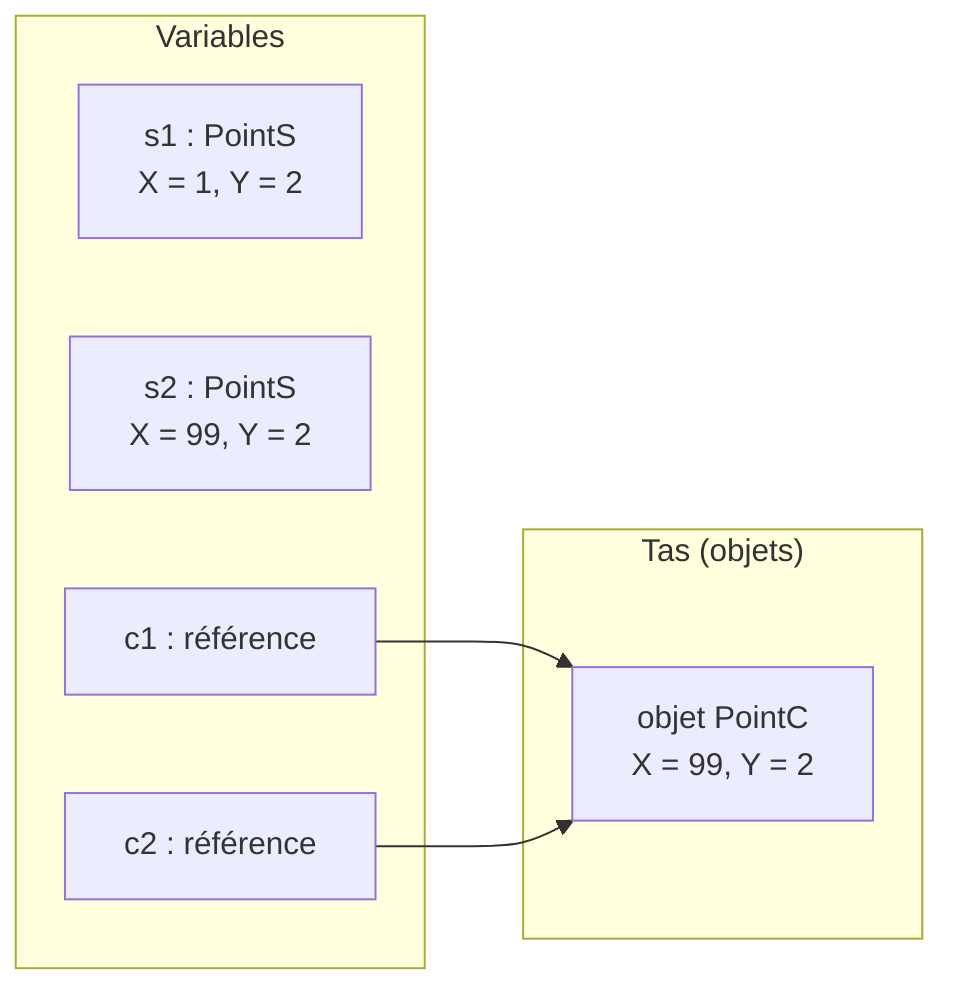

# 12. Types valeur et types référence

> 🎯 **À la fin de cette fiche, vous savez expliquer :**
> * la différence entre `class`, `struct` et `record` ;
> * ce qui est réellement copié lors d’une affectation ou d’un passage de paramètre ;
> * pourquoi `transform.position.x = 5;` ne compile pas dans Unity ;
> * quand comparer avec `==` donne `true`… ou pas.
>
> ⏱️ 25 min · Prérequis : [1. Classe et Objet](<../Partie I — Les Fondamentaux/1. Classe et Objet.md>), [3. Constructeurs](<../Partie I — Les Fondamentaux/3. Constructeurs.md>)

---

## Objectif

Comprendre comment C# stocke et copie les données. C’est la notion qui explique le plus de bugs « mystérieux » chez les débutants : un objet modifié « tout seul », une modification qui « ne marche pas », deux objets identiques qui ne sont « pas égaux ».

---

## Deux familles de types

En C#, chaque type appartient à l’une de deux familles :

| | **Type valeur** | **Type référence** |
| --- | --- | --- |
| Mots-clés | `struct`, `enum`, `record struct` | `class`, `interface`, `delegate`, `record` (ou `record class`) |
| Exemples du framework | `int`, `float`, `bool`, `DateTime` ; dans Unity `Vector3`, `Quaternion`, `Color` | `string`, `List<T>`, tableaux ; dans Unity `GameObject`, `Transform`, `MonoBehaviour` |
| La variable contient… | **la donnée elle-même** | **une référence** (une « adresse ») vers un objet |
| Une affectation `b = a` copie… | **toute la valeur** | **seulement la référence** : `a` et `b` désignent le même objet |
| Peut valoir `null` ? | Non (sauf `int?`, `Vector3?`…) | Oui |
| Durée de vie | Celle de la variable qui la contient | Gérée par le ramasse-miettes (*garbage collector*) |

### Ce qui se passe en mémoire



Les deux `struct` sont deux valeurs indépendantes. Les deux variables de type `class` pointent vers **le même objet**.

---

## L’affectation : copie de valeur ou copie de référence

```csharp
public struct PointS
{
    public int X;
    public int Y;
}

public class PointC
{
    public int X;
    public int Y;
}
```

```csharp
var s1 = new PointS { X = 1, Y = 2 };
var s2 = s1;   // copie de toute la valeur
s2.X = 99;
Console.WriteLine($"struct : s1.X = {s1.X}, s2.X = {s2.X}");

var c1 = new PointC { X = 1, Y = 2 };
var c2 = c1;   // copie de la référence : même objet
c2.X = 99;
Console.WriteLine($"class  : c1.X = {c1.X}, c2.X = {c2.X}");
```

**Sortie :**

```
struct : s1.X = 1, s2.X = 99
class  : c1.X = 99, c2.X = 99
```

La seule différence entre les deux blocs est le mot `struct` ou `class`, et le résultat change complètement.

---

## Le passage de paramètres

Par défaut, C# passe **toujours une copie** de ce que contient la variable. Pour un type valeur, c’est une copie de la donnée ; pour un type référence, c’est une copie de la **référence**.

```csharp
public class Joueur
{
    public string Nom;
    public int PointsDeVie;
}

static void SoignerValeur(int pv)
{
    pv += 10; // modifie une copie locale
}

static void SoignerParRef(ref int pv)
{
    pv += 10; // modifie la variable de l’appelant
}

static void SoignerJoueur(Joueur joueur)
{
    joueur.PointsDeVie += 10; // modifie l’objet partagé
}

static void RemplacerJoueur(Joueur joueur)
{
    joueur = new Joueur { Nom = "Remplaçant", PointsDeVie = 999 }; // ne change que la copie de la référence
}
```

```csharp
int pv = 50;
SoignerValeur(pv);
Console.WriteLine($"Après SoignerValeur : {pv}");

SoignerParRef(ref pv);
Console.WriteLine($"Après SoignerParRef : {pv}");

var arthur = new Joueur { Nom = "Arthur", PointsDeVie = 50 };
SoignerJoueur(arthur);
Console.WriteLine($"Après SoignerJoueur : {arthur.PointsDeVie}");

RemplacerJoueur(arthur);
Console.WriteLine($"Après RemplacerJoueur : {arthur.Nom}");
```

**Sortie :**

```
Après SoignerValeur : 50
Après SoignerParRef : 60
Après SoignerJoueur : 60
Après RemplacerJoueur : Arthur
```

> [!NOTE]
> `RemplacerJoueur` est le cas le plus piégeux : la méthode reçoit une **copie de la référence**. Elle peut modifier l’objet pointé, mais réaffecter son paramètre n’a aucun effet sur la variable de l’appelant. Pour cela, il faudrait `ref Joueur joueur`.

---

## L’égalité : `==` ne veut pas toujours dire « identique »

* Pour une `class`, `==` compare par défaut les **références** : deux objets distincts aux contenus identiques ne sont **pas** égaux.
* Pour un `record`, le compilateur génère une égalité **par valeur** : deux records aux contenus identiques sont égaux.

```csharp
public record Stats(int Vie, int Force);
```

```csharp
var p1 = new PointC { X = 1, Y = 2 };
var p2 = new PointC { X = 1, Y = 2 };
Console.WriteLine($"class  : p1 == p2 → {p1 == p2}");

var a = new Stats(100, 10);
var b = new Stats(100, 10);
Console.WriteLine($"record : a == b → {a == b}");
Console.WriteLine(a);
```

**Sortie :**

```
class  : p1 == p2 → False
record : a == b → True
Stats { Vie = 100, Force = 10 }
```

Un `record` génère aussi un `ToString()` lisible et supporte l’expression `with` (voir la fiche [3. Builder](<../../Chapitre 2/Partie I — Patterns Créationnels/3. Builder.md>)).

---

## Choisir entre `class`, `struct` et `record`

| Situation | Choix conseillé |
| --- | --- |
| Une entité qui a une **identité** et un état qui évolue (un joueur, un ennemi, un inventaire) | `class` |
| Une petite valeur **immuable**, définie uniquement par son contenu (un montant, des coordonnées, une couleur) | `readonly struct` ou `record struct` |
| Une donnée immuable un peu plus riche, comparée par contenu (des statistiques, un message, une configuration) | `record` |
| Un objet gros ou souvent passé en paramètre | `class` (copier une grosse `struct` coûte cher) |

> [!TIP]
> Règle de Microsoft : une `struct` devrait être **petite** (16 octets environ), **immuable** et représenter **une seule valeur logique**. Dans le doute, choisissez `class`.

---

## Dans Unity

Les types mathématiques d’Unity (`Vector3`, `Quaternion`, `Color`, `Rect`…) sont des **struct**. Ce choix évite des millions d’allocations par seconde, mais il a une conséquence que tout développeur Unity rencontre :

```csharp
transform.position.x = 5f; // ❌ erreur CS1612
```

`transform.position` est une **propriété** : la lire renvoie une **copie** du `Vector3`. Modifier la copie n’aurait aucun effet, donc le compilateur l’interdit. Il faut lire, modifier, puis réaffecter :

```csharp
Vector3 position = transform.position; // copie
position.x = 5f;                       // modification de la copie
transform.position = position;         // réaffectation : le setter met à jour le Transform
```

Le même piège existe avec les listes de `struct` : `liste[0].X = 5;` ne compile pas, car l’indexeur d’une `List<T>` renvoie une copie. Un **tableau**, lui, donne accès directement à l’élément : `tableau[0].X = 5;` fonctionne.

À l’inverse, `GameObject`, `Transform` et tous les composants sont des **class** : passer un `GameObject` à une méthode permet de le modifier directement.

> [!WARNING]
> Les objets Unity ont un `==` **redéfini** : un `GameObject` détruit avec `Destroy()` est considéré comme égal à `null`, alors que la référence C# existe toujours. C’est pourquoi on écrit `if (cible != null)` plutôt que `cible?.Methode()` avec les objets Unity : les opérateurs `?.` et `??` ne passent pas par ce `==` redéfini.

---

## ⚠️ Pièges courants

* **Modifier une copie sans le savoir** : une variable locale copiée depuis une autre `struct`, ou une `struct` passée en paramètre sans `ref`. Le compilateur bloque les cas les plus flagrants (propriété, élément de `List<T>`, variable de `foreach`), mais pas ceux-là.
* **Partager un objet sans le savoir** : deux variables `class` qui pointent vers le même inventaire, modifié « tout seul ».
* **Comparer deux `class` avec `==`** en espérant comparer leur contenu.
* **Créer des `struct` mutables** : la source de presque tous les pièges ci-dessus. Préférer `readonly struct`.

## 🔀 À ne pas confondre

* **Type valeur / type référence** (ce que contient la variable) et **pile / tas** (où la mémoire est allouée). Une `struct` stockée dans un champ de classe vit sur le tas, avec l’objet qui la contient. Raisonner en « copie de valeur » ou « copie de référence » est plus fiable que raisonner en « pile » et « tas ».
* **`ref`** (passer la variable elle-même) et **type référence** (la variable contient une référence) : ce sont deux notions indépendantes.

---

## 🧪 Exercice

Sans exécuter le code, prédisez les cinq lignes affichées. Vérifiez ensuite votre réponse.

```csharp
var e1 = new PointS { X = 5 };
var e2 = e1;
e2.X++;

var j1 = new Joueur { Nom = "Lancelot", PointsDeVie = 100 };
var j2 = j1;
j2.PointsDeVie -= 30;

var tableau = new[] { e1, e2 };
tableau[0].X = 42;

Console.WriteLine($"{e1.X} {e2.X}");
Console.WriteLine($"{j1.PointsDeVie} {j2.PointsDeVie}");
Console.WriteLine($"{tableau[0].X} {e1.X}");
Console.WriteLine(new Stats(1, 2) == new Stats(1, 2));
Console.WriteLine(ReferenceEquals(j1, j2));
```

<details>
<summary>Voir la solution</summary>

```
5 6
70 70
42 5
True
True
```

* `e2` est une copie de `e1` : seul `e2` est incrémenté.
* `j1` et `j2` désignent le même joueur.
* Le tableau contient des **copies** de `e1` et `e2` : modifier `tableau[0]` ne touche pas `e1`.
* Deux records au contenu identique sont égaux.
* `ReferenceEquals` confirme que `j1` et `j2` sont le même objet.

</details>

---

## ✅ Récap

| Question | `struct` | `class` | `record` |
| --- | --- | --- | --- |
| Affectation | copie la valeur | copie la référence | copie la référence |
| `==` par défaut | à définir soi-même | compare les références | compare les contenus |
| `null` possible | non | oui | oui |
| Cas d’usage | petites valeurs immuables | entités avec identité | données immuables |

---

## Références utiles

* [Microsoft Learn — Types valeur](https://learn.microsoft.com/fr-fr/dotnet/csharp/language-reference/builtin-types/value-types)
* [Microsoft Learn — Records](https://learn.microsoft.com/fr-fr/dotnet/csharp/fundamentals/types/records)
* [Microsoft Learn — Choisir entre classe et structure](https://learn.microsoft.com/fr-fr/dotnet/standard/design-guidelines/choosing-between-class-and-struct)
* Skeet, Jon. *C# in Depth*, 4th ed., Manning, 2019.

---

[← Précédent : 11. Principes SOLID](<../Partie III — Concepts Avancés/11. Principes SOLID.md>) · [Sommaire](<../../README.md>) · [Suivant : 13. Membres statiques, énumérations et namespaces →](<13. Membres statiques, énumérations et namespaces.md>)
