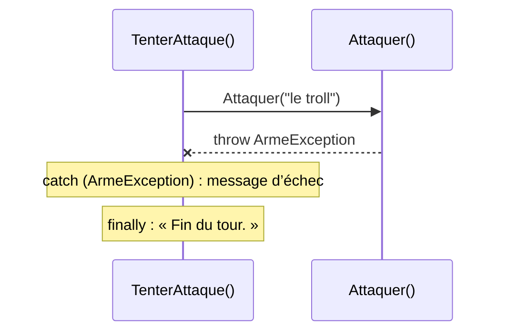

# 14. Exceptions

> 🎯 **À la fin de cette fiche, vous savez expliquer :**
> * comment lever, intercepter et propager une exception (`throw`, `try`, `catch`, `finally`) ;
> * quand créer sa propre classe d’exception ;
> * quand préférer une méthode `TryXxx` qui renvoie `bool` ;
> * le lien entre exceptions et encapsulation.
>
> ⏱️ 25 min · Prérequis : [4. Encapsulation](<../Partie II — Les 4 piliers de la POO/4. Encapsulation.md>), [6. Héritage](<../Partie II — Les 4 piliers de la POO/6. Héritage.md>)

---

## Objectif

Savoir **signaler une erreur** de façon claire et la **traiter** au bon endroit. Les exceptions sont l’outil qui permet à un objet de **refuser un état invalide**, ce qui en fait le prolongement naturel de l’encapsulation.

---

## Le principe

Une **exception** est un objet qui décrit une erreur. Quand une méthode ne peut pas faire ce qu’on lui demande, elle **lève** une exception avec `throw`. L’exécution s’interrompt immédiatement et l’exception **remonte** la pile d’appels jusqu’au premier `catch` capable de la traiter. Si personne ne l’intercepte, le programme s’arrête.



---

## Lever une exception

On lève une exception quand **l’appelant** a fait une demande impossible ou invalide. .NET fournit des exceptions standards à réutiliser :

| Exception | Quand l’utiliser |
| --- | --- |
| `ArgumentNullException` | Un paramètre obligatoire vaut `null`. |
| `ArgumentOutOfRangeException` | Un paramètre est hors de la plage autorisée (dégâts négatifs, index trop grand). |
| `ArgumentException` | Un paramètre est invalide pour une autre raison. |
| `InvalidOperationException` | L’objet n’est pas dans un état qui permet cette opération (attaquer alors qu’on est mort). |
| `NotSupportedException` | L’opération n’est pas supportée par ce type. |

Quand aucune exception standard ne décrit bien l’erreur **métier**, on crée la sienne en héritant de `Exception` :

```csharp
public class ArmeException : Exception
{
    public ArmeException(string message) : base(message) { }
}
```

```csharp
public class Guerrier
{
    public string Nom { get; }
    public bool ArmeDegainee { get; private set; }

    public Guerrier(string nom) => Nom = nom;

    public void Degainer()
    {
        ArmeDegainee = true;
        Console.WriteLine($"{Nom} dégaine son épée.");
    }

    public void Attaquer(string cible)
    {
        if (string.IsNullOrWhiteSpace(cible))
            throw new ArgumentException("La cible est obligatoire.", nameof(cible));

        if (!ArmeDegainee)
            throw new ArmeException($"{Nom} n’a pas dégainé son arme !");

        Console.WriteLine($"{Nom} attaque {cible} !");
    }
}
```

---

## Intercepter une exception

```csharp
public void TenterAttaque(string cible)
{
    try
    {
        Attaquer(cible);                              // code qui peut échouer
    }
    catch (ArmeException ex)                          // traite UNIQUEMENT ce type d’erreur
    {
        Console.WriteLine($"Échec : {ex.Message}");
    }
    finally                                           // exécuté dans tous les cas
    {
        Console.WriteLine("Fin du tour.");
    }
}
```

```csharp
var conan = new Guerrier("Conan");
conan.TenterAttaque("le troll");
conan.Degainer();
conan.TenterAttaque("le troll");
```

**Sortie :**

```
Échec : Conan n’a pas dégainé son arme !
Fin du tour.
Conan dégaine son épée.
Conan attaque le troll !
Fin du tour.
```

Quelques règles :

* **Intercepter le type le plus précis possible.** `catch (Exception)` attrape tout, y compris les vrais bugs qu’on aurait voulu voir.
* **Ne pas « avaler » une exception** avec un `catch { }` vide : l’erreur disparaît sans laisser de trace.
* **Pour relancer**, écrire `throw;` et non `throw ex;`, qui efface la pile d’appels d’origine et rend le débogage beaucoup plus difficile.
* **`finally`** sert à libérer une ressource quoi qu’il arrive. Pour les objets `IDisposable` (fichiers, flux), l’instruction `using` le fait automatiquement.

---

## Exception ou `TryXxx` ?

Une exception doit rester **exceptionnelle**. Quand l’échec est un cas **normal et fréquent** (le joueur n’a plus de potion, la saisie n’est pas un nombre), on préfère une méthode `TryXxx` qui renvoie un `bool`, sur le modèle de `int.TryParse` :

```csharp
public class Inventaire
{
    private readonly Dictionary<string, int> quantites = new() { ["Potion"] = 1 };

    public bool TryUtiliser(string objet)
    {
        if (!quantites.TryGetValue(objet, out int quantite) || quantite == 0)
            return false;

        quantites[objet] = quantite - 1;
        return true;
    }
}
```

```csharp
var inventaire = new Inventaire();
Console.WriteLine(inventaire.TryUtiliser("Potion")); // True
Console.WriteLine(inventaire.TryUtiliser("Potion")); // False : plus de potion, ce n’est pas un bug

if (int.TryParse("42", out int niveau))
    Console.WriteLine($"Niveau {niveau}");           // Niveau 42
```

| Situation | Choix |
| --- | --- |
| L’appelant a commis une **erreur de programmation** (paramètre invalide) | Exception |
| L’objet ne peut pas garantir ses **invariants** | Exception |
| L’échec est un **résultat attendu** que l’appelant doit gérer | `TryXxx` qui renvoie `bool` |

> [!TIP]
> Les exceptions sont la meilleure alliée de l’**encapsulation** : plutôt que d’ignorer silencieusement une valeur invalide (voir la fiche [4. Encapsulation](<../Partie II — Les 4 piliers de la POO/4. Encapsulation.md>)), l’objet la **refuse** en levant une exception. L’erreur est visible immédiatement, au bon endroit, au lieu de se transformer en bug plus loin.

---

## Dans Unity

* **Une exception ne fait pas planter le jeu.** Si une exception non interceptée est levée dans `Update()`, Unity l’affiche dans la Console et **arrête l’exécution de cette méthode** pour cette frame. À la frame suivante, `Update()` est rappelée et l’exception se reproduit : la Console se remplit de la même erreur, et la fin de la méthode n’est jamais exécutée.
* **`Debug.LogException(ex)`** affiche une exception interceptée avec sa pile d’appels complète et un lien cliquable vers la ligne fautive.
* **Performances :** lever une exception est coûteux. On ne s’en sert jamais comme mécanisme de contrôle « normal » dans du code appelé à chaque frame.
* **`NullReferenceException`** et **`MissingReferenceException`** (accès à un objet détruit) sont les deux erreurs les plus fréquentes dans Unity. Elles signalent presque toujours une référence non assignée dans l’Inspector ou un objet utilisé après `Destroy()`.

---

## ⚠️ Pièges courants

* **`catch (Exception)` partout**, « pour être tranquille » : les vrais bugs deviennent invisibles.
* **Utiliser les exceptions pour le déroulement normal** d’un programme (tester si une clé existe en attrapant `KeyNotFoundException`) : lent et illisible. Préférer `TryGetValue`.
* **`throw ex;`** au lieu de `throw;` : la pile d’appels d’origine est perdue.
* **Message d’erreur vague** (« Erreur ») : un bon message dit *ce qui* a échoué et *pourquoi*.

## 🔀 À ne pas confondre

* **Exception** (erreur signalée à l’exécution) et **erreur de compilation** (le code ne compile pas). Une exception signale un problème que le compilateur ne pouvait pas détecter.
* **`finally`** (exécuté dans tous les cas) et **`catch`** (exécuté seulement en cas d’erreur du type indiqué).

---

## 🧪 Exercice : le stock de la boulangerie

Écrivez une classe `Stock` qui gère des quantités de produits (`Dictionary<string, int>`) avec :

* `Ajouter(string produit, int quantite)` : lève une `ArgumentOutOfRangeException` si la quantité n’est pas strictement positive ;
* `Quantite(string produit)` : renvoie 0 pour un produit inconnu ;
* `TryPrendre(string produit)` : retire une unité et renvoie `true`, ou renvoie `false` s’il n’y en a plus ;
* `Prendre(string produit)` : comme `TryPrendre`, mais lève une `ProduitIndisponibleException` (à créer, avec une propriété `Produit`) en cas d’échec.

**Contraintes :** un stock ne doit **jamais** devenir négatif, et `Prendre` doit réutiliser `TryPrendre`.

**Test attendu :**

```csharp
var stock = new Stock();
stock.Ajouter("Croissant", 2);

stock.Prendre("Croissant");
Console.WriteLine($"Croissants restants : {stock.Quantite("Croissant")}");
Console.WriteLine(stock.TryPrendre("Croissant"));
Console.WriteLine(stock.TryPrendre("Croissant"));

try
{
    stock.Prendre("Baguette");
}
catch (ProduitIndisponibleException ex)
{
    Console.WriteLine($"Erreur : {ex.Message}");
}

try
{
    stock.Ajouter("Éclair", -3);
}
catch (ArgumentOutOfRangeException ex)
{
    Console.WriteLine($"Erreur : {ex.ParamName}");
}
```

```
Croissants restants : 1
True
False
Erreur : Plus de « Baguette » en stock.
Erreur : quantite
```

<details>
<summary>Voir la solution</summary>

```csharp
public class ProduitIndisponibleException : Exception
{
    public string Produit { get; }

    public ProduitIndisponibleException(string produit)
        : base($"Plus de « {produit} » en stock.")
    {
        Produit = produit;
    }
}

public class Stock
{
    private readonly Dictionary<string, int> quantites = new();

    public void Ajouter(string produit, int quantite)
    {
        if (quantite <= 0)
            throw new ArgumentOutOfRangeException(nameof(quantite), "La quantité doit être positive.");

        quantites[produit] = Quantite(produit) + quantite;
    }

    public int Quantite(string produit)
        => quantites.TryGetValue(produit, out int quantite) ? quantite : 0;

    public void Prendre(string produit)
    {
        if (!TryPrendre(produit))
            throw new ProduitIndisponibleException(produit);
    }

    public bool TryPrendre(string produit)
    {
        int quantite = Quantite(produit);
        if (quantite == 0)
            return false;

        quantites[produit] = quantite - 1;
        return true;
    }
}
```

</details>

---

## ✅ Récap

| Mot-clé | Rôle |
| --- | --- |
| `throw` | Lève une exception |
| `try` | Délimite le code qui peut échouer |
| `catch (Type ex)` | Traite un type d’exception précis |
| `finally` | S’exécute dans tous les cas |
| `throw;` | Relance l’exception en cours sans perdre la pile d’appels |
| `TryXxx(out …)` | Alternative sans exception pour les échecs attendus |

---

## Références utiles

* [Microsoft Learn — Exceptions et gestion des exceptions](https://learn.microsoft.com/fr-fr/dotnet/csharp/fundamentals/exceptions/)
* [Microsoft Learn — Bonnes pratiques pour les exceptions](https://learn.microsoft.com/fr-fr/dotnet/standard/exceptions/best-practices-for-exceptions)
* [Unity Scripting API — Debug.LogException](https://docs.unity3d.com/ScriptReference/Debug.LogException.html)

---

[← Précédent : 13. Membres statiques, énumérations et namespaces](<13. Membres statiques, énumérations et namespaces.md>) · [Sommaire](<../../README.md>) · [Suivant : 15. Génériques →](<15. Génériques.md>)
