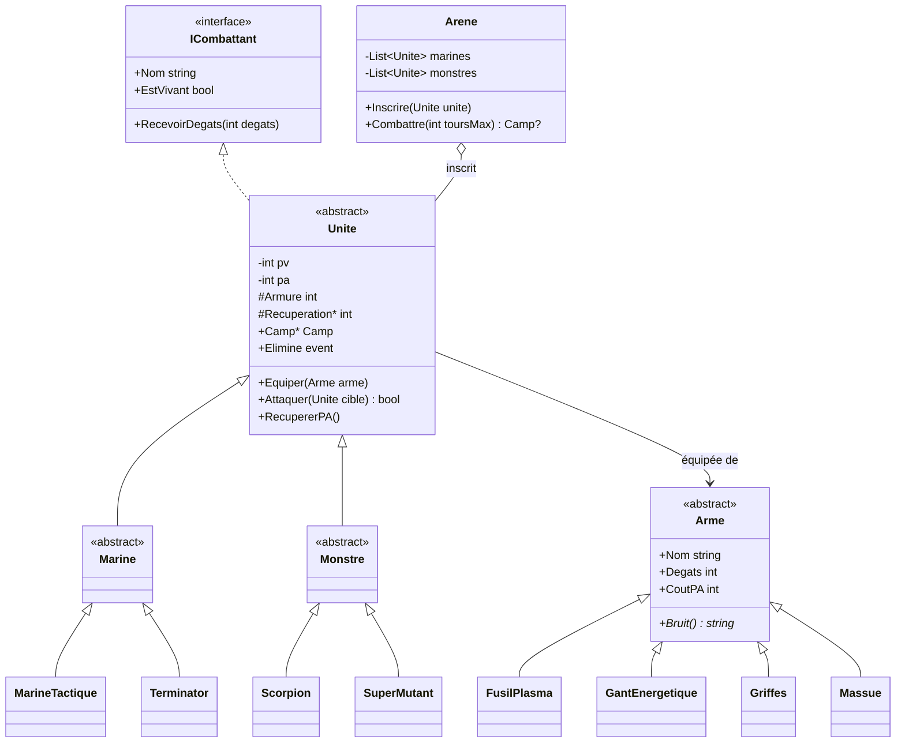

# Projet du chapitre 1 — L’arène spatiale

> 🎯 **Ce projet vous fait utiliser ensemble :**
> * une interface, des classes abstraites et une hiérarchie d’héritage sur trois niveaux ;
> * le polymorphisme (armes, unités, récupération d’énergie) ;
> * l’encapsulation (PV et points d’action protégés, invariants) ;
> * un membre statique (numérotation automatique), une énumération, des exceptions et un événement.
>
> ⏱️ 3 à 4 h · Prérequis : tout le [chapitre 1](<Chapitre 1 — Introduction à la Programmation Orientée Objet.md>)

---

## Le cahier des charges

Dans une arène perdue aux confins de la galaxie, des **marines** affrontent des **monstres** au tour par tour.

* Chaque **unité** a un nom numéroté automatiquement (« Marine #1 », « Marine #2 »…), des **points de vie** (PV), des **points d’action** (PA), une **armure** et une **arme**.
* Chaque **arme** a des dégâts, un coût en PA et un bruit caractéristique.
* Attaquer coûte les PA de l’arme. Sans assez de PA, l’unité est « à bout de souffle » et passe son tour. À la fin de chaque tour, chaque unité récupère des PA, selon son type.
* L’**armure** absorbe une partie des dégâts, mais une attaque inflige toujours au moins 1 PV.
* L’**arène** fait combattre les deux camps : à chaque tour, le premier marine encore debout frappe le premier monstre, puis le premier monstre riposte. Une unité éliminée quitte l’arène. Le combat s’arrête quand un camp est vide.

Le projet reprend l’esprit du *Space Arena* de la piscine Java, adapté à C#.

---

## Vue d’ensemble



---

## Étape 1 — Les armes

Écrivez :

* une énumération `Camp` (`Marines`, `Monstres`) et une interface `ICombattant` (`Nom`, `EstVivant`, `RecevoirDegats(int)`) ;
* une classe abstraite `Arme` avec `Nom`, `Degats` et `CoutPA` en lecture seule, un constructeur `protected` et une méthode abstraite `Bruit()` ;
* quatre armes :

| Arme | Nom affiché | Dégâts | Coût en PA | Bruit |
| --- | --- | --- | --- | --- |
| `FusilPlasma` | son fusil à plasma | 21 | 5 | Bzziou ! |
| `GantEnergetique` | son gant énergétique | 50 | 10 | Vrrr… BAM ! |
| `Griffes` | ses griffes | 14 | 4 | Shrrk ! |
| `Massue` | sa massue | 30 | 8 | Bonk ! |

**Test de l’étape :**

```csharp
Arme[] armes = { new FusilPlasma(), new GantEnergetique(), new Griffes(), new Massue() };
foreach (var arme in armes)
    Console.WriteLine($"{arme.Nom} : {arme.Degats} dégâts, {arme.CoutPA} PA, {arme.Bruit()}");
```

```
son fusil à plasma : 21 dégâts, 5 PA, Bzziou !
son gant énergétique : 50 dégâts, 10 PA, Vrrr… BAM !
ses griffes : 14 dégâts, 4 PA, Shrrk !
sa massue : 30 dégâts, 8 PA, Bonk !
```

---

## Étape 2 — Les unités

Écrivez la classe abstraite `Unite`, qui implémente `ICombattant` :

* **Constructeur `protected`** `Unite(string type, int pvMax, int paMax, int armure)`. Le nom est construit automatiquement : `"<type> #<numéro>"`, avec un compteur **par type**, partagé par toutes les unités (indice : un `Dictionary<string, int>` statique).
* **Encapsulation :** `Pv` et `Pa` sont lisibles mais **jamais** modifiables de l’extérieur. `Armure` est `protected`.
* `Equiper(Arme)` : lève une `ArgumentNullException` si l’arme est `null`.
* `RecevoirDegats(int)` : refuse les dégâts négatifs ; ne fait rien si l’unité est déjà morte ; retire `max(1, dégâts - armure)` PV sans descendre sous 0 ; affiche `  <Nom> perd <n> PV (<pv>/<pvMax>)`, puis `  <Nom> est éliminé !` et déclenche l’événement `Elimine` si les PV tombent à 0.
* `Attaquer(Unite cible)` renvoie `true` si l’attaque a eu lieu :
  * s’attaquer soi-même lève une `InvalidOperationException` ;
  * sans arme : `<Nom> n’a pas d’arme.` ;
  * sans assez de PA : `<Nom> est à bout de souffle (<pa> PA).` ;
  * sinon : retire le coût en PA, affiche `<Nom> attaque <cible> avec <arme> : <bruit>`, puis inflige les dégâts.
* `RecupererPA()` ajoute une propriété abstraite `Recuperation` aux PA, sans dépasser le maximum.
* Une propriété abstraite `Camp`.

---

## Étape 3 — Les deux camps

* Deux classes abstraites `Marine` et `Monstre` fixent le `Camp`.
* Quatre unités concrètes, chacune équipée de son arme dans son constructeur :

| Unité | Camp | Type affiché | PV | PA | Armure | Récupération | Arme |
| --- | --- | --- | --- | --- | --- | --- | --- |
| `MarineTactique` | Marines | Marine | 100 | 20 | 3 | 9 | Fusil à plasma |
| `Terminator` | Marines | Terminator | 150 | 30 | 6 | 6 | Gant énergétique |
| `Scorpion` | Monstres | Scorpion | 80 | 20 | 0 | 6 | Griffes |
| `SuperMutant` | Monstres | Super-mutant | 170 | 20 | 2 | 4 | Massue |

**Test des étapes 2 et 3 :**

```csharp
var marine1 = new MarineTactique();
var marine2 = new MarineTactique();
var scorpion = new Scorpion();
Console.WriteLine($"{marine1.Nom}, {marine2.Nom}, {scorpion.Nom}");

marine1.Attaquer(scorpion);
scorpion.RecevoirDegats(100);
Console.WriteLine($"{scorpion.Nom} vivant : {scorpion.EstVivant}");

try
{
    marine1.Attaquer(marine1);
}
catch (InvalidOperationException ex)
{
    Console.WriteLine(ex.Message);
}

for (int i = 0; i < 5; i++)
    marine2.Attaquer(marine1);
```

```
Marine #1, Marine #2, Scorpion #1
Marine #1 attaque Scorpion #1 avec son fusil à plasma : Bzziou !
  Scorpion #1 perd 21 PV (59/80)
  Scorpion #1 perd 100 PV (0/80)
  Scorpion #1 est éliminé !
Scorpion #1 vivant : False
Marine #1 ne peut pas s’attaquer lui-même.
Marine #2 attaque Marine #1 avec son fusil à plasma : Bzziou !
  Marine #1 perd 18 PV (82/100)
Marine #2 attaque Marine #1 avec son fusil à plasma : Bzziou !
  Marine #1 perd 18 PV (64/100)
Marine #2 attaque Marine #1 avec son fusil à plasma : Bzziou !
  Marine #1 perd 18 PV (46/100)
Marine #2 attaque Marine #1 avec son fusil à plasma : Bzziou !
  Marine #1 perd 18 PV (28/100)
Marine #2 est à bout de souffle (0 PA).
```

---

## Étape 4 — L’arène

Écrivez la classe `Arene` :

* `Inscrire(Unite)` : refuse une unité déjà morte (`ArgumentException`), la range dans la liste de son camp, **s’abonne** à son événement `Elimine` et affiche `<Nom> entre dans l’arène.` ;
* quand une unité est éliminée, l’arène la retire de sa liste et se désabonne ;
* `Combattre(int toursMax = 20)` : tant que les deux camps ont des combattants (et dans la limite des tours), affiche `--- Tour <n> ---`, fait attaquer le premier marine, puis (si le combat continue) le premier monstre, et enfin fait récupérer leurs PA à toutes les unités. À la fin, affiche `Victoire des <camp> !` ou `Match nul : temps écoulé.` et renvoie le camp vainqueur (ou `null`).

**Contrainte :** l’arène ne teste jamais le type concret d’une unité (`is MarineTactique`…). Elle ne connaît que `Unite` et `Camp`.

---

## Scénario final

```csharp
var arene = new Arene();
arene.Inscrire(new MarineTactique());
arene.Inscrire(new Terminator());
arene.Inscrire(new Scorpion());
arene.Inscrire(new SuperMutant());

arene.Combattre();
```

```
Marine #1 entre dans l’arène.
Terminator #1 entre dans l’arène.
Scorpion #1 entre dans l’arène.
Super-mutant #1 entre dans l’arène.
--- Tour 1 ---
Marine #1 attaque Scorpion #1 avec son fusil à plasma : Bzziou !
  Scorpion #1 perd 21 PV (59/80)
Scorpion #1 attaque Marine #1 avec ses griffes : Shrrk !
  Marine #1 perd 11 PV (89/100)
--- Tour 2 ---
Marine #1 attaque Scorpion #1 avec son fusil à plasma : Bzziou !
  Scorpion #1 perd 21 PV (38/80)
Scorpion #1 attaque Marine #1 avec ses griffes : Shrrk !
  Marine #1 perd 11 PV (78/100)
--- Tour 3 ---
Marine #1 attaque Scorpion #1 avec son fusil à plasma : Bzziou !
  Scorpion #1 perd 21 PV (17/80)
Scorpion #1 attaque Marine #1 avec ses griffes : Shrrk !
  Marine #1 perd 11 PV (67/100)
--- Tour 4 ---
Marine #1 attaque Scorpion #1 avec son fusil à plasma : Bzziou !
  Scorpion #1 perd 21 PV (0/80)
  Scorpion #1 est éliminé !
Super-mutant #1 attaque Marine #1 avec sa massue : Bonk !
  Marine #1 perd 27 PV (40/100)
--- Tour 5 ---
Marine #1 attaque Super-mutant #1 avec son fusil à plasma : Bzziou !
  Super-mutant #1 perd 19 PV (151/170)
Super-mutant #1 attaque Marine #1 avec sa massue : Bonk !
  Marine #1 perd 27 PV (13/100)
--- Tour 6 ---
Marine #1 attaque Super-mutant #1 avec son fusil à plasma : Bzziou !
  Super-mutant #1 perd 19 PV (132/170)
Super-mutant #1 attaque Marine #1 avec sa massue : Bonk !
  Marine #1 perd 27 PV (0/100)
  Marine #1 est éliminé !
--- Tour 7 ---
Terminator #1 attaque Super-mutant #1 avec son gant énergétique : Vrrr… BAM !
  Super-mutant #1 perd 48 PV (84/170)
Super-mutant #1 attaque Terminator #1 avec sa massue : Bonk !
  Terminator #1 perd 24 PV (126/150)
--- Tour 8 ---
Terminator #1 attaque Super-mutant #1 avec son gant énergétique : Vrrr… BAM !
  Super-mutant #1 perd 48 PV (36/170)
Super-mutant #1 est à bout de souffle (4 PA).
--- Tour 9 ---
Terminator #1 attaque Super-mutant #1 avec son gant énergétique : Vrrr… BAM !
  Super-mutant #1 perd 48 PV (0/170)
  Super-mutant #1 est éliminé !
Victoire des Marines !
```

Observez le tour 8 : le super-mutant n’a plus assez de PA pour frapper et laisse le Terminator l’achever.

---

## Pour aller plus loin

* **Un soigneur :** une interface `ISoigneur` et une unité `Medic` qui soigne l’allié le plus blessé au lieu d’attaquer. Que faut-il modifier dans `Arene` ? (Indice : rien, si chaque unité décide elle-même de son action. C’est le [pattern Strategy](<../Chapitre 2/Partie III — Patterns Comportementaux/8. Strategy.md>) qui vous attend au chapitre 2.)
* **Le ciblage :** au lieu du « premier monstre », viser le plus faible ou le plus dangereux.
* **Des équipes de taille variable** et un tableau des scores (nombre d’éliminations par unité), mis à jour grâce à l’événement `Elimine`.

---

## ✅ Grille d’auto-évaluation

| Notion | Où la retrouver dans votre code |
| --- | --- |
| Interface | `ICombattant`, implémentée par `Unite` |
| Classe abstraite, méthode abstraite | `Arme.Bruit()`, `Unite.Recuperation`, `Unite.Camp` |
| Héritage sur trois niveaux | `Unite` → `Marine` → `MarineTactique` |
| Polymorphisme | `Arme.Bruit()`, `RecupererPA()` : aucun `if` sur le type |
| Encapsulation, invariants | `pv` et `pa` privés, jamais négatifs ni au-dessus du maximum |
| Membre statique | Compteur de noms par type |
| Énumération | `Camp` |
| Exceptions | Arme `null`, dégâts négatifs, auto-attaque, unité morte inscrite |
| Événement | `Elimine`, écouté par l’arène |

---

## Solution complète

<details>
<summary>Voir la solution</summary>

**Le socle et les armes**

```csharp
public enum Camp
{
    Marines,
    Monstres
}

public interface ICombattant
{
    string Nom { get; }
    bool EstVivant { get; }
    void RecevoirDegats(int degats);
}

// ---------- Les armes
public abstract class Arme
{
    public string Nom { get; }
    public int Degats { get; }
    public int CoutPA { get; }

    protected Arme(string nom, int degats, int coutPA)
    {
        Nom = nom;
        Degats = degats;
        CoutPA = coutPA;
    }

    public abstract string Bruit();
}

public class FusilPlasma : Arme
{
    public FusilPlasma() : base("son fusil à plasma", 21, 5) { }
    public override string Bruit() => "Bzziou !";
}

public class GantEnergetique : Arme
{
    public GantEnergetique() : base("son gant énergétique", 50, 10) { }
    public override string Bruit() => "Vrrr… BAM !";
}

public class Griffes : Arme
{
    public Griffes() : base("ses griffes", 14, 4) { }
    public override string Bruit() => "Shrrk !";
}

public class Massue : Arme
{
    public Massue() : base("sa massue", 30, 8) { }
    public override string Bruit() => "Bonk !";
}
```

**Les unités**

```csharp
public abstract class Unite : ICombattant
{
    private static readonly Dictionary<string, int> compteurs = new();

    private int pv;
    private int pa;

    public string Nom { get; }
    public int PvMax { get; }
    public int PaMax { get; }
    public int Pv => pv;
    public int Pa => pa;
    public Arme Arme { get; private set; }
    public bool EstVivant => pv > 0;

    protected int Armure { get; }
    protected abstract int Recuperation { get; }
    public abstract Camp Camp { get; }

    public event Action<Unite> Elimine;

    protected Unite(string type, int pvMax, int paMax, int armure)
    {
        compteurs[type] = compteurs.GetValueOrDefault(type) + 1;
        Nom = $"{type} #{compteurs[type]}";
        PvMax = pvMax;
        PaMax = paMax;
        Armure = armure;
        pv = pvMax;
        pa = paMax;
    }

    public void Equiper(Arme arme)
    {
        Arme = arme ?? throw new ArgumentNullException(nameof(arme));
    }

    public void RecevoirDegats(int degats)
    {
        if (degats < 0)
            throw new ArgumentOutOfRangeException(nameof(degats), "Les dégâts ne peuvent pas être négatifs.");
        if (!EstVivant)
            return;

        int subis = Math.Max(1, degats - Armure);     // l’armure absorbe une partie, minimum 1
        pv = Math.Max(0, pv - subis);
        Console.WriteLine($"  {Nom} perd {subis} PV ({pv}/{PvMax})");

        if (!EstVivant)
        {
            Console.WriteLine($"  {Nom} est éliminé !");
            Elimine?.Invoke(this);
        }
    }

    public bool Attaquer(Unite cible)
    {
        if (cible == this)
            throw new InvalidOperationException($"{Nom} ne peut pas s’attaquer lui-même.");

        if (Arme == null)
        {
            Console.WriteLine($"{Nom} n’a pas d’arme.");
            return false;
        }

        if (pa < Arme.CoutPA)
        {
            Console.WriteLine($"{Nom} est à bout de souffle ({pa} PA).");
            return false;
        }

        pa -= Arme.CoutPA;
        Console.WriteLine($"{Nom} attaque {cible.Nom} avec {Arme.Nom} : {Arme.Bruit()}");
        cible.RecevoirDegats(Arme.Degats);
        return true;
    }

    public void RecupererPA() => pa = Math.Min(PaMax, pa + Recuperation);
}
```

**Les deux camps**

```csharp
public abstract class Marine : Unite
{
    protected Marine(string type, int pvMax, int paMax, int armure) : base(type, pvMax, paMax, armure) { }
    public override Camp Camp => Camp.Marines;
}

public abstract class Monstre : Unite
{
    protected Monstre(string type, int pvMax, int paMax, int armure) : base(type, pvMax, paMax, armure) { }
    public override Camp Camp => Camp.Monstres;
}

public class MarineTactique : Marine
{
    public MarineTactique() : base("Marine", 100, 20, 3) => Equiper(new FusilPlasma());
    protected override int Recuperation => 9;
}

public class Terminator : Marine
{
    public Terminator() : base("Terminator", 150, 30, 6) => Equiper(new GantEnergetique());
    protected override int Recuperation => 6;
}

public class Scorpion : Monstre
{
    public Scorpion() : base("Scorpion", 80, 20, 0) => Equiper(new Griffes());
    protected override int Recuperation => 6;
}

public class SuperMutant : Monstre
{
    public SuperMutant() : base("Super-mutant", 170, 20, 2) => Equiper(new Massue());
    protected override int Recuperation => 4;
}
```

**L’arène**

```csharp
public class Arene
{
    private readonly List<Unite> marines = new();
    private readonly List<Unite> monstres = new();

    public void Inscrire(Unite unite)
    {
        if (!unite.EstVivant)
            throw new ArgumentException($"{unite.Nom} est déjà hors de combat.", nameof(unite));

        Equipe(unite.Camp).Add(unite);
        unite.Elimine += Retirer;
        Console.WriteLine($"{unite.Nom} entre dans l’arène.");
    }

    private List<Unite> Equipe(Camp camp) => camp == Camp.Marines ? marines : monstres;

    private void Retirer(Unite unite)
    {
        unite.Elimine -= Retirer;
        Equipe(unite.Camp).Remove(unite);
    }

    private bool CombatTermine => marines.Count == 0 || monstres.Count == 0;

    public Camp? Combattre(int toursMax = 20)
    {
        for (int tour = 1; tour <= toursMax && !CombatTermine; tour++)
        {
            Console.WriteLine($"--- Tour {tour} ---");

            marines[0].Attaquer(monstres[0]);       // les marines frappent en premier
            if (CombatTermine) break;

            monstres[0].Attaquer(marines[0]);

            foreach (var unite in marines.Concat(monstres))
                unite.RecupererPA();
        }

        Camp? vainqueur = marines.Count == 0 ? Camp.Monstres
                        : monstres.Count == 0 ? Camp.Marines
                        : null;

        Console.WriteLine(vainqueur is null ? "Match nul : temps écoulé." : $"Victoire des {vainqueur} !");
        return vainqueur;
    }
}
```

</details>

---

[← Précédent : 16. Délégués, événements et lambdas](<Partie IV — Les outils du langage/16. Délégués, événements et lambdas.md>) · [Sommaire](<../README.md>) · [Suivant : Conclusion du chapitre 1 →](<Conclusion du chapitre 1.md>)
