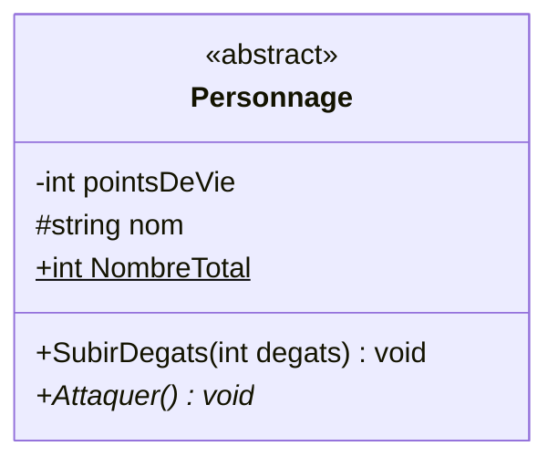
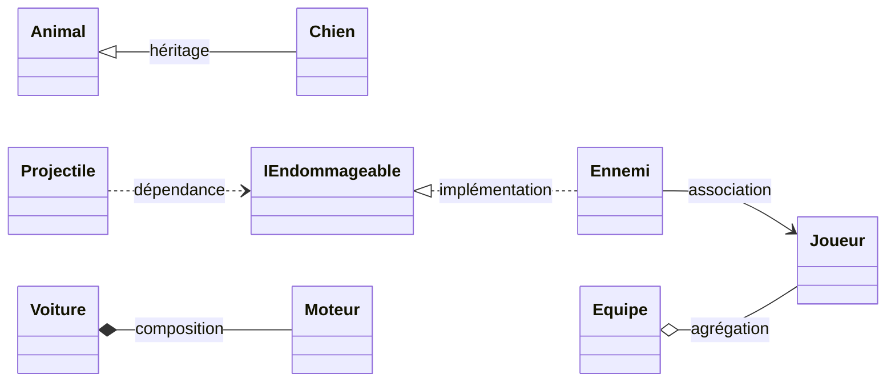
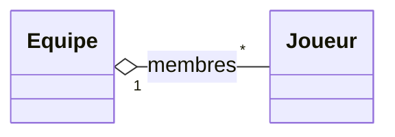
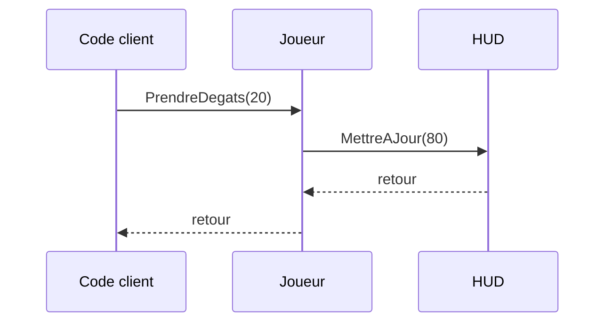
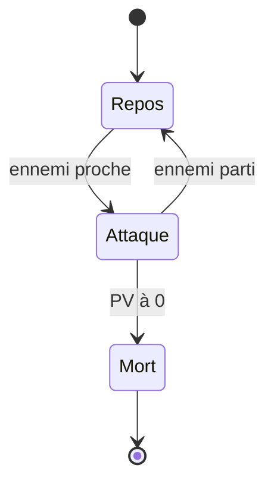

# Lire un diagramme UML

## Objectif

Savoir lire les diagrammes qui accompagnent chaque pattern de ce chapitre : la **boîte de classe**, les **symboles de visibilité** et les **six types de relations** entre classes. Cette fiche donne aussi les bases des diagrammes de séquence et d’états.

---

## Définition et explication

**UML** (*Unified Modeling Language*) est un langage graphique standardisé (par l’OMG, depuis 1997) pour décrire la structure et le comportement d’un logiciel. Il en existe une quinzaine de types, mais ce cours n’en utilise que trois :

| Diagramme | Ce qu’il montre | Utilisé pour |
| --- | --- | --- |
| **Diagramme de classes** | Les classes, leurs membres et leurs relations (vue *statique*). | Tous les patterns. |
| **Diagramme de séquence** | L’ordre des appels entre objets au fil du temps (vue *dynamique*). | Observer, Command, Facade… |
| **Diagramme d’états** | Les états d’un objet et les transitions entre eux. | State. |

Les diagrammes de ce cours sont écrits en **Mermaid**, un format texte que GitHub affiche directement sous forme de schéma.

> Un diagramme de classes n’est pas du code : il **résume** une conception. On n’y met que ce qui aide à comprendre, pas forcément tous les membres.

---

## La boîte de classe

Une classe est représentée par une boîte à **trois compartiments** :

1. le **nom** de la classe (avec éventuellement un *stéréotype* comme `«interface»` ou `«abstract»`) ;
2. les **attributs** (champs et propriétés), sous la forme `visibilité type nom` ;
3. les **méthodes**, sous la forme `visibilité nom(paramètres) typeDeRetour`.

```csharp
public abstract class Personnage
{
    private int pointsDeVie;
    protected string nom;
    public static int NombreTotal;

    public void SubirDegats(int degats) { /* ... */ }
    public abstract void Attaquer();
}
```



| Notation | Signification | En C# |
| --- | --- | --- |
| `«interface»` | La boîte est une interface. | `interface` |
| `«abstract»` ou nom en *italique* | Classe abstraite (non instanciable). | `abstract class` |
| Membre *en italique* (`*` en Mermaid) | Méthode abstraite. | `abstract` |
| Membre <ins>souligné</ins> (`$` en Mermaid) | Membre statique. | `static` |

---

## Les visibilités

Le symbole placé devant chaque membre indique sa visibilité :

| Symbole | Visibilité UML | Équivalent C# |
| --- | --- | --- |
| `+` | public | `public` |
| `-` | private | `private` |
| `#` | protected | `protected` |
| `~` | package | `internal` (le plus proche) |

> [!TIP]
> Un diagramme bien conçu montre surtout des `-` pour les attributs et des `+` pour les méthodes : c’est l’encapsulation qui se voit d’un coup d’œil.

---

## Les relations entre classes

Les flèches sont le cœur du diagramme : elles disent **comment les classes dépendent les unes des autres**. Il y en a six à connaître, de la plus forte à la plus faible.



| Relation | Trait | Mermaid | Se lit | En C# |
| --- | --- | --- | --- | --- |
| **Héritage** | plein, triangle vide vers la base | `Animal <\|-- Chien` | « `Chien` **est un** `Animal` » | `class Chien : Animal` |
| **Implémentation** | pointillé, triangle vide vers l’interface | `IEndommageable <\|.. Ennemi` | « `Ennemi` **sait faire** ce que promet `IEndommageable` » | `class Ennemi : IEndommageable` |
| **Association** | plein, flèche simple | `Ennemi --> Joueur` | « `Ennemi` **connaît** un `Joueur` » | un champ `private Joueur cible;` |
| **Agrégation** | plein, losange **vide** côté conteneur | `Equipe o-- Joueur` | « `Equipe` **regroupe** des `Joueur` qui existent sans elle » | une liste remplie depuis l’extérieur |
| **Composition** | plein, losange **plein** côté conteneur | `Voiture *-- Moteur` | « `Voiture` **possède** un `Moteur` qui naît et meurt avec elle » | `private Moteur moteur = new Moteur();` |
| **Dépendance** | pointillé, flèche simple | `Projectile ..> IEndommageable` | « `Projectile` **utilise** ponctuellement `IEndommageable` » | un paramètre, une variable locale, un `new` dans une méthode |

### Agrégation ou composition ?

C’est la confusion la plus fréquente. La question à se poser est : **qui crée la partie, et peut-elle survivre au conteneur ?**

```csharp
// Composition : la voiture crée son moteur, il disparaît avec elle
public class Voiture
{
    private Moteur moteur = new Moteur();
}

// Agrégation : les joueurs existent avant l’équipe et lui survivent
public class Equipe
{
    private List<Joueur> membres = new List<Joueur>();
    public void Recruter(Joueur joueur) => membres.Add(joueur);
}
```

> [!NOTE]
> En C#, le ramasse-miettes gère la mémoire : la différence entre agrégation et composition est donc une question de **responsabilité** (qui crée l’objet, qui le contrôle), pas de libération mémoire comme en C++.

### Multiplicités

Un nombre peut apparaître à l’extrémité d’une relation pour dire **combien** d’objets sont liés : `1` (exactement un), `0..1` (zéro ou un), `*` (zéro ou plusieurs), `1..*` (au moins un).



Se lit : « une `Equipe` regroupe zéro ou plusieurs `Joueur` ».

---

## Lire un diagramme de séquence

Un diagramme de séquence se lit **de haut en bas**, comme une ligne de temps. Chaque colonne est un objet ; chaque flèche est un message.



* **Flèche pleine** (`->>`) : un appel de méthode.
* **Flèche en pointillés** (`-->>`) : un retour (souvent omis quand il n’apporte rien).
* Une flèche qui revient sur la même colonne est un appel à soi-même (par exemple `Notifier()`).

---

## Lire un diagramme d’états

Un diagramme d’états montre les **états possibles** d’un objet et les **événements** qui le font passer de l’un à l’autre.



* Le **disque plein** (`[*]` au départ) est l’état initial ; le disque cerclé (`[*]` à l’arrivée), l’état final.
* Chaque flèche est une **transition**, étiquetée par la condition qui la déclenche.

---

## Méthode de lecture en 4 étapes

1. **Repérer les abstractions** : les boîtes `«interface»` et `«abstract»` sont les points stables de la conception.
2. **Suivre les triangles** (héritage et implémentation) pour voir les familles de classes.
3. **Suivre les losanges et les flèches simples** pour voir qui contient ou connaît qui.
4. **Chercher qui dépend de quoi** : une classe qui pointe vers une interface plutôt que vers une classe concrète est faiblement couplée.

---

## Références utiles

* [Mermaid — Diagrammes de classes](https://mermaid.js.org/syntax/classDiagram.html)
* [Mermaid — Diagrammes de séquence](https://mermaid.js.org/syntax/sequenceDiagram.html)
* [Mermaid — Diagrammes d’états](https://mermaid.js.org/syntax/stateDiagram.html)
* [GitHub Docs — Création de diagrammes](https://docs.github.com/fr/get-started/writing-on-github/working-with-advanced-formatting/creating-diagrams)
* [OMG — Spécification UML](https://www.omg.org/spec/UML/)
* Fowler, Martin. *UML Distilled: A Brief Guide to the Standard Object Modeling Language*, 3rd ed., Addison-Wesley, 2003.

---

[← Précédent : Introduction du chapitre 2](<Chapitre 2 — Les Design Patterns.md>) · [Sommaire](<../README.md>) · [Suivant : 1. Singleton →](<Partie I — Patterns Créationnels/1. Singleton.md>)
