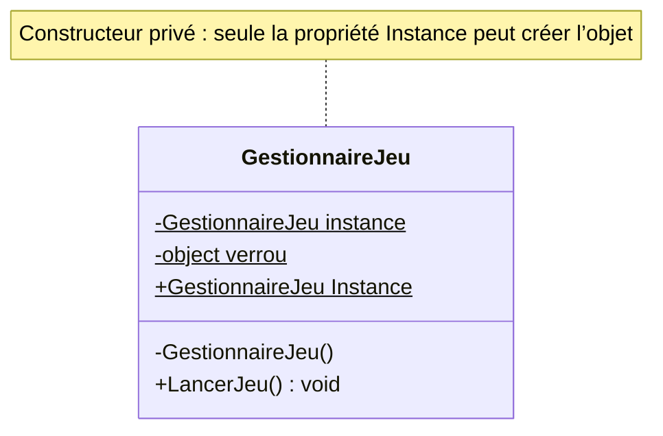
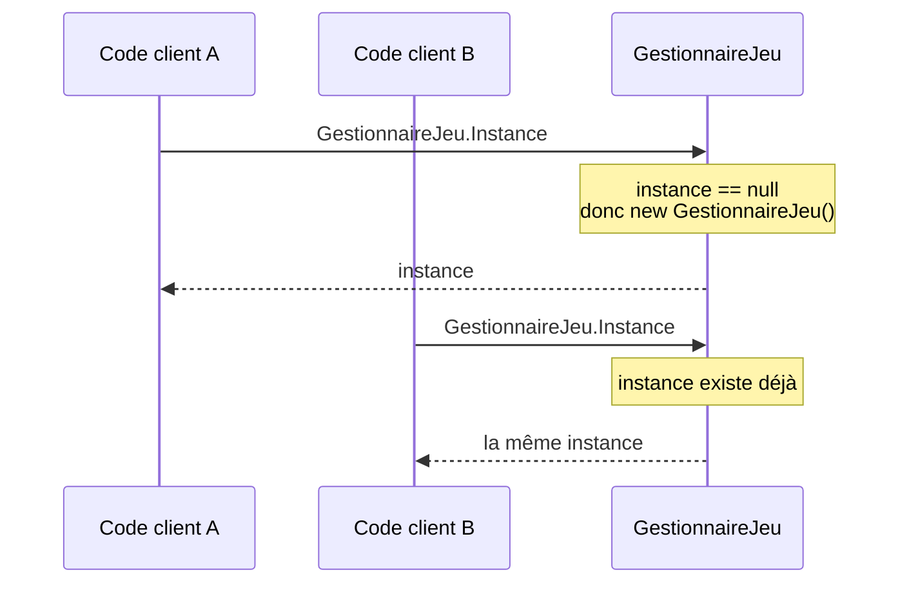

# 1. Le Singleton

> 🎯 **À la fin de cette fiche, vous savez expliquer :**
> * comment garantir qu’une classe n’a qu’une seule instance ;
> * les différentes implémentations en C# (verrou, initialisation statique, `Lazy<T>`) et dans Unity ;
> * pourquoi le Singleton est souvent considéré comme un anti-pattern, et quelles sont ses alternatives.
>
> ⏱️ 25 min · Prérequis : [13. Membres statiques](<../../Chapitre 1/Partie IV — Les outils du langage/13. Membres statiques, énumérations et namespaces.md>), [Lire un diagramme UML](<../0. Lire un diagramme UML.md>)

---

## Objectif

Garantir qu’une **classe ne possède qu’une seule instance** dans le programme et fournir un **point d’accès global** à cette instance.

---

## Définition et explication

Le **Singleton** est un *pattern de création* qui s’assure qu’une classe donnée **ne soit instanciée qu’une seule fois** durant toute l’exécution du programme.
Il permet également de **centraliser l’accès** à cette instance unique.

Ce pattern est utile lorsqu’un seul objet doit coordonner les actions du système — par exemple, un gestionnaire d’état global, un système de son, un gestionnaire de score, ou un logger.

### Problème à résoudre

Certaines ressources ou comportements doivent être **uniques et accessibles de partout** :

* Le gestionnaire de jeu (GestionnaireJeu)
* Le système de son (GestionnaireAudio)
* Le gestionnaire d’entrées ou de scènes
  Créer plusieurs instances de ces objets entraînerait des incohérences ou des conflits.

### Solution

Le Singleton encapsule la logique suivante :

1. **Empêcher la création directe** de nouvelles instances depuis l’extérieur.
2. **Conserver une instance unique** dans un membre statique privé.
3. **Fournir une méthode ou propriété d’accès** à cette instance.

---

## Implémentation en C# (version standard)

```csharp
public class GestionnaireJeu
{
    private static GestionnaireJeu instance;   // Instance unique
    private static readonly object verrou = new object(); // Sécurité multithread

    // Constructeur privé : empêche l’instanciation directe
    private GestionnaireJeu() { }

    public static GestionnaireJeu Instance
    {
        get
        {
            // Initialisation paresseuse (lazy initialization)
            if (instance == null)
            {
                lock (verrou)
                {
                    if (instance == null)
                        instance = new GestionnaireJeu();
                }
            }
            return instance;
        }
    }

    public void LancerJeu()
    {
        Console.WriteLine("Le jeu démarre !");
    }
}
```

Utilisation :

```csharp
GestionnaireJeu.Instance.LancerJeu();
```

Ici, peu importe combien de fois `GestionnaireJeu.Instance` est appelée, **une seule instance** est créée et partagée.



Les membres soulignés sont `static` : ils appartiennent à la classe, pas à un objet. Le premier accès crée l’instance, les suivants la réutilisent :



---

## Caractéristiques principales

| Aspect                 | Description                                          |
| ---------------------- | ---------------------------------------------------- |
| **Portée**             | Globale : accessible depuis n’importe quelle classe. |
| **Nombre d’instances** | Une seule, créée à la demande.                       |
| **Contrôle d’accès**   | Le constructeur est `private`.                       |
| **Stockage**           | Instance conservée dans un champ `static`.           |

---

## Variante simplifiée (C# moderne)

Il existe une version plus concise, et thread-safe grâce aux garanties d’initialisation des champs statiques par le runtime .NET (valable depuis les toutes premières versions de C#) :

```csharp
public sealed class Journaliseur
{
    private static readonly Journaliseur instance = new Journaliseur();

    public static Journaliseur Instance => instance;

    private Journaliseur() { }

    public void Ecrire(string message)
    {
        Console.WriteLine($"[LOG] {message}");
    }
}
```

Utilisation :

```csharp
Journaliseur.Instance.Ecrire("Initialisation terminée");
```

Ici :

* `sealed` empêche l’héritage (bonne pratique pour un Singleton).
* L’initialisation statique garantit la sécurité et la simplicité.

### Variante paresseuse avec `Lazy<T>`

Pour retarder la création jusqu’au premier accès (objet coûteux à construire), `Lazy<T>` fournit une initialisation paresseuse et thread-safe sans écrire soi-même de verrou :

```csharp
public sealed class Configuration
{
    private static readonly Lazy<Configuration> instance =
        new Lazy<Configuration>(() => new Configuration());

    public static Configuration Instance => instance.Value;

    private Configuration() { /* chargement coûteux */ }
}
```

C’est la forme recommandée en C# moderne hors Unity : plus simple et moins sujette aux erreurs que le double verrouillage de la version standard.

---

## Implémentation dans Unity

Unity rend l’utilisation du Singleton particulièrement courante pour les **gestionnaires globaux** (audio, scène, UI, etc.).
Cependant, il faut adapter le modèle au cycle de vie des **GameObjects** et de **MonoBehaviour**.

### Exemple : Singleton Unity classique

```csharp
using UnityEngine;

public class GestionnaireJeu : MonoBehaviour
{
    public static GestionnaireJeu Instance { get; private set; }

    private void Awake()
    {
        if (Instance != null && Instance != this)
        {
            Destroy(gameObject); // Empêche les doublons
            return;
        }

        Instance = this;
        DontDestroyOnLoad(gameObject); // Persiste entre les scènes
    }

    private void OnDestroy()
    {
        if (Instance == this)
            Instance = null; // Évite de garder une référence vers un objet détruit
    }

    public void DemarrerJeu()
    {
        Debug.Log("Le jeu commence !");
    }
}
```

Usage :

```csharp
GestionnaireJeu.Instance.DemarrerJeu();
```

### Points importants :

* Le `MonoBehaviour` Singleton **ne peut pas être instancié avec `new`** : il doit exister dans la scène.
* `DontDestroyOnLoad()` empêche sa destruction lors d’un changement de scène.
* Le contrôle dans `Awake()` garantit l’unicité.
* `OnDestroy()` remet `Instance` à `null` : sans cela, un accès après destruction (changement de scène, fin du Play Mode) viserait un objet détruit.
* `DontDestroyOnLoad()` ne fonctionne que sur un GameObject **racine** (sans parent).

> [!WARNING]
> **Piège des *Enter Play Mode Options*.** Si le *Domain Reload* est désactivé pour accélérer l’entrée en Play Mode, les champs `static` **ne sont pas réinitialisés** entre deux sessions de jeu : `Instance` peut encore pointer vers l’objet de la session précédente. Il faut alors le remettre à zéro explicitement, par exemple dans une méthode statique marquée `[RuntimeInitializeOnLoadMethod(RuntimeInitializeLoadType.SubsystemRegistration)]`.

---

## Avantages du Singleton

1. **Instance unique garantie** — cohérence des données partagées.
2. **Accès global simplifié** — facile à utiliser depuis n’importe quel script.
3. **Contrôle centralisé** — utile pour les systèmes transversaux (gestion du son, sauvegarde, etc.).
4. **Économie de ressources** — pas besoin de recréer des objets redondants.

---

## Inconvénients et risques

1. **Couplage global** — les classes dépendant du Singleton deviennent difficilement testables.
2. **Risque d’abus** — tendance à en faire un “accès magique” pour tout, ce qui viole l’encapsulation.
3. **Cycle de vie difficile à contrôler** — surtout dans Unity si plusieurs scènes réinitialisent le Singleton.
4. **Dépendances cachées** — le code semble simple, mais introduit une forte dépendance implicite.

### Bonnes pratiques :

* Ne pas utiliser un Singleton pour tout : seulement pour des services globaux.
* Préférer l’**injection de dépendances** lorsque c’est possible, ou des alternatives plus souples : un **ScriptableObject** partagé référencé dans l’Inspector, ou un **Service Locator** qui permet de substituer l’implémentation (tests, prototypes).
* Garder en tête que beaucoup de développeurs considèrent le Singleton comme un **anti-pattern** lorsqu’il sert surtout de variable globale déguisée. À chaque fois, se demander : « ai-je besoin d’une instance *unique*, ou juste d’un accès *pratique* ? ».
* Limiter les responsabilités du Singleton à **une seule fonction claire** (ex. : gestion audio, pas gameplay + UI + score).

---

## Exemple Unity typique

Exemples d’utilisation justifiée de Singletons dans Unity :

* `GestionnaireAudio` : gérer les effets sonores et musiques.
* `InputManager` : centraliser les entrées utilisateur.
* `GestionnaireJeu` : suivre l’état global du jeu (score, niveau, pause).
* `SceneController` : gérer les transitions entre scènes.

```csharp
public class GestionnaireAudio : MonoBehaviour
{
    public static GestionnaireAudio Instance { get; private set; }
    public AudioSource musique;

    private void Awake()
    {
        if (Instance != null && Instance != this)
        {
            Destroy(gameObject);
            return;
        }

        Instance = this;
        DontDestroyOnLoad(gameObject);
    }

    public void JouerMusique()
    {
        musique.Play();
    }
}
```

---

## Quand utiliser le Singleton

| Situation                                                     | Singleton adapté ? |
| ------------------------------------------------------------- | ------------------ |
| Gestion d’un état global unique (son, score, configuration)   | ✅ Oui              |
| Objets temporaires ou multiples (ennemis, projectiles, items) | ❌ Non              |
| Partage de données entre scènes                               | ✅ Oui              |
| Gestion d’un comportement individuel                          | ❌ Non              |

---

## ⚠️ Pièges courants

* **Le Singleton « fourre-tout »** : un `GestionnaireJeu` unique, accessible de partout, qui finit par tout gérer. C’est une variable globale géante.
* **Dépendre de l’ordre d’initialisation dans Unity** : accéder à `GestionnaireJeu.Instance` dans l’`Awake()` d’un autre script peut renvoyer `null` si le `GestionnaireJeu` n’a pas encore exécuté son propre `Awake()`.
* **Rendre le code impossible à tester** : une classe qui appelle `GestionnaireAudio.Instance` en dur ne peut pas être testée sans un vrai `GestionnaireAudio`.
* **Déclarer le constructeur `protected` au lieu de `private`** (ou oublier `sealed`) : une classe dérivée pourrait alors créer d’autres instances.

## 🔀 À ne pas confondre

* **Singleton** (un objet unique, qui peut implémenter une interface et être remplacé) et **classe statique** (pas d’instance du tout, pas de polymorphisme).
* **Singleton** (le pattern impose l’unicité) et **instance unique par convention** (un seul objet est créé et injecté là où il faut, sans que la classe l’impose) : la seconde approche apporte les mêmes avantages sans le couplage global.

---

## 🧪 Exercice : la configuration paresseuse

Écrivez une classe `ConfigurationJeu` :

* singleton thread-safe basé sur `Lazy<T>` ;
* une propriété `Volume` (entier, 100 par défaut) ;
* une propriété statique `NombreInstances` qui compte les appels au constructeur.

**Contraintes :** `new ConfigurationJeu()` ne doit pas compiler en dehors de la classe, et l’instance ne doit être créée qu’au **premier accès** à `Instance`.

**Test attendu :**

```csharp
Console.WriteLine($"Instances avant le premier accès : {ConfigurationJeu.NombreInstances}");

var a = ConfigurationJeu.Instance;
var b = ConfigurationJeu.Instance;
a.Volume = 80;

Console.WriteLine($"Même objet : {ReferenceEquals(a, b)}");
Console.WriteLine($"Volume vu par b : {b.Volume}");
Console.WriteLine($"Instances après : {ConfigurationJeu.NombreInstances}");
```

```
Instances avant le premier accès : 0
Même objet : True
Volume vu par b : 80
Instances après : 1
```

<details>
<summary>Voir la solution</summary>

```csharp
public sealed class ConfigurationJeu
{
    private static readonly Lazy<ConfigurationJeu> instance =
        new Lazy<ConfigurationJeu>(() => new ConfigurationJeu());

    public static ConfigurationJeu Instance => instance.Value;
    public static int NombreInstances { get; private set; }

    public int Volume { get; set; } = 100;

    private ConfigurationJeu()
    {
        NombreInstances++;
    }
}
```

Le `Lazy<T>` est créé tout de suite, mais la fonction qu’il contient (`() => new ConfigurationJeu()`) ne s’exécute qu’au premier appel de `instance.Value`. D’où les 0 instances au début.

</details>

---

## Résumé

| Avantages                             | Inconvénients                  |
| ------------------------------------- | ------------------------------ |
| Centralise un état global             | Crée du couplage fort          |
| Simplifie l’accès depuis tout le code | Cache les dépendances          |
| Garantit l’unicité                    | Difficile à tester ou étendre  |
| Idéal pour services globaux           | Mauvaise utilisation fréquente |

---

## Références utiles

* [Microsoft Learn — Design Patterns: Singleton](https://learn.microsoft.com/en-us/previous-versions/msp-n-p/ff650316%28v=pandp.10%29)
* [Refactoring Guru — Singleton Pattern](https://refactoring.guru/fr/design-patterns/singleton)
* [Robert Nystrom — Game Programming Patterns : Singleton](https://gameprogrammingpatterns.com/singleton.html)
* [Microsoft Learn — Lazy<T>](https://learn.microsoft.com/fr-fr/dotnet/api/system.lazy-1)
* [Unity Manual — Domain Reloading (Enter Play Mode Options)](https://docs.unity3d.com/Manual/domain-reloading.html)
* Freeman, Eric & Robson, Elisabeth. *Head First Design Patterns*, O’Reilly, 2021.

---

[← Précédent : Lire un diagramme UML](<../0. Lire un diagramme UML.md>) · [Sommaire](<../../README.md>) · [Suivant : 2. Factory Method →](<2. Factory Method.md>)
