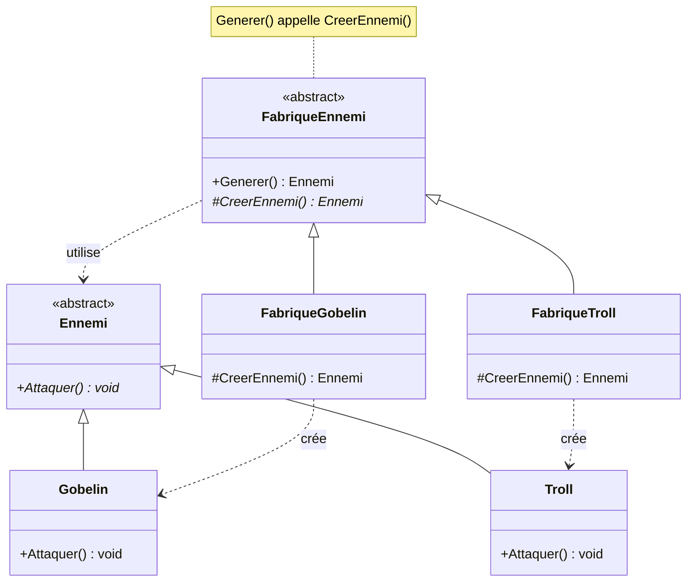

# 2. Factory Method

> 🎯 **À la fin de cette fiche, vous savez expliquer :**
> * comment une classe délègue à ses sous-classes le choix du type d’objet à créer ;
> * la différence entre Simple Factory, Factory Method et Abstract Factory ;
> * comment choisir une fabrique depuis l’Inspector dans Unity.
>
> ⏱️ 25 min · Prérequis : [7. Polymorphisme](<../../Chapitre 1/Partie II — Les 4 piliers de la POO/7. Polymorphisme.md>), [11. Principes SOLID](<../../Chapitre 1/Partie III — Concepts Avancés/11. Principes SOLID.md>)

---

## Objectif

Déléguer la **création d’objets** à des **sous-classes spécialisées** plutôt que d’instancier directement les classes dans le code.
Ce patron permet d’isoler la logique d’instanciation et de rendre le code **ouvert à l’extension**, mais **fermé à la modification** (principe *Open/Closed* du modèle SOLID).

---

## Définition et explication

Le **Factory Method** est un *pattern de création* qui définit **une interface de création d’objets**, tout en laissant aux classes dérivées le soin de **déterminer quel type concret** d’objet sera réellement instancié.

En d’autres termes, il s’agit d’une **“fabrique d’objets” polymorphe** :
le code client demande un objet sans connaître sa classe exacte, et la fabrique décide quel type créer.

### Problème à résoudre

Dans un code naïf, on a tendance à créer les objets directement :

```csharp
var ennemi = new Gobelin();
```

Mais cela **couple fortement** le code à une implémentation précise (`Gobelin`).
Si demain on ajoute un `Orc` ou un `Troll`, il faudra modifier toutes les parties du code qui instancient des ennemis.

### Solution

Définir une **interface ou classe abstraite** qui déclare une méthode de création (`CréerEnnemi()`), puis déléguer aux **sous-classes concrètes** la responsabilité d’instancier le bon type.

Le code client manipule uniquement l’interface abstraite — sans connaître la classe réelle créée.

---

## Structure du pattern

**Composants principaux :**

1. **Creator (créateur abstrait)** : définit la méthode de création d’objet (souvent `FactoryMethod()` ou similaire).
2. **ConcreteCreator (créateur concret)** : implémente la méthode de création pour produire un objet spécifique.
3. **Product (produit abstrait)** : définit l’interface commune des objets à créer.
4. **ConcreteProduct (produit concret)** : implémente le type d’objet réel.

Appliqués à l’exemple ci-dessous : `FabriqueEnnemi` est le *Creator*, `FabriqueGobelin` et `FabriqueTroll` les *ConcreteCreator*, `Ennemi` le *Product*, `Gobelin` et `Troll` les *ConcreteProduct*.



Les deux hiérarchies sont parallèles : chaque fabrique concrète crée le produit concret correspondant, alors que `Generer()` ne connaît que les deux types abstraits.

---

## Implémentation en C#

### Exemple général

```csharp
// Produit abstrait
public abstract class Ennemi
{
    public abstract void Attaquer();
}

// Produits concrets
public class Gobelin : Ennemi
{
    public override void Attaquer() => Console.WriteLine("Le gobelin attaque !");
}

public class Troll : Ennemi
{
    public override void Attaquer() => Console.WriteLine("Le troll frappe avec sa massue !");
}

// Créateur abstrait : il contient la logique métier commune…
public abstract class FabriqueEnnemi
{
    public Ennemi Generer()
    {
        Ennemi ennemi = CreerEnnemi();   // …et délègue le choix du type concret
        Console.WriteLine($"Un {ennemi.GetType().Name} apparaît !");
        return ennemi;
    }

    // La « factory method » proprement dite
    protected abstract Ennemi CreerEnnemi();
}

// Créateurs concrets
public class FabriqueGobelin : FabriqueEnnemi
{
    protected override Ennemi CreerEnnemi() => new Gobelin();
}

public class FabriqueTroll : FabriqueEnnemi
{
    protected override Ennemi CreerEnnemi() => new Troll();
}
```

### Utilisation

```csharp
FabriqueEnnemi fabrique = new FabriqueGobelin();
Ennemi ennemi = fabrique.Generer();
ennemi.Attaquer();
```

**Sortie :**

```
Un Gobelin apparaît !
Le gobelin attaque !
```

La méthode `Generer()` (le code commun) ne sait pas si l’ennemi est un Gobelin ou un Troll : elle dépend uniquement de l’abstraction `Ennemi` et laisse les sous-classes décider. C’est **l’essence du Factory Method** : une méthode de création *redéfinissable*, appelée par une logique commune.

> [!NOTE]
> **À ne pas confondre :**
> * **Simple Factory** (ce n’est pas un pattern GoF) : une seule classe avec une méthode du type `Creer(string type)` qui contient un `switch`. C’est simple et souvent suffisant, mais il faut la modifier à chaque nouveau type.
> * **Factory Method** : une méthode de création `abstract` ou `virtual`, redéfinie par des sous-classes (ce qui est présenté ici).
> * **Abstract Factory** : un objet qui crée une **famille** de produits cohérents entre eux (par exemple une `IFabriqueTheme` qui crée à la fois le bouton, le panneau et la police d’un même thème).

---

## Avantages

1. **Découplage**

    * Le code client ne dépend plus des classes concrètes.
    * Ajout d’un nouveau type d’objet sans modifier le code existant.

2. **Extensibilité**

    * Facile d’ajouter de nouveaux “produits” en créant simplement une nouvelle fabrique.

3. **Cohérence de création**

    * Centralise la logique d’instanciation, utile pour contrôler ou valider la création d’objets.

4. **Polymorphisme**

    * Les objets créés partagent une interface commune, donc interchangeables dans le code client.

---

## Inconvénients

* Introduit **plus de classes** (une fabrique par type de produit).
* Peut paraître **complexe** pour des cas simples.
* Le choix du bon niveau d’abstraction demande de la **discipline de conception**.

---

## Application dans Unity

Le pattern Factory Method est **très utile dans Unity** pour la **création dynamique d’objets** (ennemis, projectiles, objets de jeu, etc.) sans dépendre d’un type concret.

### Exemple Unity : Générateur d’ennemis

```csharp
using UnityEngine;

public abstract class FabriqueEnnemi : MonoBehaviour
{
    public abstract GameObject CreerEnnemi(Vector3 position);
}

public class FabriqueGobelin : FabriqueEnnemi
{
    [SerializeField] private GameObject prefabGobelin;

    public override GameObject CreerEnnemi(Vector3 position)
    {
        return Instantiate(prefabGobelin, position, Quaternion.identity);
    }
}

public class FabriqueTroll : FabriqueEnnemi
{
    [SerializeField] private GameObject prefabTroll;

    public override GameObject CreerEnnemi(Vector3 position)
    {
        return Instantiate(prefabTroll, position, Quaternion.identity);
    }
}
```

Le code client :

```csharp
public class Generateur : MonoBehaviour
{
    // On glisse n’importe quelle fabrique (Gobelin, Troll…) dans l’Inspector :
    // le Generateur ne connaît que le type abstrait.
    [SerializeField] private FabriqueEnnemi fabrique;

    private void Start()
    {
        fabrique.CreerEnnemi(transform.position);
    }
}
```

Le client ne nomme **jamais** de type concret : on change de type d’ennemi dans l’éditeur, sans toucher au code. Ainsi, le système de génération d’ennemis est **ouvert à l’extension** (ajout de nouvelles fabriques) mais **fermé à la modification** du code principal.

---

## Comparaison : Factory Method vs new

| Approche       | Avantages                      | Inconvénients                    |
| -------------- | ------------------------------ | -------------------------------- |
| `new` direct   | Simple, rapide                 | Couplage fort, peu flexible      |
| Factory Method | Découplé, extensible, testable | Légère complexité supplémentaire |

---

## Quand utiliser le Factory Method

| Situation                                                      | Recommandation   |
| -------------------------------------------------------------- | ---------------- |
| Vous devez créer des objets dont le type concret peut varier   | ✅ Oui            |
| Vous voulez centraliser ou contrôler la création des instances | ✅ Oui            |
| Les objets sont simples et fixes                               | ❌ Pas nécessaire |
| Le projet nécessite une évolutivité (ajout futur de types)     | ✅ Oui            |

---

## ⚠️ Pièges courants

* **Un client qui nomme encore la classe concrète** (`new FabriqueGobelin()` partout dans le code) : le couplage a seulement été déplacé. Le choix de la fabrique doit se faire à **un seul** endroit (configuration, Inspector, injection).
* **Une hiérarchie de fabriques parallèle à celle des produits**, pour des produits qui ne diffèrent que par quelques valeurs : un seul prefab ou un ScriptableObject paramétré suffit souvent.
* **Oublier la logique commune** : un Creator qui ne contient que la méthode abstraite n’apporte rien de plus qu’un simple `new`.

## 🔀 À ne pas confondre

* **Factory Method** (une méthode redéfinie par héritage) et **[Template Method](<../Partie IV — Patterns complémentaires/11. Template Method.md>)** (un algorithme dont certaines étapes sont redéfinies) : une factory method est souvent une étape d’un template method.
* **Factory Method** (une sous-classe décide quoi créer) et **[Prototype](<../Partie IV — Patterns complémentaires/13. Prototype.md>)** (on copie un objet existant).

---

## 🧪 Exercice : l’atelier du Père Noël

1. Écrivez une classe abstraite `Jouet` avec une propriété abstraite `Nom` et une méthode abstraite `string Jouer()`. Créez `Peluche` (« Ours en peluche », « Câlin ! ») et `ConsolePortable` (« Console portable », « Bip bip ! »).
2. Écrivez une classe abstraite `Atelier` dont la méthode `Livrer()` fabrique un jouet, affiche `Contrôle qualité : <Nom>… OK` puis `Emballage : <Nom>`, et renvoie le jouet. La fabrication est déléguée à une factory method `FabriquerJouet()`.
3. Créez `AtelierPeluches` et `AtelierConsoles`.

**Contrainte :** le test ne doit jamais écrire `new Peluche()` ni `new ConsolePortable()`.

**Test attendu :**

```csharp
var ateliers = new List<Atelier> { new AtelierPeluches(), new AtelierConsoles() };

foreach (var atelier in ateliers)
{
    Jouet cadeau = atelier.Livrer();
    Console.WriteLine($"L’enfant joue : {cadeau.Jouer()}");
}
```

```
Contrôle qualité : Ours en peluche… OK
Emballage : Ours en peluche
L’enfant joue : Câlin !
Contrôle qualité : Console portable… OK
Emballage : Console portable
L’enfant joue : Bip bip !
```

<details>
<summary>Voir la solution</summary>

```csharp
public abstract class Jouet
{
    public abstract string Nom { get; }
    public abstract string Jouer();
}

public class Peluche : Jouet
{
    public override string Nom => "Ours en peluche";
    public override string Jouer() => "Câlin !";
}

public class ConsolePortable : Jouet
{
    public override string Nom => "Console portable";
    public override string Jouer() => "Bip bip !";
}

public abstract class Atelier
{
    // Logique commune : fabriquer, contrôler, emballer
    public Jouet Livrer()
    {
        Jouet jouet = FabriquerJouet();
        Console.WriteLine($"Contrôle qualité : {jouet.Nom}… OK");
        Console.WriteLine($"Emballage : {jouet.Nom}");
        return jouet;
    }

    protected abstract Jouet FabriquerJouet();   // la factory method
}

public class AtelierPeluches : Atelier
{
    protected override Jouet FabriquerJouet() => new Peluche();
}

public class AtelierConsoles : Atelier
{
    protected override Jouet FabriquerJouet() => new ConsolePortable();
}
```

</details>

---

## Résumé

| Aspect              | Description                                                        |
| ------------------- | ------------------------------------------------------------------ |
| Avantage principal  | Délégation de la création à des sous-classes                       |
| Objectif            | Découpler le code client de l’instanciation des objets             |
| Principe            | “Laissez les sous-classes décider du type d’objet à créer.”        |
| Utilisation typique | Génération d’ennemis, objets, projectiles, quêtes, etc. dans Unity |

---

## Références utiles

* [Refactoring Guru — Factory Method](https://refactoring.guru/fr/design-patterns/factory-method)
* [Refactoring Guru — Abstract Factory (pour comparer)](https://refactoring.guru/fr/design-patterns/abstract-factory)
* Freeman, Eric & Robson, Elisabeth. *Head First Design Patterns*, O’Reilly, 2021.
* [Unity Manual — Prefabs](https://docs.unity3d.com/Manual/Prefabs.html)

---

[← Précédent : 1. Singleton](<1. Singleton.md>) · [Sommaire](<../../README.md>) · [Suivant : 3. Builder →](<3. Builder.md>)
