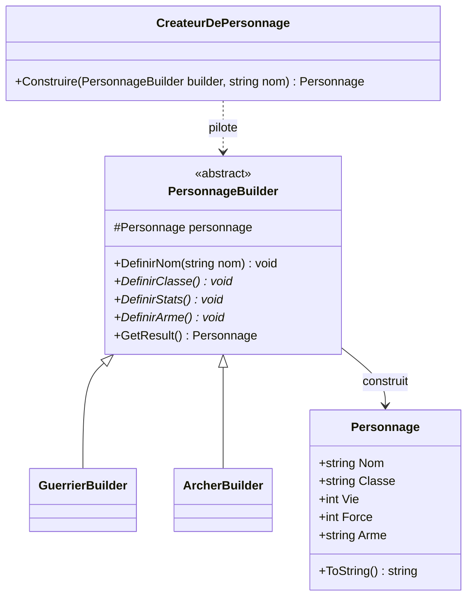
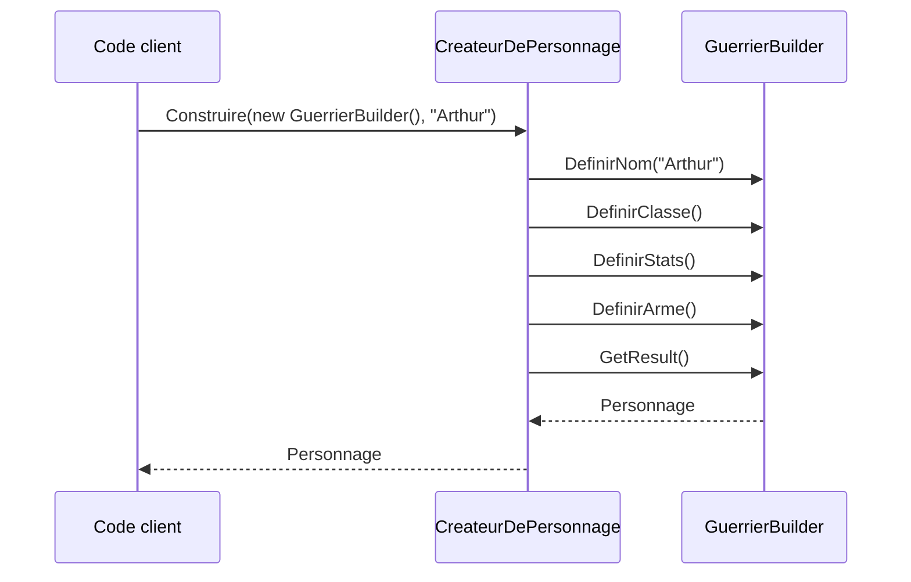

# 3. Builder

> 🎯 **À la fin de cette fiche, vous savez expliquer :**
> * quand un constructeur à rallonge justifie un Builder ;
> * la différence entre le Builder du GoF (avec *Director*) et le Builder « fluide » ;
> * comment un Builder valide l’objet avant de le créer ;
> * quelles fonctionnalités de C# rendent souvent le Builder inutile.
>
> ⏱️ 25 min · Prérequis : [3. Constructeurs](<../../Chapitre 1/Partie I — Les Fondamentaux/3. Constructeurs.md>), [4. Encapsulation](<../../Chapitre 1/Partie II — Les 4 piliers de la POO/4. Encapsulation.md>)

---

## Objectif

Permettre la **construction progressive et contrôlée** d’un objet complexe, sans exposer ses détails internes, et sans avoir à utiliser un constructeur comportant une longue liste de paramètres.

Le **Builder** sépare la **construction** d’un objet de sa **représentation**, ce qui permet de **réutiliser le même processus de création** pour produire différentes configurations d’objets.

---

## Définition et explication

Le **Builder** est un *pattern de création* utilisé lorsque :

* un objet comporte **de nombreux paramètres** (souvent optionnels),
* ou sa construction nécessite **plusieurs étapes successives**,
* ou encore lorsque différentes **variantes** d’un même type d’objet doivent être créées.

Ce patron **isole la logique de création** dans une classe distincte (le “constructeur d’objet”), appelée **Builder**.
L’objet final est assemblé étape par étape via une interface fluide et claire, souvent appelée **“fluent interface”**.

---

## Problème à résoudre

Sans le pattern Builder, on se retrouve souvent avec des **constructeurs longs et illisibles** :

```csharp
var joueur = new Joueur("Arthur", 100, 50, "Épée", true, false, "Guerrier", "Bois");
```

Ce type de constructeur est difficile à lire, à maintenir et à étendre.
De plus, la plupart de ces paramètres sont optionnels ou dépendent de conditions.

---

## Solution

Le pattern **Builder** propose de :

1. Décomposer la création d’un objet complexe en **étapes claires et successives**.
2. **Cacher** les détails internes de la construction.
3. **Retourner l’objet finalisé** via une méthode dédiée (`Build()` ou `GetResult()`).

Chaque appel configure une partie de l’objet, jusqu’à ce qu’il soit complet.

---

## Structure du pattern

| Élément                                    | Rôle                                                      |
| ------------------------------------------ | --------------------------------------------------------- |
| **Product (Produit)**                      | L’objet complexe à construire.                            |
| **Builder (Constructeur abstrait)**        | Définit les étapes de la construction.                    |
| **ConcreteBuilder (Constructeur concret)** | Implémente les étapes de création.                        |
| **Director (Optionnel)**                   | Ordonne les étapes de construction dans un certain ordre. |

Appliqués à l’exemple ci-dessous : `Personnage` est le *Product*, `PersonnageBuilder` le *Builder*, `GuerrierBuilder` et `ArcherBuilder` les *ConcreteBuilder*, `CreateurDePersonnage` le *Director*.



---

## Implémentation en C#

### Exemple : création d’un personnage

```csharp
// Produit
public class Personnage
{
    public string Nom;
    public string Classe;
    public int Vie;
    public int Force;
    public string Arme;

    public override string ToString() =>
        $"{Nom} ({Classe}, PV: {Vie}, Force: {Force}) avec {Arme}";
}
```

### Builder abstrait

```csharp
public abstract class PersonnageBuilder
{
    protected Personnage personnage = new Personnage();

    public void DefinirNom(string nom) => personnage.Nom = nom;
    public abstract void DefinirClasse();
    public abstract void DefinirStats();
    public abstract void DefinirArme();

    public Personnage GetResult()
    {
        Personnage resultat = personnage;
        personnage = new Personnage(); // le builder est prêt pour une nouvelle construction
        return resultat;
    }
}
```

### Builders concrets

```csharp
public class GuerrierBuilder : PersonnageBuilder
{
    public override void DefinirClasse() => personnage.Classe = "Guerrier";
    public override void DefinirStats() { personnage.Vie = 150; personnage.Force = 20; }
    public override void DefinirArme() => personnage.Arme = "Épée";
}

public class ArcherBuilder : PersonnageBuilder
{
    public override void DefinirClasse() => personnage.Classe = "Archer";
    public override void DefinirStats() { personnage.Vie = 100; personnage.Force = 15; }
    public override void DefinirArme() => personnage.Arme = "Arc long";
}
```

### Directeur (optionnel)

```csharp
public class CreateurDePersonnage
{
    public Personnage Construire(PersonnageBuilder builder, string nom)
    {
        builder.DefinirNom(nom);
        builder.DefinirClasse();
        builder.DefinirStats();
        builder.DefinirArme();
        return builder.GetResult();
    }
}
```

Le directeur enchaîne toujours les mêmes étapes, et chaque builder concret les remplit à sa façon :



### Utilisation

```csharp
var createur = new CreateurDePersonnage();

Personnage guerrier = createur.Construire(new GuerrierBuilder(), "Arthur");
Personnage archer = createur.Construire(new ArcherBuilder(), "Robin");

Console.WriteLine(guerrier);
Console.WriteLine(archer);
```

**Sortie :**

```
Arthur (Guerrier, PV: 150, Force: 20) avec Épée
Robin (Archer, PV: 100, Force: 15) avec Arc long
```

---

## Variante : Fluent Builder (chaînage des appels)

C# permet une version plus fluide, très lisible :

```csharp
public class JoueurBuilder
{
    // Valeurs par défaut : on ne précise que les paramètres utiles
    private string nom = "Inconnu";
    private int vie = 100;
    private string arme = "Mains nues";

    public JoueurBuilder AvecNom(string nom)
    {
        this.nom = nom;
        return this;
    }

    public JoueurBuilder AvecVie(int vie)
    {
        this.vie = vie;
        return this;
    }

    public JoueurBuilder AvecArme(string arme)
    {
        this.arme = arme;
        return this;
    }

    public Joueur Build()
    {
        // Validation centralisée : impossible d’obtenir un Joueur incohérent
        if (string.IsNullOrWhiteSpace(nom))
            throw new InvalidOperationException("Un joueur doit avoir un nom.");
        if (vie <= 0)
            throw new InvalidOperationException("Les PV initiaux doivent être positifs.");

        return new Joueur(nom, vie, arme); // un nouvel objet à chaque appel
    }
}

public class Joueur
{
    public string Nom { get; }
    public int Vie { get; }
    public string Arme { get; }

    // internal : depuis l’extérieur de l’assembly, on passe par le builder
    internal Joueur(string nom, int vie, string arme)
    {
        Nom = nom;
        Vie = vie;
        Arme = arme;
    }

    public override string ToString() => $"{Nom} ({Vie} PV) - Arme : {Arme}";
}
```

### Utilisation fluide :

```csharp
var joueur = new JoueurBuilder()
    .AvecNom("Arthur")
    .AvecVie(120)
    .AvecArme("Épée légendaire")
    .Build();

Console.WriteLine(joueur);
```

**Sortie :**

```
Arthur (120 PV) - Arme : Épée légendaire
```

Cette approche rend le code **expressif, lisible et extensible** — parfaite pour la configuration d’objets complexes.

Le produit est ici **immuable** (propriétés en lecture seule) et `Build()` **valide** l’ensemble avant de créer l’objet : c’est ce qui fait la vraie valeur d’un Builder.

### Avez-vous vraiment besoin d’un Builder en C# ?

C# offre plusieurs alternatives natives qui couvrent la plupart des cas simples :

```csharp
// Initialiseur d’objet + propriétés init / required (C# 9 et C# 11)
public class Arme
{
    public required string Nom { get; init; }
    public int Degats { get; init; } = 10;
}

var epee = new Arme { Nom = "Excalibur", Degats = 50 };

// Record + expression with : copie modifiée d’un objet immuable (C# 9)
public record Stats(int Vie, int Force);

var normales = new Stats(100, 10);
var boostees = normales with { Force = 20 };
```

Réservez le Builder aux cas où la construction est **réellement complexe** : étapes ordonnées, validation croisée entre paramètres, ou plusieurs représentations construites par le même processus (le rôle du *Director*).

> [!NOTE]
> Selon la version de Unity, certaines fonctionnalités récentes du langage (comme `required`, apparu en C# 11) ne sont pas disponibles : vérifiez la version de C# supportée par votre éditeur.

---

## Application dans Unity

Le pattern Builder s’intègre naturellement dans Unity lorsqu’on souhaite :

* **configurer dynamiquement** des objets complexes (personnages, ennemis, armes, quêtes, etc.),
* **préparer des objets avant instanciation** (via des *ScriptableObjects* ou des *prefabs*),
* ou encore **créer des systèmes modulaires** de génération de personnages, de niveaux ou d’équipements.

### Exemple Unity : Construction d’un personnage

```csharp
public class PersonnageBuilder
{
    private GameObject prefab;
    private Vector3 position;
    private string nom;

    public PersonnageBuilder AvecPrefab(GameObject p)
    {
        prefab = p;
        return this;
    }

    public PersonnageBuilder ALaPosition(Vector3 pos)
    {
        position = pos;
        return this;
    }

    public PersonnageBuilder AvecNom(string n)
    {
        nom = n;
        return this;
    }

    public GameObject Build()
    {
        var go = Object.Instantiate(prefab, position, Quaternion.identity);
        go.name = nom;
        return go;
    }
}
```

### Utilisation :

```csharp
var personnage = new PersonnageBuilder()
    .AvecPrefab(prefabGuerrier)
    .ALaPosition(new Vector3(0, 0, 0))
    .AvecNom("Lancelot")
    .Build();
```

Ce modèle est particulièrement adapté à la **génération procédurale** ou à la **création de contenu dynamique**.

---

## Avantages

1. **Lisibilité accrue** : élimine les constructeurs complexes.
2. **Flexibilité** : permet de créer différentes variantes d’un même objet.
3. **Séparation des responsabilités** : la construction est isolée dans une classe dédiée.
4. **Contrôle total** : chaque étape de la création peut être personnalisée ou validée.
5. **Compatible avec l’immuabilité** : le builder accumule les paramètres, puis crée en une seule fois un objet en lecture seule (voir la variante fluide).

---

## Inconvénients

* Légère complexité ajoutée pour les objets simples.
* Nécessite plusieurs classes (Builder, Produit, éventuellement Directeur).
* Peut sembler excessif si l’objet n’a que quelques paramètres.

---

## Quand utiliser le Builder

| Situation                                        | Recommandation |
| ------------------------------------------------ | -------------- |
| L’objet a beaucoup de paramètres optionnels      | ✅ Oui          |
| L’objet doit être construit étape par étape      | ✅ Oui          |
| Le processus de création est complexe            | ✅ Oui          |
| L’objet est simple (ex. : un `Vector3`)          | ❌ Inutile      |
| On veut des objets configurables via du chaînage | ✅ Oui          |

---

## ⚠️ Pièges courants

* **Un `Build()` qui renvoie l’objet interne du builder** : appeler `Build()` deux fois renvoie le même objet, et continuer à utiliser le builder modifie un objet déjà distribué. Créez un **nouvel** objet à chaque appel.
* **Un produit mutable** (champs publics) : le builder garantit un état valide à la création… que n’importe qui peut casser juste après.
* **Aucune validation dans `Build()`** : le builder n’apporte alors presque rien par rapport à un initialiseur d’objet.

## 🔀 À ne pas confondre

* **Builder** (construire *un* objet complexe en plusieurs étapes) et **[Factory Method](<2. Factory Method.md>)** (choisir *quel type* d’objet créer, en une étape).
* **Builder fluide** (méthodes qui renvoient `this`) et **interface fluide** en général (LINQ en est une, sans rien construire).

---

## 🧪 Exercice : le générateur de quêtes

Écrivez une classe **immuable** `Quete` (`Titre`, `Objectifs` en `IReadOnlyList<string>`, `Recompense`) avec une méthode `Decrire()`, et un `QueteBuilder` fluide :

* `AvecTitre(string)`, `AjouterObjectif(string)` (appelable plusieurs fois), `AvecRecompense(int)` ;
* `Build()` lève une `InvalidOperationException` si le titre est vide, s’il n’y a aucun objectif ou si la récompense est négative.

**Test attendu :**

```csharp
Quete quete = new QueteBuilder()
    .AvecTitre("Le dragon du nord")
    .AjouterObjectif("Trouver la caverne")
    .AjouterObjectif("Vaincre le dragon")
    .AvecRecompense(500)
    .Build();
quete.Decrire();

try
{
    new QueteBuilder().AvecTitre("Quête vide").Build();
}
catch (InvalidOperationException ex)
{
    Console.WriteLine($"Erreur : {ex.Message}");
}
```

```
Quête : Le dragon du nord (500 pièces d’or)
  1. Trouver la caverne
  2. Vaincre le dragon
Erreur : Une quête doit avoir au moins un objectif.
```

<details>
<summary>Voir la solution</summary>

```csharp
public class Quete
{
    public string Titre { get; }
    public IReadOnlyList<string> Objectifs { get; }
    public int Recompense { get; }

    internal Quete(string titre, List<string> objectifs, int recompense)
    {
        Titre = titre;
        Objectifs = objectifs;
        Recompense = recompense;
    }

    public void Decrire()
    {
        Console.WriteLine($"Quête : {Titre} ({Recompense} pièces d’or)");
        for (int i = 0; i < Objectifs.Count; i++)
            Console.WriteLine($"  {i + 1}. {Objectifs[i]}");
    }
}

public class QueteBuilder
{
    private string titre;
    private readonly List<string> objectifs = new();
    private int recompense;

    public QueteBuilder AvecTitre(string titre)
    {
        this.titre = titre;
        return this;
    }

    public QueteBuilder AjouterObjectif(string objectif)
    {
        objectifs.Add(objectif);
        return this;
    }

    public QueteBuilder AvecRecompense(int pieces)
    {
        recompense = pieces;
        return this;
    }

    public Quete Build()
    {
        if (string.IsNullOrWhiteSpace(titre))
            throw new InvalidOperationException("Une quête doit avoir un titre.");
        if (objectifs.Count == 0)
            throw new InvalidOperationException("Une quête doit avoir au moins un objectif.");
        if (recompense < 0)
            throw new InvalidOperationException("La récompense ne peut pas être négative.");

        return new Quete(titre, new List<string>(objectifs), recompense);   // copie : le builder reste réutilisable
    }
}
```

La copie de la liste dans `Build()` est essentielle : sans elle, un `AjouterObjectif` ultérieur sur le builder modifierait une quête déjà construite.

</details>

---

## Résumé

| Aspect                  | Description                                                 |
| ----------------------- | ----------------------------------------------------------- |
| **But**                 | Construire des objets complexes étape par étape             |
| **Principe**            | Séparer la construction de la représentation                |
| **Avantage**            | Code clair, modulaire, extensible                           |
| **Utilisation typique** | Configuration de personnages, objets, quêtes, niveaux, etc. |

---

## Références utiles

* [Refactoring Guru — Builder](https://refactoring.guru/fr/design-patterns/builder)
* [Microsoft Learn — Initialiseurs d’objets et de collections](https://learn.microsoft.com/fr-fr/dotnet/csharp/programming-guide/classes-and-structs/object-and-collection-initializers)
* [Microsoft Learn — Records](https://learn.microsoft.com/fr-fr/dotnet/csharp/fundamentals/types/records)
* [Unity Learn — Scriptable Objects and Data Architecture](https://learn.unity.com/tutorial/introduction-to-scriptable-objects)
* Freeman, Eric & Robson, Elisabeth. *Head First Design Patterns*, O’Reilly, 2021.

---

[← Précédent : 2. Factory Method](<2. Factory Method.md>) · [Sommaire](<../../README.md>) · [Suivant : 4. Adapter →](<../Partie II — Patterns Structurels/4. Adapter.md>)
