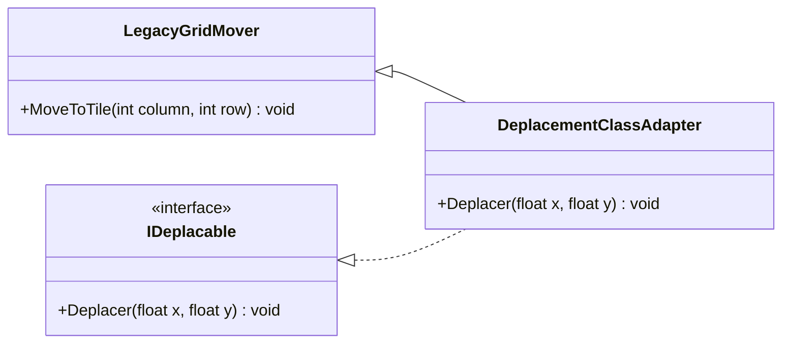

# 4. Adapter

## Objectif

Permettre à **deux classes incompatibles** de collaborer en **convertissant l’interface** de l’une en une interface que l’autre attend.
En d’autres termes, le pattern **Adapter** agit comme un **pont** entre deux systèmes qui ne parlent pas le même “langage”.

---

## Définition et explication

Le **pattern Adapter** (ou *Wrapper*) est un *pattern structurel* qui permet à des classes ayant des **interfaces différentes mais des fonctionnalités compatibles** de travailler ensemble.
Il **traduit** ou **adapte** l’interface d’une classe existante pour qu’elle soit compatible avec une autre interface attendue.

> L’adaptateur ne change pas le comportement interne des classes ; il se contente de les faire “communiquer”.

---

## Problème à résoudre

Imaginons que votre jeu attende une méthode `Deplacer(x, y)` exprimée en **mètres**, mais que vous disposiez d’une ancienne classe externe qui ne propose que `MoveToTile(column, row)`, exprimée en **cases de grille**.
Les interfaces (et même les unités) sont différentes, mais le but est le même.

Modifier la classe existante n’est pas possible (parce qu’elle appartient à une bibliothèque tierce, ou qu’elle est utilisée ailleurs).
Le pattern Adapter résout ce problème en **créant une classe intermédiaire** qui traduit les appels.

---

## Structure du pattern

| Élément               | Rôle                                                                   |
| --------------------- | ---------------------------------------------------------------------- |
| **Client**            | Le code qui veut utiliser une fonctionnalité via une interface donnée. |
| **Target (Cible)**    | L’interface attendue par le client.                                    |
| **Adaptee (Adaptée)** | La classe existante à adapter (incompatible).                          |
| **Adapter**           | La classe intermédiaire qui fait le lien entre les deux.               |

---

## Implémentation en C#

### Exemple : adaptation de méthodes de mouvement

#### Classe existante (incompatible)

```csharp
// Ancien système (bibliothèque tierce) : il travaille en cases de grille,
// avec une API en anglais et des coordonnées entières
public class LegacyGridMover
{
    public void MoveToTile(int column, int row)
    {
        Console.WriteLine($"Déplacement vers la case ({column}, {row})");
    }
}
```

#### Interface attendue

```csharp
// Notre jeu raisonne en positions du monde, exprimées en mètres
public interface IDeplacable
{
    void Deplacer(float x, float y);
}
```

#### Adaptateur

```csharp
public class DeplacementAdapter : IDeplacable
{
    private const float TailleCase = 2f; // 1 case = 2 mètres
    private readonly LegacyGridMover systeme;

    public DeplacementAdapter(LegacyGridMover systeme)
    {
        this.systeme = systeme;
    }

    public void Deplacer(float x, float y)
    {
        // Traduction : nom de méthode, unités (mètres → cases) et types (float → int)
        int colonne = (int)MathF.Round(x / TailleCase);
        int ligne   = (int)MathF.Round(y / TailleCase);
        systeme.MoveToTile(colonne, ligne);
    }
}
```

#### Utilisation

```csharp
var systeme = new LegacyGridMover();
IDeplacable joueur = new DeplacementAdapter(systeme);

joueur.Deplacer(10, 20);
```

**Sortie :**

```
Déplacement vers la case (5, 10)
```

Le client manipule un simple `IDeplacable` en mètres. L’adaptateur se charge de **toute la traduction** (nom de méthode, unités, types) vers `LegacyGridMover`, qui reste intact. Un adaptateur qui se contenterait de renommer une méthode n’apporterait presque rien : sa valeur vient de cette conversion.

Ici, `IDeplacable` est la *Target*, `LegacyGridMover` l’*Adaptee* et `DeplacementAdapter` l’*Adapter* :


---

## Types d’adaptateurs

### 1. **Adaptateur d’objet (composition)**

L’adaptateur **contient** une instance de la classe à adapter (comme dans l’exemple ci-dessus).
➡️ C’est la méthode la plus flexible et la plus utilisée en C# et Unity.

### 2. **Adaptateur de classe (héritage)**

L’adaptateur **hérite** à la fois de la classe à adapter et de l’interface cible.
➡️ Moins courant en C#, car il ne permet pas d’adapter plusieurs classes à la fois (héritage simple), et il expose aussi les méthodes publiques de la classe adaptée.

```csharp
public class DeplacementClassAdapter : LegacyGridMover, IDeplacable
{
    public void Deplacer(float x, float y)
        => MoveToTile((int)MathF.Round(x / 2f), (int)MathF.Round(y / 2f));
}
```

Comparé à l’adaptateur d’objet, la flèche de composition est remplacée par un **héritage** :



---

## Avantages

1. **Réutilisation du code existant** sans le modifier.
2. **Découplage** entre les systèmes : aucune dépendance directe à la classe originale.
3. **Compatibilité ascendante** : facilite l’intégration de bibliothèques externes.
4. **Souplesse** : un adaptateur peut être remplacé sans impact sur le code client.

---

## Inconvénients

* Introduit une **couche d’indirection** supplémentaire (léger coût en performance).
* Peut complexifier la structure s’il y a trop de niveaux d’adaptation.
* Doit être bien documenté pour éviter les confusions dans les grandes bases de code.

---

## Application dans Unity

Dans Unity, le pattern **Adapter** est particulièrement utile lorsqu’on veut **unifier plusieurs systèmes hétérogènes** :

* Adapter des **anciens scripts** à un nouveau système de gameplay.
* Connecter des **composants tiers** (comme une API, un SDK, un plugin externe).
* Simplifier des interfaces Unity en les encapsulant dans des classes plus cohérentes.

### Exemple Unity : adaptation d’un système de mouvement externe

```csharp
using UnityEngine;

// SDK tiers : il attend des composantes séparées et une durée de trajet
public class OldMovementSystem
{
    public void MoveToPosition(float x, float y, float z, float durationSeconds)
    {
        Debug.Log($"Déplacement vers ({x}, {y}, {z}) en {durationSeconds:0.0} s");
    }
}

// Notre jeu raisonne en Vector3 et en vitesse
public interface IMovable
{
    void Move(Vector3 from, Vector3 destination);
}

public class MovementAdapter : IMovable
{
    private readonly OldMovementSystem oldSystem;
    private readonly float speed; // unités par seconde

    public MovementAdapter(OldMovementSystem system, float speed)
    {
        oldSystem = system;
        this.speed = speed;
    }

    public void Move(Vector3 from, Vector3 destination)
    {
        // Traduction : Vector3 → composantes, vitesse → durée
        float duration = Vector3.Distance(from, destination) / speed;
        oldSystem.MoveToPosition(destination.x, destination.y, destination.z, duration);
    }
}
```

### Utilisation

```csharp
IMovable player = new MovementAdapter(new OldMovementSystem(), speed: 4f);
player.Move(Vector3.zero, new Vector3(3, 0, 4)); // distance 5 → 1.25 s
```

Grâce à l’adaptateur, on peut réutiliser `OldMovementSystem` sans le modifier, tout en respectant l’interface attendue (`IMovable`).

---

## Quand utiliser le pattern Adapter

| Situation                                                                          | Recommandation |
| ---------------------------------------------------------------------------------- | -------------- |
| Vous devez utiliser une classe dont l’interface ne correspond pas à celle attendue | ✅ Oui          |
| Vous intégrez une bibliothèque externe ou un ancien système                        | ✅ Oui          |
| Vous pouvez modifier la classe d’origine                                           | ❌ Inutile      |
| Vous avez besoin d’uniformiser plusieurs API différentes                           | ✅ Oui          |

---

## Résumé

| Aspect                  | Description                                                                   |
| ----------------------- | ----------------------------------------------------------------------------- |
| **But**                 | Faire collaborer des classes aux interfaces incompatibles                     |
| **Principe**            | Convertir l’interface d’une classe en une autre interface attendue            |
| **Type principal**      | Adaptateur d’objet (via composition)                                          |
| **Utilisation typique** | Migration de code, intégration de systèmes externes, compatibilité ascendante |

---

## Références utiles

* [Refactoring Guru — Adapter Pattern](https://refactoring.guru/fr/design-patterns/adapter)
* [Unity — e-book « Level up your code with design patterns and SOLID »](https://unity.com/resources/design-patterns-solid-ebook)
* Freeman, Eric & Robson, Elisabeth. *Head First Design Patterns*, O’Reilly, 2021.
* [Microsoft Learn — Interfaces (C#)](https://learn.microsoft.com/fr-fr/dotnet/csharp/fundamentals/types/interfaces)

---

[← Précédent : 3. Builder](<../Partie I — Patterns Créationnels/3. Builder.md>) · [Sommaire](<../../README.md>) · [Suivant : 5. Decorator →](<5. Decorator.md>)
