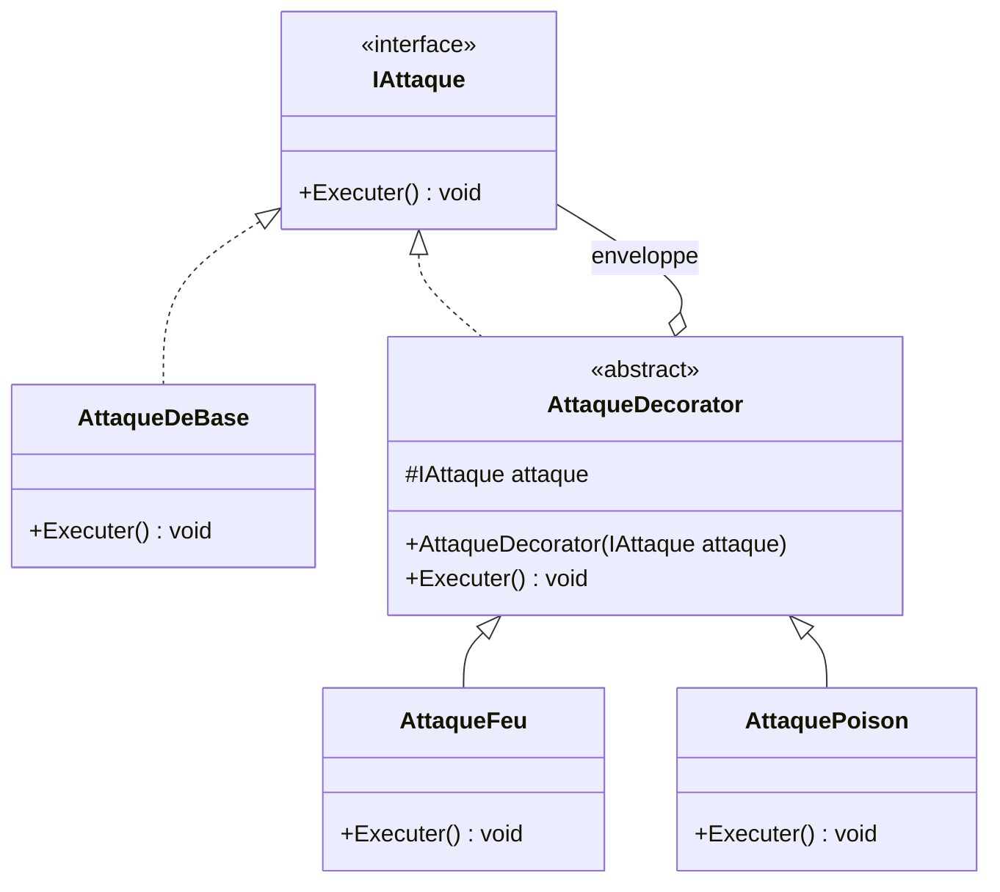
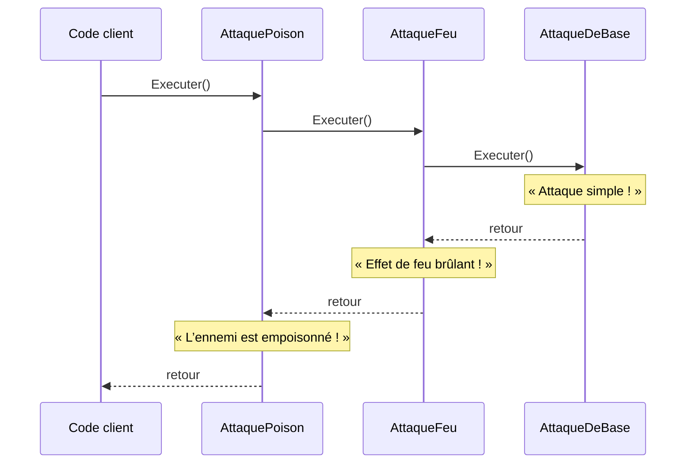

# 5. Decorator

> 🎯 **À la fin de cette fiche, vous savez expliquer :**
> * comment ajouter des comportements à un objet en l’enveloppant, sans sous-classe ;
> * pourquoi l’ordre des décorateurs peut changer le résultat ;
> * les limites du pattern (retirer un décorateur, déboguer une longue chaîne).
>
> ⏱️ 25 min · Prérequis : [8. Composition vs héritage](<../../Chapitre 1/Partie III — Concepts Avancés/8. Composition vs héritage.md>)

---

## Objectif

Permettre d’**ajouter dynamiquement des comportements** à un objet **sans modifier son code** ni créer de sous-classes supplémentaires.
Le **Decorator** étend les fonctionnalités d’un objet de manière flexible et modulable.

---

## Définition et explication

Le **pattern Decorator** (ou *Décorateur*) est un *pattern structurel* qui consiste à **envelopper** un objet dans un autre objet afin d’en modifier ou enrichir le comportement.
L’idée est de composer plusieurs objets qui implémentent la même interface, chacun ajoutant une fonctionnalité particulière.

> Ce pattern favorise la **composition dynamique** plutôt que l’héritage statique.

C’est une excellente alternative à l’héritage lorsqu’on veut **combiner plusieurs comportements** à la volée, sans multiplier les classes dérivées.

---

## Problème à résoudre

Supposons que vous ayez une classe `Attaque` de base, et que vous souhaitiez ajouter différents effets :

* feu,
* poison,
* ralentissement,
* critique, etc.

Créer une classe pour chaque combinaison (`AttaqueFeu`, `AttaqueFeuEtPoison`, `AttaquePoisonEtCritique`, etc.) conduirait à une **explosion du nombre de sous-classes**.

Le pattern Decorator résout ce problème en **empilant dynamiquement des couches de comportement** autour d’un objet.

---

## Structure du pattern

| Élément                   | Rôle                                                                                             |
| ------------------------- | ------------------------------------------------------------------------------------------------ |
| **Component (Composant)** | Interface commune à tous les objets pouvant être décorés.                                        |
| **ConcreteComponent**     | Objet de base que l’on veut étendre.                                                             |
| **Decorator**             | Classe abstraite qui implémente la même interface et contient une référence vers un `Component`. |
| **ConcreteDecorator**     | Classe concrète qui ajoute un comportement supplémentaire.                                       |

Appliqués à l’exemple ci-dessous : `IAttaque` est le *Component*, `AttaqueDeBase` le *ConcreteComponent*, `AttaqueDecorator` le *Decorator*, `AttaqueFeu` et `AttaquePoison` les *ConcreteDecorator*.



La particularité du pattern se lit dans le diagramme : le décorateur **est** un `IAttaque` (implémentation) **et contient** un `IAttaque` (agrégation). C’est ce qui permet d’empiler les couches.

---

## Implémentation en C#

### Exemple : système d’attaque avec effets

#### Interface de base

```csharp
public interface IAttaque
{
    void Executer();
}
```

#### Composant de base

```csharp
public class AttaqueDeBase : IAttaque
{
    public void Executer()
    {
        Console.WriteLine("Attaque simple !");
    }
}
```

#### Classe décoratrice abstraite

```csharp
public abstract class AttaqueDecorator : IAttaque
{
    protected IAttaque attaque;

    public AttaqueDecorator(IAttaque attaque)
    {
        this.attaque = attaque;
    }

    public virtual void Executer()
    {
        attaque.Executer();
    }
}
```

#### Décorateurs concrets

```csharp
public class AttaqueFeu : AttaqueDecorator
{
    public AttaqueFeu(IAttaque attaque) : base(attaque) { }

    public override void Executer()
    {
        base.Executer();
        Console.WriteLine("→ Effet de feu brûlant !");
    }
}

public class AttaquePoison : AttaqueDecorator
{
    public AttaquePoison(IAttaque attaque) : base(attaque) { }

    public override void Executer()
    {
        base.Executer();
        Console.WriteLine("→ L’ennemi est empoisonné !");
    }
}
```

#### Utilisation

```csharp
IAttaque attaque = new AttaqueDeBase();
attaque = new AttaqueFeu(attaque);
attaque = new AttaquePoison(attaque);

attaque.Executer();
```

**Sortie :**

```
Attaque simple !
→ Effet de feu brûlant !
→ L’ennemi est empoisonné !
```

Chaque décorateur ajoute son propre effet **sans altérer** le comportement du composant original.

Le déroulement de `attaque.Executer()` explique l’ordre de la sortie : chaque couche délègue d’abord à celle qu’elle enveloppe, puis ajoute son effet au retour.



### Variante : des décorateurs qui calculent une valeur

Le Decorator devient vraiment parlant quand chaque couche **modifie un résultat** plutôt que d’afficher du texte. Exemple : de l’équipement qui modifie les statistiques d’un guerrier.

```csharp
public interface IGuerrier
{
    int Degats { get; }
    int Vie { get; }
}

public class GuerrierDeBase : IGuerrier
{
    public int Degats => 5;
    public int Vie => 100;
}

public abstract class Equipement : IGuerrier
{
    protected readonly IGuerrier porteur;
    protected Equipement(IGuerrier porteur) => this.porteur = porteur;

    public virtual int Degats => porteur.Degats;
    public virtual int Vie => porteur.Vie;
}

public class Bouclier : Equipement
{
    public Bouclier(IGuerrier porteur) : base(porteur) { }
    public override int Vie => porteur.Vie + 10;
}

public class EpeeDeFeu : Equipement
{
    public EpeeDeFeu(IGuerrier porteur) : base(porteur) { }
    public override int Degats => porteur.Degats + 3;
}
```

```csharp
IGuerrier georges = new GuerrierDeBase();
georges = new Bouclier(new EpeeDeFeu(georges));

Console.WriteLine($"Dégâts : {georges.Degats}, Vie : {georges.Vie}");
```

**Sortie :**

```
Dégâts : 8, Vie : 110
```

Chaque couche s’appuie sur le résultat de la couche qu’elle enveloppe : c’est ainsi que l’on empile des bonus.

---

## Avantages

1. **Flexibilité extrême** : on peut combiner plusieurs décorateurs dynamiquement.
2. **Pas de modification du code existant** : respecte le principe *Open/Closed*.
3. **Substitution transparente** : tous les objets partagent la même interface.
4. **Réutilisation du code** : les décorateurs sont indépendants les uns des autres.

---

## Inconvénients

* Complexité accrue si les décorateurs sont nombreux.
* L’ordre d’application peut influer sur le comportement.
* Plus difficile à déboguer (chaînes d’appels imbriquées).
* **Difficile de retirer un décorateur** situé au milieu de la chaîne. Pour un bonus *temporaire*, il faut reconstruire la chaîne, ou préférer une simple liste de modificateurs parcourue à chaque calcul.

---

## Application dans Unity

Dans Unity, le **Decorator** est particulièrement utile pour enrichir des comportements sans créer de hiérarchies complexes.
On peut l’utiliser pour :

* Ajouter des **effets** (bonus, debuffs, power-ups), en gardant en tête qu’un décorateur se retire difficilement (voir *Inconvénients*).
* Étendre des systèmes (attaques, IA, interactions).
* Gérer des **chaînes de traitement** (par exemple, filtres de dégâts ou effets visuels).

### Exemple Unity : système d’effets sur attaques

```csharp
public interface IAttaque
{
    void Executer();
}

public class AttaqueDeBase : IAttaque
{
    public void Executer()
    {
        Debug.Log("Attaque de base !");
    }
}

public abstract class AttaqueDecorator : IAttaque
{
    protected IAttaque attaque;
    public AttaqueDecorator(IAttaque attaque) => this.attaque = attaque;

    public virtual void Executer() => attaque.Executer();
}

public class AttaqueFeu : AttaqueDecorator
{
    public AttaqueFeu(IAttaque attaque) : base(attaque) { }

    public override void Executer()
    {
        base.Executer();
        Debug.Log("Effet de feu appliqué !");
    }
}

public class AttaqueGlace : AttaqueDecorator
{
    public AttaqueGlace(IAttaque attaque) : base(attaque) { }

    public override void Executer()
    {
        base.Executer();
        Debug.Log("Effet de glace appliqué !");
    }
}
```

### Utilisation dans Unity

```csharp
IAttaque attaque = new AttaqueDeBase();
attaque = new AttaqueFeu(attaque);
attaque = new AttaqueGlace(attaque);

attaque.Executer();
```

**Console Unity :**

```
Attaque de base !
Effet de feu appliqué !
Effet de glace appliqué !
```

L’avantage : on peut combiner librement des effets sans créer des dizaines de classes dérivées comme `FireAndIceAttack`, `PoisonAndCritAttack`, etc.

---

## Quand utiliser le Decorator

| Situation                                                                | Recommandation |
| ------------------------------------------------------------------------ | -------------- |
| Vous devez ajouter des fonctionnalités à un objet sans modifier son code | ✅ Oui          |
| Vous voulez éviter une explosion de sous-classes                         | ✅ Oui          |
| Vous avez besoin de combiner plusieurs comportements dynamiquement       | ✅ Oui          |
| Le comportement ne varie jamais                                          | ❌ Inutile      |

---

## Comparaison : Héritage vs Décoration

| Approche       | Avantage             | Limite                 |
| -------------- | -------------------- | ---------------------- |
| **Héritage**   | Simple à implémenter | Rigide, peu flexible   |
| **Décorateur** | Dynamique, modulaire | Plus complexe à suivre |

---

## ⚠️ Pièges courants

* **Oublier de déléguer** à l’objet enveloppé : le décorateur *remplace* alors le comportement au lieu de l’*enrichir*, et toute la chaîne en dessous est ignorée.
* **Tester le type concret d’un objet décoré** (`if (attaque is AttaqueDeBase)`) : une fois enveloppé, l’objet n’est plus de ce type.
* **Ignorer l’ordre d’empilement** quand les décorateurs ne sont pas commutatifs (voir l’exercice).

## 🔀 À ne pas confondre

* **Decorator** (ajoute un comportement, même interface) et **[Adapter](<4. Adapter.md>)** (change l’interface).
* **Decorator** (une chaîne d’enveloppes, un seul enfant chacune) et **[Composite](<../Partie IV — Patterns complémentaires/12. Composite.md>)** (un arbre, plusieurs enfants par nœud).

---

## 🧪 Exercice : l’alchimiste

Une potion de soin rend 20 PV. Deux ingrédients peuvent la modifier :

* **Concentrée** : double la puissance, et ajoute « concentrée » au nom ;
* **Épicée** : ajoute 5 PV, et ajoute « épicée » au nom.

Écrivez une interface `IPotion` (`Nom`, `Puissance`), la classe `PotionDeSoin`, une classe abstraite `Ingredient` (le décorateur) et les deux décorateurs `Concentree` et `Epicee`.

**Question :** les deux potions du test ont les mêmes ingrédients. Pourquoi n’ont-elles pas la même puissance ?

**Test attendu :**

```csharp
IPotion p1 = new Concentree(new Epicee(new PotionDeSoin()));
IPotion p2 = new Epicee(new Concentree(new PotionDeSoin()));

Console.WriteLine($"{p1.Nom} : {p1.Puissance} PV");
Console.WriteLine($"{p2.Nom} : {p2.Puissance} PV");
```

```
Potion de soin épicée concentrée : 50 PV
Potion de soin concentrée épicée : 45 PV
```

<details>
<summary>Voir la solution</summary>

```csharp
public interface IPotion
{
    string Nom { get; }
    int Puissance { get; }
}

public class PotionDeSoin : IPotion
{
    public string Nom => "Potion de soin";
    public int Puissance => 20;
}

public abstract class Ingredient : IPotion
{
    protected readonly IPotion potion;
    protected Ingredient(IPotion potion) => this.potion = potion;

    public abstract string Nom { get; }
    public abstract int Puissance { get; }
}

public class Concentree : Ingredient
{
    public Concentree(IPotion potion) : base(potion) { }
    public override string Nom => potion.Nom + " concentrée";
    public override int Puissance => potion.Puissance * 2;
}

public class Epicee : Ingredient
{
    public Epicee(IPotion potion) : base(potion) { }
    public override string Nom => potion.Nom + " épicée";
    public override int Puissance => potion.Puissance + 5;
}
```

Le décorateur le plus **extérieur** s’applique en **dernier** : `p1` calcule (20 + 5) × 2 = 50, alors que `p2` calcule 20 × 2 + 5 = 45. Multiplier puis additionner ne donne pas le même résultat qu’additionner puis multiplier.

</details>

---

## Résumé

| Aspect              | Description                                                       |
| ------------------- | ----------------------------------------------------------------- |
| **But**             | Ajouter dynamiquement des fonctionnalités à un objet              |
| **Principe**        | Envelopper l’objet d’autres objets implémentant la même interface |
| **Mot-clé**         | “Composition dynamique plutôt qu’héritage”                        |
| **Exemple typique** | Effets sur attaque, filtres, bonus temporaires                    |

---

## Références utiles

* [Refactoring Guru — Decorator Pattern](https://refactoring.guru/fr/design-patterns/decorator)
* [Unity — e-book « Level up your code with design patterns and SOLID »](https://unity.com/resources/design-patterns-solid-ebook)
* [Unity Manual — Component-based Design](https://docs.unity3d.com/Manual/Components.html)
* Freeman, Eric & Robson, Elisabeth. *Head First Design Patterns*, O’Reilly, 2021.

---

[← Précédent : 4. Adapter](<4. Adapter.md>) · [Sommaire](<../../README.md>) · [Suivant : 6. Facade →](<6. Facade.md>)
