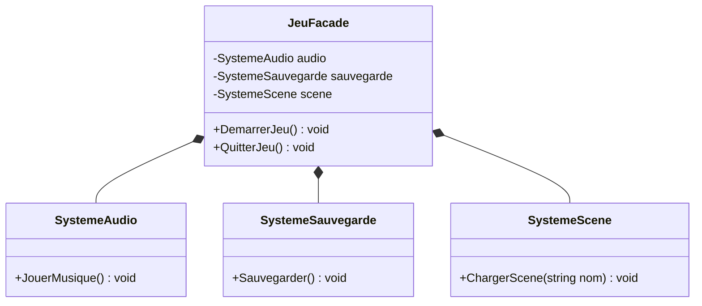
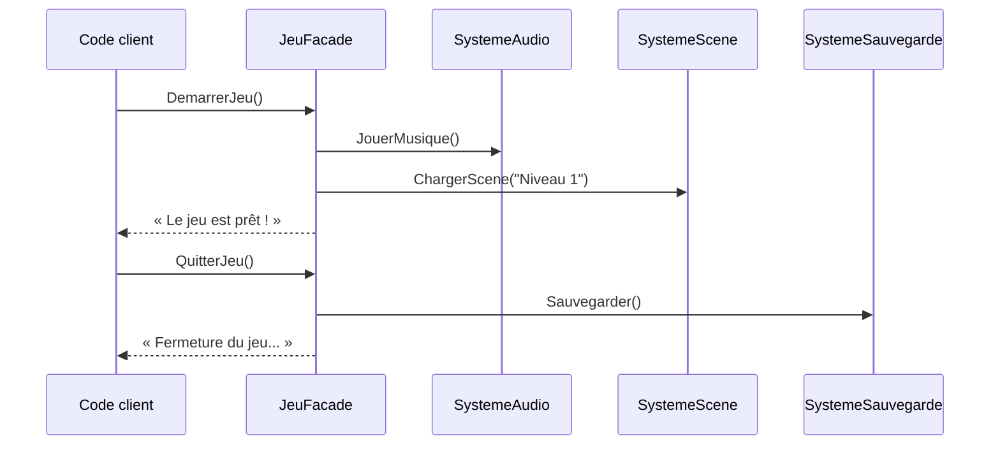

# 6. Facade

> 🎯 **À la fin de cette fiche, vous savez expliquer :**
> * comment offrir un point d’entrée simple à un ensemble de sous-systèmes ;
> * pourquoi une façade qui dépend d’interfaces devient testable ;
> * la différence entre une façade, un Mediator et un « God Object ».
>
> ⏱️ 20 min · Prérequis : [10. Couplage et Cohésion](<../../Chapitre 1/Partie III — Concepts Avancés/10. Couplage et Cohésion.md>)

---

## Objectif

Fournir une **interface unifiée et simplifiée** à un ensemble de classes ou de sous-systèmes complexes.
Le **pattern Facade** (ou *façade*) permet de **masquer la complexité interne** d’un système derrière une interface claire, cohérente et plus facile à utiliser.

---

## Définition et explication

Le **Facade** est un *pattern structurel* qui agit comme un **point d’entrée unique** vers un sous-système.
Il ne modifie pas la logique interne des classes qu’il encapsule — il se contente de **les coordonner** et de **simplifier leur utilisation**.

> L’objectif est de rendre un ensemble de fonctionnalités puissantes accessibles via une API simple et compréhensible.

---

## Problème à résoudre

Dans une application, on interagit souvent avec **plusieurs classes interdépendantes** :

* gérer l’audio,
* sauvegarder des données,
* charger une scène,
* configurer des paramètres.

Appeler toutes ces classes directement crée un **couplage fort** et **une grande complexité**.
Le pattern **Facade** permet de créer une **interface centrale** qui orchestre ces appels, simplifiant considérablement le code client.

---

## Structure du pattern

| Élément               | Rôle                                                                        |
| --------------------- | --------------------------------------------------------------------------- |
| **Subsystem classes** | Ensemble de classes complexes qui fournissent les fonctionnalités.          |
| **Facade**            | Interface simplifiée qui encapsule la complexité du sous-système.           |
| **Client**            | Code qui utilise la façade au lieu d’accéder directement aux sous-systèmes. |

Appliqués à l’exemple ci-dessous : `JeuFacade` est la *Facade*, `SystemeAudio`, `SystemeSauvegarde` et `SystemeScene` sont les classes du sous-système.



---

## Implémentation en C#

### Exemple : gestion de jeu simplifiée

#### Sous-systèmes indépendants

```csharp
public class SystemeAudio
{
    public void JouerMusique() => Console.WriteLine("Musique de fond lancée...");
}

public class SystemeSauvegarde
{
    public void Sauvegarder() => Console.WriteLine("Partie sauvegardée !");
}

public class SystemeScene
{
    public void ChargerScene(string nom) => Console.WriteLine($"Scène '{nom}' chargée.");
}
```

#### Façade unifiée

```csharp
public class JeuFacade
{
    private SystemeAudio audio = new SystemeAudio();
    private SystemeSauvegarde sauvegarde = new SystemeSauvegarde();
    private SystemeScene scene = new SystemeScene();

    public void DemarrerJeu()
    {
        audio.JouerMusique();
        scene.ChargerScene("Niveau 1");
        Console.WriteLine("Le jeu est prêt !");
    }

    public void QuitterJeu()
    {
        sauvegarde.Sauvegarder();
        Console.WriteLine("Fermeture du jeu...");
    }
}
```

#### Utilisation

```csharp
var jeu = new JeuFacade();
jeu.DemarrerJeu();
jeu.QuitterJeu();
```

**Sortie :**

```
Musique de fond lancée...
Scène 'Niveau 1' chargée.
Le jeu est prêt !
Partie sauvegardée !
Fermeture du jeu...
```

Le client n’a plus besoin de connaître ni d’instancier les trois sous-systèmes :
la façade agit comme **interface simplifiée et point central d’accès**.

Le diagramme de séquence montre ce que le client *n’a plus à faire* : il envoie deux messages, et la façade orchestre les appels aux sous-systèmes.



---

## Avantages

1. **Simplification de l’utilisation** : le client interagit avec une seule interface.
2. **Réduction du couplage** : le code client ne dépend plus des sous-systèmes internes.
3. **Organisation claire** : structure logique entre couches ou modules d’un projet.
4. **Encapsulation de la complexité** : permet d’évoluer sans impacter le code externe.

---

## Inconvénients

* Risque de créer un **“goulot d’étranglement”** si la façade devient trop lourde.
* Peut masquer la complexité **au détriment de la flexibilité**.
* Si mal conçue, elle peut **devenir un point de dépendance unique** (anti-pattern *God Object*).

---

## Application dans Unity

Dans Unity, le pattern **Facade** est très utile pour **organiser la communication entre systèmes** (audio, UI, inventaire, gameplay, etc.).
Il est souvent utilisé pour construire des **“Game Systems”** propres et bien isolés.

### Exemple Unity : gestionnaire de jeu (GameFacade)

```csharp
using UnityEngine;

public class AudioSystem : MonoBehaviour
{
    public void PlayMusic() => Debug.Log("Musique de fond lancée...");
}

public class SaveSystem : MonoBehaviour
{
    public void Save() => Debug.Log("Jeu sauvegardé !");
}

public class SceneSystem : MonoBehaviour
{
    public void LoadScene(string name) => Debug.Log($"Chargement de la scène {name}...");
}

public class GameFacade : MonoBehaviour
{
    [SerializeField] private AudioSystem audioSystem;
    [SerializeField] private SaveSystem saveSystem;
    [SerializeField] private SceneSystem sceneSystem;

    public void StartGame()
    {
        audioSystem.PlayMusic();
        sceneSystem.LoadScene("Niveau 1");
        Debug.Log("Jeu lancé !");
    }

    public void QuitGame()
    {
        saveSystem.Save();
        Debug.Log("Fermeture du jeu...");
    }
}
```

### Utilisation

```csharp
// Dans un script de menu principal :
public class MainMenu : MonoBehaviour
{
    [SerializeField] private GameFacade gameFacade;

    public void OnStartButton()
    {
        gameFacade.StartGame();
    }

    public void OnQuitButton()
    {
        gameFacade.QuitGame();
    }
}
```

Le **Menu** n’interagit plus directement avec les sous-systèmes : il ne connaît que la façade.
Cela améliore **l’isolation** et la **maintenance**. Pour faciliter aussi les **tests unitaires**, il faudrait que la façade dépende d’interfaces plutôt que de MonoBehaviour concrets (voir *Bonnes pratiques*).

---

## Bonnes pratiques

* Une façade doit **rester simple** : elle expose uniquement les fonctionnalités nécessaires.
* Si un système devient trop complexe, on peut le **diviser en plusieurs façades**.
* Coupler la façade à des **interfaces** pour permettre le remplacement ou la simulation des sous-systèmes (tests, prototypes, etc.).
* **Facade ≠ Mediator ≠ God Object.** Une *façade* simplifie l’accès à un sous-système, et les sous-systèmes ignorent son existence. Un *Mediator* coordonne des objets qui communiquent à travers lui. Un *God Object* est une façade qui a grossi jusqu’à contenir elle-même toute la logique : c’est à éviter.
* Utiliser ce pattern pour **structurer les couches logiques** d’un projet : UI → Gameplay → Système → Données.

---

## Quand utiliser le pattern Facade

| Situation                                                       | Recommandation |
| --------------------------------------------------------------- | -------------- |
| Le système est complexe et composé de nombreux modules          | ✅ Oui          |
| Le code client interagit directement avec trop de classes       | ✅ Oui          |
| Vous devez simplifier une API publique                          | ✅ Oui          |
| Vous voulez remplacer ou simuler un sous-système pour des tests | ✅ Oui          |
| Le système est simple ou unique                                 | ❌ Inutile      |

---

## ⚠️ Pièges courants

* **Une façade qui grossit sans fin** jusqu’à contenir la logique des sous-systèmes : elle devient un *God Object*. Elle doit **orchestrer**, pas **faire**.
* **Interdire tout accès direct aux sous-systèmes** : la façade simplifie les cas courants, mais le code qui a besoin d’un contrôle fin peut toujours utiliser les sous-systèmes directement.
* **Créer les sous-systèmes à l’intérieur de la façade** (`new SystemeAudio()`) : impossible de les remplacer pour un test ou une autre plateforme.

## 🔀 À ne pas confondre

* **Facade** (simplifie l’accès, les sous-systèmes ne la connaissent pas) et **Mediator** (coordonne des objets qui communiquent *à travers* lui).
* **Facade** et **[Singleton](<../Partie I — Patterns Créationnels/1. Singleton.md>)** : une façade est souvent unique en pratique, mais rien ne l’oblige à être un Singleton.

---

## 🧪 Exercice : une façade testable

Écrivez une `JeuFacade` qui dépend de trois interfaces, reçues par son constructeur :

```csharp
public interface IAudio { void JouerMusique(string piste); }
public interface IChargeurNiveau { void Charger(int niveau); }
public interface ISauvegarde
{
    int DernierNiveau();
    void Sauvegarder(int niveau);
}
```

* `NouvellePartie()` : sauvegarde le niveau 1, le charge, puis joue « Thème principal » ;
* `Continuer()` : charge le dernier niveau sauvegardé, puis joue « Thème du niveau N ».

Pour la tester sans moteur de jeu, écrivez trois **fausses implémentations** (`FauxAudio`, `FauxChargeur`, `FausseSauvegarde`) qui se contentent de noter ce qu’on leur demande dans un `Journal` partagé (une simple liste de chaînes).

**Test attendu :**

```csharp
var journal = new Journal();
var jeu = new JeuFacade(new FauxAudio(journal), new FauxChargeur(journal), new FausseSauvegarde(journal, 4));

jeu.Continuer();
jeu.NouvellePartie();

foreach (string ligne in journal.Lignes)
    Console.WriteLine(ligne);
```

```
Chargement du niveau 4
Audio : Thème du niveau 4
Sauvegarde : niveau 1
Chargement du niveau 1
Audio : Thème principal
```

<details>
<summary>Voir la solution</summary>

```csharp
public class JeuFacade
{
    private readonly IAudio audio;
    private readonly IChargeurNiveau chargeur;
    private readonly ISauvegarde sauvegarde;

    public JeuFacade(IAudio audio, IChargeurNiveau chargeur, ISauvegarde sauvegarde)
    {
        this.audio = audio;
        this.chargeur = chargeur;
        this.sauvegarde = sauvegarde;
    }

    public void NouvellePartie()
    {
        sauvegarde.Sauvegarder(1);
        chargeur.Charger(1);
        audio.JouerMusique("Thème principal");
    }

    public void Continuer()
    {
        int niveau = sauvegarde.DernierNiveau();
        chargeur.Charger(niveau);
        audio.JouerMusique($"Thème du niveau {niveau}");
    }
}

// Faux sous-systèmes pour le test : ils notent ce qu’on leur demande
public class Journal
{
    public List<string> Lignes { get; } = new();
}

public class FauxAudio : IAudio
{
    private readonly Journal journal;
    public FauxAudio(Journal journal) => this.journal = journal;
    public void JouerMusique(string piste) => journal.Lignes.Add($"Audio : {piste}");
}

public class FauxChargeur : IChargeurNiveau
{
    private readonly Journal journal;
    public FauxChargeur(Journal journal) => this.journal = journal;
    public void Charger(int niveau) => journal.Lignes.Add($"Chargement du niveau {niveau}");
}

public class FausseSauvegarde : ISauvegarde
{
    private readonly Journal journal;
    private int niveau;

    public FausseSauvegarde(Journal journal, int niveauSauvegarde)
    {
        this.journal = journal;
        niveau = niveauSauvegarde;
    }

    public int DernierNiveau() => niveau;

    public void Sauvegarder(int niveau)
    {
        this.niveau = niveau;
        journal.Lignes.Add($"Sauvegarde : niveau {niveau}");
    }
}
```

Ces faux objets (*fakes*) sont la technique de base des tests unitaires : la façade est vérifiée sans fichiers, sans son et sans scène.

</details>

---

## Résumé

| Aspect              | Description                                                     |
| ------------------- | --------------------------------------------------------------- |
| **But**             | Fournir une interface simplifiée à un système complexe          |
| **Principe**        | Masquer la complexité derrière une API unique                   |
| **Bénéfices**       | Réduction du couplage, code client simplifié                    |
| **Exemple typique** | Gestionnaire global dans Unity (GameManager, AudioSystem, etc.) |

---

## Références utiles

* [Refactoring Guru — Facade Pattern](https://refactoring.guru/fr/design-patterns/facade)
* [Unity — e-book « Level up your code with design patterns and SOLID »](https://unity.com/resources/design-patterns-solid-ebook)
* [Microsoft Learn — Principes architecturaux (séparation des responsabilités, inversion des dépendances…)](https://learn.microsoft.com/fr-fr/dotnet/architecture/modern-web-apps-azure/architectural-principles)
* Freeman, Eric & Robson, Elisabeth. *Head First Design Patterns*, O’Reilly, 2021.

---

[← Précédent : 5. Decorator](<5. Decorator.md>) · [Sommaire](<../../README.md>) · [Suivant : 7. Observer →](<../Partie III — Patterns Comportementaux/7. Observer.md>)
