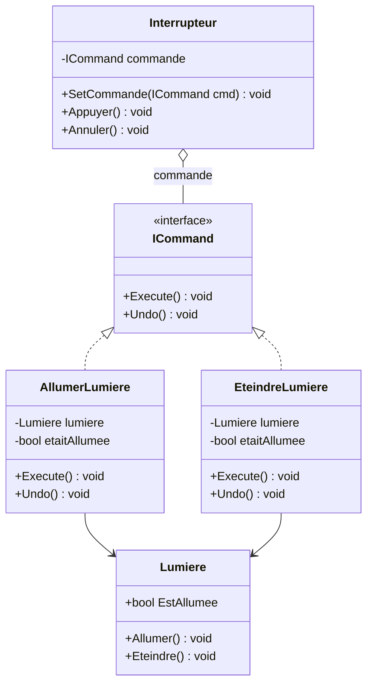
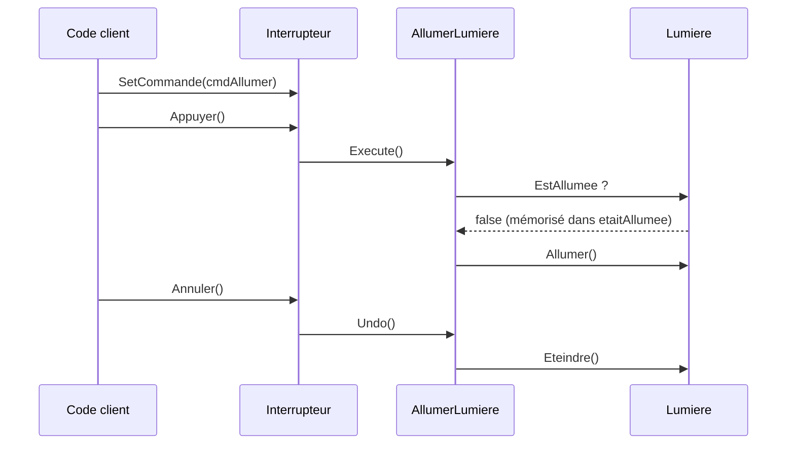

# 10. Command

## Objectif

Encapsuler une **action** ou une **opération** dans un objet distinct afin de pouvoir :

* l’exécuter plus tard,
* l’annuler (*undo*),
* la mettre en file d’attente,
* ou la combiner avec d’autres actions.

---

## Définition et explication

Le **pattern Command** est un *pattern comportemental* qui transforme une **demande** (une action, une instruction) en un **objet autonome**.
Cet objet contient :

* la **logique** de l’action à exécuter,
* et les **informations nécessaires** pour l’effectuer (cible, paramètres, etc.).

> Il découple **l’émetteur d’une commande** (ex. : une interface utilisateur, un système d’input) de **son exécuteur** (ex. : un joueur, un moteur d’actions).

---

## Problème à résoudre

Sans ce pattern, les actions utilisateur sont souvent exécutées directement :

```csharp
if (Input.GetKeyDown(KeyCode.Space))
    joueur.Sauter();
```

Ce code est simple, mais :

* il crée un **couplage fort** entre l’input et la logique du joueur,
* il empêche de **mémoriser, rejouer ou annuler** les actions,
* il rend le système **peu flexible** si de nouveaux contrôles apparaissent.

Le pattern **Command** isole ces actions dans des objets indépendants et réutilisables.

---

## Structure du pattern

| Élément                 | Rôle                                                      |
| ----------------------- | --------------------------------------------------------- |
| **Command (interface)** | Déclare une méthode d’exécution (`Execute`).              |
| **ConcreteCommand**     | Implémente une action concrète.                           |
| **Receiver**            | L’objet qui exécute réellement la commande.               |
| **Invoker**             | L’objet qui invoque la commande.                          |
| **Client**              | Configure les associations entre commandes et récepteurs. |

Appliqués à l’exemple ci-dessous : `ICommand` est la *Command*, `AllumerLumiere` et `EteindreLumiere` les *ConcreteCommand*, `Lumiere` le *Receiver*, `Interrupteur` l’*Invoker*, et le code d’utilisation joue le rôle du *Client*.



L’`Interrupteur` ne connaît que `ICommand` : il ignore qu’il pilote une lumière.

---

## Implémentation en C#

### Interface de commande

```csharp
public interface ICommand
{
    void Execute();
    void Undo();
}
```

### Récepteur

```csharp
public class Lumiere
{
    public bool EstAllumee { get; private set; }

    public void Allumer()  { EstAllumee = true;  Console.WriteLine("Lumière allumée !"); }
    public void Eteindre() { EstAllumee = false; Console.WriteLine("Lumière éteinte !"); }
}
```

### Commandes concrètes

```csharp
public class AllumerLumiere : ICommand
{
    private readonly Lumiere lumiere;
    private bool etaitAllumee; // état mémorisé pour pouvoir annuler correctement

    public AllumerLumiere(Lumiere lumiere)
    {
        this.lumiere = lumiere;
    }

    public void Execute()
    {
        etaitAllumee = lumiere.EstAllumee;
        lumiere.Allumer();
    }

    public void Undo()
    {
        if (!etaitAllumee)   // on ne défait que ce qu’on a réellement changé
            lumiere.Eteindre();
    }
}

public class EteindreLumiere : ICommand
{
    private readonly Lumiere lumiere;
    private bool etaitAllumee;

    public EteindreLumiere(Lumiere lumiere)
    {
        this.lumiere = lumiere;
    }

    public void Execute()
    {
        etaitAllumee = lumiere.EstAllumee;
        lumiere.Eteindre();
    }

    public void Undo()
    {
        if (etaitAllumee)
            lumiere.Allumer();
    }
}
```

### Invocateur

```csharp
public class Interrupteur
{
    private ICommand commande;

    public void SetCommande(ICommand cmd)
    {
        commande = cmd;
    }

    public void Appuyer()
    {
        commande?.Execute(); // aucune commande assignée : on ne fait rien
    }

    public void Annuler()
    {
        commande?.Undo();
    }
}
```

### Utilisation

```csharp
var lumiere = new Lumiere();
var cmdAllumer = new AllumerLumiere(lumiere);
var cmdEteindre = new EteindreLumiere(lumiere);

var interrupteur = new Interrupteur();

interrupteur.SetCommande(cmdAllumer);
interrupteur.Appuyer();  // → Lumière allumée !
interrupteur.Annuler();  // → Lumière éteinte !

interrupteur.SetCommande(cmdEteindre);
interrupteur.Appuyer();  // → Lumière éteinte !
```

Le trajet d’un appui puis d’une annulation :



L’`Interrupteur` (l’émetteur) n’appelle jamais `Lumiere` (l’exécuteur) directement : tout passe par l’objet commande, qui mémorise aussi de quoi annuler.

---

## Avantages

1. **Découplage complet** entre le demandeur et l’exécuteur de l’action.
2. **Stockage d’historique** des actions possible (Undo/Redo).
3. **Programmation flexible** (mise en file d’attente, macros, enregistrement).
4. **Réutilisation et composition** : on peut combiner plusieurs commandes.

---

## Inconvénients

* Nombre important de petites classes (une par commande).
* Complexité accrue si le système est volumineux.
* Requiert une gestion claire des dépendances et de l’historique.

---

## Application dans Unity

Le pattern **Command** est extrêmement utile dans Unity, notamment pour :

* la **gestion d’inputs** (actions utilisateur indépendantes du contrôleur),
* les **systèmes de macro-commandes** (enchaînements d’actions),
* les **systèmes Undo/Redo** dans des éditeurs ou outils,
* les **moteurs d’animation ou gameplay séquencés**.

### Exemple Unity : système d’input modulaire

```csharp
using UnityEngine;

// Un saut ne s’annule pas : cette interface d’input n’a donc pas de Undo().
// Le CommandManager plus bas utilise l’ICommand avec Undo() défini en début de fiche.
public interface IInputCommand
{
    void Execute();
}

public class JumpCommand : IInputCommand
{
    private Player player;
    public JumpCommand(Player player) => this.player = player;
    public void Execute() => player.Jump();
}

public class AttackCommand : IInputCommand
{
    private Player player;
    public AttackCommand(Player player) => this.player = player;
    public void Execute() => player.Attack();
}

public class Player : MonoBehaviour
{
    public void Jump() => Debug.Log("Le joueur saute !");
    public void Attack() => Debug.Log("Le joueur attaque !");
}
```

### Invocateur : gestionnaire d’inputs

```csharp
public class InputHandler : MonoBehaviour
{
    private IInputCommand jumpCommand;
    private IInputCommand attackCommand;

    void Start()
    {
        var player = FindFirstObjectByType<Player>(); // FindObjectOfType est obsolète depuis Unity 2023.1
        jumpCommand = new JumpCommand(player);
        attackCommand = new AttackCommand(player);
    }

    void Update()
    {
        if (Input.GetKeyDown(KeyCode.Space))
            jumpCommand.Execute();

        if (Input.GetKeyDown(KeyCode.A))
            attackCommand.Execute();
    }
}
```

Résultat :

* Le système d’input est **découplé du joueur**.
* On peut changer les commandes sans modifier la logique du jeu.
* Comme chaque action est un objet, on *pourrait* la stocker pour l’**enregistrer**, la **rejouer** ou l’**annuler** (voir l’historique ci-dessous).

> [!NOTE]
> `Input.GetKeyDown` appartient à l’ancien *Input Manager*. Avec le nouvel **Input System** (par défaut dans les projets récents), on associe plutôt chaque commande au callback d’une `InputAction` (`jumpAction.performed += _ => jumpCommand.Execute();`). Le principe du pattern reste identique.

---

### Extension : historique des commandes (Undo/Redo)

```csharp
public class CommandManager
{
    private readonly Stack<ICommand> historique = new Stack<ICommand>();
    private readonly Stack<ICommand> annulees = new Stack<ICommand>();

    public void ExecuterCommande(ICommand commande)
    {
        commande.Execute();
        historique.Push(commande);
        annulees.Clear(); // une nouvelle action invalide ce qui pouvait être « refait »
    }

    public void Annuler()
    {
        if (historique.Count == 0) return;

        var commande = historique.Pop();
        commande.Undo();
        annulees.Push(commande);
    }

    public void Refaire()
    {
        if (annulees.Count == 0) return;

        var commande = annulees.Pop();
        commande.Execute();
        historique.Push(commande);
    }
}
```

Deux piles suffisent pour un système **Undo/Redo** complet, par exemple dans un éditeur de niveau Unity. Ce gestionnaire utilise l’interface `ICommand` *avec* `Undo()` définie en début de fiche.

---

## Quand utiliser le Command Pattern

| Situation                                                     | Recommandation |
| ------------------------------------------------------------- | -------------- |
| Vous voulez découpler l’émetteur de l’exécuteur d’une action  | ✅ Oui          |
| Vous avez besoin d’un système Undo/Redo                       | ✅ Oui          |
| Vous souhaitez enregistrer ou rejouer des actions utilisateur | ✅ Oui          |
| Vous avez peu d’actions simples et fixes                      | ❌ Inutile      |

---

## Comparaison avec d’autres patterns

| Pattern      | Objectif                               |
| ------------ | -------------------------------------- |
| **Observer** | Réagir à des événements.               |
| **Strategy** | Choisir un algorithme.                 |
| **Command**  | Encapsuler une action.                 |
| **State**    | Changer de comportement selon un état. |

---

## Résumé

| Aspect                    | Description                                                                        |
| ------------------------- | ---------------------------------------------------------------------------------- |
| **But**                   | Encapsuler des actions sous forme d’objets pour les exécuter, annuler ou planifier |
| **Principe**              | Découpler l’émetteur d’une commande de son exécuteur                               |
| **Avantage clé**          | Extensible, testable, compatible Undo/Redo                                         |
| **Exemple Unity typique** | Systèmes d’input, éditeurs, gameplay scripté                                       |

---

## Références utiles

* [Refactoring Guru — Command Pattern](https://refactoring.guru/fr/design-patterns/command)
* [Robert Nystrom — Game Programming Patterns : Command](https://gameprogrammingpatterns.com/command.html)
* [Unity — Documentation de l’Input System](https://docs.unity3d.com/Packages/com.unity.inputsystem@1.11/manual/index.html)
* Freeman, Eric & Robson, Elisabeth. *Head First Design Patterns*, O’Reilly, 2021.

---

[← Précédent : 9. State](<9. State.md>) · [Sommaire](<../../README.md>) · [Suivant : 11. Template Method →](<../Partie IV — Patterns complémentaires/11. Template Method.md>)
