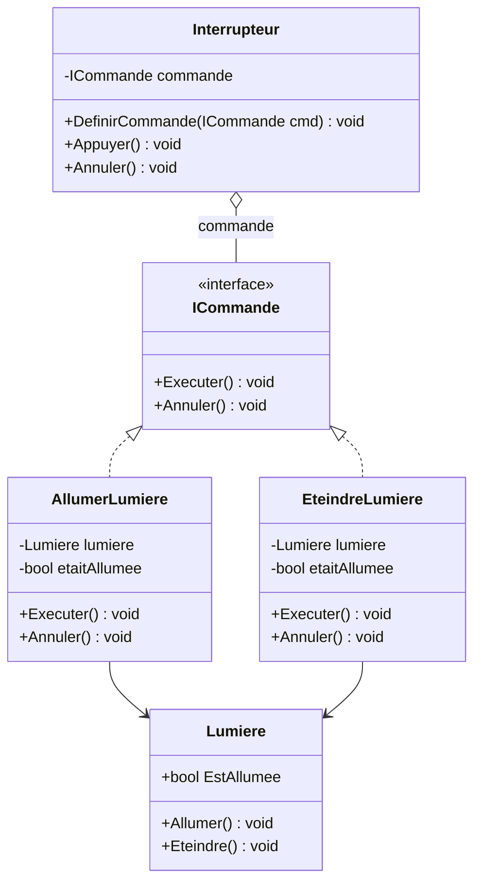
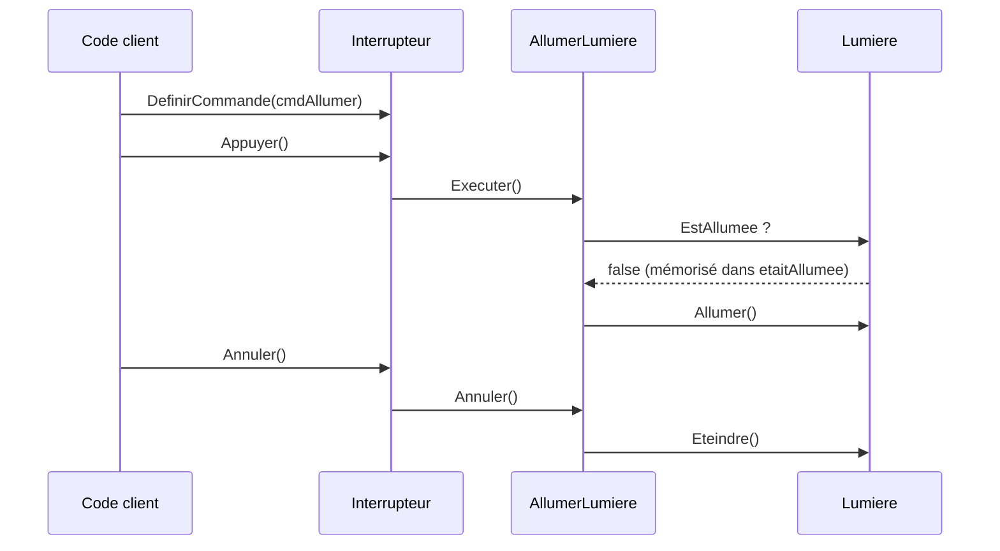

# 10. Command

> 🎯 **À la fin de cette fiche, vous savez expliquer :**
> * comment transformer une action en objet ;
> * comment deux piles suffisent à implémenter Undo et Redo ;
> * pourquoi une nouvelle action efface l’historique « refaire ».
>
> ⏱️ 30 min · Prérequis : [5. Abstraction](<../../Chapitre 1/Partie II — Les 4 piliers de la POO/5. Abstraction.md>), [16. Délégués, événements et lambdas](<../../Chapitre 1/Partie IV — Les outils du langage/16. Délégués, événements et lambdas.md>)

---

## Objectif

Encapsuler une **action** ou une **opération** dans un objet distinct afin de pouvoir :

* l’exécuter plus tard,
* l’annuler (*undo*),
* la mettre en file d’attente,
* ou la combiner avec d’autres actions.

---

## Définition et explication

Le **pattern Command** est un *pattern comportemental* qui transforme une **demande** (une action, une instruction) en un **objet autonome**.
Cet objet contient :

* la **logique** de l’action à exécuter,
* et les **informations nécessaires** pour l’effectuer (cible, paramètres, etc.).

> Il découple **l’émetteur d’une commande** (ex. : une interface utilisateur, un système d’input) de **son exécuteur** (ex. : un joueur, un moteur d’actions).

---

## Problème à résoudre

Sans ce pattern, les actions utilisateur sont souvent exécutées directement :

```csharp
if (Input.GetKeyDown(KeyCode.Space))
    joueur.Sauter();
```

Ce code est simple, mais :

* il crée un **couplage fort** entre l’input et la logique du joueur,
* il empêche de **mémoriser, rejouer ou annuler** les actions,
* il rend le système **peu flexible** si de nouveaux contrôles apparaissent.

Le pattern **Command** isole ces actions dans des objets indépendants et réutilisables.

---

## Structure du pattern

| Élément                 | Rôle                                                      |
| ----------------------- | --------------------------------------------------------- |
| **Command (interface)** | Déclare une méthode d’exécution (`Executer`).              |
| **ConcreteCommand**     | Implémente une action concrète.                           |
| **Receiver**            | L’objet qui exécute réellement la commande.               |
| **Invoker**             | L’objet qui invoque la commande.                          |
| **Client**              | Configure les associations entre commandes et récepteurs. |

Appliqués à l’exemple ci-dessous : `ICommande` est la *Command*, `AllumerLumiere` et `EteindreLumiere` les *ConcreteCommand*, `Lumiere` le *Receiver*, `Interrupteur` l’*Invoker*, et le code d’utilisation joue le rôle du *Client*.



L’`Interrupteur` ne connaît que `ICommande` : il ignore qu’il pilote une lumière.

---

## Implémentation en C#

### Interface de commande

```csharp
public interface ICommande
{
    void Executer();
    void Annuler();
}
```

### Récepteur

```csharp
public class Lumiere
{
    public bool EstAllumee { get; private set; }

    public void Allumer()  { EstAllumee = true;  Console.WriteLine("Lumière allumée !"); }
    public void Eteindre() { EstAllumee = false; Console.WriteLine("Lumière éteinte !"); }
}
```

### Commandes concrètes

```csharp
public class AllumerLumiere : ICommande
{
    private readonly Lumiere lumiere;
    private bool etaitAllumee; // état mémorisé pour pouvoir annuler correctement

    public AllumerLumiere(Lumiere lumiere)
    {
        this.lumiere = lumiere;
    }

    public void Executer()
    {
        etaitAllumee = lumiere.EstAllumee;
        lumiere.Allumer();
    }

    public void Annuler()
    {
        if (!etaitAllumee)   // on ne défait que ce qu’on a réellement changé
            lumiere.Eteindre();
    }
}

public class EteindreLumiere : ICommande
{
    private readonly Lumiere lumiere;
    private bool etaitAllumee;

    public EteindreLumiere(Lumiere lumiere)
    {
        this.lumiere = lumiere;
    }

    public void Executer()
    {
        etaitAllumee = lumiere.EstAllumee;
        lumiere.Eteindre();
    }

    public void Annuler()
    {
        if (etaitAllumee)
            lumiere.Allumer();
    }
}
```

### Invocateur

```csharp
public class Interrupteur
{
    private ICommande commande;

    public void DefinirCommande(ICommande cmd)
    {
        commande = cmd;
    }

    public void Appuyer()
    {
        commande?.Executer(); // aucune commande assignée : on ne fait rien
    }

    public void Annuler()
    {
        commande?.Annuler();
    }
}
```

### Utilisation

```csharp
var lumiere = new Lumiere();
var cmdAllumer = new AllumerLumiere(lumiere);
var cmdEteindre = new EteindreLumiere(lumiere);

var interrupteur = new Interrupteur();

interrupteur.DefinirCommande(cmdAllumer);
interrupteur.Appuyer();  // → Lumière allumée !
interrupteur.Annuler();  // → Lumière éteinte !

interrupteur.DefinirCommande(cmdEteindre);
interrupteur.Appuyer();  // → Lumière éteinte !
```

Le trajet d’un appui puis d’une annulation :



L’`Interrupteur` (l’émetteur) n’appelle jamais `Lumiere` (l’exécuteur) directement : tout passe par l’objet commande, qui mémorise aussi de quoi annuler.

---

## Avantages

1. **Découplage complet** entre le demandeur et l’exécuteur de l’action.
2. **Stockage d’historique** des actions possible (Undo/Redo).
3. **Programmation flexible** (mise en file d’attente, macros, enregistrement).
4. **Réutilisation et composition** : on peut combiner plusieurs commandes.

---

## Inconvénients

* Nombre important de petites classes (une par commande).
* Complexité accrue si le système est volumineux.
* Requiert une gestion claire des dépendances et de l’historique.

---

## Application dans Unity

Le pattern **Command** est extrêmement utile dans Unity, notamment pour :

* la **gestion d’inputs** (actions utilisateur indépendantes du contrôleur),
* les **systèmes de macro-commandes** (enchaînements d’actions),
* les **systèmes Undo/Redo** dans des éditeurs ou outils,
* les **moteurs d’animation ou gameplay séquencés**.

### Exemple Unity : système d’input modulaire

```csharp
using UnityEngine;

// Un saut ne s’annule pas : cette interface d’input n’a donc pas de Annuler().
// Le GestionnaireCommandes plus bas utilise l’ICommande avec Annuler() défini en début de fiche.
public interface ICommandeEntree
{
    void Executer();
}

public class CommandeSaut : ICommandeEntree
{
    private Joueur joueur;
    public CommandeSaut(Joueur joueur) => this.joueur = joueur;
    public void Executer() => joueur.Sauter();
}

public class CommandeAttaque : ICommandeEntree
{
    private Joueur joueur;
    public CommandeAttaque(Joueur joueur) => this.joueur = joueur;
    public void Executer() => joueur.Attaquer();
}

public class Joueur : MonoBehaviour
{
    public void Sauter() => Debug.Log("Le joueur saute !");
    public void Attaquer() => Debug.Log("Le joueur attaque !");
}
```

### Invocateur : gestionnaire d’inputs

```csharp
public class GestionnaireEntrees : MonoBehaviour
{
    private ICommandeEntree commandeSaut;
    private ICommandeEntree commandeAttaque;

    void Start()
    {
        var joueur = FindFirstObjectByType<Joueur>(); // FindObjectOfType est obsolète depuis Unity 2023.1
        commandeSaut = new CommandeSaut(joueur);
        commandeAttaque = new CommandeAttaque(joueur);
    }

    void Update()
    {
        if (Input.GetKeyDown(KeyCode.Space))
            commandeSaut.Executer();

        if (Input.GetKeyDown(KeyCode.A))
            commandeAttaque.Executer();
    }
}
```

Résultat :

* Le système d’input est **découplé du joueur**.
* On peut changer les commandes sans modifier la logique du jeu.
* Comme chaque action est un objet, on *pourrait* la stocker pour l’**enregistrer**, la **rejouer** ou l’**annuler** (voir l’historique ci-dessous).

> [!NOTE]
> `Input.GetKeyDown` appartient à l’ancien *Input Manager*. Avec le nouvel **Input System** (par défaut dans les projets récents), on associe plutôt chaque commande au callback d’une `InputAction` (`jumpAction.performed += _ => commandeSaut.Executer();`). Le principe du pattern reste identique.

---

### Extension : historique des commandes (Undo/Redo)

```csharp
public class GestionnaireCommandes
{
    private readonly Stack<ICommande> historique = new Stack<ICommande>();
    private readonly Stack<ICommande> annulees = new Stack<ICommande>();

    public void ExecuterCommande(ICommande commande)
    {
        commande.Executer();
        historique.Push(commande);
        annulees.Clear(); // une nouvelle action invalide ce qui pouvait être « refait »
    }

    public void Annuler()
    {
        if (historique.Count == 0) return;

        var commande = historique.Pop();
        commande.Annuler();
        annulees.Push(commande);
    }

    public void Refaire()
    {
        if (annulees.Count == 0) return;

        var commande = annulees.Pop();
        commande.Executer();
        historique.Push(commande);
    }
}
```

Deux piles suffisent pour un système **Undo/Redo** complet, par exemple dans un éditeur de niveau Unity. Ce gestionnaire utilise l’interface `ICommande` *avec* `Annuler()` définie en début de fiche.

---

## Quand utiliser le Command Pattern

| Situation                                                     | Recommandation |
| ------------------------------------------------------------- | -------------- |
| Vous voulez découpler l’émetteur de l’exécuteur d’une action  | ✅ Oui          |
| Vous avez besoin d’un système Undo/Redo                       | ✅ Oui          |
| Vous souhaitez enregistrer ou rejouer des actions utilisateur | ✅ Oui          |
| Vous avez peu d’actions simples et fixes                      | ❌ Inutile      |

---

## Comparaison avec d’autres patterns

| Pattern      | Objectif                               |
| ------------ | -------------------------------------- |
| **Observer** | Réagir à des événements.               |
| **Strategy** | Choisir un algorithme.                 |
| **Command**  | Encapsuler une action.                 |
| **State**    | Changer de comportement selon un état. |

---

## ⚠️ Pièges courants

* **Un `Annuler()` qui fait « l’inverse » au lieu de restaurer l’état précédent** : éteindre une lumière déjà éteinte, puis annuler, l’*allume* (voir la correction plus haut).
* **Oublier de vider la pile « refaire »** après une nouvelle action : on pourrait refaire une action qui n’a plus de sens dans le nouvel état.
* **Des commandes qui gardent une référence vers des objets détruits** (dans Unity, un ennemi détruit avec `Destroy`) : l’annulation provoque une `MissingReferenceException`.
* **Un historique illimité** : en mémoire, chaque commande conserve ses données. Plafonnez la taille si besoin.

## 🔀 À ne pas confondre

* **Command** (une action à exécuter, stocker, annuler) et **[Strategy](<8. Strategy.md>)** (une façon de faire, interchangeable).
* **Command** et **Memento** : pour annuler, une commande peut recalculer l’inverse de son action (comme ici) ou mémoriser une capture complète de l’état (c’est le pattern Memento, plus coûteux mais plus sûr pour les actions complexes).

---

## 🧪 Exercice : le robot sur une grille

Un robot se déplace sur une grille (`X`, `Y`, méthode `Deplacer(dx, dy)`). Écrivez :

* `CommandeDeplacement`, qui implémente l’interface `ICommande` (`Executer` / `Annuler`) de cette fiche ;
* un `GestionnaireCommandes` avec `ExecuterCommande`, `Annuler` et `Refaire`.

**Test attendu :**

```csharp
var robot = new Robot();
var gestionnaire = new GestionnaireCommandes();

gestionnaire.ExecuterCommande(new CommandeDeplacement(robot, 1, 0));
gestionnaire.ExecuterCommande(new CommandeDeplacement(robot, 0, 2));
gestionnaire.ExecuterCommande(new CommandeDeplacement(robot, 3, 0));
Console.WriteLine($"Après 3 déplacements : {robot}");

gestionnaire.Annuler();
gestionnaire.Annuler();
Console.WriteLine($"Après 2 annulations : {robot}");

gestionnaire.Refaire();
Console.WriteLine($"Après « refaire » : {robot}");

gestionnaire.ExecuterCommande(new CommandeDeplacement(robot, 0, -5));
gestionnaire.Refaire();   // sans effet : la nouvelle commande a vidé la pile « refaire »
Console.WriteLine($"Après un nouveau déplacement : {robot}");
```

```
Après 3 déplacements : (4, 2)
Après 2 annulations : (1, 0)
Après « refaire » : (1, 2)
Après un nouveau déplacement : (1, -3)
```

<details>
<summary>Voir la solution</summary>

```csharp
public class Robot
{
    public int X { get; private set; }
    public int Y { get; private set; }

    public void Deplacer(int dx, int dy)
    {
        X += dx;
        Y += dy;
    }

    public override string ToString() => $"({X}, {Y})";
}

public class CommandeDeplacement : ICommande
{
    private readonly Robot robot;
    private readonly int dx, dy;

    public CommandeDeplacement(Robot robot, int dx, int dy)
    {
        this.robot = robot;
        this.dx = dx;
        this.dy = dy;
    }

    public void Executer() => robot.Deplacer(dx, dy);
    public void Annuler() => robot.Deplacer(-dx, -dy);   // un déplacement est parfaitement réversible
}

public class GestionnaireCommandes
{
    private readonly Stack<ICommande> historique = new();
    private readonly Stack<ICommande> annulees = new();

    public void ExecuterCommande(ICommande commande)
    {
        commande.Executer();
        historique.Push(commande);
        annulees.Clear();
    }

    public void Annuler()
    {
        if (historique.Count == 0) return;
        var commande = historique.Pop();
        commande.Annuler();
        annulees.Push(commande);
    }

    public void Refaire()
    {
        if (annulees.Count == 0) return;
        var commande = annulees.Pop();
        commande.Executer();
        historique.Push(commande);
    }
}
```

**Pour aller plus loin :** en enregistrant la liste des commandes exécutées avec l’instant de chaque action, on peut **rejouer** une partie entière, ce qui est le principe des systèmes de *replay* dans les jeux.

</details>

---

## Résumé

| Aspect                    | Description                                                                        |
| ------------------------- | ---------------------------------------------------------------------------------- |
| **But**                   | Encapsuler des actions sous forme d’objets pour les exécuter, annuler ou planifier |
| **Principe**              | Découpler l’émetteur d’une commande de son exécuteur                               |
| **Avantage clé**          | Extensible, testable, compatible Undo/Redo                                         |
| **Exemple Unity typique** | Systèmes d’input, éditeurs, gameplay scripté                                       |

---

## Références utiles

* [Refactoring Guru — Command Pattern](https://refactoring.guru/fr/design-patterns/command)
* [Robert Nystrom — Game Programming Patterns : Command](https://gameprogrammingpatterns.com/command.html)
* [Unity — Documentation de l’Input System](https://docs.unity3d.com/Packages/com.unity.inputsystem@1.11/manual/index.html)
* Freeman, Eric & Robson, Elisabeth. *Head First Design Patterns*, O’Reilly, 2021.

---

[← Précédent : 9. State](<9. State.md>) · [Sommaire](<../../README.md>) · [Suivant : 11. Template Method →](<../Partie IV — Patterns complémentaires/11. Template Method.md>)
