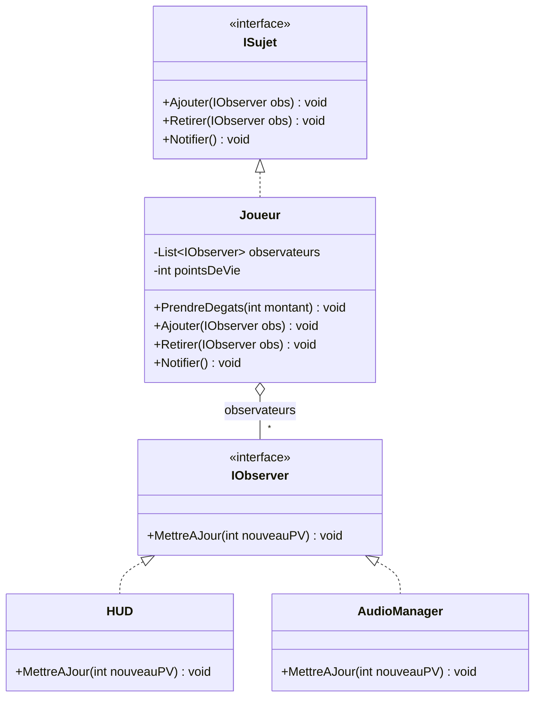
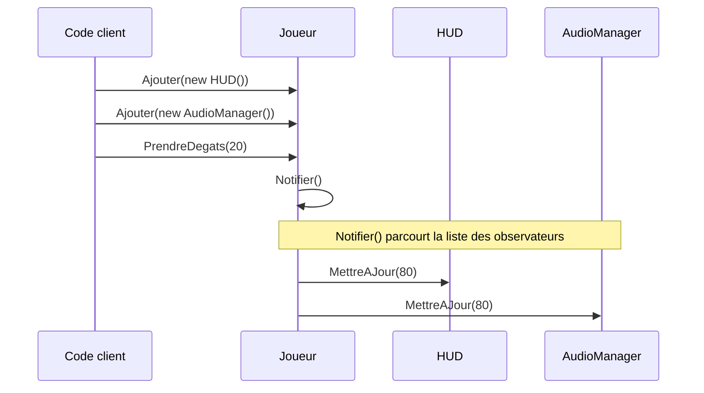

# 7. Observer

## Objectif

Permettre à des objets de **réagir automatiquement à des changements d’état** d’un autre objet sans créer de dépendance forte entre eux.
Le **pattern Observer** définit une **relation de notification un-à-plusieurs** entre un objet “observé” (le *subject*) et plusieurs “observateurs”.

---

## Définition et explication

Le **pattern Observer** (ou *observateur*) est un *pattern comportemental* qui permet à un objet (*sujet*) d’informer automatiquement plusieurs autres objets (*observateurs*) de tout changement d’état, sans connaître leur identité concrète.

> Il met en œuvre le principe de **faible couplage** : le sujet n’a pas besoin de savoir *qui* l’écoute, il se contente de diffuser un événement.

Ce modèle est au cœur des **systèmes d’événements**, des **interfaces utilisateur** et des **architectures réactives**.

---

## Problème à résoudre

Vous avez un objet dont l’état change (ex. : les points de vie d’un joueur).
Plusieurs autres objets doivent être informés (HUD, effets visuels, sons, IA ennemie...).
Sans Observer, on aurait tendance à **appeler directement** ces objets depuis le joueur :

```csharp
public class Joueur
{
    private HUD hud;
    private AudioManager audio;

    public void PrendreDegats(int montant)
    {
        hud.MettreAJourPV();
        audio.JouerEffet("Hit");
    }
}
```

Ce code crée un **fort couplage** : le joueur dépend de la HUD, de l’audio, etc.
Si on change la HUD, tout le code doit être modifié.

Le pattern **Observer** casse ce lien : le joueur *notifie un événement*, et les autres objets *s’abonnent librement* à cet événement.

---

## Structure du pattern

| Élément                    | Rôle                                                                                  |
| -------------------------- | ------------------------------------------------------------------------------------- |
| **Subject (Sujet)**        | L’objet observé : il maintient la liste des observateurs et envoie les notifications. |
| **Observer (Observateur)** | Interface ou classe recevant les notifications.                                       |
| **ConcreteSubject**        | Sujet concret (ex. : Joueur, ScoreManager, etc.).                                     |
| **ConcreteObserver**       | Observateur concret (ex. : HUD, AudioManager, etc.).                                  |

Appliqués à la version classique ci-dessous : `ISujet` est le *Subject*, `IObserver` l’*Observer*, `Joueur` le *ConcreteSubject*, `HUD` et `AudioManager` les *ConcreteObserver*.



Le `Joueur` ne pointe que vers l’interface `IObserver` : il ignore que `HUD` et `AudioManager` existent.

---

## Implémentation en C# (version classique)

### Interface de base

```csharp
public interface IObserver
{
    void MettreAJour(int nouveauPV);
}

public interface ISujet
{
    void Ajouter(IObserver obs);
    void Retirer(IObserver obs);
    void Notifier();
}
```

### Sujet concret

```csharp
public class Joueur : ISujet
{
    private List<IObserver> observateurs = new List<IObserver>();
    private int pointsDeVie = 100;

    public void PrendreDegats(int montant)
    {
        pointsDeVie -= montant;
        Notifier();
    }

    public void Ajouter(IObserver obs) => observateurs.Add(obs);
    public void Retirer(IObserver obs) => observateurs.Remove(obs);

    public void Notifier()
    {
        foreach (var obs in observateurs)
            obs.MettreAJour(pointsDeVie);
    }
}
```

### Observateurs concrets

```csharp
public class HUD : IObserver
{
    public void MettreAJour(int nouveauPV)
    {
        Console.WriteLine($"HUD mis à jour : {nouveauPV} PV restants.");
    }
}

public class AudioManager : IObserver
{
    public void MettreAJour(int nouveauPV)
    {
        Console.WriteLine("Effet sonore : le joueur est blessé !");
    }
}
```

### Utilisation

```csharp
Joueur joueur = new Joueur();
joueur.Ajouter(new HUD());
joueur.Ajouter(new AudioManager());

joueur.PrendreDegats(20);
```

**Sortie :**

```
HUD mis à jour : 80 PV restants.
Effet sonore : le joueur est blessé !
```

Le joueur ne connaît plus ni la HUD ni l’AudioManager : il notifie simplement ses abonnés.

L’ordre des appels, qui produit la sortie ci-dessus :



---

## Implémentation moderne avec `event` et `delegate` en C#

C# fournit une solution native et élégante pour implémenter le pattern Observer via les **délégués** et les **événements**.

### Exemple :

```csharp
public class Joueur
{
    public event Action<int> OnPVChange; // Événement

    private int pointsDeVie = 100;

    public void PrendreDegats(int montant)
    {
        pointsDeVie -= montant;
        OnPVChange?.Invoke(pointsDeVie); // Notification
    }
}
```

### Observateurs :

```csharp
public class HUD
{
    public void MettreAJour(int pv)
    {
        Console.WriteLine($"[HUD] PV actuels : {pv}");
    }
}

public class AudioManager
{
    public void MettreAJour(int pv)
    {
        Console.WriteLine("[Audio] Effet : dommage reçu !");
    }
}
```

### Utilisation :

```csharp
var joueur = new Joueur();
var hud = new HUD();
var audio = new AudioManager();

// Abonnement
joueur.OnPVChange += hud.MettreAJour;
joueur.OnPVChange += audio.MettreAJour;

joueur.PrendreDegats(25);
```

**Sortie :**

```
[HUD] PV actuels : 75
[Audio] Effet : dommage reçu !
```

C’est une implémentation **propre, moderne et naturelle** en C#, parfaitement compatible avec Unity.

> [!NOTE]
> **Pourquoi le mot-clé `event` ?** Un simple champ `public Action<int> OnPVChange;` fonctionnerait aussi, mais n’importe quel code extérieur pourrait alors l’**invoquer** (`joueur.OnPVChange(0)`) ou l’**écraser** (`joueur.OnPVChange = null`, ce qui désabonne tout le monde). Avec `event`, l’extérieur peut seulement s’abonner (`+=`) et se désabonner (`-=`) : seul le sujet déclenche la notification.

---

## Application dans Unity

Le pattern Observer est **fondamental dans Unity**, car tout le moteur repose sur ce principe :

* Les **`UnityEvent`** (par exemple `Button.onClick`) suivent ce modèle : on y abonne des méthodes, depuis le code ou depuis l’Inspector.
* À l’inverse, `OnTriggerEnter` ou `OnCollisionEnter` ne sont **pas** des abonnements : ce sont des messages que le moteur envoie directement aux scripts du GameObject concerné.
* Les **systèmes d’UI**, **entrées utilisateur** et **réactions de gameplay** utilisent ce schéma.
* Les **délégués C#** sont fréquemment employés pour relier différents scripts sans couplage fort.

### Exemple Unity : notification de dégâts

```csharp
using UnityEngine;
using System;

public class Player : MonoBehaviour
{
    public event Action<int> OnHealthChanged;
    private int health = 100;

    public void TakeDamage(int amount)
    {
        health -= amount;
        OnHealthChanged?.Invoke(health);
    }
}
```

#### Observateurs

```csharp
public class HealthUI : MonoBehaviour
{
    public void UpdateHealth(int newHealth)
    {
        Debug.Log($"HUD : {newHealth} PV restants");
    }
}

public class AudioSystem : MonoBehaviour
{
    public void PlayDamageSound(int newHealth)
    {
        Debug.Log("Son de dégât joué !");
    }
}
```

#### Connexion dans Unity

```csharp
public class GameSetup : MonoBehaviour
{
    [SerializeField] private Player player;
    [SerializeField] private HealthUI hud;
    [SerializeField] private AudioSystem audioSystem;

    private void OnEnable()
    {
        player.OnHealthChanged += hud.UpdateHealth;
        player.OnHealthChanged += audioSystem.PlayDamageSound;
    }

    private void OnDisable()
    {
        // Toujours se désabonner : sinon le Player garde des références
        // vers des objets peut-être détruits (MissingReferenceException)
        player.OnHealthChanged -= hud.UpdateHealth;
        player.OnHealthChanged -= audioSystem.PlayDamageSound;
    }
}
```

Cette approche permet de **lier les systèmes au runtime**, sans dépendances rigides ni appels directs entre scripts. Le couple `OnEnable` / `OnDisable` est l’idiome Unity : l’abonnement dure exactement le temps où le composant est actif.

---

## Avantages

1. **Faible couplage** : le sujet ne connaît pas le type concret de ses observateurs.
2. **Extensibilité** : on peut ajouter ou retirer des observateurs à la volée.
3. **Réactivité** : permet de propager automatiquement des changements.
4. **Intégration native dans Unity** via les `events`, `UnityEvents` et `delegates`.

---

## Inconvénients

* Peut être difficile à **déboguer** si trop d’abonnements sont actifs.
* Risque de **fuites de mémoire** si les observateurs ne se désabonnent pas (`-= ...`).
* Si mal structuré, peut conduire à une **chaîne d’événements non contrôlée**.

---

## Bonnes pratiques

* Toujours **se désabonner** (`-=`) : dans `OnDisable()` si l’abonnement a lieu dans `OnEnable()`, sinon dans `OnDestroy()`.
* Éviter les événements globaux non contrôlés.
* Documenter clairement les événements disponibles.
* Utiliser des **ScriptableObjects d’événements** (pattern *Event Channel*) pour les grands projets Unity.

### Variante Unity : l’Event Channel (ScriptableObject)

Ici, le sujet et les observateurs ne se référencent plus du tout : ils partagent seulement un **asset** d’événement, assigné dans l’Inspector.

```csharp
using System;
using UnityEngine;

[CreateAssetMenu(menuName = "Events/Int Event Channel")]
public class IntEventChannel : ScriptableObject
{
    public event Action<int> OnRaised;
    public void Raise(int value) => OnRaised?.Invoke(value);
}

public class Player : MonoBehaviour
{
    [SerializeField] private IntEventChannel healthChanged;
    private int health = 100;

    public void TakeDamage(int amount)
    {
        health -= amount;
        healthChanged.Raise(health);
    }
}

public class HealthUI : MonoBehaviour
{
    [SerializeField] private IntEventChannel healthChanged;

    private void OnEnable()  => healthChanged.OnRaised += UpdateHealth;
    private void OnDisable() => healthChanged.OnRaised -= UpdateHealth;

    private void UpdateHealth(int value) => Debug.Log($"HUD : {value} PV restants");
}
```

Le `Player` et la `HealthUI` peuvent vivre dans des scènes différentes et se tester séparément.

---

## Quand utiliser le pattern Observer

| Situation                                              | Recommandation |
| ------------------------------------------------------ | -------------- |
| Plusieurs objets doivent réagir à un même événement    | ✅ Oui          |
| Vous voulez éviter les appels directs entre classes    | ✅ Oui          |
| Vous gérez des notifications UI, gameplay, audio, etc. | ✅ Oui          |
| Les dépendances sont simples et fixes                  | ❌ Inutile      |

---

## Résumé

| Aspect                    | Description                                                      |
| ------------------------- | ---------------------------------------------------------------- |
| **But**                   | Synchroniser plusieurs objets via des notifications d’événements |
| **Principe**              | Relation sujet-observateurs (un-à-plusieurs)                     |
| **Avantage clé**          | Faible couplage, haute extensibilité                             |
| **Exemple Unity typique** | UI santé, score, inventaire, notifications de gameplay           |

---

## Références utiles

* [Refactoring Guru — Observer Pattern](https://refactoring.guru/fr/design-patterns/observer)
* [Microsoft Learn — Events and Delegates in C#](https://learn.microsoft.com/fr-fr/dotnet/csharp/programming-guide/events/)
* [Unity Manual — UnityEvents](https://docs.unity3d.com/Manual/unity-events.html)
* [Robert Nystrom — Game Programming Patterns : Observer](https://gameprogrammingpatterns.com/observer.html)
* Martin, Robert C. *Clean Architecture*, Prentice Hall, 2017 — chap. 8 : “Boundaries”.

---

[← Précédent : 6. Facade](<../Partie II — Patterns Structurels/6. Facade.md>) · [Sommaire](<../../README.md>) · [Suivant : 8. Strategy →](<8. Strategy.md>)
