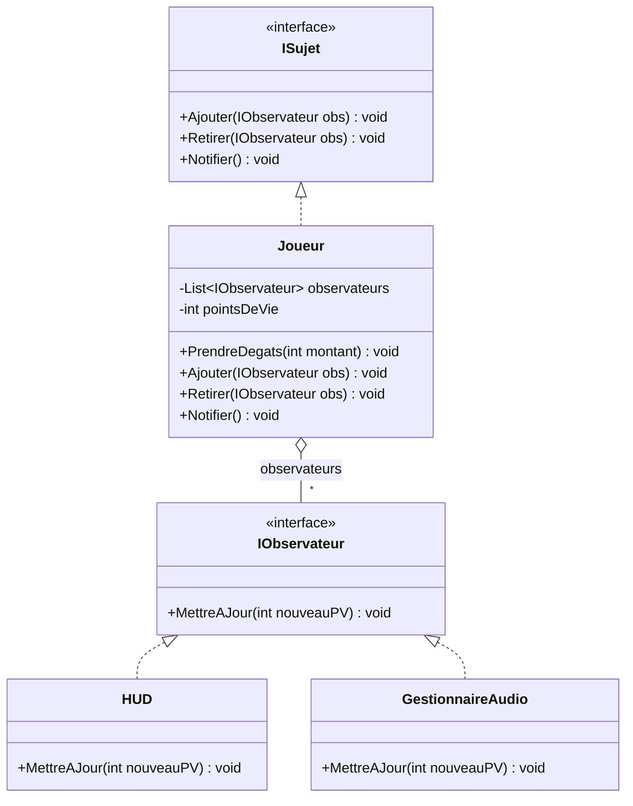
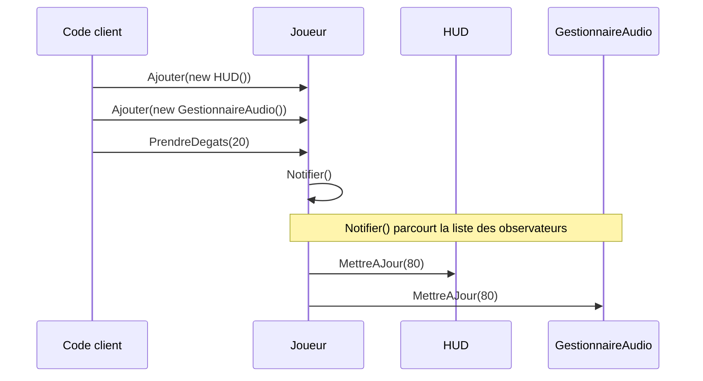

# 7. Observer

> 🎯 **À la fin de cette fiche, vous savez expliquer :**
> * comment un objet notifie plusieurs autres objets sans les connaître ;
> * la version classique (interfaces) et la version C# (`event`) du pattern ;
> * pourquoi il faut toujours se désabonner, et où le faire dans Unity.
>
> ⏱️ 30 min · Prérequis : [16. Délégués, événements et lambdas](<../../Chapitre 1/Partie IV — Les outils du langage/16. Délégués, événements et lambdas.md>)

---

## Objectif

Permettre à des objets de **réagir automatiquement à des changements d’état** d’un autre objet sans créer de dépendance forte entre eux.
Le **pattern Observer** définit une **relation de notification un-à-plusieurs** entre un objet “observé” (le *subject*) et plusieurs “observateurs”.

---

## Définition et explication

Le **pattern Observer** (ou *observateur*) est un *pattern comportemental* qui permet à un objet (*sujet*) d’informer automatiquement plusieurs autres objets (*observateurs*) de tout changement d’état, sans connaître leur identité concrète.

> Il met en œuvre le principe de **faible couplage** : le sujet n’a pas besoin de savoir *qui* l’écoute, il se contente de diffuser un événement.

Ce modèle est au cœur des **systèmes d’événements**, des **interfaces utilisateur** et des **architectures réactives**.

---

## Problème à résoudre

Vous avez un objet dont l’état change (ex. : les points de vie d’un joueur).
Plusieurs autres objets doivent être informés (HUD, effets visuels, sons, IA ennemie...).
Sans Observer, on aurait tendance à **appeler directement** ces objets depuis le joueur :

```csharp
public class Joueur
{
    private HUD hud;
    private GestionnaireAudio audio;

    public void PrendreDegats(int montant)
    {
        hud.MettreAJourPV();
        audio.JouerEffet("Hit");
    }
}
```

Ce code crée un **fort couplage** : le joueur dépend de la HUD, de l’audio, etc.
Si on change la HUD, tout le code doit être modifié.

Le pattern **Observer** casse ce lien : le joueur *notifie un événement*, et les autres objets *s’abonnent librement* à cet événement.

---

## Structure du pattern

| Élément                    | Rôle                                                                                  |
| -------------------------- | ------------------------------------------------------------------------------------- |
| **Subject (Sujet)**        | L’objet observé : il maintient la liste des observateurs et envoie les notifications. |
| **Observer (Observateur)** | Interface ou classe recevant les notifications.                                       |
| **ConcreteSubject**        | Sujet concret (ex. : Joueur, ScoreManager, etc.).                                     |
| **ConcreteObserver**       | Observateur concret (ex. : HUD, GestionnaireAudio, etc.).                                  |

Appliqués à la version classique ci-dessous : `ISujet` est le *Subject*, `IObservateur` l’*Observer*, `Joueur` le *ConcreteSubject*, `HUD` et `GestionnaireAudio` les *ConcreteObserver*.



Le `Joueur` ne pointe que vers l’interface `IObservateur` : il ignore que `HUD` et `GestionnaireAudio` existent.

---

## Implémentation en C# (version classique)

### Interface de base

```csharp
public interface IObservateur
{
    void MettreAJour(int nouveauPV);
}

public interface ISujet
{
    void Ajouter(IObservateur obs);
    void Retirer(IObservateur obs);
    void Notifier();
}
```

### Sujet concret

```csharp
public class Joueur : ISujet
{
    private List<IObservateur> observateurs = new List<IObservateur>();
    private int pointsDeVie = 100;

    public void PrendreDegats(int montant)
    {
        pointsDeVie -= montant;
        Notifier();
    }

    public void Ajouter(IObservateur obs) => observateurs.Add(obs);
    public void Retirer(IObservateur obs) => observateurs.Remove(obs);

    public void Notifier()
    {
        foreach (var obs in observateurs)
            obs.MettreAJour(pointsDeVie);
    }
}
```

### Observateurs concrets

```csharp
public class HUD : IObservateur
{
    public void MettreAJour(int nouveauPV)
    {
        Console.WriteLine($"HUD mis à jour : {nouveauPV} PV restants.");
    }
}

public class GestionnaireAudio : IObservateur
{
    public void MettreAJour(int nouveauPV)
    {
        Console.WriteLine("Effet sonore : le joueur est blessé !");
    }
}
```

### Utilisation

```csharp
Joueur joueur = new Joueur();
joueur.Ajouter(new HUD());
joueur.Ajouter(new GestionnaireAudio());

joueur.PrendreDegats(20);
```

**Sortie :**

```
HUD mis à jour : 80 PV restants.
Effet sonore : le joueur est blessé !
```

Le joueur ne connaît plus ni la HUD ni le GestionnaireAudio : il notifie simplement ses abonnés.

L’ordre des appels, qui produit la sortie ci-dessus :



---

## Implémentation moderne avec `event` et `delegate` en C#

C# fournit une solution native et élégante pour implémenter le pattern Observer via les **délégués** et les **événements**.

### Exemple :

```csharp
public class Joueur
{
    public event Action<int> OnPVChange; // Événement

    private int pointsDeVie = 100;

    public void PrendreDegats(int montant)
    {
        pointsDeVie -= montant;
        OnPVChange?.Invoke(pointsDeVie); // Notification
    }
}
```

### Observateurs :

```csharp
public class HUD
{
    public void MettreAJour(int pv)
    {
        Console.WriteLine($"[HUD] PV actuels : {pv}");
    }
}

public class GestionnaireAudio
{
    public void MettreAJour(int pv)
    {
        Console.WriteLine("[Audio] Effet : dommage reçu !");
    }
}
```

### Utilisation :

```csharp
var joueur = new Joueur();
var hud = new HUD();
var audio = new GestionnaireAudio();

// Abonnement
joueur.OnPVChange += hud.MettreAJour;
joueur.OnPVChange += audio.MettreAJour;

joueur.PrendreDegats(25);
```

**Sortie :**

```
[HUD] PV actuels : 75
[Audio] Effet : dommage reçu !
```

C’est une implémentation **propre, moderne et naturelle** en C#, parfaitement compatible avec Unity.

> [!NOTE]
> **Pourquoi le mot-clé `event` ?** Un simple champ `public Action<int> OnPVChange;` fonctionnerait aussi, mais n’importe quel code extérieur pourrait alors l’**invoquer** (`joueur.OnPVChange(0)`) ou l’**écraser** (`joueur.OnPVChange = null`, ce qui désabonne tout le monde). Avec `event`, l’extérieur peut seulement s’abonner (`+=`) et se désabonner (`-=`) : seul le sujet déclenche la notification.

---

## Application dans Unity

Le pattern Observer est **fondamental dans Unity**, car tout le moteur repose sur ce principe :

* Les **`UnityEvent`** (par exemple `Button.onClick`) suivent ce modèle : on y abonne des méthodes, depuis le code ou depuis l’Inspector.
* À l’inverse, `OnTriggerEnter` ou `OnCollisionEnter` ne sont **pas** des abonnements : ce sont des messages que le moteur envoie directement aux scripts du GameObject concerné.
* Les **systèmes d’UI**, **entrées utilisateur** et **réactions de gameplay** utilisent ce schéma.
* Les **délégués C#** sont fréquemment employés pour relier différents scripts sans couplage fort.

### Exemple Unity : notification de dégâts

```csharp
using UnityEngine;
using System;

public class Joueur : MonoBehaviour
{
    public event Action<int> OnPVChange;
    private int pointsDeVie = 100;

    public void PrendreDegats(int montant)
    {
        pointsDeVie -= montant;
        OnPVChange?.Invoke(pointsDeVie);
    }
}
```

#### Observateurs

```csharp
public class InterfaceSante : MonoBehaviour
{
    public void MettreAJour(int pv)
    {
        Debug.Log($"HUD : {pv} PV restants");
    }
}

public class SystemeAudio : MonoBehaviour
{
    public void JouerSonDegats(int pv)
    {
        Debug.Log("Son de dégât joué !");
    }
}
```

#### Connexion dans Unity

```csharp
public class InitialisationJeu : MonoBehaviour
{
    [SerializeField] private Joueur joueur;
    [SerializeField] private InterfaceSante hud;
    [SerializeField] private SystemeAudio systemeAudio;

    private void OnEnable()
    {
        joueur.OnPVChange += hud.MettreAJour;
        joueur.OnPVChange += systemeAudio.JouerSonDegats;
    }

    private void OnDisable()
    {
        // Toujours se désabonner : sinon le Joueur garde des références
        // vers des objets peut-être détruits (MissingReferenceException)
        joueur.OnPVChange -= hud.MettreAJour;
        joueur.OnPVChange -= systemeAudio.JouerSonDegats;
    }
}
```

Cette approche permet de **lier les systèmes au runtime**, sans dépendances rigides ni appels directs entre scripts. Le couple `OnEnable` / `OnDisable` est l’idiome Unity : l’abonnement dure exactement le temps où le composant est actif.

---

## Avantages

1. **Faible couplage** : le sujet ne connaît pas le type concret de ses observateurs.
2. **Extensibilité** : on peut ajouter ou retirer des observateurs à la volée.
3. **Réactivité** : permet de propager automatiquement des changements.
4. **Intégration native dans Unity** via les `events`, `UnityEvents` et `delegates`.

---

## Inconvénients

* Peut être difficile à **déboguer** si trop d’abonnements sont actifs.
* Risque de **fuites de mémoire** si les observateurs ne se désabonnent pas (`-= ...`).
* Si mal structuré, peut conduire à une **chaîne d’événements non contrôlée**.

---

## Bonnes pratiques

* Toujours **se désabonner** (`-=`) : dans `OnDisable()` si l’abonnement a lieu dans `OnEnable()`, sinon dans `OnDestroy()`.
* Éviter les événements globaux non contrôlés.
* Documenter clairement les événements disponibles.
* Utiliser des **ScriptableObjects d’événements** (pattern *Event Channel*) pour les grands projets Unity.

### Variante Unity : l’Event Channel (ScriptableObject)

Ici, le sujet et les observateurs ne se référencent plus du tout : ils partagent seulement un **asset** d’événement, assigné dans l’Inspector.

```csharp
using System;
using UnityEngine;

[CreateAssetMenu(menuName = "Événements/Canal d’entiers")]
public class CanalEvenementEntier : ScriptableObject
{
    public event Action<int> OnDeclenchement;
    public void Declencher(int valeur) => OnDeclenchement?.Invoke(valeur);
}

public class Joueur : MonoBehaviour
{
    [SerializeField] private CanalEvenementEntier pvModifies;
    private int pointsDeVie = 100;

    public void PrendreDegats(int montant)
    {
        pointsDeVie -= montant;
        pvModifies.Declencher(pointsDeVie);
    }
}

public class InterfaceSante : MonoBehaviour
{
    [SerializeField] private CanalEvenementEntier pvModifies;

    private void OnEnable()  => pvModifies.OnDeclenchement += MettreAJour;
    private void OnDisable() => pvModifies.OnDeclenchement -= MettreAJour;

    private void MettreAJour(int valeur) => Debug.Log($"HUD : {valeur} PV restants");
}
```

Le `Joueur` et la `InterfaceSante` peuvent vivre dans des scènes différentes et se tester séparément.

---

## Quand utiliser le pattern Observer

| Situation                                              | Recommandation |
| ------------------------------------------------------ | -------------- |
| Plusieurs objets doivent réagir à un même événement    | ✅ Oui          |
| Vous voulez éviter les appels directs entre classes    | ✅ Oui          |
| Vous gérez des notifications UI, gameplay, audio, etc. | ✅ Oui          |
| Les dépendances sont simples et fixes                  | ❌ Inutile      |

---

## ⚠️ Pièges courants

* **Notifier alors que rien n’a changé** : des mises à jour inutiles, voire des boucles infinies si un observateur modifie à son tour le sujet.
* **Modifier la liste des observateurs pendant la notification** (un observateur qui se désabonne dans sa propre méthode de notification) : avec une `List<IObservateur>` parcourue par `foreach`, c’est une `InvalidOperationException`. Les `event` C# n’ont pas ce problème, car ils parcourent une copie.
* **Une exception dans un observateur** interrompt la notification des suivants.
* **Dépendre de l’ordre de notification** : il n’est pas garanti par le pattern.

## 🔀 À ne pas confondre

* **Observer** (le sujet notifie ses abonnés directement) et **Event Channel / Event Bus** (un intermédiaire relaie les événements : sujet et observateurs ne se connaissent plus du tout).
* **`event` C#** (rapide, abonnement par code) et **`UnityEvent`** (sérialisé, configurable depuis l’Inspector, plus lent).

---

## 🧪 Exercice : le suivi de commande

Écrivez :

* une classe `Commande` avec un `Numero`, une propriété `Statut` (« En préparation » au départ) et un événement `StatutChange` (`Action<Commande>`) déclenché **seulement si le statut change vraiment** ;
* une classe `Client` avec `Suivre(Commande)` et `NePlusSuivre(Commande)`, qui affiche `[<Nom>] Commande n°<Numero> : <Statut>` à chaque notification.

**Test attendu :**

```csharp
var commande = new Commande(42);
var alice = new Client("Alice");
var bob = new Client("Bob");

alice.Suivre(commande);
bob.Suivre(commande);

commande.Statut = "Expédiée";
commande.Statut = "Expédiée";   // aucun changement : aucune notification

bob.NePlusSuivre(commande);
commande.Statut = "Livrée";
```

```
[Alice] Commande n°42 : Expédiée
[Bob] Commande n°42 : Expédiée
[Alice] Commande n°42 : Livrée
```

<details>
<summary>Voir la solution</summary>

```csharp
public class Commande
{
    private string statut = "En préparation";

    public int Numero { get; }
    public event Action<Commande> StatutChange;

    public Commande(int numero) => Numero = numero;

    public string Statut
    {
        get => statut;
        set
        {
            if (value == statut)
                return;            // pas de notification si rien ne change

            statut = value;
            StatutChange?.Invoke(this);
        }
    }
}

public class Client
{
    public string Nom { get; }

    public Client(string nom) => Nom = nom;

    public void Suivre(Commande commande) => commande.StatutChange += Notifier;
    public void NePlusSuivre(Commande commande) => commande.StatutChange -= Notifier;

    private void Notifier(Commande commande)
        => Console.WriteLine($"[{Nom}] Commande n°{commande.Numero} : {commande.Statut}");
}
```

Le client s’abonne avec une **méthode nommée** (`Notifier`), ce qui permet de se désabonner ensuite avec `-=`. Avec une lambda écrite en ligne, le désabonnement serait impossible.

</details>

---

## Résumé

| Aspect                    | Description                                                      |
| ------------------------- | ---------------------------------------------------------------- |
| **But**                   | Synchroniser plusieurs objets via des notifications d’événements |
| **Principe**              | Relation sujet-observateurs (un-à-plusieurs)                     |
| **Avantage clé**          | Faible couplage, haute extensibilité                             |
| **Exemple Unity typique** | UI santé, score, inventaire, notifications de gameplay           |

---

## Références utiles

* [Refactoring Guru — Observer Pattern](https://refactoring.guru/fr/design-patterns/observer)
* [Microsoft Learn — Events and Delegates in C#](https://learn.microsoft.com/fr-fr/dotnet/csharp/programming-guide/events/)
* [Unity Manual — UnityEvents](https://docs.unity3d.com/Manual/unity-events.html)
* [Robert Nystrom — Game Programming Patterns : Observer](https://gameprogrammingpatterns.com/observer.html)
* Martin, Robert C. *Clean Architecture*, Prentice Hall, 2017 — chap. 8 : “Boundaries”.

---

[← Précédent : 6. Facade](<../Partie II — Patterns Structurels/6. Facade.md>) · [Sommaire](<../../README.md>) · [Suivant : 8. Strategy →](<8. Strategy.md>)
