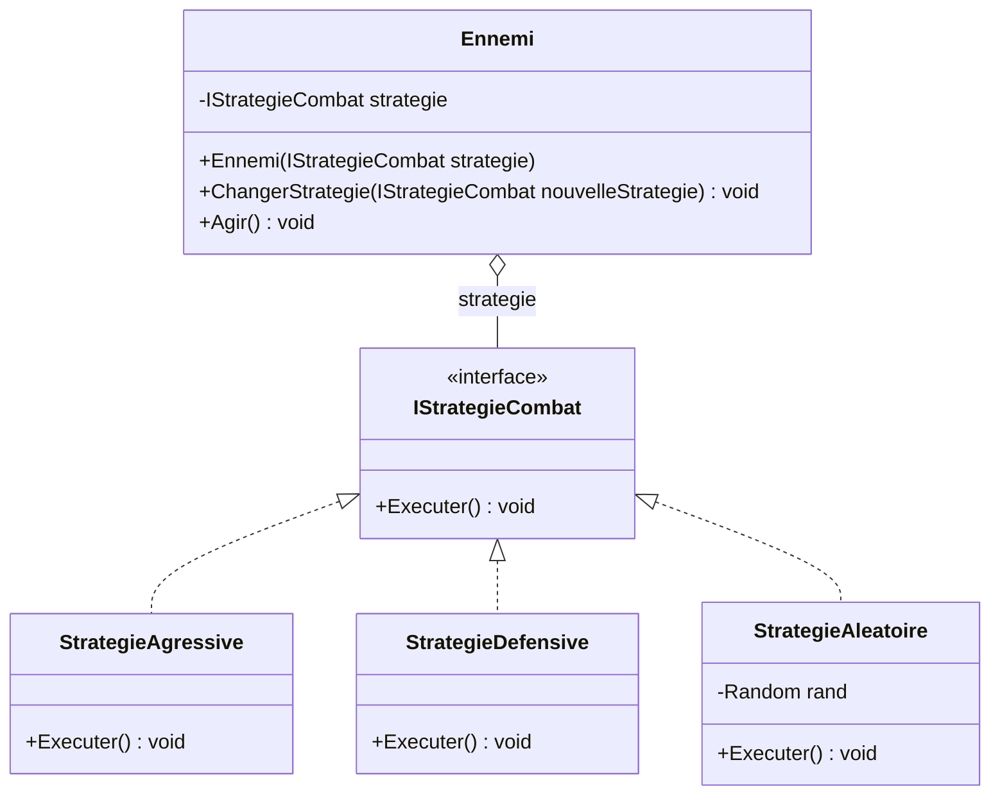

# 8. Strategy

> 🎯 **À la fin de cette fiche, vous savez expliquer :**
> * comment rendre un algorithme interchangeable à l’exécution ;
> * les trois façons de l’écrire en C# et Unity (interface, délégué, ScriptableObject) ;
> * la différence entre Strategy et State.
>
> ⏱️ 25 min · Prérequis : [8. Composition vs héritage](<../../Chapitre 1/Partie III — Concepts Avancés/8. Composition vs héritage.md>), [16. Délégués, événements et lambdas](<../../Chapitre 1/Partie IV — Les outils du langage/16. Délégués, événements et lambdas.md>)

---

## Objectif

Définir **une famille d’algorithmes interchangeables**, encapsuler chacun d’eux dans une classe distincte, et permettre au système de **choisir dynamiquement** lequel utiliser, **sans modifier le code client**.

---

## Définition et explication

Le **pattern Strategy** est un *pattern comportemental* qui consiste à **séparer un comportement variable du reste du code**.
L’idée est d’encapsuler plusieurs stratégies possibles dans des classes indépendantes, toutes basées sur une **même interface**, afin de pouvoir **changer le comportement à la volée**.

> En d’autres termes : *“On ne change pas la logique principale, on change la stratégie qu’elle emploie.”*

---

## Problème à résoudre

Imaginons un jeu où des ennemis ont plusieurs comportements possibles :

* agressif,
* défensif,
* aléatoire.

Une implémentation naïve serait d’utiliser des conditions partout :

```csharp
if (type == "agressif") { Attaquer(); }
else if (type == "defensif") { SeRetirer(); }
else if (type == "aleatoire") { FuirOuAttaquer(); }
```

Ce code est **rigide, non extensible et illisible**.
Chaque fois qu’un nouveau comportement est ajouté, il faut modifier la logique du système.

Le pattern **Strategy** résout ce problème en **isolant chaque comportement dans une classe distincte**, ce qui permet de les interchanger librement.

---

## Structure du pattern

| Élément                  | Rôle                                                  |
| ------------------------ | ----------------------------------------------------- |
| **Context**              | L’objet qui utilise une stratégie (ex. : Ennemi).     |
| **Strategy (interface)** | Définit l’interface commune de toutes les stratégies. |
| **ConcreteStrategy**     | Implémente un comportement spécifique.                |

Appliqués à l’exemple ci-dessous : `Ennemi` est le *Context*, `IStrategieCombat` la *Strategy*, `StrategieAgressive`, `StrategieDefensive` et `StrategieAleatoire` les *ConcreteStrategy*.



Les stratégies ne se connaissent pas entre elles : c’est le code client qui choisit laquelle brancher, via `ChangerStrategie()`.

---

## Implémentation en C#

### Interface de stratégie

```csharp
public interface IStrategieCombat
{
    void Executer();
}
```

### Stratégies concrètes

```csharp
public class StrategieAgressive : IStrategieCombat
{
    public void Executer() => Console.WriteLine("L’ennemi attaque violemment !");
}

public class StrategieDefensive : IStrategieCombat
{
    public void Executer() => Console.WriteLine("L’ennemi se met en position défensive.");
}

public class StrategieAleatoire : IStrategieCombat
{
    private Random rand = new Random();
    public void Executer()
    {
        if (rand.Next(0, 2) == 0)
            Console.WriteLine("L’ennemi attaque !");
        else
            Console.WriteLine("L’ennemi fuit !");
    }
}
```

### Contexte

```csharp
public class Ennemi
{
    private IStrategieCombat strategie;

    public Ennemi(IStrategieCombat strategie)
    {
        this.strategie = strategie;
    }

    public void ChangerStrategie(IStrategieCombat nouvelleStrategie)
    {
        strategie = nouvelleStrategie;
    }

    public void Agir()
    {
        strategie.Executer();
    }
}
```

### Utilisation

```csharp
Ennemi ennemi = new Ennemi(new StrategieAgressive());
ennemi.Agir();  // → "L’ennemi attaque violemment !"

ennemi.ChangerStrategie(new StrategieDefensive());
ennemi.Agir();  // → "L’ennemi se met en position défensive."
```

---

## Avantages

1. **Extensibilité** : ajouter une nouvelle stratégie ne nécessite pas de modifier le code existant.
2. **Lisibilité** : chaque comportement est isolé dans sa propre classe.
3. **Flexibilité** : le comportement peut être modifié à l’exécution.
4. **Respect du principe Open/Closed** : ouvert à l’extension, fermé à la modification.

---

## Inconvénients

* Multiplication du nombre de petites classes.
* Nécessite une **bonne gestion des dépendances** (injection ou instanciation claire).
* Pas idéal pour des comportements simples ou rarement modifiés.

---

## Application dans Unity

Dans Unity, le **Strategy Pattern** est très utilisé pour :

* les **IA d’ennemis** (stratégie de déplacement, de combat, de fuite, etc.),
* les **compétences de joueur** (attaque, soin, esquive, etc.),
* les **armes ou pouvoirs** (tir rapide, explosion, laser, etc.),
* les **systèmes de décision** (navigation, comportement d’alliés, etc.).

### Exemple Unity : IA d’ennemi

```csharp
using UnityEngine;

public interface IEnemyBehavior
{
    void Execute(Transform self, Transform target);
}

public class AggressiveBehavior : IEnemyBehavior
{
    public void Execute(Transform self, Transform target)
    {
        Debug.Log("L’ennemi fonce sur le joueur !");
        self.position = Vector3.MoveTowards(self.position, target.position, Time.deltaTime * 5);
    }
}

public class DefensiveBehavior : IEnemyBehavior
{
    public void Execute(Transform self, Transform target)
    {
        Debug.Log("L’ennemi se replie !");
        // S’éloigner : on vise un point situé à l’opposé de la cible
        Vector3 fuite = self.position + (self.position - target.position).normalized;
        self.position = Vector3.MoveTowards(self.position, fuite, Time.deltaTime * 3);
    }
}

public class RandomBehavior : IEnemyBehavior
{
    public void Execute(Transform self, Transform target)
    {
        if (Random.value > 0.5f)
            Debug.Log("Attaque surprise !");
        else
            Debug.Log("Fuite stratégique !");
    }
}
```

### Contexte (Ennemi)

```csharp
public class Enemy : MonoBehaviour
{
    private IEnemyBehavior behavior;
    [SerializeField] private Transform target;

    public void SetBehavior(IEnemyBehavior newBehavior)
    {
        behavior = newBehavior;
    }

    private void Update()
    {
        behavior?.Execute(transform, target);
    }
}
```

### Utilisation (dans un autre script)

```csharp
public class EnemySetup : MonoBehaviour
{
    [SerializeField] private Enemy enemy;

    void Start()
    {
        enemy.SetBehavior(new AggressiveBehavior());
    }

    void Update()
    {
        if (Input.GetKeyDown(KeyCode.Alpha1))
            enemy.SetBehavior(new AggressiveBehavior());
        if (Input.GetKeyDown(KeyCode.Alpha2))
            enemy.SetBehavior(new DefensiveBehavior());
        if (Input.GetKeyDown(KeyCode.Alpha3))
            enemy.SetBehavior(new RandomBehavior());
    }
}
```

L’ennemi peut ainsi **changer de comportement en temps réel** sans modifier sa logique interne.

> [!NOTE]
> Les `Debug.Log` servent à la démonstration : appelés depuis `Update()`, ils s’affichent à **chaque frame**. Retirez-les dans un vrai projet.

### Variante C# idiomatique : la stratégie comme délégué

Quand une stratégie se résume à **une seule méthode sans état**, une interface et une classe par stratégie sont superflues : un délégué (`Func<>` / `Action<>`) et des lambdas suffisent.

```csharp
public class Calculateur
{
    private Func<int, int> calculBonus;

    public Calculateur(Func<int, int> calculBonus) => this.calculBonus = calculBonus;
    public void ChangerStrategie(Func<int, int> nouvelle) => calculBonus = nouvelle;

    public int Calculer(int degatsDeBase) => calculBonus(degatsDeBase);
}
```

```csharp
var calc = new Calculateur(d => d);     // pas de bonus
Console.WriteLine(calc.Calculer(10));   // 10

calc.ChangerStrategie(d => d * 2);      // coup critique
Console.WriteLine(calc.Calculer(10));   // 20
```

### Variante Unity : la stratégie en ScriptableObject

Si chaque stratégie est un **asset**, le choix du comportement se fait dans l’Inspector, sans code, et les game designers peuvent créer et régler des variantes eux-mêmes.

```csharp
using UnityEngine;

public abstract class EnemyBehaviorSO : ScriptableObject
{
    public abstract void Execute(Transform self, Transform target);
}

[CreateAssetMenu(menuName = "AI/Aggressive")]
public class AggressiveBehaviorSO : EnemyBehaviorSO
{
    [SerializeField] private float speed = 5f;

    public override void Execute(Transform self, Transform target)
        => self.position = Vector3.MoveTowards(self.position, target.position, speed * Time.deltaTime);
}

public class Enemy : MonoBehaviour
{
    [SerializeField] private EnemyBehaviorSO behavior; // glissé depuis le projet
    [SerializeField] private Transform target;

    private void Update() => behavior.Execute(transform, target);
}
```

> [!WARNING]
> Un ScriptableObject est **partagé** par tous les ennemis qui le référencent. Il ne doit donc pas stocker d’état propre à un ennemi (cible courante, minuterie…), seulement des paramètres de réglage.

---

## Comparaison avec d’autres patterns

| Pattern      | Objectif principal                                             |
| ------------ | -------------------------------------------------------------- |
| **Strategy** | Choisir dynamiquement un algorithme.                           |
| **State**    | Gérer un comportement dépendant d’un état interne.             |
| **Command**  | Encapsuler une action pour la stocker ou l’exécuter plus tard. |

Le *Strategy* se concentre sur **le choix d’une logique**, pas sur la gestion d’un état.

---

## Quand utiliser le Strategy Pattern

| Situation                                                     | Recommandation |
| ------------------------------------------------------------- | -------------- |
| Plusieurs variantes d’un même comportement existent           | ✅ Oui          |
| Le comportement doit être interchangeable à l’exécution       | ✅ Oui          |
| Le code contient beaucoup de conditions (`if/else`, `switch`) | ✅ Oui          |
| Les comportements sont simples et fixes                       | ❌ Inutile      |

---

## ⚠️ Pièges courants

* **Un contexte qui teste quelle stratégie il possède** (`if (strategie is StrategieAgressive)`) : on retombe dans le `if/else` que le pattern devait supprimer.
* **Une stratégie qui a besoin de tout le contexte** : si l’interface de stratégie reçoit dix paramètres, le découpage est sans doute mauvais.
* **Des stratégies avec un état partagé** : une même instance utilisée par plusieurs contextes ne doit pas stocker d’état propre à l’un d’eux (c’est le piège des ScriptableObjects vu plus haut).
* **Créer une nouvelle stratégie à chaque frame** (`new AggressiveBehavior()` dans `Update`) : allocations inutiles. Les stratégies sans état peuvent être réutilisées.

## 🔀 À ne pas confondre

* **Strategy** (le **client** choisit l’algorithme) et **[State](<9. State.md>)** (l’**objet** change lui-même de comportement selon son état).
* **Strategy** (composition) et **[Template Method](<../Partie IV — Patterns complémentaires/11. Template Method.md>)** (héritage).

---

## 🧪 Exercice : la tourelle

Une tourelle de défense doit choisir une cible parmi des ennemis (`Nom`, `Distance`, `PointsDeVie`). Écrivez :

* une interface `IStrategieCiblage` avec `Ennemi Choisir(IReadOnlyList<Ennemi> ennemis)` ;
* trois stratégies : `PlusProche`, `PlusFaible` (le moins de PV), `PlusResistant` (le plus de PV) ;
* une classe `Tourelle` qui reçoit une stratégie, peut en changer, et dont `Tirer(ennemis)` affiche `La tourelle vise <Nom> (<NomDeLaStrategie>).`.

**Contrainte :** `Tourelle` ne doit contenir aucun `if` ni `switch`.

**Test attendu :**

```csharp
var ennemis = new List<Ennemi>
{
    new() { Nom = "Gobelin", Distance = 12, PointsDeVie = 30 },
    new() { Nom = "Ogre",    Distance = 25, PointsDeVie = 200 },
    new() { Nom = "Rat",     Distance = 15, PointsDeVie = 10 },
    new() { Nom = "Orc",     Distance = 8,  PointsDeVie = 80 }
};

var tourelle = new Tourelle(new PlusProche());
tourelle.Tirer(ennemis);

tourelle.ChangerStrategie(new PlusResistant());
tourelle.Tirer(ennemis);

tourelle.ChangerStrategie(new PlusFaible());
tourelle.Tirer(ennemis);
```

```
La tourelle vise Orc (PlusProche).
La tourelle vise Ogre (PlusResistant).
La tourelle vise Rat (PlusFaible).
```

<details>
<summary>Voir la solution</summary>

```csharp
public class Ennemi
{
    public string Nom { get; init; }
    public int Distance { get; init; }
    public int PointsDeVie { get; init; }
}

public interface IStrategieCiblage
{
    Ennemi Choisir(IReadOnlyList<Ennemi> ennemis);
}

public class PlusProche : IStrategieCiblage
{
    public Ennemi Choisir(IReadOnlyList<Ennemi> ennemis) => ennemis.OrderBy(e => e.Distance).First();
}

public class PlusFaible : IStrategieCiblage
{
    public Ennemi Choisir(IReadOnlyList<Ennemi> ennemis) => ennemis.OrderBy(e => e.PointsDeVie).First();
}

public class PlusResistant : IStrategieCiblage
{
    public Ennemi Choisir(IReadOnlyList<Ennemi> ennemis) => ennemis.OrderByDescending(e => e.PointsDeVie).First();
}

public class Tourelle
{
    private IStrategieCiblage strategie;

    public Tourelle(IStrategieCiblage strategie) => this.strategie = strategie;

    public void ChangerStrategie(IStrategieCiblage nouvelle) => strategie = nouvelle;

    public void Tirer(IReadOnlyList<Ennemi> ennemis)
    {
        Ennemi cible = strategie.Choisir(ennemis);
        Console.WriteLine($"La tourelle vise {cible.Nom} ({strategie.GetType().Name}).");
    }
}
```

`OrderBy(...).First()` fonctionne aussi dans Unity ; `MinBy` serait plus efficace, mais n’existe pas dans la version de .NET utilisée par Unity.

</details>

---

## Résumé

| Aspect                    | Description                                                               |
| ------------------------- | ------------------------------------------------------------------------- |
| **But**                   | Permettre de choisir dynamiquement un comportement ou un algorithme       |
| **Principe**              | Encapsuler chaque stratégie dans une classe distincte                     |
| **Avantage clé**          | Extensibilité et faible couplage                                          |
| **Exemple Unity typique** | IA d’ennemi, stratégie d’attaque, type de projectile, comportement d’arme |

---

## Références utiles

* [Refactoring Guru — Strategy Pattern](https://refactoring.guru/fr/design-patterns/strategy)
* [Microsoft Learn — Expressions lambda](https://learn.microsoft.com/fr-fr/dotnet/csharp/language-reference/operators/lambda-expressions)
* [Unity — e-book « Level up your code with design patterns and SOLID »](https://unity.com/resources/design-patterns-solid-ebook)
* Gamma et al. *Design Patterns: Elements of Reusable Object-Oriented Software*, Addison-Wesley, 1994.

---

[← Précédent : 7. Observer](<7. Observer.md>) · [Sommaire](<../../README.md>) · [Suivant : 9. State →](<9. State.md>)
