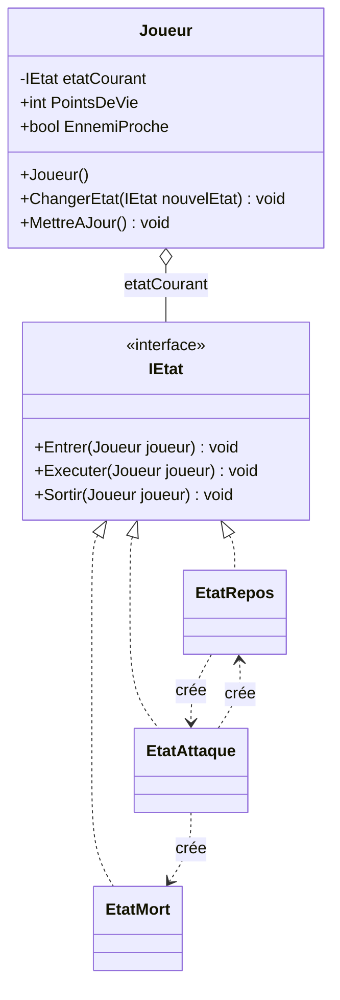
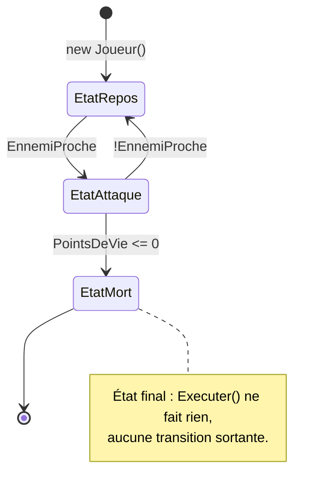

# 9. State

> 🎯 **À la fin de cette fiche, vous savez expliquer :**
> * comment remplacer un gros `switch` sur un état par des classes d’état ;
> * pourquoi ce sont les **états** qui décident des transitions ;
> * le rôle des méthodes `Entrer` / `Executer` / `Sortir` d’une machine à états.
>
> ⏱️ 30 min · Prérequis : [7. Polymorphisme](<../../Chapitre 1/Partie II — Les 4 piliers de la POO/7. Polymorphisme.md>), [8. Strategy](<8. Strategy.md>)

---

## Objectif

Permettre à un objet de **modifier son comportement en fonction de son état interne**, comme s’il changeait de classe à l’exécution.
Chaque état est représenté par une classe distincte, et l’objet délègue ses actions à celle qui correspond à son état actuel.

---

## Définition et explication

Le **pattern State** (ou *État*) est un *pattern comportemental* qui permet de **remplacer les conditions `if/else` ou `switch` répétitives** par une **structure orientée objet**.
Au lieu de gérer les états via des drapeaux ou des variables (`if (etat == "Attaque")`...), on encapsule chaque état dans une classe dédiée.

> L’objet principal délègue son comportement à un “état courant”, qui peut être changé à tout moment.

Ce pattern est fondamental pour les systèmes **à logique évolutive** : personnages de jeux, machines à états, IA, interfaces utilisateur, etc.

---

## Problème à résoudre

Prenons un personnage de jeu qui peut être :

* au repos,
* en attaque,
* en fuite,
* mort.

Une approche naïve utiliserait un code rempli de conditions :

```csharp
if (etat == "Repos") { ... }
else if (etat == "Attaque") { ... }
else if (etat == "Fuite") { ... }
```

Ce type de code devient vite illisible et difficile à maintenir.
Chaque ajout de nouvel état nécessite de modifier tout le bloc `switch`.

Le pattern **State** permet de déléguer chaque comportement à **une classe d’état indépendante**, tout en gardant la logique principale claire et extensible.

---

## Structure du pattern

| Élément               | Rôle                                                            |
| --------------------- | --------------------------------------------------------------- |
| **Context**           | L’objet dont le comportement varie selon l’état (ex. : Joueur). |
| **State (interface)** | Définit les comportements possibles dans chaque état.           |
| **ConcreteState**     | Implémente le comportement pour un état spécifique.             |
| **Transition**        | Le contexte peut changer d’état à tout moment.                  |

Appliqués à l’exemple ci-dessous : `Joueur` est le *Context*, `IEtat` le *State*, `EtatRepos`, `EtatAttaque` et `EtatMort` les *ConcreteState*.



À la différence de Strategy, les états **se connaissent entre eux** (flèches en pointillés) : chacun sait vers quel état il peut basculer.

---

## Implémentation en C#

### Interface d’état

```csharp
public interface IEtat
{
    void Entrer(Joueur joueur);
    void Executer(Joueur joueur);
    void Sortir(Joueur joueur);
}
```

### États concrets

```csharp
public class EtatRepos : IEtat
{
    public void Entrer(Joueur joueur) => Console.WriteLine("Le joueur se repose.");

    public void Executer(Joueur joueur)
    {
        if (joueur.EnnemiProche)
            joueur.ChangerEtat(new EtatAttaque());   // transition décidée par l’état lui-même
        else
            Console.WriteLine("Zzz...");
    }

    public void Sortir(Joueur joueur) => Console.WriteLine("Le joueur se réveille.");
}

public class EtatAttaque : IEtat
{
    public void Entrer(Joueur joueur) => Console.WriteLine("Le joueur se met en position d'attaque !");

    public void Executer(Joueur joueur)
    {
        if (joueur.PointsDeVie <= 0)
            joueur.ChangerEtat(new EtatMort());
        else if (!joueur.EnnemiProche)
            joueur.ChangerEtat(new EtatRepos());
        else
            Console.WriteLine("Le joueur attaque !");
    }

    public void Sortir(Joueur joueur) => Console.WriteLine("Le joueur cesse d'attaquer.");
}

public class EtatMort : IEtat
{
    public void Entrer(Joueur joueur) => Console.WriteLine("Le joueur est mort.");
    public void Executer(Joueur joueur) { }   // état final : aucune transition sortante
    public void Sortir(Joueur joueur) { }
}
```

### Contexte

```csharp
public class Joueur
{
    private IEtat etatCourant;

    public int PointsDeVie { get; set; } = 100;
    public bool EnnemiProche { get; set; }

    public Joueur() => ChangerEtat(new EtatRepos());

    public void ChangerEtat(IEtat nouvelEtat)
    {
        etatCourant?.Sortir(this);
        etatCourant = nouvelEtat;
        etatCourant.Entrer(this);
    }

    public void MettreAJour() => etatCourant.Executer(this);
}
```

### Utilisation

```csharp
var joueur = new Joueur();      // démarre au repos
joueur.MettreAJour();

joueur.EnnemiProche = true;     // le contexte change…
joueur.MettreAJour();           // …et l’état Repos décide de passer en Attaque
joueur.MettreAJour();

joueur.PointsDeVie = 0;
joueur.MettreAJour();           // l’état Attaque décide de passer en Mort
joueur.MettreAJour();           // plus rien ne se passe
```

**Sortie :**

```
Le joueur se repose.
Zzz...
Le joueur se réveille.
Le joueur se met en position d'attaque !
Le joueur attaque !
Le joueur cesse d'attaquer.
Le joueur est mort.
```

Le point clé : **ce sont les états eux-mêmes qui décident des transitions**, en fonction du contexte. Le code client se contente de mettre à jour le joueur. C’est ce qui distingue State de Strategy, où le changement de comportement est décidé de l’extérieur.

Le diagramme d’états correspondant : chaque flèche est une transition déclenchée dans la méthode `Executer()` de l’état de départ.



---

## Avantages

1. **Lisibilité accrue** : plus de blocs `switch` ou `if/else` géants.
2. **Extensibilité** : ajouter un nouvel état ne casse pas le code existant.
3. **Encapsulation claire** : chaque état gère son propre comportement.
4. **Transitions explicites** : contrôle précis des changements d’état.

---

## Inconvénients

* Multiplication du nombre de classes (un état = une classe).
* Peut sembler verbeux pour des systèmes simples.
* Demande une **discipline de conception** pour bien gérer les transitions.

---

## Application dans Unity

Le **State Pattern** est extrêmement courant dans Unity, notamment pour :

* les **machines à états** de gameplay (menu, combat, pause, mort),
* les **comportements d’ennemis IA**,
* les **animations** (via `Animator` ou code),
* les **logiques de joueur** (saut, course, attaque, etc.).

### Exemple Unity : machine à états pour un personnage

```csharp
using UnityEngine;

public interface IEtatJoueur
{
    void Entrer(Joueur joueur);
    void Executer(Joueur joueur);
    void Sortir(Joueur joueur);
}

public class EtatRepos : IEtatJoueur
{
    public void Entrer(Joueur joueur) => Debug.Log("Le joueur se met au repos.");
    public void Executer(Joueur joueur) => Debug.Log("Zzz...");
    public void Sortir(Joueur joueur) => Debug.Log("Le joueur se prépare à bouger.");
}

public class EtatAttaque : IEtatJoueur
{
    public void Entrer(Joueur joueur) => Debug.Log("Le joueur prépare son attaque !");
    public void Executer(Joueur joueur) => Debug.Log("Coup porté !");
    public void Sortir(Joueur joueur) => Debug.Log("Le joueur reprend sa garde.");
}

public class EtatMort : IEtatJoueur
{
    public void Entrer(Joueur joueur) => Debug.Log("Le joueur est mort !");
    public void Executer(Joueur joueur) { }
    public void Sortir(Joueur joueur) { }  // jamais appelé : voir le garde dans ChangerEtat
}
```

### Contexte (Player)

```csharp
public class Joueur : MonoBehaviour
{
    private IEtatJoueur etatCourant;

    void Start()
    {
        ChangerEtat(new EtatRepos());
    }

    void Update()
    {
        // Entrées de test. Dans un vrai jeu, ce sont plutôt les états
        // eux-mêmes qui déclenchent les transitions (comme dans l’exemple C#).
        if (Input.GetKeyDown(KeyCode.A))
            ChangerEtat(new EtatAttaque());
        if (Input.GetKeyDown(KeyCode.D))
            ChangerEtat(new EtatMort());

        etatCourant?.Executer(this);
    }

    public void ChangerEtat(IEtatJoueur nouvelEtat)
    {
        if (etatCourant is EtatMort)
            return; // état final : on ne quitte pas la mort

        etatCourant?.Sortir(this);
        etatCourant = nouvelEtat;
        etatCourant.Entrer(this);
    }
}
```

Résultat dans la console (en appuyant sur A, puis sur D) :

```
Le joueur se met au repos.
Zzz...                          ← répété à chaque frame
Le joueur se prépare à bouger.
Le joueur prépare son attaque !
Coup porté !                    ← répété à chaque frame
Le joueur reprend sa garde.
Le joueur est mort !
```

> [!NOTE]
> `Executer()` est appelé depuis `Update()`, donc **à chaque frame** : dans un vrai projet, on n’y met pas de `Debug.Log`. On évite aussi d’allouer un nouvel état à chaque transition, en gardant les instances d’états en cache.

Chaque comportement est **isolé**, **remplaçable** et **testable indépendamment**.

---

## Différence entre *State* et *Strategy*

| Aspect                   | **State**                                       | **Strategy**                          |
| ------------------------ | ----------------------------------------------- | ------------------------------------- |
| Objectif                 | Gérer les transitions d’état interne d’un objet | Choisir dynamiquement un comportement |
| Qui décide du changement ? | Les états eux-mêmes, selon le contexte        | Le code client (décision externe)     |
| Exemple typique          | Joueur : repos → attaque → mort                 | IA : agressif / défensif / aléatoire  |
| Transition automatique ? | Oui                                             | Non                                   |

> En résumé :
> **Strategy** = “Choisir une manière d’agir.”
> **State** = “Changer de comportement en fonction de la situation.”

---

## Quand utiliser le State Pattern

| Situation                                                | Recommandation              |
| -------------------------------------------------------- | --------------------------- |
| Un objet possède plusieurs états internes distincts      | ✅ Oui                       |
| Son comportement varie selon l’état                      | ✅ Oui                       |
| Le code actuel contient beaucoup de conditions `if/else` | ✅ Oui                       |
| Le nombre d’états est faible et fixe                     | ⚠️ Peut être surdimensionné |

---

## ⚠️ Pièges courants

* **Laisser le contexte décider des transitions** avec des `if` : le `switch` géant réapparaît simplement ailleurs.
* **Des transitions dispersées et non documentées** : dessinez le diagramme d’états (comme plus haut) avant de coder, et gardez-le à jour.
* **Oublier `Sortir()`** : un effet démarré en entrant dans un état (son en boucle, animation, bouclier) n’est jamais arrêté.
* **Des états qui stockent des données du contexte** (les PV du joueur dans l’état) : ces données appartiennent au contexte, l’état ne fait que les lire.

## 🔀 À ne pas confondre

* **State** (les transitions sont internes) et **[Strategy](<8. Strategy.md>)** (le choix est externe).
* **Pattern State en code** et **Animator Controller d’Unity** : l’Animator est lui aussi une machine à états, mais pour les **animations**. Il peut être piloté par la logique de jeu sans la remplacer.

---

## 🧪 Exercice : la porte

Une porte peut être **fermée**, **ouverte** ou **verrouillée**. Elle accepte quatre actions : `Ouvrir()`, `Fermer()`, `Verrouiller()`, `Deverrouiller()`.

| Action | Fermée | Ouverte | Verrouillée |
| --- | --- | --- | --- |
| Ouvrir | s’ouvre → Ouverte | déjà ouverte | refus |
| Fermer | déjà fermée | se ferme → Fermée | déjà fermée |
| Verrouiller | se verrouille → Verrouillée | refus | déjà verrouillée |
| Déverrouiller | pas verrouillée | pas verrouillée | se déverrouille → Fermée |

**Contrainte :** la classe `Porte` ne contient **aucun** `if` ni `switch` : elle délègue tout à son état courant.

**Test attendu :**

```csharp
var porte = new Porte();
porte.Ouvrir();
porte.Verrouiller();
porte.Fermer();
porte.Verrouiller();
porte.Ouvrir();
porte.Deverrouiller();
porte.Ouvrir();
```

```
La porte s’ouvre.
Impossible de verrouiller une porte ouverte.
La porte se ferme.
Clic ! La porte est verrouillée.
La porte est verrouillée.
Clac ! La porte est déverrouillée.
La porte s’ouvre.
```

<details>
<summary>Voir la solution</summary>

```csharp
public interface IEtatPorte
{
    void Ouvrir(Porte porte);
    void Fermer(Porte porte);
    void Verrouiller(Porte porte);
    void Deverrouiller(Porte porte);
}

public class Porte
{
    private IEtatPorte etat = new Fermee();

    public void ChangerEtat(IEtatPorte nouvelEtat) => etat = nouvelEtat;

    public void Ouvrir() => etat.Ouvrir(this);
    public void Fermer() => etat.Fermer(this);
    public void Verrouiller() => etat.Verrouiller(this);
    public void Deverrouiller() => etat.Deverrouiller(this);
}

public class Fermee : IEtatPorte
{
    public void Ouvrir(Porte porte)
    {
        Console.WriteLine("La porte s’ouvre.");
        porte.ChangerEtat(new Ouverte());
    }

    public void Fermer(Porte porte) => Console.WriteLine("La porte est déjà fermée.");

    public void Verrouiller(Porte porte)
    {
        Console.WriteLine("Clic ! La porte est verrouillée.");
        porte.ChangerEtat(new Verrouillee());
    }

    public void Deverrouiller(Porte porte) => Console.WriteLine("La porte n’est pas verrouillée.");
}

public class Ouverte : IEtatPorte
{
    public void Ouvrir(Porte porte) => Console.WriteLine("La porte est déjà ouverte.");

    public void Fermer(Porte porte)
    {
        Console.WriteLine("La porte se ferme.");
        porte.ChangerEtat(new Fermee());
    }

    public void Verrouiller(Porte porte) => Console.WriteLine("Impossible de verrouiller une porte ouverte.");
    public void Deverrouiller(Porte porte) => Console.WriteLine("La porte n’est pas verrouillée.");
}

public class Verrouillee : IEtatPorte
{
    public void Ouvrir(Porte porte) => Console.WriteLine("La porte est verrouillée.");
    public void Fermer(Porte porte) => Console.WriteLine("La porte est déjà fermée.");
    public void Verrouiller(Porte porte) => Console.WriteLine("La porte est déjà verrouillée.");

    public void Deverrouiller(Porte porte)
    {
        Console.WriteLine("Clac ! La porte est déverrouillée.");
        porte.ChangerEtat(new Fermee());
    }
}
```

Chaque case du tableau correspond à une méthode d’une classe d’état. Ajouter un état (« Enfoncée », par exemple) revient à ajouter une classe, sans toucher à `Porte`.

</details>

---

## Résumé

| Aspect                    | Description                                           |
| ------------------------- | ----------------------------------------------------- |
| **But**                   | Encapsuler des comportements selon des états internes |
| **Principe**              | Remplacer les `if/else` par des classes d’états       |
| **Avantage clé**          | Code extensible, clair et orienté objet               |
| **Exemple Unity typique** | Joueur, IA, systèmes de menus, machines à états       |

---

## Références utiles

* [Refactoring Guru — State Pattern](https://refactoring.guru/fr/design-patterns/state)
* [Robert Nystrom — Game Programming Patterns : State](https://gameprogrammingpatterns.com/state.html)
* [Unity — e-book « Level up your code with design patterns and SOLID »](https://unity.com/resources/design-patterns-solid-ebook)
* Freeman, Eric & Robson, Elisabeth. *Head First Design Patterns*, O’Reilly, 2021.

---

[← Précédent : 8. Strategy](<8. Strategy.md>) · [Sommaire](<../../README.md>) · [Suivant : 10. Command →](<10. Command.md>)
