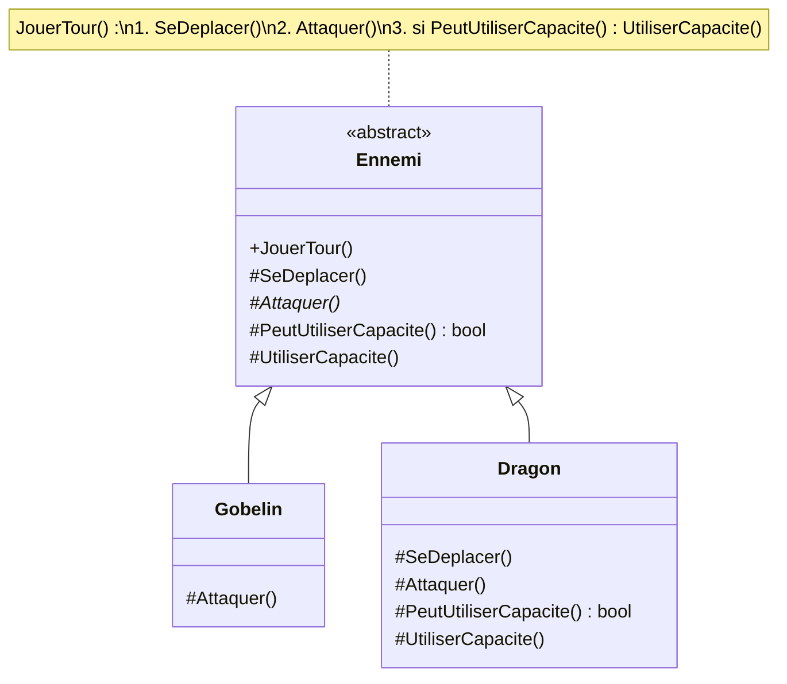

# 11. Template Method

> 🎯 **À la fin de cette fiche, vous savez expliquer :**
> * comment une classe de base fixe l’**ordre** des étapes d’un algorithme tout en laissant les sous-classes en définir certaines ;
> * la différence entre une étape abstraite, une étape par défaut et un *hook* ;
> * le lien avec Factory Method, et la différence avec Strategy.
>
> ⏱️ 20 min · Prérequis : [6. Héritage](<../../Chapitre 1/Partie II — Les 4 piliers de la POO/6. Héritage.md>), [2. Factory Method](<../Partie I — Patterns Créationnels/2. Factory Method.md>)

---

## Objectif

Définir le **squelette d’un algorithme** dans une méthode de la classe de base, en déléguant certaines étapes aux sous-classes, **sans qu’elles puissent changer l’ordre global**.

---

## Problème à résoudre

Tous les ennemis d’un jeu au tour par tour jouent leur tour de la même façon : se déplacer, attaquer, puis éventuellement utiliser une capacité spéciale. Seul le **contenu** des étapes change d’un ennemi à l’autre.

Si chaque classe réécrit son propre `JouerTour()`, l’ordre des étapes est dupliqué partout. Le jour où l’on veut ajouter une étape commune (vérifier un effet de poison, par exemple), il faut modifier toutes les classes… et on en oublie forcément une.

---

## Solution

La classe de base écrit une **méthode modèle** (*template method*) qui appelle les étapes dans le bon ordre. Les étapes sont des méthodes `abstract` (obligatoires) ou `virtual` (optionnelles) que les sous-classes redéfinissent.



| Type d’étape | Déclaration | Rôle |
| --- | --- | --- |
| **Étape obligatoire** | `protected abstract` | Chaque sous-classe **doit** la fournir. |
| **Étape par défaut** | `protected virtual` avec un corps | Les sous-classes **peuvent** la remplacer. |
| **Hook** (crochet) | `protected virtual`, souvent vide ou renvoyant `false` | Point d’extension facultatif, qui ne fait rien par défaut. |

---

## Implémentation en C#

```csharp
public abstract class Ennemi
{
    public string Nom { get; }

    protected Ennemi(string nom) => Nom = nom;

    // Méthode modèle : l’ordre des étapes est fixé ici, une fois pour toutes
    public void JouerTour()
    {
        Console.WriteLine($"--- Tour de {Nom} ---");
        SeDeplacer();
        Attaquer();

        if (PeutUtiliserCapacite())
            UtiliserCapacite();
    }

    protected virtual void SeDeplacer() => Console.WriteLine($"{Nom} avance.");   // étape par défaut
    protected abstract void Attaquer();                                          // étape obligatoire
    protected virtual bool PeutUtiliserCapacite() => false;                      // « hook »
    protected virtual void UtiliserCapacite() { }
}

public class Gobelin : Ennemi
{
    public Gobelin() : base("Gobelin") { }

    protected override void Attaquer() => Console.WriteLine("Le gobelin lance une pierre.");
}

public class Dragon : Ennemi
{
    private int tours;

    public Dragon() : base("Dragon") { }

    protected override void SeDeplacer() => Console.WriteLine("Le dragon s’envole.");
    protected override void Attaquer() => Console.WriteLine("Le dragon donne un coup de griffe.");
    protected override bool PeutUtiliserCapacite() => ++tours % 2 == 0;   // un tour sur deux
    protected override void UtiliserCapacite() => Console.WriteLine("Le dragon crache du feu !");
}
```

### Utilisation

```csharp
var ennemis = new List<Ennemi> { new Gobelin(), new Dragon() };

for (int tour = 1; tour <= 2; tour++)
    foreach (var ennemi in ennemis)
        ennemi.JouerTour();
```

**Sortie :**

```
--- Tour de Gobelin ---
Gobelin avance.
Le gobelin lance une pierre.
--- Tour de Dragon ---
Le dragon s’envole.
Le dragon donne un coup de griffe.
--- Tour de Gobelin ---
Gobelin avance.
Le gobelin lance une pierre.
--- Tour de Dragon ---
Le dragon s’envole.
Le dragon donne un coup de griffe.
Le dragon crache du feu !
```

Remarques :

* `JouerTour()` **n’est pas `virtual`** : en C#, une méthode ne peut pas être redéfinie par défaut. Les sous-classes ne peuvent donc pas modifier l’ordre des étapes, seulement leur contenu.
* Les étapes sont **`protected`** : le code client appelle uniquement `JouerTour()`, jamais une étape isolée.

> [!NOTE]
> **Le principe d’Hollywood : « Ne nous appelez pas, nous vous appellerons. »** Ce ne sont pas les sous-classes qui décident quand leurs méthodes s’exécutent : c’est la classe de base qui les appelle, au moment qu’elle a choisi.

---

## Avantages

1. **Pas de duplication** de l’enchaînement des étapes.
2. **Ordre garanti** : une sous-classe ne peut pas oublier ou inverser une étape.
3. **Points d’extension clairs** : les étapes `abstract`, `virtual` et les hooks indiquent exactement ce qui peut varier.

## Inconvénients

* Repose sur l’**héritage** : une classe ne peut avoir qu’une seule base, et la hiérarchie devient rigide.
* Les sous-classes dépendent fortement de la classe de base (il faut savoir quelles étapes redéfinir et dans quel contexte elles sont appelées).
* Avec beaucoup d’étapes et de hooks, l’algorithme devient difficile à suivre.

---

## Application dans Unity

Le pattern est courant pour donner une structure commune à une famille de composants. Exemple : toutes les armes tirent de la même façon, mais chaque arme a son propre projectile et ses propres conditions.

```csharp
using UnityEngine;

public abstract class Arme : MonoBehaviour
{
    [SerializeField] private float cadence = 0.5f;
    private float prochainTir;

    // Méthode modèle
    public void Tirer()
    {
        if (Time.time < prochainTir || !PeutTirer())
            return;

        prochainTir = Time.time + cadence;
        CreerProjectile();
        JouerEffets();
    }

    protected virtual bool PeutTirer() => true;     // hook : munitions, surchauffe…
    protected abstract void CreerProjectile();       // étape obligatoire
    protected virtual void JouerEffets() { }         // hook : son, particules…
}

public class Pistolet : Arme
{
    [SerializeField] private Rigidbody prefabBalle;
    [SerializeField] private int munitions = 12;

    protected override bool PeutTirer() => munitions > 0;

    protected override void CreerProjectile()
    {
        munitions--;
        var balle = Instantiate(prefabBalle, transform.position, transform.rotation);
        balle.linearVelocity = transform.forward * 30f;
    }
}
```

> [!NOTE]
> `linearVelocity` remplace `velocity` depuis Unity 6. Sur une version antérieure, utilisez `balle.velocity`.

> [!WARNING]
> Les méthodes de cycle de vie d’Unity (`Start()`, `Update()`…) **ne sont pas** un Template Method au sens C# : ce ne sont pas des méthodes `virtual` (voir [7. Polymorphisme](<../../Chapitre 1/Partie II — Les 4 piliers de la POO/7. Polymorphisme.md>)). Si une classe de base déclare `void Update()` et qu’une sous-classe déclare aussi `void Update()`, la seconde **masque** la première et celle de la base n’est plus appelée. Pour construire un Template Method autour du cycle de vie, la base déclare `protected virtual void Update()` et les sous-classes utilisent `override` en appelant `base.Update()`.

---

## ⚠️ Pièges courants

* **Rendre la méthode modèle `virtual`** : une sous-classe pourrait alors réécrire tout l’algorithme et contourner l’ordre imposé.
* **Exposer les étapes en `public`** : le client pourrait les appeler dans le désordre.
* **Multiplier les hooks « au cas où »** : chaque hook est un point de couplage avec toutes les sous-classes.

## 🔀 À ne pas confondre

| Pattern | Mécanisme | Ce qui varie |
| --- | --- | --- |
| **Template Method** | **Héritage** : la sous-classe redéfinit des étapes | Certaines **étapes** d’un algorithme fixe |
| **[Strategy](<../Partie III — Patterns Comportementaux/8. Strategy.md>)** | **Composition** : on injecte un objet | **Tout** l’algorithme, interchangeable à l’exécution |
| **[Factory Method](<../Partie I — Patterns Créationnels/2. Factory Method.md>)** | Héritage | Le **type d’objet créé** : c’est souvent une étape d’un Template Method |

---

## 🧪 Exercice : la boulangerie

Écrivez une classe abstraite `Recette` dont la méthode modèle `Preparer()` :

1. affiche `== Nom ==` ;
2. pétrit la pâte (par défaut : « Pétrir la pâte. ») ;
3. **si** la pâte doit reposer (par défaut : oui), affiche « Repos de la pâte : 1 h. » ;
4. cuit (étape obligatoire) ;
5. affiche « Prêt ! ».

Créez ensuite `Baguette` (cuisson 25 min à 240 °C) et `Cookie` (mélange spécifique, pas de repos, cuisson 10 min à 180 °C).

**Test attendu :**

```csharp
new Baguette().Preparer();
new Cookie().Preparer();
```

```
== Baguette ==
Pétrir la pâte.
Repos de la pâte : 1 h.
Cuire 25 min à 240 °C.
Prêt !
== Cookie ==
Mélanger beurre, sucre et pépites.
Cuire 10 min à 180 °C.
Prêt !
```

<details>
<summary>Voir la solution</summary>

```csharp
public abstract class Recette
{
    public void Preparer()
    {
        Console.WriteLine($"== {Nom} ==");
        Petrir();
        if (DoitReposer())
            Console.WriteLine("Repos de la pâte : 1 h.");
        Cuire();
        Console.WriteLine("Prêt !");
    }

    protected abstract string Nom { get; }
    protected virtual void Petrir() => Console.WriteLine("Pétrir la pâte.");
    protected virtual bool DoitReposer() => true;   // hook
    protected abstract void Cuire();
}

public class Baguette : Recette
{
    protected override string Nom => "Baguette";
    protected override void Cuire() => Console.WriteLine("Cuire 25 min à 240 °C.");
}

public class Cookie : Recette
{
    protected override string Nom => "Cookie";
    protected override void Petrir() => Console.WriteLine("Mélanger beurre, sucre et pépites.");
    protected override bool DoitReposer() => false;
    protected override void Cuire() => Console.WriteLine("Cuire 10 min à 180 °C.");
}
```

</details>

---

## Résumé

| Aspect | Description |
| --- | --- |
| **But** | Fixer l’ordre d’un algorithme et laisser varier certaines étapes |
| **Principe** | Une méthode non virtuelle de la base appelle des étapes `abstract` / `virtual` |
| **Mécanisme** | Héritage |
| **Exemple Unity typique** | Arme de base (`Tirer`), ennemi de base (`JouerTour`), interaction de base |

---

## Références utiles

* [Refactoring Guru — Template Method](https://refactoring.guru/fr/design-patterns/template-method)
* Gamma, Helm, Johnson, Vlissides — *Design Patterns: Elements of Reusable Object-Oriented Software*, Addison-Wesley, 1994.
* [Robert Nystrom — Game Programming Patterns : Subclass Sandbox](https://gameprogrammingpatterns.com/subclass-sandbox.html) (une variante proche, très utilisée dans les jeux)

---

[← Précédent : 10. Command](<../Partie III — Patterns Comportementaux/10. Command.md>) · [Sommaire](<../../README.md>) · [Suivant : 12. Composite →](<12. Composite.md>)
