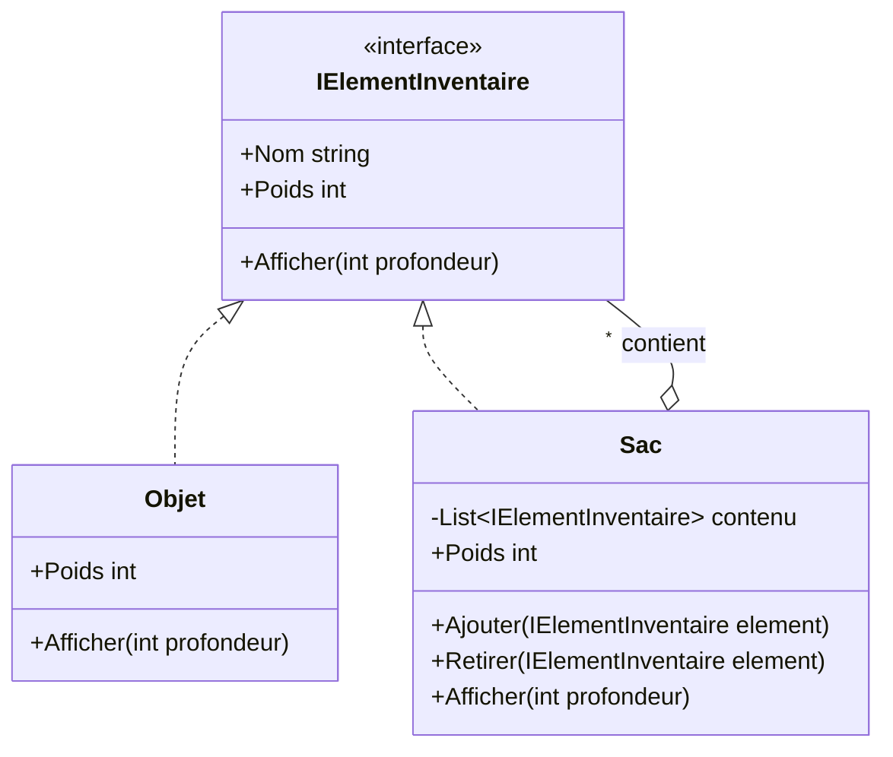

# 12. Composite

> 🎯 **À la fin de cette fiche, tu sais expliquer :**
> * comment manipuler de la même façon un objet simple et un groupe d’objets ;
> * ce que sont une *feuille* et un *composite* ;
> * pourquoi la hiérarchie de `Transform` d’Unity est un Composite.
>
> ⏱️ 20 min · Prérequis : [5. Abstraction](<../../Chapitre 1/Partie II — Les 4 piliers de la POO/5. Abstraction.md>), [8. Composition vs héritage](<../../Chapitre 1/Partie III — Concepts Avancés/8. Composition vs héritage.md>)

---

## Objectif

Organiser des objets en **arborescence** et permettre au code client de traiter **de la même manière** un élément isolé et un groupe d’éléments.

---

## Problème à résoudre

Un inventaire contient des objets (une épée, une potion) mais aussi des **conteneurs** (une bourse, un sac) qui contiennent eux-mêmes des objets… ou d’autres conteneurs.

Pour calculer le poids total, une approche naïve multiplie les tests de type :

```csharp
int poids = 0;
foreach (var element in sac)
{
    if (element is Objet objet)
        poids += objet.Poids;
    else if (element is Sac sousSac)
        poids += /* … et à nouveau une boucle pour le contenu du sous-sac, puis du sous-sous-sac… */;
}
```

Le code client doit connaître tous les types et gérer lui-même la récursion. Chaque nouveau type de conteneur l’oblige à évoluer.

---

## Solution

On définit une **interface commune** aux objets simples et aux conteneurs. Un conteneur implémente cette interface en **déléguant** à ses enfants : la récursion est cachée à l’intérieur de la structure.



| Élément | Rôle |
| --- | --- |
| **Component** (`IElementInventaire`) | Interface commune à tous les éléments de l’arbre. |
| **Leaf** / feuille (`Objet`) | Élément simple, sans enfant. |
| **Composite** (`Sac`) | Élément qui contient des enfants (feuilles ou composites) et leur délègue le travail. |
| **Client** | Manipule uniquement le *Component*, sans savoir s’il a affaire à une feuille ou à un composite. |

---

## Implémentation en C#

```csharp
public interface IElementInventaire
{
    string Nom { get; }
    int Poids { get; }
    void Afficher(int profondeur = 0);
}

// Feuille
public class Objet : IElementInventaire
{
    public string Nom { get; }
    public int Poids { get; }

    public Objet(string nom, int poids)
    {
        Nom = nom;
        Poids = poids;
    }

    public void Afficher(int profondeur = 0)
        => Console.WriteLine($"{new string(' ', profondeur * 2)}- {Nom} ({Poids} kg)");
}

// Composite
public class Sac : IElementInventaire
{
    private readonly List<IElementInventaire> contenu = new();
    private readonly int poidsAVide;

    public string Nom { get; }
    public int Poids => poidsAVide + contenu.Sum(element => element.Poids);   // récursif

    public Sac(string nom, int poidsAVide)
    {
        Nom = nom;
        this.poidsAVide = poidsAVide;
    }

    public void Ajouter(IElementInventaire element) => contenu.Add(element);
    public void Retirer(IElementInventaire element) => contenu.Remove(element);

    public void Afficher(int profondeur = 0)
    {
        Console.WriteLine($"{new string(' ', profondeur * 2)}+ {Nom} ({Poids} kg)");
        foreach (var element in contenu)
            element.Afficher(profondeur + 1);                                   // récursif
    }
}
```

### Utilisation

```csharp
var sacADos = new Sac("Sac à dos", poidsAVide: 2);
sacADos.Ajouter(new Objet("Épée", 3));

var bourse = new Sac("Bourse", poidsAVide: 0);
bourse.Ajouter(new Objet("Pièces d’or", 1));
bourse.Ajouter(new Objet("Rubis", 1));
sacADos.Ajouter(bourse);                    // un sac dans un sac

sacADos.Ajouter(new Objet("Potion", 1));

sacADos.Afficher();
Console.WriteLine($"Poids total : {sacADos.Poids} kg");
```

**Sortie :**

```
+ Sac à dos (8 kg)
  - Épée (3 kg)
  + Bourse (2 kg)
    - Pièces d’or (1 kg)
    - Rubis (1 kg)
  - Potion (1 kg)
Poids total : 8 kg
```

Le client appelle `Poids` ou `Afficher()` une seule fois, à la racine. Il ne sait pas, et n’a pas besoin de savoir, combien de niveaux de sacs se cachent dessous.

---

## Avantages

1. **Code client simple** : un seul type à manipuler, quelle que soit la profondeur de l’arbre.
2. **Ouvert à l’extension** : ajouter un nouveau type de feuille ou de conteneur (un coffre, un carquois) ne change pas le client.
3. **Structures récursives naturelles** : menus, scènes, arbres de comportement, expressions mathématiques.

## Inconvénients

* L’interface commune peut devenir **trop générale** : faut-il déclarer `Ajouter()` sur une feuille ? (voir *Pièges*)
* Il devient plus difficile de **restreindre** le contenu d’un composite (« un carquois ne contient que des flèches ») sans tests de type.
* Une opération sur un très grand arbre peut coûter cher si elle est recalculée à chaque appel (ici, `Poids` reparcourt tout l’arbre).

---

## Application dans Unity

Unity est construit autour d’un Composite : la **hiérarchie de `Transform`**. Chaque `Transform` a un parent et des enfants, et une opération appliquée à un parent s’applique à tout le sous-arbre :

* déplacer, tourner ou mettre à l’échelle un parent déplace tous ses enfants ;
* `SetActive(false)` désactive l’objet et toute sa descendance ;
* `GetComponentsInChildren<T>()` parcourt l’arbre récursivement ;
* l’interface utilisateur (Canvas → panneaux → boutons → textes) suit la même structure.

On retrouve aussi le pattern dans les **arbres de comportement** des IA : une *séquence* ou un *sélecteur* (composites) contient des actions ou des conditions (feuilles), et toutes exposent la même méthode `Evaluer()`.

```csharp
public interface INoeud
{
    bool Evaluer();
}

public class Sequence : INoeud      // composite : réussit si TOUS ses enfants réussissent
{
    private readonly List<INoeud> enfants;
    public Sequence(params INoeud[] enfants) => this.enfants = enfants.ToList();
    public bool Evaluer() => enfants.All(enfant => enfant.Evaluer());
}

public class Selecteur : INoeud     // composite : réussit dès qu’UN enfant réussit
{
    private readonly List<INoeud> enfants;
    public Selecteur(params INoeud[] enfants) => this.enfants = enfants.ToList();
    public bool Evaluer() => enfants.Any(enfant => enfant.Evaluer());
}

public class Tache : INoeud         // feuille : exécute une action concrète
{
    private readonly Func<bool> action;
    public Tache(Func<bool> action) => this.action = action;
    public bool Evaluer() => action();
}
```

```csharp
// « Si l’ennemi est visible, s’en approcher puis attaquer ; sinon, patrouiller. »
INoeud ia = new Selecteur(
    new Sequence(
        new Tache(() => cibleVisible),
        new Tache(() => SApprocher()),
        new Tache(() => Attaquer())),
    new Tache(() => Patrouiller()));

ia.Evaluer();   // un seul appel, quelle que soit la profondeur de l’arbre
```

> [!NOTE]
> `All` et `Any` s’arrêtent au premier échec ou au premier succès : c’est exactement le comportement attendu d’une séquence et d’un sélecteur.

---

## ⚠️ Pièges courants

* **Mettre `Ajouter()` dans l’interface commune** « pour simplifier » : une feuille doit alors lever une `NotSupportedException`, ce qui viole le [principe de Liskov](<../../Chapitre 1/Partie III — Concepts Avancés/11. Principes SOLID.md>). On préfère déclarer `Ajouter()` uniquement sur le composite, quitte à faire un test de type au moment de construire l’arbre.
* **Créer des cycles** (un sac qui se contient lui-même, directement ou indirectement) : toute opération récursive part alors en boucle infinie.
* **Modifier l’arbre pendant qu’on le parcourt** : `InvalidOperationException` (« Collection was modified »).

## 🔀 À ne pas confondre

* **Composite** (une **structure** arborescente, traitée de façon uniforme) et **[Decorator](<../Partie II — Patterns Structurels/5. Decorator.md>)** (une **chaîne** d’enveloppes, chacune avec un seul enfant, qui **ajoute** un comportement). Les deux reposent sur la composition récursive et une interface commune, mais leur intention diffère.
* **Composite** (le pattern) et **composition** (la relation « a un » entre objets, vue dans la fiche 8).

---

## 🧪 Exercice : des phrases composées

Écris une interface `IPhrase` avec deux méthodes : `string Texte()` et `int NombreDeMots()`. Implémente :

* une feuille `Mot`, qui contient un seul mot ;
* un composite `PhraseComposite`, qui contient des `IPhrase` et dont la méthode `Ajouter` renvoie `this` (pour pouvoir chaîner les appels).

**Contrainte :** le client ne doit jamais tester le type d’un élément.

**Test attendu :**

```csharp
var debut = new PhraseComposite().Ajouter(new Mot("Le")).Ajouter(new Mot("dragon"));
var fin = new PhraseComposite().Ajouter(new Mot("crache")).Ajouter(new Mot("du")).Ajouter(new Mot("feu"));
var phrase = new PhraseComposite().Ajouter(debut).Ajouter(fin);

Console.WriteLine(phrase.Texte());
Console.WriteLine($"{phrase.NombreDeMots()} mots");
```

```
Le dragon crache du feu
5 mots
```

<details>
<summary>Voir la solution</summary>

```csharp
public interface IPhrase
{
    string Texte();
    int NombreDeMots();
}

public class Mot : IPhrase
{
    private readonly string mot;
    public Mot(string mot) => this.mot = mot;
    public string Texte() => mot;
    public int NombreDeMots() => 1;
}

public class PhraseComposite : IPhrase
{
    private readonly List<IPhrase> parties = new();

    public PhraseComposite Ajouter(IPhrase partie)
    {
        parties.Add(partie);
        return this;
    }

    public string Texte() => string.Join(" ", parties.Select(p => p.Texte()));
    public int NombreDeMots() => parties.Sum(p => p.NombreDeMots());
}
```

</details>

---

## Résumé

| Aspect | Description |
| --- | --- |
| **But** | Traiter de la même façon un élément simple et un groupe d’éléments |
| **Principe** | Feuilles et composites partagent une interface ; les composites délèguent à leurs enfants |
| **Structure** | Arbre récursif |
| **Exemple Unity typique** | Hiérarchie de `Transform`, UI, arbres de comportement, inventaires |

---

## Références utiles

* [Refactoring Guru — Composite](https://refactoring.guru/fr/design-patterns/composite)
* [Unity Manual — Hiérarchie et relations parent-enfant](https://docs.unity3d.com/Manual/Hierarchy.html)
* Gamma, Helm, Johnson, Vlissides — *Design Patterns: Elements of Reusable Object-Oriented Software*, Addison-Wesley, 1994.

---

[← Précédent : 11. Template Method](<11. Template Method.md>) · [Sommaire](<../../README.md>) · [Suivant : 13. Prototype →](<13. Prototype.md>)
