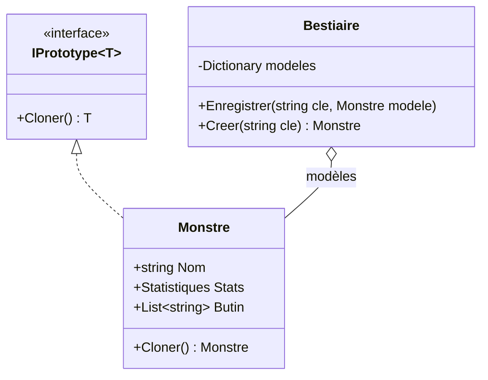

# 13. Prototype

> 🎯 **À la fin de cette fiche, vous savez expliquer :**
> * comment créer de nouveaux objets en **copiant** un modèle existant ;
> * la différence entre une copie **superficielle** et une copie **profonde** ;
> * pourquoi `Instantiate(prefab)` est un Prototype.
>
> ⏱️ 20 min · Prérequis : [12. Types valeur et types référence](<../../Chapitre 1/Partie IV — Les outils du langage/12. Types valeur et types référence.md>)

---

## Objectif

Créer des objets **en clonant un modèle déjà configuré**, plutôt qu’en les construisant de zéro. Le code client n’a pas besoin de connaître la classe concrète, ni la façon de la configurer.

---

## Problème à résoudre

Un niveau doit faire apparaître des dizaines de gobelins, tous avec les mêmes statistiques et le même butin de départ. On pourrait répéter la configuration à chaque création… ou bien configurer **un seul** gobelin modèle, puis le **copier**.

La copie paraît triviale. Pourtant, avec des types référence, elle cache un piège : copier un objet ne copie pas forcément les objets qu’il contient.

---

## Solution

Le modèle (le *prototype*) expose une méthode `Cloner()` qui renvoie une copie **indépendante** de lui-même. On peut ranger plusieurs prototypes dans un registre et créer des objets à partir d’une simple clé.



---

## Copie superficielle et copie profonde

`object.MemberwiseClone()` crée une **copie superficielle** : les champs de type valeur sont copiés, mais pour les champs de type référence, **seule la référence** est copiée. L’original et la copie **partagent** alors les mêmes objets internes.

```csharp
public interface IPrototype<T>
{
    T Cloner();
}

public class Statistiques
{
    public int Vie;
    public int Force;
}

public class Monstre : IPrototype<Monstre>
{
    public string Nom;
    public Statistiques Stats = new();
    public List<string> Butin = new();

    // ❌ Copie superficielle : les objets internes sont PARTAGÉS
    public Monstre CloneSuperficiel() => (Monstre)MemberwiseClone();

    // ✅ Copie profonde : les objets internes sont dupliqués
    public Monstre Cloner()
    {
        var copie = (Monstre)MemberwiseClone();
        copie.Stats = new Statistiques { Vie = Stats.Vie, Force = Stats.Force };
        copie.Butin = new List<string>(Butin);
        return copie;
    }

    public override string ToString()
        => $"{Nom} (PV {Stats.Vie}, Force {Stats.Force}, butin : {string.Join(", ", Butin)})";
}
```

### Le piège de la copie superficielle

```csharp
var modele = new Monstre { Nom = "Gobelin", Stats = { Vie = 30, Force = 5 }, Butin = { "Dague" } };

var superficiel = modele.CloneSuperficiel();
superficiel.Stats.Vie = 1;
superficiel.Butin.Add("Fromage");

Console.WriteLine($"Modèle après copie superficielle : {modele}");
```

```
Modèle après copie superficielle : Gobelin (PV 1, Force 5, butin : Dague, Fromage)
```

Modifier la copie a **modifié le modèle** : les deux partagent le même objet `Statistiques` et la même liste.

### Avec une copie profonde

```csharp
var profond = modele.Cloner();      // (modèle remis à 30 PV, butin : Dague)
profond.Nom = "Gobelin chef";
profond.Stats.Force = 12;
profond.Butin.Add("Couronne");

Console.WriteLine($"Modèle après copie profonde : {modele}");
Console.WriteLine($"Copie : {profond}");
```

```
Modèle après copie profonde : Gobelin (PV 30, Force 5, butin : Dague)
Copie : Gobelin chef (PV 30, Force 12, butin : Dague, Couronne)
```

> [!NOTE]
> `Nom` est une `string`, donc un type référence… mais les chaînes sont **immuables** en C#. Les partager ne pose aucun problème : on ne peut que les remplacer, jamais les modifier. Seuls les objets **mutables** doivent être dupliqués.

### Un registre de prototypes

```csharp
public class Bestiaire
{
    private readonly Dictionary<string, Monstre> modeles = new();

    public void Enregistrer(string cle, Monstre modele) => modeles[cle] = modele;

    public Monstre Creer(string cle) => modeles[cle].Cloner();
}
```

```csharp
var bestiaire = new Bestiaire();
bestiaire.Enregistrer("gobelin", modele);

var g1 = bestiaire.Creer("gobelin");
var g2 = bestiaire.Creer("gobelin");
g1.Stats.Vie -= 10;

Console.WriteLine($"g1 : {g1.Stats.Vie} PV, g2 : {g2.Stats.Vie} PV, mêmes objets ? {ReferenceEquals(g1, g2)}");
```

```
g1 : 20 PV, g2 : 30 PV, mêmes objets ? False
```

> [!WARNING]
> **L’expression `with` des records fait aussi une copie superficielle.**
> ```csharp
> public record Arme(string Nom, int Degats, List<string> Enchantements);
>
> var epee = new Arme("Épée", 10, new List<string> { "Feu" });
> var epeeGlace = epee with { Nom = "Épée de glace" };
> epeeGlace.Enchantements.Add("Glace");
>
> Console.WriteLine(string.Join(", ", epee.Enchantements));   // Feu, Glace 😱
> ```
> Pour qu’un record soit réellement sûr à copier, ses membres doivent être eux-mêmes immuables (par exemple `IReadOnlyList<string>`).

---

## Avantages

1. **Création sans connaître la classe concrète** : on clone ce qu’on a.
2. **Configuration réutilisée** : les objets complexes sont configurés une seule fois.
3. **Variantes faciles** : on clone un modèle, puis on ajuste quelques propriétés.

## Inconvénients

* La **copie profonde** doit être écrite à la main, et maintenue à chaque ajout de champ mutable.
* Les **références circulaires** (A contient B qui contient A) rendent la copie profonde délicate.
* `ICloneable` (l’interface standard de .NET) ne précise pas si la copie est superficielle ou profonde : Microsoft déconseille de l’utiliser dans une API publique. D’où l’interface `IPrototype<T>` explicite de cette fiche.

---

## Application dans Unity

**`Instantiate()` est un Prototype.** Un *prefab* est un GameObject modèle, entièrement configuré dans l’éditeur (composants, valeurs, enfants). `Instantiate(prefab)` en crée une copie complète et indépendante, y compris toute sa hiérarchie d’enfants :

```csharp
[SerializeField] private Ennemi prefabGobelin;

private void Generer(Vector3 position)
{
    Ennemi gobelin = Instantiate(prefabGobelin, position, Quaternion.identity);
    gobelin.name = "Gobelin (renfort)";   // variante : on ajuste la copie
}
```

`Instantiate()` fonctionne aussi avec un **ScriptableObject**. C’est le moyen classique d’obtenir une **copie modifiable à l’exécution** d’un asset de données, sans altérer l’asset lui-même :

```csharp
[SerializeField] private StatistiquesSO statsDeBase;   // asset partagé, ne pas modifier en jeu
private StatistiquesSO stats;

private void Awake()
{
    stats = Instantiate(statsDeBase);   // copie propre à ce personnage
}
```

> [!WARNING]
> Modifier directement un ScriptableObject **en Play Mode dans l’éditeur** modifie l’**asset** sur le disque : la modification persiste après l’arrêt du jeu. Dans un build, elle est perdue au redémarrage. Dans les deux cas, ce n’est presque jamais ce qu’on veut : on clone d’abord.

---

## ⚠️ Pièges courants

* **Utiliser `MemberwiseClone()` seul** sur un objet qui contient des listes ou d’autres objets mutables.
* **Oublier de mettre à jour `Cloner()`** quand on ajoute un nouveau champ mutable à la classe.
* **Croire que `with` copie en profondeur** (voir l’encadré sur les records).

## 🔀 À ne pas confondre

* **Prototype** (on copie une instance existante) et **[Factory Method](<../Partie I — Patterns Créationnels/2. Factory Method.md>)** (une sous-classe décide quelle classe instancier). Les deux cachent la classe concrète au client.
* **Copie superficielle** (les références internes sont partagées) et **copie profonde** (tout est dupliqué).

---

## 🧪 Exercice

Une classe `Personnage` possède un `Nom` (`string`), un `Niveau` (`int`) et un `Inventaire` (`List<string>`).

1. Implémentez `IPrototype<Personnage>` avec une copie **profonde**.
2. Écrivez un test qui prouve que modifier l’inventaire et le niveau du clone ne modifie pas l’original.

**Test attendu :**

```csharp
var heros = new Personnage { Nom = "Arthur", Niveau = 5, Inventaire = { "Épée" } };
var clone = heros.Cloner();
clone.Nom = "Arthur (illusion)";
clone.Niveau = 1;
clone.Inventaire.Add("Miroir");

Console.WriteLine($"{heros.Nom} niv. {heros.Niveau} : {string.Join(", ", heros.Inventaire)}");
Console.WriteLine($"{clone.Nom} niv. {clone.Niveau} : {string.Join(", ", clone.Inventaire)}");
```

```
Arthur niv. 5 : Épée
Arthur (illusion) niv. 1 : Épée, Miroir
```

<details>
<summary>Voir la solution</summary>

```csharp
public class Personnage : IPrototype<Personnage>
{
    public string Nom;
    public int Niveau;
    public List<string> Inventaire = new();

    public Personnage Cloner()
    {
        var copie = (Personnage)MemberwiseClone();   // copie Nom et Niveau
        copie.Inventaire = new List<string>(Inventaire);  // duplique la liste mutable
        return copie;
    }
}
```

`Nom` (chaîne immuable) et `Niveau` (type valeur) n’ont pas besoin d’être dupliqués : seule la liste doit l’être.

</details>

---

## Résumé

| Aspect | Description |
| --- | --- |
| **But** | Créer des objets en copiant un modèle configuré |
| **Principe** | Le prototype expose `Cloner()`, qui renvoie une copie indépendante |
| **Point clé** | Copie superficielle (`MemberwiseClone`, `with`) ≠ copie profonde |
| **Exemple Unity typique** | `Instantiate(prefab)`, `Instantiate(scriptableObject)` |

---

## Références utiles

* [Refactoring Guru — Prototype](https://refactoring.guru/fr/design-patterns/prototype)
* [Robert Nystrom — Game Programming Patterns : Prototype](https://gameprogrammingpatterns.com/prototype.html)
* [Microsoft Learn — Object.MemberwiseClone](https://learn.microsoft.com/fr-fr/dotnet/api/system.object.memberwiseclone)
* [Unity Scripting API — Object.Instantiate](https://docs.unity3d.com/ScriptReference/Object.Instantiate.html)

---

[← Précédent : 12. Composite](<12. Composite.md>) · [Sommaire](<../../README.md>) · [Suivant : 14. Object Pool →](<14. Object Pool.md>)
