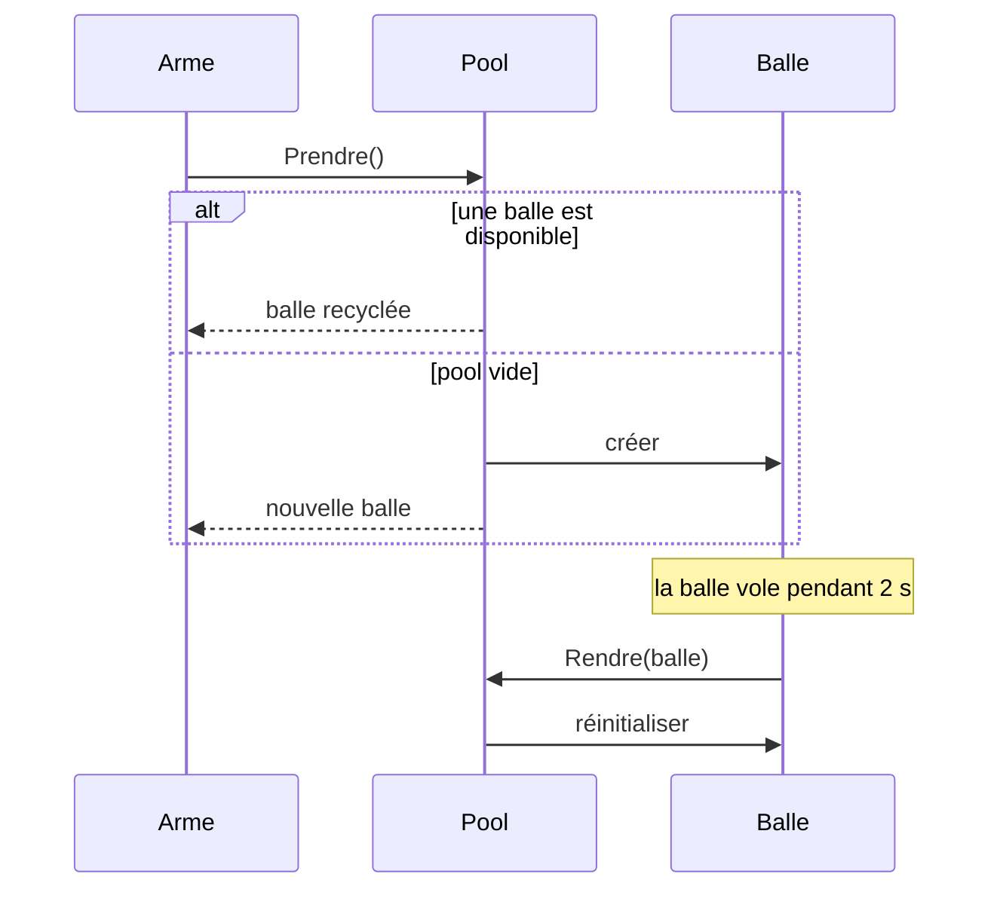

# 14. Object Pool

> 🎯 **À la fin de cette fiche, vous savez expliquer :**
> * pourquoi créer et détruire des objets en permanence coûte cher dans un jeu ;
> * comment un pool **recycle** des objets au lieu de les recréer ;
> * utiliser `UnityEngine.Pool.ObjectPool<T>` ;
> * les erreurs classiques : objet mal réinitialisé, objet rendu deux fois.
>
> ⏱️ 25 min · Prérequis : [15. Génériques](<../../Chapitre 1/Partie IV — Les outils du langage/15. Génériques.md>), [16. Délégués, événements et lambdas](<../../Chapitre 1/Partie IV — Les outils du langage/16. Délégués, événements et lambdas.md>)

---

## Objectif

**Réutiliser** des objets coûteux à créer plutôt que de les détruire et de les recréer en boucle. Ce n’est pas un pattern du *Gang of Four*, mais c’est l’un des patterns d’optimisation les plus utilisés dans le jeu vidéo.

---

## Problème à résoudre

Une mitrailleuse tire 10 balles par seconde. Chaque balle est créée avec `Instantiate()`, puis détruite avec `Destroy()` au bout de deux secondes. Cela fait des centaines de créations et de destructions par minute :

* `Instantiate()` et `Destroy()` sont des opérations **coûteuses** (allocation, initialisation des composants, enregistrement auprès du moteur) ;
* chaque objet détruit laisse de la mémoire que le **ramasse-miettes** (*garbage collector*) doit récupérer, ce qui provoque des **saccades** visibles.

---

## Solution

On crée les objets **une fois**, puis on les **recycle** :

1. Quand on a besoin d’un objet, on le **prend** dans le pool. S’il n’y en a plus de disponible, le pool en crée un.
2. Quand on n’en a plus besoin, on le **rend** au pool au lieu de le détruire. Le pool le **réinitialise** et le garde pour la prochaine fois.



---

## Implémentation en C#

```csharp
public class Pool<T> where T : class
{
    private readonly Stack<T> disponibles = new();
    private readonly Func<T> creer;
    private readonly Action<T> reinitialiser;

    public int NombreCrees { get; private set; }
    public int NombreDisponibles => disponibles.Count;

    public Pool(Func<T> creer, Action<T> reinitialiser)
    {
        this.creer = creer;
        this.reinitialiser = reinitialiser;
    }

    public T Prendre()
    {
        if (disponibles.Count > 0)
            return disponibles.Pop();     // on recycle un objet existant

        NombreCrees++;
        return creer();                   // le pool est vide : on en crée un nouveau
    }

    public void Rendre(T objet)
    {
        reinitialiser(objet);             // remise à zéro AVANT de le rendre disponible
        disponibles.Push(objet);
    }
}

public class Projectile
{
    private static int compteur;
    public int Id { get; } = ++compteur;
    public int DistanceParcourue { get; set; }
}
```

Le pool est **générique** et reçoit deux comportements en paramètre (voir [16. Délégués](<../../Chapitre 1/Partie IV — Les outils du langage/16. Délégués, événements et lambdas.md>)) : comment créer un objet, et comment le remettre à zéro.

### Utilisation

```csharp
var pool = new Pool<Projectile>(
    creer: () => new Projectile(),
    reinitialiser: p => p.DistanceParcourue = 0);

for (int salve = 1; salve <= 3; salve++)
{
    var tirs = new List<Projectile> { pool.Prendre(), pool.Prendre(), pool.Prendre() };
    Console.WriteLine($"Salve {salve} : projectiles {string.Join(", ", tirs.Select(p => p.Id))}");

    foreach (var p in tirs)
        pool.Rendre(p);
}

Console.WriteLine($"Projectiles créés : {pool.NombreCrees} pour 9 tirs");
```

**Sortie :**

```
Salve 1 : projectiles 1, 2, 3
Salve 2 : projectiles 3, 2, 1
Salve 3 : projectiles 1, 2, 3
Projectiles créés : 3 pour 9 tirs
```

Seuls 3 projectiles ont été créés pour 9 tirs. L’ordre s’inverse à chaque salve parce qu’une `Stack` rend toujours en premier le **dernier** objet rendu.

---

## Avantages

1. **Moins d’allocations**, donc moins de travail pour le ramasse-miettes et moins de saccades.
2. **Coût de création payé une seule fois**, éventuellement pendant un écran de chargement (*préchauffage* du pool).
3. **Nombre d’objets maîtrisé** : on peut plafonner la taille du pool.

## Inconvénients

* Les objets du pool occupent la mémoire **en permanence**, même quand on ne s’en sert pas.
* Chaque objet doit être **correctement réinitialisé** : un état oublié « fuit » d’une utilisation à l’autre.
* Complexité supplémentaire : c’est une **optimisation**, à réserver aux objets réellement créés en grand nombre (projectiles, particules, ennemis, textes de dégâts).

---

## Application dans Unity

Depuis Unity 2021, le moteur fournit `UnityEngine.Pool.ObjectPool<T>`. Il suffit de lui indiquer quoi faire à la création, à la prise, au retour et à la destruction :

```csharp
using UnityEngine;
using UnityEngine.Pool;

public class Mitrailleuse : MonoBehaviour
{
    [SerializeField] private Balle prefabBalle;
    private IObjectPool<Balle> pool;

    private void Awake()
    {
        pool = new ObjectPool<Balle>(
            createFunc: () =>
            {
                Balle balle = Instantiate(prefabBalle);
                balle.DefinirPool(pool);              // la balle saura se rendre elle-même
                return balle;
            },
            actionOnGet: balle => balle.gameObject.SetActive(true),
            actionOnRelease: balle => balle.gameObject.SetActive(false),
            actionOnDestroy: balle => Destroy(balle.gameObject),
            collectionCheck: true,     // détecte un objet rendu deux fois (dans l’éditeur)
            defaultCapacity: 20,
            maxSize: 100);             // au-delà, les balles rendues sont détruites
    }

    public void Tirer()
    {
        Balle balle = pool.Get();
        balle.transform.SetPositionAndRotation(transform.position, transform.rotation);
    }
}
```

```csharp
using UnityEngine;
using UnityEngine.Pool;

public class Balle : MonoBehaviour
{
    [SerializeField] private float vitesse = 20f;
    [SerializeField] private float duree = 2f;

    private IObjectPool<Balle> pool;
    private float tempsRestant;

    public void DefinirPool(IObjectPool<Balle> pool) => this.pool = pool;

    private void OnEnable() => tempsRestant = duree;   // réinitialisation à chaque sortie du pool

    private void Update()
    {
        transform.Translate(Vector3.forward * vitesse * Time.deltaTime);

        tempsRestant -= Time.deltaTime;
        if (tempsRestant <= 0f)
            pool.Release(this);                          // au lieu de Destroy(gameObject)
    }
}
```

> [!TIP]
> `OnEnable()` est un endroit pratique pour réinitialiser un objet poolé : il est appelé à chaque `SetActive(true)`, donc à chaque sortie du pool.

---

## ⚠️ Pièges courants

* **Oublier de réinitialiser l’état** : une balle recyclée garde la vitesse, les dégâts ou la cible de sa vie précédente. Un ennemi recyclé revient avec 0 PV.
* **Rendre deux fois le même objet** : il sera ensuite distribué à **deux** utilisateurs en même temps. `collectionCheck: true` le détecte (au prix d’une vérification à chaque retour).
* **Garder une référence** vers un objet après l’avoir rendu : on modifie un objet que quelqu’un d’autre utilise peut-être déjà.
* **Appeler `Destroy()` sur un objet poolé** : le pool garde une référence vers un objet détruit (`MissingReferenceException` à la prochaine utilisation).
* **Optimiser sans mesurer** : utiliser le *Profiler* d’Unity pour vérifier que les créations sont vraiment un problème avant d’ajouter un pool.

## 🔀 À ne pas confondre

* **Object Pool** (des objets **réutilisés** les uns après les autres, chacun ayant un seul utilisateur à la fois) et **[Flyweight](https://refactoring.guru/fr/design-patterns/flyweight)** (des données **partagées simultanément** par de nombreux objets, comme un ScriptableObject de statistiques).
* **Object Pool** et **[Singleton](<../Partie I — Patterns Créationnels/1. Singleton.md>)** : un pool gère **plusieurs** instances recyclables, pas une instance unique.

---

## 🧪 Exercice : un pool borné

Écrivez une classe `PoolBorne<T>` qui reçoit une fonction de création et une **taille maximale** :

* `Prendre()` renvoie un objet disponible, ou en crée un nouveau ;
* `Rendre(T objet)` lève une `InvalidOperationException` si l’objet est **déjà** dans le pool ; si le pool est **plein**, l’objet n’est pas conservé et un compteur `NombreDetruits` est incrémenté.

**Test attendu :**

```csharp
var borne = new PoolBorne<Projectile>(() => new Projectile(), tailleMax: 2);
var a = borne.Prendre();
var b = borne.Prendre();
var c = borne.Prendre();
borne.Rendre(a);
borne.Rendre(b);
borne.Rendre(c);
Console.WriteLine($"Disponibles : {borne.NombreDisponibles}, détruits : {borne.NombreDetruits}");

try
{
    borne.Rendre(a);
}
catch (InvalidOperationException ex)
{
    Console.WriteLine($"Erreur : {ex.Message}");
}
```

```
Disponibles : 2, détruits : 1
Erreur : Cet objet a déjà été rendu au pool.
```

<details>
<summary>Voir la solution</summary>

```csharp
public class PoolBorne<T> where T : class
{
    private readonly Stack<T> disponibles = new();
    private readonly Func<T> creer;
    private readonly int tailleMax;

    public int NombreDetruits { get; private set; }
    public int NombreDisponibles => disponibles.Count;

    public PoolBorne(Func<T> creer, int tailleMax)
    {
        this.creer = creer;
        this.tailleMax = tailleMax;
    }

    public T Prendre() => disponibles.Count > 0 ? disponibles.Pop() : creer();

    public void Rendre(T objet)
    {
        if (disponibles.Contains(objet))
            throw new InvalidOperationException("Cet objet a déjà été rendu au pool.");

        if (disponibles.Count >= tailleMax)
        {
            NombreDetruits++;   // pool plein : on laisse l’objet au ramasse-miettes
            return;
        }

        disponibles.Push(objet);
    }
}
```

`Contains` parcourt toute la pile : c’est acceptable pour un petit pool ou en mode débogage. Pour un grand pool, on ajouterait un `HashSet<T>` en parallèle de la pile.

</details>

---

## Résumé

| Aspect | Description |
| --- | --- |
| **But** | Recycler des objets coûteux au lieu de les recréer |
| **Principe** | `Prendre()` → utiliser → `Rendre()` (avec réinitialisation) |
| **Point clé** | Réinitialiser correctement chaque objet, ne jamais le rendre deux fois |
| **Exemple Unity typique** | Projectiles, particules, ennemis, textes de dégâts avec `ObjectPool<T>` |

---

## Références utiles

* [Unity Scripting API — ObjectPool&lt;T&gt;](https://docs.unity3d.com/ScriptReference/Pool.ObjectPool_1.html)
* [Robert Nystrom — Game Programming Patterns : Object Pool](https://gameprogrammingpatterns.com/object-pool.html)
* [Unity — e-book « Level up your code with design patterns and SOLID »](https://unity.com/resources/design-patterns-solid-ebook)

---

[← Précédent : 13. Prototype](<13. Prototype.md>) · [Sommaire](<../../README.md>) · [Suivant : Conclusion du chapitre 2 →](<../Conclusion du chapitre 2.md>)
