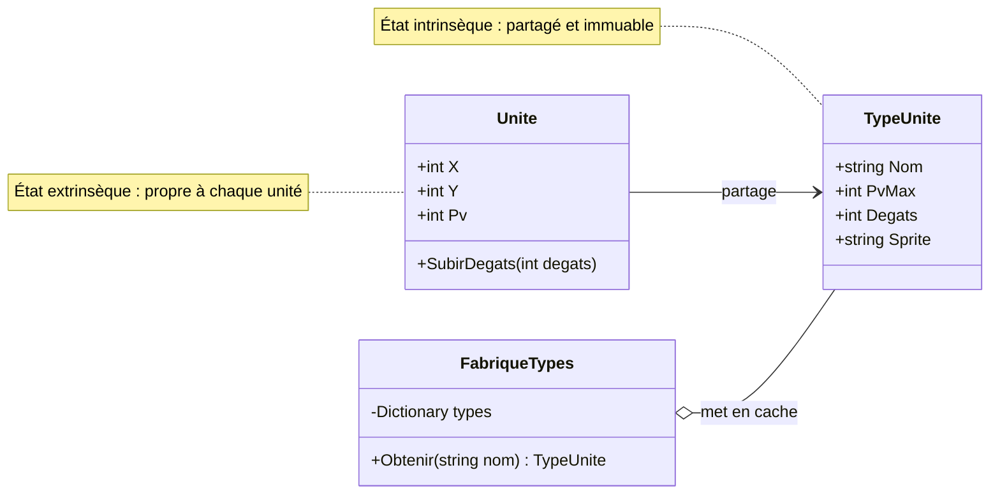

# 15. Flyweight

> 🎯 **À la fin de cette fiche, vous savez expliquer :**
> * comment partager les données communes à des milliers d’objets pour économiser la mémoire ;
> * la différence entre état **intrinsèque** (partagé) et état **extrinsèque** (propre à chaque objet) ;
> * pourquoi un ScriptableObject de données est un Flyweight, et le piège de `renderer.material`.
>
> ⏱️ 20 min · Prérequis : [12. Types valeur et types référence](<../../Chapitre 1/Partie IV — Les outils du langage/12. Types valeur et types référence.md>), [14. Object Pool](<14. Object Pool.md>)

---

## Objectif

Permettre à un très grand nombre d’objets de **partager** les données qu’ils ont en commun, au lieu de les dupliquer dans chacun d’eux. Le nom vient de la catégorie de poids la plus légère en boxe : *poids-mouche*.

---

## Problème à résoudre

Une bataille met en scène 1 000 unités. Chaque soldat stocke son nom de type, ses PV maximum, ses dégâts, le chemin de son sprite, sa description… alors que ces valeurs sont **identiques** pour tous les soldats. Seules la position et les PV actuels changent d’une unité à l’autre.

Avec 1 000 unités et 3 types, on stocke 1 000 copies d’informations qui n’existent en réalité qu’en 3 exemplaires.

---

## Solution

On sépare l’état de chaque objet en deux :

| État | Contenu | Où il vit |
| --- | --- | --- |
| **Intrinsèque** | Ce qui est commun à tous les objets d’un même type (nom, PV max, dégâts, sprite) | Dans un objet **partagé** et **immuable** : le *flyweight* |
| **Extrinsèque** | Ce qui est propre à chaque objet (position, PV actuels) | Dans chaque objet, qui garde une **référence** vers son flyweight |

Une **fabrique** garantit qu’un flyweight n’est créé qu’une fois par type, puis réutilisé.



---

## Implémentation en C#

```csharp
// État INTRINSÈQUE : partagé, immuable, identique pour toutes les unités d’un même type
public sealed class TypeUnite
{
    public string Nom { get; }
    public int PvMax { get; }
    public int Degats { get; }
    public string Sprite { get; }

    public TypeUnite(string nom, int pvMax, int degats, string sprite)
    {
        Nom = nom;
        PvMax = pvMax;
        Degats = degats;
        Sprite = sprite;
    }
}

// Fabrique de poids-mouches : ne crée chaque type qu’une seule fois
public class FabriqueTypes
{
    private readonly Dictionary<string, TypeUnite> types = new();

    public int NombreDeTypes => types.Count;

    public TypeUnite Obtenir(string nom)
    {
        if (types.TryGetValue(nom, out TypeUnite existant))
            return existant;                       // déjà créé : on le réutilise

        TypeUnite nouveau = nom switch
        {
            "Soldat"    => new TypeUnite("Soldat", 100, 10, "soldat.png"),
            "Archer"    => new TypeUnite("Archer", 70, 14, "archer.png"),
            "Chevalier" => new TypeUnite("Chevalier", 180, 18, "chevalier.png"),
            _ => throw new ArgumentException($"Type d’unité inconnu : {nom}", nameof(nom))
        };

        types[nom] = nouveau;
        return nouveau;
    }
}

// État EXTRINSÈQUE : propre à chaque unité
public class Unite
{
    public TypeUnite Type { get; }
    public int X { get; }
    public int Y { get; }
    public int Pv { get; private set; }

    public Unite(TypeUnite type, int x, int y)
    {
        Type = type;
        X = x;
        Y = y;
        Pv = type.PvMax;
    }

    public void SubirDegats(int degats) => Pv = Math.Max(0, Pv - degats);
}
```

### Utilisation

```csharp
var fabrique = new FabriqueTypes();
var armee = new List<Unite>();
string[] noms = { "Soldat", "Soldat", "Archer", "Soldat", "Chevalier" };

for (int i = 0; i < 1000; i++)
    armee.Add(new Unite(fabrique.Obtenir(noms[i % noms.Length]), x: i % 40, y: i / 40));

armee[0].SubirDegats(30);

Console.WriteLine($"Unités créées : {armee.Count}");
Console.WriteLine($"Types en mémoire : {fabrique.NombreDeTypes}");
Console.WriteLine($"Même type partagé : {ReferenceEquals(armee[0].Type, armee[1].Type)}");
Console.WriteLine($"PV indépendants : {armee[0].Pv} et {armee[1].Pv}");
```

**Sortie :**

```
Unités créées : 1000
Types en mémoire : 3
Même type partagé : True
PV indépendants : 70 et 100
```

Les 1 000 unités ne référencent que **3** objets `TypeUnite`. Les PV, eux, restent propres à chaque unité : blesser le premier soldat ne touche pas le deuxième.

> [!WARNING]
> Un flyweight doit être **immuable**. S’il était modifiable, changer les dégâts d’un seul archer modifierait ceux de **tous** les archers, puisqu’ils partagent le même objet.

---

## Avantages

1. **Économie de mémoire** considérable quand les objets sont nombreux et se ressemblent.
2. **Données centralisées** : modifier un type (en dehors de l’exécution) met à jour toutes les unités qui le partagent.
3. **Création plus rapide** : les données lourdes ne sont chargées qu’une fois.

## Inconvénients

* Le code est découpé en deux (état partagé / état propre), ce qui le rend un peu moins direct.
* L’état intrinsèque doit rester **immuable**, ce qui demande de la rigueur.
* Le gain n’existe que si les objets sont **nombreux** : pour une dizaine d’objets, c’est de la complexité pour rien.

---

## Application dans Unity

**Les ScriptableObjects de données sont des flyweights.** Toutes les instances d’un prefab d’ennemi référencent le **même** asset `DonneesEnnemi` (statistiques, sons, sprite), tandis que chaque instance garde ses propres PV et sa position dans un composant :

```csharp
using UnityEngine;

[CreateAssetMenu(menuName = "Jeu/Données d’ennemi")]
public class DonneesEnnemi : ScriptableObject        // état intrinsèque, partagé
{
    public string nom;
    public int pvMax;
    public int degats;
    public AudioClip sonAttaque;
}

public class Ennemi : MonoBehaviour                  // état extrinsèque, propre à chaque ennemi
{
    [SerializeField] private DonneesEnnemi donnees;   // même asset pour tous les gobelins
    private int pv;

    private void Awake() => pv = donnees.pvMax;
}
```

Le moteur applique lui-même le principe : un **mesh** ou une **texture** utilisés par 500 objets ne sont chargés qu’une fois en mémoire.

> [!WARNING]
> **`renderer.material` casse le partage.** Lire `renderer.material` crée automatiquement une **copie** du matériau pour cet objet. Le faire sur 500 objets crée 500 matériaux, ce qui fait exploser la mémoire et empêche le regroupement des appels de dessin. Utilisez `renderer.sharedMaterial` pour lire ou modifier le matériau **partagé**, ou un `MaterialPropertyBlock` pour varier une couleur par objet sans dupliquer le matériau.

---

## ⚠️ Pièges courants

* **Un flyweight modifiable** : une modification « locale » se propage à tous les objets qui le partagent.
* **Mettre de l’état extrinsèque dans le flyweight** (les PV actuels dans `TypeUnite`) : tous les soldats partageraient la même barre de vie.
* **Modifier un ScriptableObject partagé en jeu** pour un seul ennemi : c’est l’asset qui change, pour tous (voir aussi [13. Prototype](<13. Prototype.md>)).

## 🔀 À ne pas confondre

* **Flyweight** (des données partagées **en même temps** par de nombreux objets) et **[Object Pool](<14. Object Pool.md>)** (des objets **réutilisés les uns après les autres**, un seul utilisateur à la fois).
* **Flyweight** et **[Singleton](<../Partie I — Patterns Créationnels/1. Singleton.md>)** : un flyweight existe en un exemplaire **par type** (un pour les soldats, un pour les archers…), pas en un exemplaire unique.

---

## 🧪 Exercice : la forêt

Une forêt contient des milliers d’arbres. Chaque arbre a une position, mais l’**espèce** (nom et couleur du feuillage) est partagée.

Écrivez :

* une classe immuable `Espece` (`Nom`, `Couleur`) ;
* une classe `Arbre` (`Espece`, `X`, `Y`) ;
* une classe `Foret` avec `Planter(x, y, nom, couleur)`, qui réutilise une espèce existante si le **couple** nom + couleur est déjà connu, une méthode `Dessiner()` et deux propriétés `NombreArbres` et `NombreEspeces`.

**Test attendu :**

```csharp
var foret = new Foret();
foret.Planter(0, 0, "Chêne", "vert");
foret.Planter(3, 1, "Sapin", "vert foncé");
foret.Planter(5, 2, "Chêne", "vert");
foret.Planter(7, 4, "Chêne", "roux");
foret.Planter(9, 9, "Sapin", "vert foncé");
foret.Planter(2, 8, "Chêne", "vert");

foret.Dessiner();
Console.WriteLine($"{foret.NombreArbres} arbres, {foret.NombreEspeces} espèces en mémoire");
```

```
Chêne (vert) en (0, 0)
Sapin (vert foncé) en (3, 1)
Chêne (vert) en (5, 2)
Chêne (roux) en (7, 4)
Sapin (vert foncé) en (9, 9)
Chêne (vert) en (2, 8)
6 arbres, 3 espèces en mémoire
```

<details>
<summary>Voir la solution</summary>

```csharp
public sealed class Espece
{
    public string Nom { get; }
    public string Couleur { get; }
    public Espece(string nom, string couleur) { Nom = nom; Couleur = couleur; }
}

public class Arbre
{
    public Espece Espece { get; }
    public int X { get; }
    public int Y { get; }
    public Arbre(Espece espece, int x, int y) { Espece = espece; X = x; Y = y; }
}

public class Foret
{
    private readonly Dictionary<(string, string), Espece> especes = new();
    private readonly List<Arbre> arbres = new();

    public int NombreArbres => arbres.Count;
    public int NombreEspeces => especes.Count;

    public void Planter(int x, int y, string nom, string couleur)
    {
        if (!especes.TryGetValue((nom, couleur), out var espece))
        {
            espece = new Espece(nom, couleur);
            especes[(nom, couleur)] = espece;
        }
        arbres.Add(new Arbre(espece, x, y));
    }

    public void Dessiner()
    {
        foreach (var arbre in arbres)
            Console.WriteLine($"{arbre.Espece.Nom} ({arbre.Espece.Couleur}) en ({arbre.X}, {arbre.Y})");
    }
}
```

Le dictionnaire utilise un **tuple** `(nom, couleur)` comme clé : un chêne roux et un chêne vert sont deux espèces distinctes.

</details>

---

## Résumé

| Aspect | Description |
| --- | --- |
| **But** | Partager les données communes à de nombreux objets |
| **Principe** | État intrinsèque partagé et immuable + état extrinsèque propre à chaque objet |
| **Point clé** | Une fabrique ne crée chaque flyweight qu’une fois |
| **Exemple Unity typique** | ScriptableObjects de données, `sharedMaterial`, meshes et textures partagés |

---

## Références utiles

* [Refactoring Guru — Flyweight](https://refactoring.guru/fr/design-patterns/flyweight)
* [Robert Nystrom — Game Programming Patterns : Flyweight](https://gameprogrammingpatterns.com/flyweight.html)
* [Unity Scripting API — Renderer.sharedMaterial](https://docs.unity3d.com/ScriptReference/Renderer-sharedMaterial.html)

---

[← Précédent : 14. Object Pool](<14. Object Pool.md>) · [Sommaire](<../../README.md>) · [Suivant : 16. Mediator →](<16. Mediator.md>)
