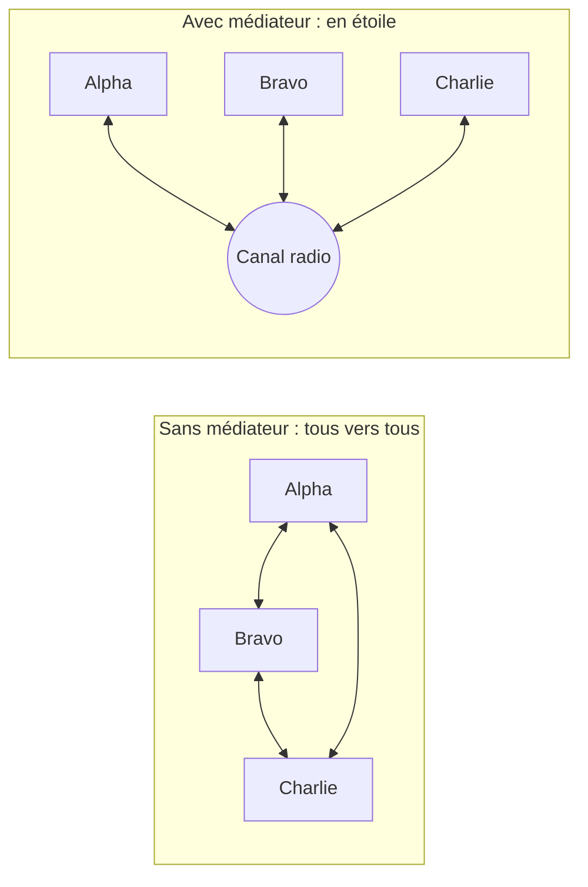

# 16. Mediator

> 🎯 **À la fin de cette fiche, vous savez expliquer :**
> * comment faire communiquer des objets **sans qu’ils se connaissent** ;
> * pourquoi un médiateur remplace un réseau de dépendances « tous vers tous » par une étoile ;
> * comment l’appliquer à une interface Unity sans créer de boucles de notifications.
>
> ⏱️ 25 min · Prérequis : [10. Couplage et Cohésion](<../../Chapitre 1/Partie III — Concepts Avancés/10. Couplage et Cohésion.md>), [7. Observer](<../Partie III — Patterns Comportementaux/7. Observer.md>)

---

## Objectif

Centraliser la communication entre plusieurs objets dans un objet **médiateur**. Les objets ne se parlent plus directement : ils s’adressent au médiateur, qui décide qui doit être prévenu et comment.

---

## Problème à résoudre

Une escouade de soldats doit communiquer : un soldat qui repère un ennemi prévient les autres, un autre répond à un équipier précis. Si chaque soldat garde une référence vers chacun des autres :

* avec 4 soldats, il y a 12 liens ; avec 10 soldats, 90 ;
* ajouter un soldat oblige à mettre à jour tous les autres ;
* les règles (« ne pas se répondre à soi-même », « que faire si le destinataire n’existe pas ») sont dupliquées partout.

---

## Solution

Chaque soldat ne connaît qu’un seul objet : le **canal radio**. C’est lui qui connaît tout le monde et qui applique les règles de communication.



| Élément | Rôle |
| --- | --- |
| **Mediator** (`IMediateurRadio`) | Interface de communication. |
| **ConcreteMediator** (`CanalRadio`) | Connaît les participants et applique les règles. |
| **Colleague** (`Soldat`) | Participant qui ne connaît que le médiateur. |

---

## Implémentation en C#

```csharp
public interface IMediateurRadio
{
    void Enregistrer(Soldat soldat);
    void Diffuser(Soldat emetteur, string message);
    void Envoyer(Soldat emetteur, string destinataire, string message);
}

public class Soldat
{
    private readonly IMediateurRadio radio;
    public string Indicatif { get; }

    public Soldat(string indicatif, IMediateurRadio radio)
    {
        Indicatif = indicatif;
        this.radio = radio;
        radio.Enregistrer(this);
    }

    public void Parler(string message) => radio.Diffuser(this, message);
    public void ParlerA(string destinataire, string message) => radio.Envoyer(this, destinataire, message);

    public void Recevoir(string emetteur, string message)
        => Console.WriteLine($"[{Indicatif}] reçu de {emetteur} : {message}");
}

public class CanalRadio : IMediateurRadio
{
    private readonly Dictionary<string, Soldat> soldats = new();

    public void Enregistrer(Soldat soldat) => soldats[soldat.Indicatif] = soldat;

    public void Diffuser(Soldat emetteur, string message)
    {
        foreach (var soldat in soldats.Values)
            if (soldat != emetteur)
                soldat.Recevoir(emetteur.Indicatif, message);
    }

    public void Envoyer(Soldat emetteur, string destinataire, string message)
    {
        if (soldats.TryGetValue(destinataire, out var soldat))
            soldat.Recevoir(emetteur.Indicatif, message);
        else
            Console.WriteLine($"[Radio] {destinataire} ne répond pas.");
    }
}
```

### Utilisation

```csharp
var radio = new CanalRadio();
var alpha = new Soldat("Alpha", radio);
var bravo = new Soldat("Bravo", radio);
var charlie = new Soldat("Charlie", radio);

alpha.Parler("Ennemi en vue au nord !");
charlie.ParlerA("Alpha", "Bien reçu, je couvre ta position.");
bravo.ParlerA("Delta", "Delta, tu m’entends ?");
```

**Sortie :**

```
[Bravo] reçu de Alpha : Ennemi en vue au nord !
[Charlie] reçu de Alpha : Ennemi en vue au nord !
[Alpha] reçu de Charlie : Bien reçu, je couvre ta position.
[Radio] Delta ne répond pas.
```

Aucun soldat ne contient de référence vers un autre soldat. Ajouter un quatrième soldat ne demande de modifier personne.

---

## Avantages

1. **Faible couplage** entre les participants : chacun ne dépend que du médiateur.
2. **Règles centralisées** : la logique d’interaction est écrite à un seul endroit.
3. **Participants réutilisables** : un `Soldat` fonctionne avec n’importe quelle implémentation de `IMediateurRadio` (radio cryptée, radio avec brouillage…).

## Inconvénients

* Le médiateur concentre la logique et peut devenir un **God Object** s’il gère trop de choses.
* Le flux des messages est moins visible : il faut lire le médiateur pour savoir qui réagit à quoi.

---

## Application dans Unity

Un **panneau d’options** est un cas d’école. Le curseur de volume et la case « Muet » doivent rester cohérents entre eux, et le bouton « Appliquer » ne doit s’activer qu’en cas de modification. Plutôt que de relier chaque widget aux autres, le panneau joue le rôle de médiateur :

```csharp
using UnityEngine;
using UnityEngine.UI;

public class PanneauOptions : MonoBehaviour          // le médiateur
{
    [SerializeField] private Slider volume;
    [SerializeField] private Toggle muet;
    [SerializeField] private Button appliquer;

    private void OnEnable()
    {
        volume.onValueChanged.AddListener(SurVolumeChange);
        muet.onValueChanged.AddListener(SurMuetChange);
        appliquer.onClick.AddListener(Appliquer);
        appliquer.interactable = false;
    }

    private void OnDisable()
    {
        volume.onValueChanged.RemoveListener(SurVolumeChange);
        muet.onValueChanged.RemoveListener(SurMuetChange);
        appliquer.onClick.RemoveListener(Appliquer);
    }

    // Les widgets ne se connaissent pas : ils préviennent le médiateur, qui décide
    private void SurVolumeChange(float valeur)
    {
        muet.SetIsOnWithoutNotify(valeur == 0f);   // évite une boucle de notifications
        appliquer.interactable = true;
    }

    private void SurMuetChange(bool estMuet)
    {
        if (estMuet)
            volume.SetValueWithoutNotify(0f);
        appliquer.interactable = true;
    }

    private void Appliquer()
    {
        AudioListener.volume = volume.value;
        appliquer.interactable = false;
    }
}
```

> [!TIP]
> `SetValueWithoutNotify` et `SetIsOnWithoutNotify` modifient un widget **sans déclencher** son événement `onValueChanged`. Sans eux, changer le curseur depuis la case « Muet » relancerait `SurVolumeChange`, qui modifierait la case… C’est le piège classique des médiateurs : les **boucles de notifications**.

Les **Event Channels** en ScriptableObject (voir [7. Observer](<../Partie III — Patterns Comportementaux/7. Observer.md>)) sont une forme de médiateur très répandue dans Unity : émetteurs et récepteurs ne partagent qu’un asset d’événement.

---

## ⚠️ Pièges courants

* **Le médiateur qui fait tout** : il doit **coordonner** les participants, pas réaliser leur travail à leur place.
* **Les boucles de notifications** : A prévient le médiateur, qui modifie B, qui prévient le médiateur, qui modifie A… (voir l’encadré ci-dessus).
* **Des participants qui gardent quand même des références entre eux** « pour aller plus vite » : le couplage revient par la petite porte.

## 🔀 À ne pas confondre

* **Mediator** (les participants passent par lui dans **les deux sens**, et il applique des règles) et **[Observer](<../Partie III — Patterns Comportementaux/7. Observer.md>)** (un sujet diffuse à des abonnés, dans **un seul sens**). Un médiateur est souvent implémenté avec des événements.
* **Mediator** (coordonne des objets **égaux** qui se parlent) et **[Facade](<../Partie II — Patterns Structurels/6. Facade.md>)** (simplifie l’accès à un sous-système qui ne connaît même pas la façade).

---

## 🧪 Exercice : le salon de jeu

Avant une partie en ligne, les joueurs rejoignent un **salon**. La partie commence automatiquement quand **tous** les joueurs ont cliqué sur « Prêt ».

Écrivez :

* une classe `Salon` (le médiateur), construite avec un nombre de places, qui expose `Rejoindre(JoueurSalon)`, `SignalerPret(JoueurSalon)` et une propriété `PartieLancee` ;
* une classe `JoueurSalon`, qui rejoint le salon dans son constructeur et dont la méthode `EtrePret()` prévient le salon. Un joueur déjà prêt qui clique à nouveau ne doit rien déclencher.

**Contrainte :** un `JoueurSalon` ne doit jamais référencer un autre `JoueurSalon`.

**Test attendu :**

```csharp
var salon = new Salon(places: 3);
var ana = new JoueurSalon("Ana", salon);
var ben = new JoueurSalon("Ben", salon);
var chloe = new JoueurSalon("Chloé", salon);

ana.EtrePret();
ana.EtrePret();          // déjà prête : rien ne se passe
chloe.EtrePret();
Console.WriteLine($"Partie lancée : {salon.PartieLancee}");
ben.EtrePret();
Console.WriteLine($"Partie lancée : {salon.PartieLancee}");
```

```
Ana rejoint le salon (1/3).
Ben rejoint le salon (2/3).
Chloé rejoint le salon (3/3).
Ana a cliqué sur « Prêt » (1/3).
Chloé a cliqué sur « Prêt » (2/3).
Partie lancée : False
Ben a cliqué sur « Prêt » (3/3).
Tout le monde est prêt : la partie commence !
Partie lancée : True
```

<details>
<summary>Voir la solution</summary>

```csharp
public class JoueurSalon
{
    private readonly Salon salon;
    public string Nom { get; }
    public bool Pret { get; private set; }

    public JoueurSalon(string nom, Salon salon)
    {
        Nom = nom;
        this.salon = salon;
        salon.Rejoindre(this);
    }

    public void EtrePret()
    {
        if (Pret) return;
        Pret = true;
        salon.SignalerPret(this);
    }
}

public class Salon
{
    private readonly List<JoueurSalon> joueurs = new();
    private readonly int places;

    public bool PartieLancee { get; private set; }

    public Salon(int places) => this.places = places;

    public void Rejoindre(JoueurSalon joueur)
    {
        joueurs.Add(joueur);
        Console.WriteLine($"{joueur.Nom} rejoint le salon ({joueurs.Count}/{places}).");
    }

    public void SignalerPret(JoueurSalon joueur)
    {
        int prets = joueurs.Count(j => j.Pret);
        Console.WriteLine($"{joueur.Nom} a cliqué sur « Prêt » ({prets}/{places}).");

        if (prets == places)
        {
            PartieLancee = true;
            Console.WriteLine("Tout le monde est prêt : la partie commence !");
        }
    }
}
```

La règle « tout le monde est prêt » vit uniquement dans le salon : aucun joueur n’a besoin de savoir combien d’autres joueurs existent.

</details>

---

## Résumé

| Aspect | Description |
| --- | --- |
| **But** | Faire communiquer des objets sans qu’ils se connaissent |
| **Principe** | Toutes les interactions passent par un médiateur qui applique les règles |
| **Point clé** | Une étoile au lieu d’un réseau « tous vers tous » |
| **Exemple Unity typique** | Panneaux d’interface, salons de jeu, Event Channels |

---

## Références utiles

* [Refactoring Guru — Mediator](https://refactoring.guru/fr/design-patterns/mediator)
* [Unity Scripting API — Slider.SetValueWithoutNotify](https://docs.unity3d.com/Packages/com.unity.ugui@2.0/api/UnityEngine.UI.Slider.html)
* Gamma, Helm, Johnson, Vlissides — *Design Patterns: Elements of Reusable Object-Oriented Software*, Addison-Wesley, 1994.

---

[← Précédent : 15. Flyweight](<15. Flyweight.md>) · [Sommaire](<../../README.md>) · [Suivant : 17. Iterator →](<17. Iterator.md>)
