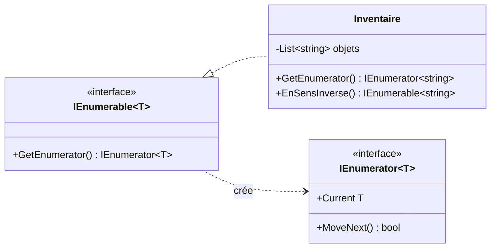

# 17. Iterator

> 🎯 **À la fin de cette fiche, vous savez expliquer :**
> * comment parcourir une collection sans connaître sa structure interne ;
> * ce que font réellement `foreach`, `IEnumerable<T>` et `IEnumerator<T>` ;
> * comment `yield return` produit des éléments **à la demande** ;
> * pourquoi les coroutines d’Unity sont des itérateurs.
>
> ⏱️ 25 min · Prérequis : [15. Génériques](<../../Chapitre 1/Partie IV — Les outils du langage/15. Génériques.md>), [12. Composite](<12. Composite.md>)

---

## Objectif

Fournir un moyen de **parcourir les éléments d’une collection un par un**, sans exposer la façon dont elle est stockée (liste, arbre, grille, calcul à la volée…).

En C#, ce pattern est intégré au langage : chaque `foreach` utilise un itérateur.

---

## Problème à résoudre

Un inventaire stocke ses objets dans une `List<string>` privée. Pour que le reste du jeu puisse les parcourir, on pourrait exposer la liste… mais alors n’importe qui peut la vider ou la modifier, et changer de structure de stockage (un dictionnaire, un tableau) casserait tout le code qui l’utilise.

On veut **parcourir** sans **exposer**.

---

## Solution

La collection fournit un **itérateur** : un objet qui sait donner l’élément courant et passer au suivant. En .NET, ce contrat est décrit par deux interfaces :



| Élément | Rôle |
| --- | --- |
| **Aggregate** (`IEnumerable<T>`) | La collection, qui sait créer un itérateur. |
| **Iterator** (`IEnumerator<T>`) | L’objet qui parcourt : `MoveNext()` avance, `Current` donne l’élément. |
| **Client** | Le code qui parcourt, presque toujours avec `foreach`. |

---

## Implémentation en C#

Écrire un `IEnumerator<T>` à la main est fastidieux. Le mot-clé **`yield return`** demande au compilateur de le générer : chaque `yield return` fournit un élément, puis la méthode **se met en pause** jusqu’à ce qu’on demande le suivant.

```csharp
using System.Collections;

public class Inventaire : IEnumerable<string>
{
    private readonly List<string> objets = new();

    public void Ajouter(string objet) => objets.Add(objet);

    public IEnumerator<string> GetEnumerator()
    {
        foreach (var objet in objets)
            yield return objet;
    }

    IEnumerator IEnumerable.GetEnumerator() => GetEnumerator();   // version non générique, exigée par l’interface

    // Un second parcours, sans rien exposer de plus
    public IEnumerable<string> EnSensInverse()
    {
        for (int i = objets.Count - 1; i >= 0; i--)
            yield return objets[i];
    }
}
```

### Utilisation

```csharp
var sac = new Inventaire();
sac.Ajouter("Épée");
sac.Ajouter("Potion");
sac.Ajouter("Carte");

foreach (var objet in sac)
    Console.WriteLine(objet);

Console.WriteLine(string.Join(", ", sac.EnSensInverse()));
```

**Sortie :**

```
Épée
Potion
Carte
Carte, Potion, Épée
```

### Ce que fait réellement `foreach`

Le `foreach` précédent est traduit par le compilateur en un code équivalent à celui-ci :

```csharp
using (IEnumerator<string> it = sac.GetEnumerator())
{
    while (it.MoveNext())
        Console.WriteLine($"-> {it.Current}");
}
```

```
-> Épée
-> Potion
-> Carte
```

### L’évaluation paresseuse

Un itérateur ne calcule un élément **qu’au moment où on le demande**. Il peut donc décrire une séquence **infinie** :

```csharp
static IEnumerable<int> Vagues()
{
    int ennemis = 3;
    for (int numero = 1; ; numero++)            // boucle sans fin !
    {
        Console.WriteLine($"(calcul de la vague {numero})");
        yield return ennemis;
        ennemis *= 2;
    }
}

foreach (int n in Vagues().Take(3))
    Console.WriteLine($"Vague : {n} ennemis");
```

**Sortie :**

```
(calcul de la vague 1)
Vague : 3 ennemis
(calcul de la vague 2)
Vague : 6 ennemis
(calcul de la vague 3)
Vague : 12 ennemis
```

Les calculs et les affichages sont **entrelacés** : chaque vague n’est calculée qu’au moment où la boucle la demande, et `Take(3)` arrête tout après la troisième. C’est aussi le fonctionnement de LINQ : `Where`, `Select` ou `OrderBy` ne font rien tant qu’on ne parcourt pas le résultat.

---

## Avantages

1. **Encapsulation** : le client parcourt sans connaître ni modifier la structure interne.
2. **Plusieurs parcours** pour une même collection (`foreach`, `EnSensInverse()`, `Vivants()`…).
3. **Évaluation paresseuse** : on ne calcule que ce qui est utilisé, et les séquences infinies deviennent possibles.

## Inconvénients

* Un itérateur paresseux **recalcule tout** à chaque parcours : le parcourir deux fois fait deux fois le travail.
* Les erreurs apparaissent **au moment du parcours**, pas au moment de l’appel de la méthode, ce qui peut surprendre en débogage.

---

## Application dans Unity

**Les coroutines sont des itérateurs.** Une coroutine est une méthode qui renvoie un `IEnumerator` et utilise `yield return`. Unity appelle `MoveNext()` à chaque frame (ou quand l’attente est terminée), ce qui permet d’étaler une action dans le temps sans bloquer le jeu :

```csharp
using System.Collections;
using UnityEngine;

public class Clignotement : MonoBehaviour
{
    [SerializeField] private Renderer rendu;

    public void Toucher() => StartCoroutine(Clignoter());

    private IEnumerator Clignoter()
    {
        for (int i = 0; i < 3; i++)
        {
            rendu.enabled = false;
            yield return new WaitForSeconds(0.1f);   // pause : Unity reprendra ici 0,1 s plus tard
            rendu.enabled = true;
            yield return new WaitForSeconds(0.1f);
        }
    }
}
```

Chaque `yield return` est un point de pause. `yield return null` attend simplement la frame suivante.

> [!WARNING]
> Appeler `Clignoter()` sans `StartCoroutine(...)` **ne fait rien** : on crée l’itérateur, mais personne n’appelle `MoveNext()`. C’est l’erreur la plus fréquente avec les coroutines, et elle ne provoque aucun message d’erreur.

La hiérarchie de `Transform` est elle-même parcourable avec un itérateur : `foreach (Transform enfant in transform)` énumère les enfants directs d’un objet.

---

## ⚠️ Pièges courants

* **Modifier une collection pendant qu’on la parcourt** (`liste.Remove(...)` dans un `foreach` sur cette liste) : `InvalidOperationException`. Parcourez une copie (`liste.ToList()`) ou utilisez une boucle `for` à l’envers.
* **Parcourir plusieurs fois un `IEnumerable` coûteux** : chaque parcours relance les calculs. Si le résultat sert plusieurs fois, matérialisez-le avec `ToList()`.
* **Une séquence infinie sans `Take`** : `Vagues().ToList()` ne se termine jamais.
* **Oublier `StartCoroutine`** dans Unity (voir l’encadré ci-dessus).

## 🔀 À ne pas confondre

* **`IEnumerable<T>`** (la collection : « je peux être parcourue ») et **`IEnumerator<T>`** (le curseur : « voici l’élément courant, je passe au suivant »).
* **`yield return`** (fournit un élément et met la méthode en pause) et **`return`** (termine la méthode). Pour arrêter un itérateur avant la fin, on écrit `yield break`.
* **Iterator** et **[Composite](<12. Composite.md>)** : les deux se combinent souvent, un itérateur permettant de parcourir tout un arbre composite comme une simple liste.

---

## 🧪 Exercice : l’ordre de jeu

Écrivez une classe `Heros` (`Nom`, `Pv` modifiable) et une classe `Equipe` qui implémente `IEnumerable<Heros>`, avec :

* `Ajouter(Heros)` ;
* `Vivants()` : renvoie, avec `yield return`, uniquement les héros dont les PV sont supérieurs à 0 ;
* `TourDeJeu()` : une séquence **infinie** qui fait jouer les héros vivants à tour de rôle (A, B, C, A, B, C…), et qui **s’arrête** (`yield break`) si plus aucun héros n’est vivant.

**Test attendu :**

```csharp
var equipe = new Equipe();
equipe.Ajouter(new Heros("Ayla", 30));
equipe.Ajouter(new Heros("Bran", 0));
equipe.Ajouter(new Heros("Cyd", 12));

Console.WriteLine(string.Join(", ", equipe.Select(h => h.Nom)));
Console.WriteLine(string.Join(", ", equipe.Vivants().Select(h => h.Nom)));
Console.WriteLine(string.Join(" → ", equipe.TourDeJeu().Take(5).Select(h => h.Nom)));

foreach (var heros in equipe) heros.Pv = 0;
Console.WriteLine($"Tours possibles quand tout le monde est KO : {equipe.TourDeJeu().Count()}");
```

```
Ayla, Bran, Cyd
Ayla, Cyd
Ayla → Cyd → Ayla → Cyd → Ayla
Tours possibles quand tout le monde est KO : 0
```

<details>
<summary>Voir la solution</summary>

```csharp
using System.Collections;   // pour l’interface non générique IEnumerable

public class Heros
{
    public string Nom { get; }
    public int Pv { get; set; }
    public Heros(string nom, int pv) { Nom = nom; Pv = pv; }
}

public class Equipe : IEnumerable<Heros>
{
    private readonly List<Heros> membres = new();

    public void Ajouter(Heros heros) => membres.Add(heros);

    public IEnumerator<Heros> GetEnumerator() => membres.GetEnumerator();
    IEnumerator IEnumerable.GetEnumerator() => GetEnumerator();

    public IEnumerable<Heros> Vivants()
    {
        foreach (var heros in membres)
            if (heros.Pv > 0)
                yield return heros;
    }

    public IEnumerable<Heros> TourDeJeu()
    {
        while (true)
        {
            bool quelquUnAJoue = false;
            foreach (var heros in Vivants())
            {
                quelquUnAJoue = true;
                yield return heros;
            }
            if (!quelquUnAJoue)
                yield break;    // tout le monde est KO : la séquence s’arrête
        }
    }
}
```

`TourDeJeu()` est infinie tant qu’un héros est vivant : c’est le `Take(5)` du test qui limite le parcours. Comme `Vivants()` est réévalué à chaque tour, un héros qui tombe à 0 PV en cours de partie disparaît automatiquement de l’ordre de jeu.

</details>

---

## Résumé

| Aspect | Description |
| --- | --- |
| **But** | Parcourir une collection sans exposer sa structure |
| **Principe** | `IEnumerable<T>` crée un `IEnumerator<T>` (`MoveNext`, `Current`) |
| **En C#** | `foreach` + `yield return` : le compilateur écrit l’itérateur |
| **Exemple Unity typique** | Coroutines, parcours des enfants d’un `Transform` |

---

## Références utiles

* [Refactoring Guru — Iterator](https://refactoring.guru/fr/design-patterns/iterator)
* [Microsoft Learn — Itérateurs](https://learn.microsoft.com/fr-fr/dotnet/csharp/iterators)
* [Microsoft Learn — Instruction yield](https://learn.microsoft.com/fr-fr/dotnet/csharp/language-reference/statements/yield)
* [Unity Manual — Coroutines](https://docs.unity3d.com/Manual/Coroutines.html)

---

[← Précédent : 16. Mediator](<16. Mediator.md>) · [Sommaire](<../../README.md>) · [Suivant : Conclusion du chapitre 2 →](<../Conclusion du chapitre 2.md>)
