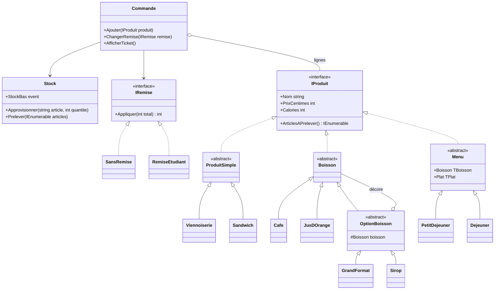

# Projet du chapitre 2 — La boulangerie

> 🎯 **Ce projet vous fait combiner plusieurs patterns dans un même programme :**
> * **Simple Factory** pour créer les produits à partir de leur nom ;
> * **Decorator** pour les options des boissons ;
> * **génériques** et **Composite** pour des menus typés, qui contiennent d’autres produits ;
> * **Observer** pour les alertes de stock, et **Strategy** pour les remises ;
> * des **exceptions** pour les ruptures de stock et les produits inconnus.
>
> ⏱️ 4 à 5 h · Prérequis : le chapitre 1 et les fiches [Factory Method](<Partie I — Patterns Créationnels/2. Factory Method.md>), [Decorator](<Partie II — Patterns Structurels/5. Decorator.md>), [Composite](<Partie IV — Patterns complémentaires/12. Composite.md>), [Observer](<Partie III — Patterns Comportementaux/7. Observer.md>) et [Strategy](<Partie III — Patterns Comportementaux/8. Strategy.md>)

---

## Le cahier des charges

Une boulangerie veut un logiciel de caisse.

* Elle vend des **viennoiseries**, des **sandwichs** et des **boissons**. Chaque produit a un nom, un prix et un nombre de calories.
* Une boisson peut recevoir des **options** cumulables : *grand format* (+0,50 €, calories × 2) et *sirop* (+0,30 €, +50 kcal). Le sirop consomme aussi un article « Sirop » du stock.
* Deux **menus** existent, avec 10 % de réduction sur la somme de leurs éléments : *petit-déjeuner* (une boisson + une viennoiserie) et *déjeuner* (une boisson + un sandwich). Composer un menu avec deux boissons doit être **impossible à compiler**.
* Le **stock** est vérifié à chaque ajout dans une commande. Un ajout est **tout ou rien** : si un seul article manque, rien n’est retiré. Quand un article descend sous un seuil, une **alerte** est émise.
* Une commande peut recevoir une **remise** (aucune, ou étudiant à -15 %), modifiable avant l’édition du ticket.

Le projet reprend l’esprit de la *Bakery* de la piscine Java, en y ajoutant les patterns du chapitre 2.

> [!TIP]
> Les prix sont stockés **en centimes** (`int`). Les calculs restent exacts, et l’affichage ne dépend pas de la langue du système (le séparateur décimal est « , » en français et « . » en anglais).

---

## Vue d’ensemble



---

## Étape 1 — Les produits simples

* Une classe statique `Prix` avec `Formater(int centimes)`, qui renvoie par exemple `"1,20 €"`.
* L’interface `IProduit` : `Nom`, `PrixCentimes`, `Calories`, et `ArticlesAPrelever()`, qui liste les articles à sortir du stock (avec `yield return`).
* Une classe abstraite `ProduitSimple` (valeurs fixées par le constructeur, un seul article à prélever : son nom), dont dérivent les classes abstraites `Viennoiserie` et `Sandwich`.
* Les produits : `Croissant` (1,20 €, 230 kcal), `PainAuChocolat` (1,40 €, 280 kcal), `JambonBeurre` (4,50 €, 420 kcal).

**Test de l’étape :**

```csharp
IProduit[] produits = { new Croissant(), new PainAuChocolat(), new JambonBeurre() };
foreach (var p in produits)
    Console.WriteLine($"{p.Nom} : {Prix.Formater(p.PrixCentimes)}, {p.Calories} kcal");
```

```
Croissant : 1,20 €, 230 kcal
Pain au chocolat : 1,40 €, 280 kcal
Jambon-beurre : 4,50 €, 420 kcal
```

---

## Étape 2 — Les boissons et leurs options (Decorator)

* Une classe abstraite `Boisson` qui implémente `IProduit` avec des membres **abstraits** (pour pouvoir être décorée).
* `Cafe` (1,50 €, 2 kcal) et `JusDOrange` (3,00 €, 110 kcal).
* Un décorateur abstrait `OptionBoisson`, et deux options : `GrandFormat` et `Sirop` (voir le cahier des charges). Le nom s’allonge (« Café grand format + sirop »), et `Sirop` ajoute « Sirop » aux articles à prélever.

**Test de l’étape :**

```csharp
Boisson boisson = new Sirop(new GrandFormat(new Cafe()));
Console.WriteLine($"{boisson.Nom} : {Prix.Formater(boisson.PrixCentimes)}, {boisson.Calories} kcal");
Console.WriteLine($"À sortir du stock : {string.Join(", ", boisson.ArticlesAPrelever())}");
```

```
Café grand format + sirop : 2,30 €, 54 kcal
À sortir du stock : Café, Sirop
```

---

## Étape 3 — Les menus (génériques + Composite)

* Une classe abstraite générique `Menu<TBoisson, TPlat>`, avec les contraintes `where TBoisson : Boisson` et `where TPlat : IProduit`, qui implémente elle-même `IProduit` : son prix vaut 90 % de la somme, ses calories la somme, et ses articles ceux de ses deux éléments.
* `PetitDejeuner : Menu<Boisson, Viennoiserie>` et `Dejeuner : Menu<Boisson, Sandwich>`.

**Test de l’étape :**

```csharp
var menu = new PetitDejeuner(new JusDOrange(), new PainAuChocolat());
Console.WriteLine($"{menu.Nom} : {Prix.Formater(menu.PrixCentimes)}");
Console.WriteLine($"À sortir du stock : {string.Join(", ", menu.ArticlesAPrelever())}");

// new PetitDejeuner(new Cafe(), new JambonBeurre());   // ne doit pas compiler
```

```
Petit-déjeuner (Jus d’orange, Pain au chocolat) : 3,96 €
À sortir du stock : Jus d’orange, Pain au chocolat
```

Un menu est un `IProduit` qui contient d’autres `IProduit` : c’est le pattern **Composite**. La commande et le stock le traitent exactement comme un croissant.

---

## Étape 4 — Le catalogue et le stock (Factory, exceptions, Observer)

* Une classe statique `Catalogue` avec `Creer(string nom)`, qui renvoie le produit correspondant ou lève une `ProduitInconnuException`.
* Une classe `Stock` :
  * `Approvisionner(article, quantite)` refuse une quantité non positive ;
  * `Quantite(article)` renvoie 0 pour un article inconnu ;
  * `Prelever(articles)` vérifie **d’abord** que tout est disponible (sinon `RuptureDeStockException`, sans rien retirer), puis retire les articles ;
  * un événement `StockBas` (`Action<string, int>`) est déclenché quand un article passe sous le seuil (inclus) fixé à la construction.

**Test de l’étape :**

```csharp
var stock = new Stock(seuilAlerte: 2);
stock.StockBas += (article, reste) => Console.WriteLine($"[Alerte stock] Plus que {reste} × {article}");
stock.Approvisionner("Croissant", 4);

stock.Prelever(Catalogue.Creer("Croissant").ArticlesAPrelever());
stock.Prelever(Catalogue.Creer("Croissant").ArticlesAPrelever());
Console.WriteLine($"Croissants restants : {stock.Quantite("Croissant")}");

try
{
    stock.Prelever(new[] { "Croissant", "Croissant", "Croissant" });
}
catch (RuptureDeStockException ex)
{
    Console.WriteLine($"{ex.Message} Croissants restants : {stock.Quantite("Croissant")}");
}
```

```
[Alerte stock] Plus que 2 × Croissant
Croissants restants : 2
Rupture de stock : Croissant. Croissants restants : 2
```

---

## Étape 5 — La commande et les remises (Strategy)

* Une interface `IRemise` (`Description`, `Appliquer(int totalCentimes)`), et deux stratégies : `SansRemise` et `RemiseEtudiant` (-15 %, arrondi au centime inférieur).
* Une classe `Commande` qui reçoit le stock et une remise, avec `Ajouter(IProduit)` (prélève le stock, puis ajoute la ligne), `ChangerRemise(IRemise)`, une propriété `Total` et `AfficherTicket()`.

**Contrainte :** `Commande` ne teste jamais le type d’un produit (`is Menu`…). Tout passe par `IProduit`.

---

## Scénario final

```csharp
var stock = new Stock(seuilAlerte: 1);
stock.Approvisionner("Café", 10);
stock.Approvisionner("Croissant", 3);
stock.Approvisionner("Sirop", 1);
stock.Approvisionner("Jus d’orange", 4);
stock.Approvisionner("Jambon-beurre", 2);

stock.StockBas += (article, reste) => Console.WriteLine($"[Alerte stock] Plus que {reste} × {article}");

var commande = new Commande(stock, new SansRemise());

commande.Ajouter(new PetitDejeuner(new Sirop(new GrandFormat(new Cafe())), new Croissant()));
commande.Ajouter(Catalogue.Creer("Croissant"));
commande.Ajouter(new Dejeuner(new JusDOrange(), new JambonBeurre()));

try
{
    commande.Ajouter(new Sirop(new Cafe()));
}
catch (RuptureDeStockException ex)
{
    Console.WriteLine($"Impossible : {ex.Message}");
}

try
{
    commande.Ajouter(Catalogue.Creer("Baguette"));
}
catch (ProduitInconnuException ex)
{
    Console.WriteLine($"Impossible : {ex.Message}");
}

commande.ChangerRemise(new RemiseEtudiant());
commande.AfficherTicket();
Console.WriteLine($"Cafés restants : {stock.Quantite("Café")}");
```

```
[Alerte stock] Plus que 0 × Sirop
[Alerte stock] Plus que 1 × Croissant
[Alerte stock] Plus que 1 × Jambon-beurre
Impossible : Rupture de stock : Sirop.
Impossible : Produit inconnu : « Baguette ».
===== Ticket =====
Petit-déjeuner (Café grand format + sirop, Croissant) : 3,15 €
Croissant : 1,20 €
Déjeuner (Jus d’orange, Jambon-beurre) : 6,75 €
Remise étudiant (-15 %)
Total : 9,43 € (1044 kcal)
Cafés restants : 9
```

Vérifiez à la main : le petit-déjeuner coûte (2,30 + 1,20) × 0,9 = 3,15 €, et le total (3,15 + 1,20 + 6,75) × 0,85 = 9,435 €, arrondi à 9,43 €. Le deuxième sirop est refusé, car le premier a vidé le stock.

---

## Pour aller plus loin

* **Undo :** permettre d’annuler la dernière ligne d’une commande, en remettant les articles en stock (pattern [Command](<Partie III — Patterns Comportementaux/10. Command.md>)).
* **Une remise « happy hour »** qui offre la boisson la moins chère, sans modifier `Commande`.
* **Un Builder de commande** fluide : `new CommandeBuilder().AvecRemise(...).Ajouter("Croissant").Construire()`.

---

## ✅ Grille d’auto-évaluation

| Notion | Où la retrouver dans votre code |
| --- | --- |
| Simple Factory | `Catalogue.Creer` |
| Decorator | `OptionBoisson`, `GrandFormat`, `Sirop` |
| Génériques et contraintes | `Menu<TBoisson, TPlat>` |
| Composite | Un menu est un `IProduit` qui contient des `IProduit` |
| Iterator (`yield return`) | `ArticlesAPrelever()` |
| Observer | `Stock.StockBas` |
| Strategy | `IRemise`, `SansRemise`, `RemiseEtudiant` |
| Exceptions | `ProduitInconnuException`, `RuptureDeStockException` |
| Polymorphisme sans test de type | `Commande.Ajouter` ne connaît que `IProduit` |

---

## Solution complète

<details>
<summary>Voir la solution</summary>

**Les produits simples**

```csharp
// ---------- Outils
public static class Prix
{
    // Les prix sont stockés en centimes (int) : pas d’arrondi, pas de souci de virgule
    public static string Formater(int centimes) => $"{centimes / 100},{centimes % 100:00} €";
}

public class ProduitInconnuException : Exception
{
    public ProduitInconnuException(string nom) : base($"Produit inconnu : « {nom} ».") { }
}

public class RuptureDeStockException : Exception
{
    public string Article { get; }

    public RuptureDeStockException(string article) : base($"Rupture de stock : {article}.")
        => Article = article;
}

// ---------- Les produits
public interface IProduit
{
    string Nom { get; }
    int PrixCentimes { get; }
    int Calories { get; }
    IEnumerable<string> ArticlesAPrelever();   // ce qu’il faut sortir du stock
}

public abstract class ProduitSimple : IProduit
{
    public string Nom { get; }
    public int PrixCentimes { get; }
    public int Calories { get; }

    protected ProduitSimple(string nom, int prixCentimes, int calories)
    {
        Nom = nom;
        PrixCentimes = prixCentimes;
        Calories = calories;
    }

    public IEnumerable<string> ArticlesAPrelever()
    {
        yield return Nom;
    }
}

public abstract class Viennoiserie : ProduitSimple
{
    protected Viennoiserie(string nom, int prix, int calories) : base(nom, prix, calories) { }
}

public abstract class Sandwich : ProduitSimple
{
    protected Sandwich(string nom, int prix, int calories) : base(nom, prix, calories) { }
}

public class Croissant : Viennoiserie { public Croissant() : base("Croissant", 120, 230) { } }
public class PainAuChocolat : Viennoiserie { public PainAuChocolat() : base("Pain au chocolat", 140, 280) { } }
public class JambonBeurre : Sandwich { public JambonBeurre() : base("Jambon-beurre", 450, 420) { } }
```

**Les boissons et leurs options**

```csharp
// Les boissons sont décorables : leurs propriétés sont abstraites
public abstract class Boisson : IProduit
{
    public abstract string Nom { get; }
    public abstract int PrixCentimes { get; }
    public abstract int Calories { get; }
    public abstract IEnumerable<string> ArticlesAPrelever();
}

public class Cafe : Boisson
{
    public override string Nom => "Café";
    public override int PrixCentimes => 150;
    public override int Calories => 2;
    public override IEnumerable<string> ArticlesAPrelever() { yield return "Café"; }
}

public class JusDOrange : Boisson
{
    public override string Nom => "Jus d’orange";
    public override int PrixCentimes => 300;
    public override int Calories => 110;
    public override IEnumerable<string> ArticlesAPrelever() { yield return "Jus d’orange"; }
}

// ---------- Decorator : options de boisson
public abstract class OptionBoisson : Boisson
{
    protected readonly Boisson boisson;
    protected OptionBoisson(Boisson boisson) => this.boisson = boisson;
}

public class GrandFormat : OptionBoisson
{
    public GrandFormat(Boisson boisson) : base(boisson) { }
    public override string Nom => boisson.Nom + " grand format";
    public override int PrixCentimes => boisson.PrixCentimes + 50;
    public override int Calories => boisson.Calories * 2;
    public override IEnumerable<string> ArticlesAPrelever() => boisson.ArticlesAPrelever();
}

public class Sirop : OptionBoisson
{
    public Sirop(Boisson boisson) : base(boisson) { }
    public override string Nom => boisson.Nom + " + sirop";
    public override int PrixCentimes => boisson.PrixCentimes + 30;
    public override int Calories => boisson.Calories + 50;
    public override IEnumerable<string> ArticlesAPrelever() => boisson.ArticlesAPrelever().Append("Sirop");
}
```

**Les menus**

```csharp
// ---------- Génériques + Composite : les menus
public abstract class Menu<TBoisson, TPlat> : IProduit
    where TBoisson : Boisson
    where TPlat : IProduit
{
    public TBoisson Boisson { get; }
    public TPlat Plat { get; }

    protected Menu(TBoisson boisson, TPlat plat)
    {
        Boisson = boisson;
        Plat = plat;
    }

    protected abstract string Formule { get; }

    public string Nom => $"{Formule} ({Boisson.Nom}, {Plat.Nom})";
    public int PrixCentimes => (Boisson.PrixCentimes + Plat.PrixCentimes) * 90 / 100;   // -10 %
    public int Calories => Boisson.Calories + Plat.Calories;
    public IEnumerable<string> ArticlesAPrelever() => Boisson.ArticlesAPrelever().Concat(Plat.ArticlesAPrelever());
}

public class PetitDejeuner : Menu<Boisson, Viennoiserie>
{
    public PetitDejeuner(Boisson boisson, Viennoiserie viennoiserie) : base(boisson, viennoiserie) { }
    protected override string Formule => "Petit-déjeuner";
}

public class Dejeuner : Menu<Boisson, Sandwich>
{
    public Dejeuner(Boisson boisson, Sandwich sandwich) : base(boisson, sandwich) { }
    protected override string Formule => "Déjeuner";
}
```

**Le catalogue et le stock**

```csharp
// ---------- Simple Factory : le catalogue
public static class Catalogue
{
    public static IProduit Creer(string nom) => nom switch
    {
        "Croissant"        => new Croissant(),
        "Pain au chocolat" => new PainAuChocolat(),
        "Jambon-beurre"    => new JambonBeurre(),
        "Café"             => new Cafe(),
        "Jus d’orange"     => new JusDOrange(),
        _ => throw new ProduitInconnuException(nom)
    };
}

// ---------- Observer : le stock prévient quand il devient bas
public class Stock
{
    private readonly Dictionary<string, int> quantites = new();
    private readonly int seuilAlerte;

    public event Action<string, int> StockBas;

    public Stock(int seuilAlerte) => this.seuilAlerte = seuilAlerte;

    public void Approvisionner(string article, int quantite)
    {
        if (quantite <= 0)
            throw new ArgumentOutOfRangeException(nameof(quantite), "La quantité doit être positive.");
        quantites[article] = Quantite(article) + quantite;
    }

    public int Quantite(string article) => quantites.GetValueOrDefault(article);

    // Tout ou rien : on vérifie TOUS les articles avant d’en retirer un seul
    public void Prelever(IEnumerable<string> articles)
    {
        var besoins = articles.GroupBy(a => a).ToDictionary(g => g.Key, g => g.Count());

        foreach (var (article, nombre) in besoins)
            if (Quantite(article) < nombre)
                throw new RuptureDeStockException(article);

        foreach (var (article, nombre) in besoins)
        {
            quantites[article] -= nombre;
            if (quantites[article] <= seuilAlerte)
                StockBas?.Invoke(article, quantites[article]);
        }
    }
}
```

**Les remises et la commande**

```csharp
// ---------- Strategy : les remises
public interface IRemise
{
    string Description { get; }
    int Appliquer(int totalCentimes);
}

public class SansRemise : IRemise
{
    public string Description => "Aucune remise";
    public int Appliquer(int totalCentimes) => totalCentimes;
}

public class RemiseEtudiant : IRemise
{
    public string Description => "Remise étudiant (-15 %)";
    public int Appliquer(int totalCentimes) => totalCentimes * 85 / 100;
}

// ---------- La commande
public class Commande
{
    private readonly List<IProduit> lignes = new();
    private readonly Stock stock;
    private IRemise remise;

    public Commande(Stock stock, IRemise remise)
    {
        this.stock = stock;
        this.remise = remise;
    }

    public void ChangerRemise(IRemise nouvelle) => remise = nouvelle;

    public void Ajouter(IProduit produit)
    {
        stock.Prelever(produit.ArticlesAPrelever());   // peut lever RuptureDeStockException
        lignes.Add(produit);
    }

    public int Total => remise.Appliquer(lignes.Sum(p => p.PrixCentimes));

    public void AfficherTicket()
    {
        Console.WriteLine("===== Ticket =====");
        foreach (var produit in lignes)
            Console.WriteLine($"{produit.Nom} : {Prix.Formater(produit.PrixCentimes)}");
        Console.WriteLine(remise.Description);
        Console.WriteLine($"Total : {Prix.Formater(Total)} ({lignes.Sum(p => p.Calories)} kcal)");
    }
}
```

</details>

---

[← Précédent : 17. Iterator](<Partie IV — Patterns complémentaires/17. Iterator.md>) · [Sommaire](<../README.md>) · [Suivant : Conclusion du chapitre 2 →](<Conclusion du chapitre 2.md>)
