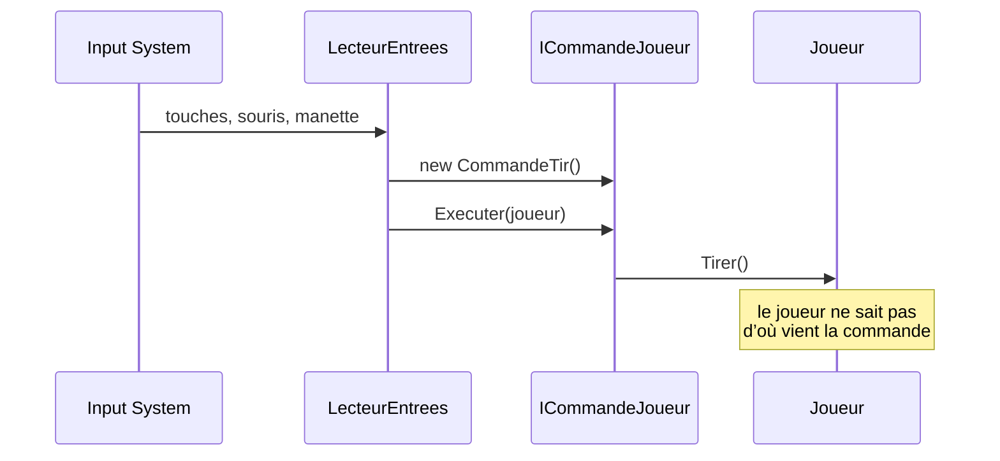

# 1. Le joueur et ses commandes

> 🎯 **À la fin de cette fiche, vous savez expliquer :**
> * pourquoi le joueur ne lit jamais le clavier lui-même ;
> * comment le pattern **Command** sépare la lecture des entrées de l’exécution des actions ;
> * comment déclarer des actions de l’**Input System** directement dans le code ;
> * pourquoi `LireCommandes()` est un **itérateur**.
>
> ⏱️ 45 min · Prérequis : [10. Command](<../Chapitre 2/Partie III — Patterns Comportementaux/10. Command.md>), [17. Iterator](<../Chapitre 2/Partie IV — Patterns complémentaires/17. Iterator.md>)

---

## Le problème

La façon la plus directe d’écrire un joueur est de lire le clavier dans son `Update()` :

```csharp
private void Update()
{
    if (Keyboard.current.spaceKey.isPressed) Tirer();
    // … et ainsi de suite pour chaque touche
}
```

Tout marche… jusqu’au jour où l’on veut :

* ajouter une **manette** (il faut modifier le joueur) ;
* faire jouer une **IA de démonstration** sur l’écran titre (elle ne peut pas « appuyer sur Espace ») ;
* enregistrer les actions pour un **replay** (elles ne sont stockées nulle part) ;
* tester le joueur **sans clavier** (impossible).

---

## La solution : des commandes

Le joueur expose des méthodes d’action (`Deplacer`, `Viser`, `Tirer`, `ChoisirModeDeTir`). Un seul script, le `LecteurEntrees`, connaît le clavier, la souris et la manette : il traduit les entrées en **objets commande**, que le joueur exécute.



### Les commandes

```csharp
using UnityEngine;

namespace ArenePatterns
{
    /// <summary>
    /// Une action demandée au joueur, transformée en objet (pattern Command).
    /// Le clavier, une manette, une IA de démonstration ou un système de replay
    /// peuvent produire les mêmes commandes : le joueur ne voit pas la différence.
    /// </summary>
    public interface ICommandeJoueur
    {
        void Executer(Joueur joueur);
    }

    public class CommandeDeplacement : ICommandeJoueur
    {
        private readonly Vector2 direction;
        public CommandeDeplacement(Vector2 direction) => this.direction = direction;
        public void Executer(Joueur joueur) => joueur.Deplacer(direction);
    }

    public class CommandeVisee : ICommandeJoueur
    {
        private readonly Vector3 pointVise;
        public CommandeVisee(Vector3 pointVise) => this.pointVise = pointVise;
        public void Executer(Joueur joueur) => joueur.Viser(pointVise);
    }

    public class CommandeTir : ICommandeJoueur
    {
        public void Executer(Joueur joueur) => joueur.Tirer();
    }

    public class CommandeChangerModeDeTir : ICommandeJoueur
    {
        private readonly int index;
        public CommandeChangerModeDeTir(int index) => this.index = index;
        public void Executer(Joueur joueur) => joueur.ChoisirModeDeTir(index);
    }
}
```

Chaque commande est minuscule : elle mémorise ses paramètres et appelle une méthode du joueur. Sa valeur ne vient pas de ce qu’elle fait, mais de ce qu’elle **permet** : une commande peut être créée par n’importe qui, stockée, rejouée ou envoyée par le réseau.

### Le lecteur d’entrées

```csharp
using System.Collections.Generic;
using UnityEngine;
using UnityEngine.InputSystem;

namespace ArenePatterns
{
    /// <summary>
    /// Lit les entrées (Input System) et les traduit en commandes pour le joueur.
    /// C’est le seul script du jeu qui connaît le clavier, la souris et la manette.
    /// </summary>
    public class LecteurEntrees : MonoBehaviour
    {
        [SerializeField] private Joueur joueur;
        [SerializeField] private Camera cameraJeu;

        private InputAction deplacement;
        private InputAction tir;
        private InputAction modeDeTir1;
        private InputAction modeDeTir2;
        private readonly Plane sol = new Plane(Vector3.up, Vector3.zero);

        private void Awake()
        {
            // Les chemins désignent la POSITION physique des touches :
            // « w » est la touche Z sur un clavier AZERTY.
            deplacement = new InputAction("Déplacement", InputActionType.Value);
            deplacement.AddCompositeBinding("2DVector")
                .With("Up", "<Keyboard>/w")
                .With("Down", "<Keyboard>/s")
                .With("Left", "<Keyboard>/a")
                .With("Right", "<Keyboard>/d");
            deplacement.AddBinding("<Gamepad>/leftStick");

            tir = new InputAction("Tir", InputActionType.Button, "<Mouse>/leftButton");
            tir.AddBinding("<Keyboard>/space");
            tir.AddBinding("<Gamepad>/rightTrigger");

            modeDeTir1 = new InputAction("Mode de tir 1", InputActionType.Button, "<Keyboard>/digit1");
            modeDeTir2 = new InputAction("Mode de tir 2", InputActionType.Button, "<Keyboard>/digit2");
        }

        private void OnEnable()
        {
            deplacement.Enable();
            tir.Enable();
            modeDeTir1.Enable();
            modeDeTir2.Enable();
        }

        private void OnDisable()
        {
            deplacement.Disable();
            tir.Disable();
            modeDeTir1.Disable();
            modeDeTir2.Disable();
        }

        private void OnDestroy()
        {
            deplacement.Dispose();
            tir.Dispose();
            modeDeTir1.Dispose();
            modeDeTir2.Dispose();
        }

        private void Update()
        {
            foreach (ICommandeJoueur commande in LireCommandes())
                commande.Executer(joueur);
        }

        // Pattern Iterator : les commandes de la frame sont produites à la demande
        private IEnumerable<ICommandeJoueur> LireCommandes()
        {
            Vector2 direction = deplacement.ReadValue<Vector2>();
            if (direction != Vector2.zero)
                yield return new CommandeDeplacement(direction);

            if (Mouse.current != null && TrouverPointVise(Mouse.current.position.ReadValue(), out Vector3 point))
                yield return new CommandeVisee(point);

            if (tir.IsPressed())
                yield return new CommandeTir();

            if (modeDeTir1.WasPressedThisFrame())
                yield return new CommandeChangerModeDeTir(0);
            if (modeDeTir2.WasPressedThisFrame())
                yield return new CommandeChangerModeDeTir(1);
        }

        private bool TrouverPointVise(Vector2 positionEcran, out Vector3 point)
        {
            Ray rayon = cameraJeu.ScreenPointToRay(positionEcran);
            if (sol.Raycast(rayon, out float distance))
            {
                point = rayon.GetPoint(distance);
                return true;
            }

            point = default;
            return false;
        }
    }
}
```

Quelques points à remarquer :

* **Les actions sont déclarées dans le code** (`new InputAction(...)`), ce qui rend le script autonome. Dans un projet plus gros, on préférerait un asset `.inputactions` éditable par un game designer : le principe resterait identique.
* **Les chemins de touches sont physiques** : `<Keyboard>/w` désigne la touche située à l’emplacement du W d’un clavier QWERTY, c’est-à-dire le Z sur un clavier AZERTY. Les déplacements fonctionnent donc sur les deux claviers sans rien changer.
* **`LireCommandes()` est un itérateur** (`yield return`) : il produit les commandes de la frame une par une, et `Update()` les exécute au fur et à mesure.
* **Cycle de vie des actions** : elles sont activées dans `OnEnable()`, désactivées dans `OnDisable()` et libérées dans `OnDestroy()`.

### Le joueur

```csharp
using System;
using UnityEngine;

namespace ArenePatterns
{
    /// <summary>
    /// Le joueur. Il ne lit jamais le clavier : il exécute des commandes (pattern Command)
    /// et prévient le reste du jeu par des événements (pattern Observer).
    /// </summary>
    public class Joueur : MonoBehaviour, IEndommageable
    {
        [SerializeField] private float vitesse = 7f;
        [SerializeField] private int pvMax = 100;
        [SerializeField] private float limiteArene = 14f;
        [SerializeField] private Transform canon;
        [SerializeField] private PoolProjectiles projectiles;
        [SerializeField] private ModeDeTirSO[] modesDeTir;

        private int pv;
        private int indexModeDeTir;
        private float prochainTir;

        public int Pv => pv;
        public int PvMax => pvMax;
        public bool EstVivant => pv > 0;
        public ModeDeTirSO ModeDeTir => modesDeTir[indexModeDeTir];

        public event Action<int, int> PvChange;              // (pv, pvMax)
        public event Action<ModeDeTirSO> ModeDeTirChange;
        public event Action Mort;

        private void Awake()
        {
            pv = pvMax;
        }

        private void Start()
        {
            // Les abonnés (HUD…) se sont inscrits dans leur OnEnable : on leur donne l’état initial
            PvChange?.Invoke(pv, pvMax);
            ModeDeTirChange?.Invoke(ModeDeTir);
        }

        public void Deplacer(Vector2 direction)
        {
            if (!EstVivant)
                return;

            Vector3 deplacement = new Vector3(direction.x, 0f, direction.y) * (vitesse * Time.deltaTime);
            Vector3 position = transform.position + deplacement;
            position.x = Mathf.Clamp(position.x, -limiteArene, limiteArene);
            position.z = Mathf.Clamp(position.z, -limiteArene, limiteArene);
            transform.position = position;
        }

        public void Viser(Vector3 pointVise)
        {
            if (!EstVivant)
                return;

            Vector3 direction = pointVise - transform.position;
            direction.y = 0f;
            if (direction.sqrMagnitude > 0.01f)
                transform.rotation = Quaternion.LookRotation(direction);
        }

        public void Tirer()
        {
            if (!EstVivant || Time.time < prochainTir)
                return;

            prochainTir = Time.time + ModeDeTir.Cadence;
            ModeDeTir.Tirer(projectiles, canon);      // la stratégie de tir décide du reste
        }

        public void ChoisirModeDeTir(int index)
        {
            if (index < 0 || index >= modesDeTir.Length || index == indexModeDeTir)
                return;

            indexModeDeTir = index;
            ModeDeTirChange?.Invoke(ModeDeTir);
        }

        public void SubirDegats(int degats)
        {
            if (degats < 0)
                throw new ArgumentOutOfRangeException(nameof(degats), "Les dégâts ne peuvent pas être négatifs.");
            if (!EstVivant)
                return;

            pv = Mathf.Max(0, pv - degats);
            PvChange?.Invoke(pv, pvMax);

            if (!EstVivant)
                Mort?.Invoke();
        }

        public void Reinitialiser()
        {
            pv = pvMax;
            transform.SetPositionAndRotation(new Vector3(0f, transform.position.y, 0f), Quaternion.identity);
            PvChange?.Invoke(pv, pvMax);
        }
    }
}
```

Le joueur ne connaît ni le clavier, ni le HUD, ni le gestionnaire de partie. Il expose des **méthodes** (ce qu’on peut lui demander) et des **événements** (ce qu’il annonce : `PvChange`, `ModeDeTirChange`, `Mort`). Les fiches suivantes montrent qui écoute ces événements.

> [!NOTE]
> `Start()` déclenche `PvChange` et `ModeDeTirChange` une première fois. Les abonnés (le HUD) se sont inscrits dans leur `OnEnable()`, qui s’exécute avant tous les `Start()` de la scène : ils reçoivent ainsi l’état initial sans avoir à le lire eux-mêmes.

---

## ⚠️ Pièges courants

* **Lire le clavier ailleurs** « juste pour un test » : dès qu’un deuxième script lit les entrées, le découplage est perdu.
* **Oublier d’activer une action** (`Enable()`) : elle ne déclenche jamais rien, sans aucun message d’erreur.
* **Créer des objets à chaque frame** : ici, une `CommandeDeplacement` est allouée à chaque frame où le joueur bouge. C’est négligeable pour ce jeu, mais dans un jeu exigeant, on réutiliserait les commandes ou on en ferait des `struct` pour éviter le travail du ramasse-miettes.
* **Mettre de la logique de jeu dans les commandes** : une commande *transmet* une demande. C’est le joueur qui décide s’il peut tirer (cadence, PV).

---

## 🧪 Défi : l’esquive

Ajoutez une **esquive** : en appuyant sur **Maj gauche** (ou le bouton Est de la manette), le joueur fait un bond de 4 mètres dans la direction où il se déplace, au plus une fois par seconde.

**Contraintes :**

* le joueur ne lit toujours pas le clavier ;
* l’esquive passe par une nouvelle commande.

<details>
<summary>Voir la solution</summary>

**1. Dans `Joueur`**, ajoutez la capacité d’esquiver :

```csharp
[SerializeField] private float distanceEsquive = 4f;
[SerializeField] private float delaiEsquive = 1f;
private float prochaineEsquive;

public void Esquiver(Vector2 direction)
{
    if (!EstVivant || direction == Vector2.zero || Time.time < prochaineEsquive)
        return;

    prochaineEsquive = Time.time + delaiEsquive;
    Vector3 saut = new Vector3(direction.x, 0f, direction.y).normalized * distanceEsquive;
    Vector3 position = transform.position + saut;
    position.x = Mathf.Clamp(position.x, -limiteArene, limiteArene);
    position.z = Mathf.Clamp(position.z, -limiteArene, limiteArene);
    transform.position = position;
}
```

**2. Dans `CommandesJoueur.cs`**, ajoutez la commande :

```csharp
public class CommandeEsquive : ICommandeJoueur
{
    private readonly Vector2 direction;
    public CommandeEsquive(Vector2 direction) => this.direction = direction;
    public void Executer(Joueur joueur) => joueur.Esquiver(direction);
}
```

**3. Dans `LecteurEntrees`**, déclarez l’action :

```csharp
private InputAction esquive;
```

… créez-la dans `Awake()` :

```csharp
esquive = new InputAction("Esquive", InputActionType.Button, "<Keyboard>/leftShift");
esquive.AddBinding("<Gamepad>/buttonEast");
```

… n’oubliez pas `esquive.Enable()` dans `OnEnable()`, `esquive.Disable()` dans `OnDisable()` et `esquive.Dispose()` dans `OnDestroy()`, puis produisez la commande dans `LireCommandes()`, juste après le déplacement :

```csharp
if (esquive.WasPressedThisFrame())
    yield return new CommandeEsquive(direction);
```

Le joueur n’a rien appris du clavier : on pourrait tout aussi bien déclencher l’esquive depuis une IA ou un replay.

</details>

---

[← Précédent : Introduction du chapitre 3](<Chapitre 3 — Mise en pratique.md>) · [Sommaire](<../README.md>) · [Suivant : 2. Les armes →](<2. Les armes.md>)
