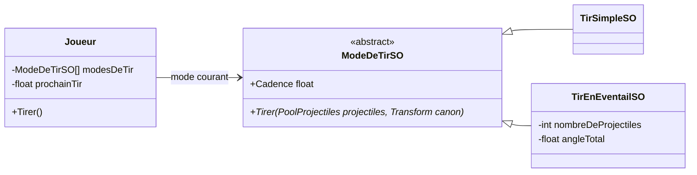

# 2. Les armes : Strategy et Object Pool

> 🎯 **À la fin de cette fiche, vous savez expliquer :**
> * comment des **ScriptableObjects** rendent les stratégies réglables dans l’éditeur ;
> * pourquoi l’état propre au joueur (la cadence de tir en cours) ne doit pas vivre dans la stratégie partagée ;
> * comment le pool de projectiles s’appuie sur `UnityEngine.Pool.ObjectPool<T>` ;
> * comment un projectile se protège contre un double retour au pool.
>
> ⏱️ 45 min · Prérequis : [8. Strategy](<../Chapitre 2/Partie III — Patterns Comportementaux/8. Strategy.md>), [14. Object Pool](<../Chapitre 2/Partie IV — Patterns complémentaires/14. Object Pool.md>)

---

## Les modes de tir : une Strategy en ScriptableObject

Le joueur possède une liste de **modes de tir** et en utilise un à la fois. Chaque mode est un **asset** (`Assets/_Arene/Donnees/TirSimple.asset`, `TirEnEventail.asset`) dont on règle la cadence, les dégâts ou l’angle dans l’Inspector.



```csharp
using UnityEngine;

namespace ArenePatterns
{
    /// <summary>
    /// Une façon de tirer (pattern Strategy). Chaque stratégie est un asset :
    /// on crée et on règle de nouveaux modes de tir dans l’éditeur, sans toucher au code du joueur.
    /// </summary>
    public abstract class ModeDeTirSO : ScriptableObject
    {
        [SerializeField] private string nomAffiche = "Tir";
        [SerializeField, Min(0.05f)] private float cadence = 0.25f;   // secondes entre deux tirs
        [SerializeField, Min(1)] private int degats = 10;

        public string NomAffiche => nomAffiche;
        public float Cadence => cadence;
        protected int Degats => degats;

        public abstract void Tirer(PoolProjectiles projectiles, Transform canon);
    }
}
```

```csharp
using UnityEngine;

namespace ArenePatterns
{
    [CreateAssetMenu(menuName = "Arène/Mode de tir/Tir simple")]
    public class TirSimpleSO : ModeDeTirSO
    {
        public override void Tirer(PoolProjectiles projectiles, Transform canon)
            => projectiles.Lancer(canon.position, canon.rotation, Degats);
    }
}
```

```csharp
using UnityEngine;

namespace ArenePatterns
{
    [CreateAssetMenu(menuName = "Arène/Mode de tir/Tir en éventail")]
    public class TirEnEventailSO : ModeDeTirSO
    {
        [SerializeField, Min(2)] private int nombreDeProjectiles = 5;
        [SerializeField, Range(5f, 180f)] private float angleTotal = 50f;

        public override void Tirer(PoolProjectiles projectiles, Transform canon)
        {
            for (int i = 0; i < nombreDeProjectiles; i++)
            {
                float angle = -angleTotal / 2f + angleTotal * i / (nombreDeProjectiles - 1);
                projectiles.Lancer(canon.position, canon.rotation * Quaternion.Euler(0f, angle, 0f), Degats);
            }
        }
    }
}
```

Côté joueur, tirer se résume à vérifier la cadence puis à déléguer à la stratégie :

```csharp
public void Tirer()
{
    if (!EstVivant || Time.time < prochainTir)
        return;

    prochainTir = Time.time + ModeDeTir.Cadence;
    ModeDeTir.Tirer(projectiles, canon);      // la stratégie de tir décide du reste
}
```

> [!WARNING]
> **Où ranger `prochainTir` ?** Il serait tentant de le mettre dans le ScriptableObject, à côté de la cadence. Mais un asset est **partagé** : si deux joueurs (ou un joueur et une tourelle) utilisaient le même mode de tir, ils partageraient aussi le même délai. La règle : le ScriptableObject contient des **réglages**, l’objet de la scène contient l’**état**.

Les attributs `[Min]` et `[Range]` empêchent de saisir des valeurs absurdes dans l’Inspector : c’est l’**encapsulation** appliquée aux données éditées à la main.

---

## Les projectiles : un Object Pool

En tir en éventail, chaque pression crée cinq projectiles. Les créer et les détruire en permanence provoquerait des allocations et des passages du ramasse-miettes : on les **recycle**.

```csharp
using UnityEngine;
using UnityEngine.Pool;

namespace ArenePatterns
{
    /// <summary>Recycle les projectiles au lieu de les créer et de les détruire (pattern Object Pool).</summary>
    public class PoolProjectiles : MonoBehaviour
    {
        [SerializeField] private Projectile prefab;
        [SerializeField] private int capaciteInitiale = 30;
        [SerializeField] private int tailleMax = 200;

        private ObjectPool<Projectile> pool;

        public int NombreCrees { get; private set; }
        public int NombreActifs => pool.CountActive;

        private void Awake()
        {
            pool = new ObjectPool<Projectile>(
                createFunc: Creer,
                actionOnGet: projectile => projectile.gameObject.SetActive(true),
                actionOnRelease: projectile => projectile.gameObject.SetActive(false),
                actionOnDestroy: projectile => Destroy(projectile.gameObject),
                collectionCheck: true,
                defaultCapacity: capaciteInitiale,
                maxSize: tailleMax);
        }

        private Projectile Creer()
        {
            NombreCrees++;
            Projectile projectile = Instantiate(prefab, transform);
            projectile.DefinirPool(pool);
            return projectile;
        }

        public void Lancer(Vector3 position, Quaternion rotation, int degats)
        {
            Projectile projectile = pool.Get();
            projectile.transform.SetPositionAndRotation(position, rotation);
            projectile.Initialiser(degats);
        }
    }
}
```

```csharp
using UnityEngine;
using UnityEngine.Pool;

namespace ArenePatterns
{
    public class Projectile : MonoBehaviour
    {
        [SerializeField] private float vitesse = 25f;
        [SerializeField] private float duree = 1.2f;

        private IObjectPool<Projectile> pool;
        private float tempsRestant;
        private int degats;
        private bool dejaRendu;

        public void DefinirPool(IObjectPool<Projectile> pool) => this.pool = pool;

        // Appelé à chaque sortie du pool : on remet TOUT l’état à zéro
        public void Initialiser(int degats)
        {
            this.degats = degats;
            tempsRestant = duree;
            dejaRendu = false;
        }

        private void Update()
        {
            transform.position += transform.forward * (vitesse * Time.deltaTime);

            tempsRestant -= Time.deltaTime;
            if (tempsRestant <= 0f)
                Rendre();
        }

        private void OnTriggerEnter(Collider autre)
        {
            if (dejaRendu)
                return;

            if (autre.TryGetComponent(out IEndommageable cible) && cible.EstVivant && cible is not Joueur)
            {
                cible.SubirDegats(degats);
                Rendre();
            }
        }

        private void Rendre()
        {
            if (dejaRendu)
                return;      // un projectile ne doit jamais être rendu deux fois au pool

            dejaRendu = true;
            pool.Release(this);
        }
    }
}
```

Les règles de la fiche [14. Object Pool](<../Chapitre 2/Partie IV — Patterns complémentaires/14. Object Pool.md>) sont toutes appliquées :

* **Réinitialisation complète** à chaque sortie du pool, dans `Initialiser()` : dégâts, durée de vie et drapeau `dejaRendu`.
* **Jamais de double retour** : si un projectile touche un ennemi pendant la même frame où sa durée expire, `Rendre()` pourrait être appelée deux fois. Le drapeau `dejaRendu` l’empêche, et `collectionCheck: true` le signalerait dans l’éditeur.
* **Jamais de `Destroy`** sur un projectile actif : seul le pool détruit, dans `actionOnDestroy`, quand il dépasse sa taille maximale.
* **Une mesure** : `NombreCrees` permet de vérifier que le pool recycle bien. C’est exactement ce que contrôle le test `Le_pool_recycle_les_projectiles` (voir la [conclusion du chapitre](<Conclusion du chapitre 3.md>)).

> [!NOTE]
> Pour recevoir `OnTriggerEnter`, au moins un des deux objets doit avoir un `Rigidbody`. Le projectile en porte un, en mode **kinématique** : il est déplacé par le code, pas par la physique.

---

## ⚠️ Pièges courants

* **Stocker de l’état de jeu dans un ScriptableObject** (voir l’encadré plus haut).
* **Modifier un ScriptableObject en Play Mode** dans l’éditeur : la modification est enregistrée dans l’asset et persiste après l’arrêt du jeu.
* **Le test `cible is not Joueur`** dans `Projectile` est une solution simple pour éviter que le joueur se tire dessus. Dans un projet plus gros, on utiliserait plutôt les **calques de physique** (*Layers* et matrice de collision) pour que les projectiles du joueur ne détectent jamais le joueur.
* **Oublier d’ajouter un nouveau mode de tir dans le tableau `modesDeTir`** du joueur : l’asset existe, mais personne ne l’utilise.

---

## 🧪 Défi : le tir avant-arrière

Créez un troisième mode de tir qui envoie un projectile **devant** le joueur et un autre **derrière** lui, puis rendez-le accessible avec la touche **3**.

**Contrainte :** aucune modification de `Joueur`, ni de `PoolProjectiles`, ni de `Projectile`.

<details>
<summary>Voir la solution</summary>

**1. Le nouveau mode de tir**, dans `Scripts/Armes/TirAvantArriereSO.cs` (une classe par fichier, et le nom du fichier doit être celui de la classe, sinon Unity ne peut pas créer l’asset) :

```csharp
using UnityEngine;

namespace ArenePatterns
{
    [CreateAssetMenu(menuName = "Arène/Mode de tir/Tir avant-arrière")]
    public class TirAvantArriereSO : ModeDeTirSO
    {
        public override void Tirer(PoolProjectiles projectiles, Transform canon)
        {
            projectiles.Lancer(canon.position, canon.rotation, Degats);

            Vector3 derriere = canon.position - canon.forward * 1.8f;          // de l’autre côté du joueur
            projectiles.Lancer(derriere, canon.rotation * Quaternion.Euler(0f, 180f, 0f), Degats);
        }
    }
}
```

**2. Dans l’éditeur :** créez l’asset avec **Create › Arène › Mode de tir › Tir avant-arrière**, puis ajoutez-le comme troisième élément du tableau **Modes De Tir** du `Joueur`.

**3. Dans `LecteurEntrees`**, ajoutez une action `modeDeTir3` liée à `<Keyboard>/digit3` (sans oublier `Enable`, `Disable` et `Dispose`), qui produit `new CommandeChangerModeDeTir(2)`.

Le projectile arrière part de l’autre côté du joueur : il ne le traverse pas, et de toute façon le test `cible is not Joueur` l’empêcherait de le blesser. Le joueur, le pool et les projectiles n’ont pas changé : c’est le principe ouvert/fermé en action.

</details>

---

[← Précédent : 1. Le joueur et ses commandes](<1. Le joueur et ses commandes.md>) · [Sommaire](<../README.md>) · [Suivant : 3. Les ennemis →](<3. Les ennemis.md>)
