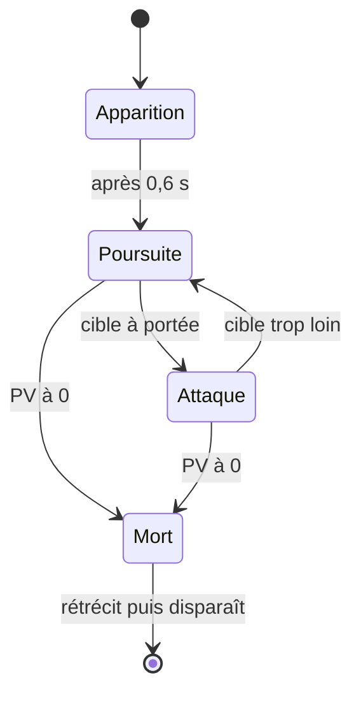

# 3. Les ennemis : Flyweight, State et Factory

> 🎯 **À la fin de cette fiche, vous savez expliquer :**
> * comment séparer les données **partagées** par un type d’ennemi de l’état **propre** à chaque ennemi ;
> * pourquoi `sharedMaterial` plutôt que `material` ;
> * comment une machine à états pilote l’IA, et qui décide des transitions ;
> * ce que la fabrique d’ennemis cache au reste du jeu.
>
> ⏱️ 1 h · Prérequis : [15. Flyweight](<../Chapitre 2/Partie IV — Patterns complémentaires/15. Flyweight.md>), [9. State](<../Chapitre 2/Partie III — Patterns Comportementaux/9. State.md>), [2. Factory Method](<../Chapitre 2/Partie I — Patterns Créationnels/2. Factory Method.md>)

---

## Les données d’ennemi : un Flyweight

Tous les ennemis rapides ont les mêmes PV maximum, la même vitesse, les mêmes dégâts et la même couleur. Ces valeurs vivent dans **un seul asset** par type (`EnnemiRapide.asset`, `EnnemiCostaud.asset`), référencé par tous les ennemis de ce type.

```csharp
using UnityEngine;

namespace ArenePatterns
{
    /// <summary>
    /// Les caractéristiques d’un TYPE d’ennemi, partagées par tous les ennemis de ce type (pattern Flyweight).
    /// Ces données ne sont jamais modifiées en jeu : l’état propre à chaque ennemi (PV, position) vit dans Ennemi.
    /// </summary>
    [CreateAssetMenu(menuName = "Arène/Données d’ennemi")]
    public class DonneesEnnemiSO : ScriptableObject
    {
        [SerializeField] private string nomAffiche = "Ennemi";
        [SerializeField, Min(1)] private int pvMax = 30;
        [SerializeField, Min(0f)] private float vitesse = 3f;
        [SerializeField, Min(0)] private int degatsContact = 10;
        [SerializeField, Min(0.1f)] private float intervalleAttaque = 1f;
        [SerializeField, Min(0)] private int points = 10;
        [SerializeField, Min(0.1f)] private float taille = 1f;
        [SerializeField] private Material materiau;     // partagé : on utilise sharedMaterial, jamais material

        public string NomAffiche => nomAffiche;
        public int PvMax => pvMax;
        public float Vitesse => vitesse;
        public int DegatsContact => degatsContact;
        public float IntervalleAttaque => intervalleAttaque;
        public int Points => points;
        public float Taille => taille;
        public Material Materiau => materiau;
    }
}
```

| État **intrinsèque** (partagé, dans `DonneesEnnemiSO`) | État **extrinsèque** (propre, dans `Ennemi`) |
| --- | --- |
| PV maximum, vitesse, dégâts, points, taille, matériau | PV actuels, position, état courant de l’IA |

> [!WARNING]
> Dans `Ennemi.Initialiser`, la couleur est appliquée avec `GetComponent<Renderer>().sharedMaterial = donnees.Materiau;`. Lire ou modifier `renderer.material` créerait une **copie** du matériau pour chaque ennemi : c’est exactement ce que le Flyweight cherche à éviter.

---

## L’IA : une machine à états



`Ennemi` est le **contexte** : il délègue son `Update()` à son état courant.

```csharp
using System;
using UnityEngine;

namespace ArenePatterns
{
    /// <summary>
    /// Le contexte de la machine à états (pattern State). Il délègue son comportement à son état courant ;
    /// ce sont les états qui décident des transitions, sauf la mort, qui peut survenir dans n’importe quel état.
    /// </summary>
    public class Ennemi : MonoBehaviour, IEndommageable
    {
        private DonneesEnnemiSO donnees;
        private IEtatEnnemi etat;
        private int pv;

        public DonneesEnnemiSO Donnees => donnees;
        public Transform Cible { get; private set; }
        public IEndommageable CibleEndommageable { get; private set; }
        public float PorteeAttaque => 0.7f + donnees.Taille * 0.5f;
        public bool EstVivant => pv > 0;
        public string NomEtat => etat?.GetType().Name ?? "Aucun";

        public event Action<Ennemi> Elimine;

        public void Initialiser(DonneesEnnemiSO donnees, Transform cible)
        {
            this.donnees = donnees;
            Cible = cible;
            CibleEndommageable = cible.GetComponent<IEndommageable>();
            pv = donnees.PvMax;

            transform.localScale = Vector3.one * donnees.Taille;
            GetComponent<Renderer>().sharedMaterial = donnees.Materiau;   // pas de copie de matériau

            ChangerEtat(new EtatApparition());
        }

        public void ChangerEtat(IEtatEnnemi nouvelEtat)
        {
            etat?.Sortir(this);
            etat = nouvelEtat;
            etat.Entrer(this);
        }

        private void Update()
        {
            etat?.Executer(this);
        }

        public void SubirDegats(int degats)
        {
            if (!EstVivant || !etat.EstVulnerable)
                return;

            pv = Mathf.Max(0, pv - degats);
            if (!EstVivant)
            {
                ChangerEtat(new EtatMort());
                Elimine?.Invoke(this);
            }
        }
    }
}
```

Chaque état est une petite classe C# (pas un `MonoBehaviour`). Ce sont **les états qui décident des transitions** : la poursuite sait quand passer à l’attaque, l’attaque sait quand reprendre la poursuite.

```csharp
using UnityEngine;

namespace ArenePatterns
{
    public interface IEtatEnnemi
    {
        bool EstVulnerable { get; }
        void Entrer(Ennemi ennemi);
        void Executer(Ennemi ennemi);
        void Sortir(Ennemi ennemi);
    }

    /// <summary>L’ennemi grandit pendant une courte durée, sans pouvoir être touché.</summary>
    public class EtatApparition : IEtatEnnemi
    {
        private const float Duree = 0.6f;
        private float debut;
        private Vector3 tailleFinale;

        public bool EstVulnerable => false;

        public void Entrer(Ennemi ennemi)
        {
            debut = Time.time;
            tailleFinale = ennemi.transform.localScale;
            ennemi.transform.localScale = Vector3.zero;
        }

        public void Executer(Ennemi ennemi)
        {
            float progression = (Time.time - debut) / Duree;
            ennemi.transform.localScale = Vector3.Lerp(Vector3.zero, tailleFinale, progression);

            if (progression >= 1f)
                ennemi.ChangerEtat(new EtatPoursuite());
        }

        public void Sortir(Ennemi ennemi) => ennemi.transform.localScale = tailleFinale;
    }

    /// <summary>L’ennemi avance vers sa cible, puis attaque quand il est assez près.</summary>
    public class EtatPoursuite : IEtatEnnemi
    {
        public bool EstVulnerable => true;

        public void Entrer(Ennemi ennemi) { }

        public void Executer(Ennemi ennemi)
        {
            Vector3 versCible = ennemi.Cible.position - ennemi.transform.position;
            versCible.y = 0f;

            if (versCible.magnitude <= ennemi.PorteeAttaque)
            {
                ennemi.ChangerEtat(new EtatAttaque());
                return;
            }

            ennemi.transform.position += versCible.normalized * (ennemi.Donnees.Vitesse * Time.deltaTime);
            ennemi.transform.rotation = Quaternion.LookRotation(versCible);
        }

        public void Sortir(Ennemi ennemi) { }
    }

    /// <summary>L’ennemi frappe à intervalle régulier ; si la cible s’éloigne, il reprend la poursuite.</summary>
    public class EtatAttaque : IEtatEnnemi
    {
        private float prochaineAttaque;

        public bool EstVulnerable => true;

        public void Entrer(Ennemi ennemi) => prochaineAttaque = Time.time;

        public void Executer(Ennemi ennemi)
        {
            Vector3 versCible = ennemi.Cible.position - ennemi.transform.position;
            versCible.y = 0f;

            if (versCible.magnitude > ennemi.PorteeAttaque * 1.2f)
            {
                ennemi.ChangerEtat(new EtatPoursuite());
                return;
            }

            if (Time.time >= prochaineAttaque && ennemi.CibleEndommageable.EstVivant)
            {
                ennemi.CibleEndommageable.SubirDegats(ennemi.Donnees.DegatsContact);
                prochaineAttaque = Time.time + ennemi.Donnees.IntervalleAttaque;
            }
        }

        public void Sortir(Ennemi ennemi) { }
    }

    /// <summary>État final : l’ennemi rétrécit puis disparaît. Aucune transition n’en sort.</summary>
    public class EtatMort : IEtatEnnemi
    {
        private const float Duree = 0.3f;
        private float debut;
        private Vector3 tailleInitiale;

        public bool EstVulnerable => false;

        public void Entrer(Ennemi ennemi)
        {
            debut = Time.time;
            tailleInitiale = ennemi.transform.localScale;
        }

        public void Executer(Ennemi ennemi)
        {
            float progression = (Time.time - debut) / Duree;
            ennemi.transform.localScale = Vector3.Lerp(tailleInitiale, Vector3.zero, progression);

            if (progression >= 1f)
                Object.Destroy(ennemi.gameObject);
        }

        public void Sortir(Ennemi ennemi) { }
    }
}
```

Deux choix méritent l’attention :

* **La mort est gérée par le contexte.** Elle peut survenir dans n’importe quel état. Plutôt que de dupliquer ce test dans chaque état, `Ennemi.SubirDegats` s’en charge. Les états, eux, déclarent seulement s’ils sont vulnérables (`EstVulnerable`) : un ennemi en train d’apparaître ou de mourir ne peut pas être touché.
* **Chaque transition crée un nouvel état.** Les états gardent donc leurs propres données (l’heure de la prochaine attaque, la taille finale…) sans risque de les partager entre ennemis. À l’inverse des données de la section précédente, ils ne sont **pas** des flyweights.

---

## La fabrique d’ennemis

```csharp
using UnityEngine;

namespace ArenePatterns
{
    /// <summary>
    /// Centralise la création des ennemis (pattern Factory). Le reste du jeu demande « un ennemi de tel type,
    /// à tel endroit » sans savoir comment il est assemblé : prefab, données, cible, état initial.
    /// </summary>
    public class FabriqueEnnemis : MonoBehaviour
    {
        [SerializeField] private Ennemi prefab;
        [SerializeField] private Transform cible;

        public Ennemi Creer(DonneesEnnemiSO donnees, Vector3 positionAuSol)
        {
            Vector3 position = positionAuSol + Vector3.up * (donnees.Taille / 2f);   // posé sur le sol
            Ennemi ennemi = Instantiate(prefab, position, Quaternion.identity, transform);
            ennemi.name = donnees.NomAffiche;
            ennemi.Initialiser(donnees, cible);
            return ennemi;
        }
    }
}
```

Le générateur de vagues demande simplement « un ennemi de tel type, à tel endroit ». Il ignore tout du prefab, de la hauteur à laquelle poser un ennemi selon sa taille, de la cible à poursuivre, et de l’état initial. Si demain les ennemis sont recyclés par un pool plutôt qu’instanciés, seule la fabrique changera.

> [!NOTE]
> C’est une **Simple Factory** plutôt qu’un Factory Method au sens strict (voir l’encadré de la fiche [2. Factory Method](<../Chapitre 2/Partie I — Patterns Créationnels/2. Factory Method.md>)). Grâce aux données en ScriptableObject, un nouveau type d’ennemi ne demande même pas de nouvelle classe : un nouvel asset suffit.

---

## ⚠️ Pièges courants

* **Mettre des PV actuels dans `DonneesEnnemiSO`** : tous les ennemis de ce type partageraient la même barre de vie.
* **Laisser le contexte décider des transitions** avec des `if (etat is …)` : le pattern State n’aurait plus d’intérêt.
* **Oublier la mort dans un nouvel état** : grâce au choix fait ici, impossible, puisque c’est le contexte qui la gère.
* **Détruire un ennemi sans prévenir** : le générateur tient une liste des ennemis vivants. L’événement `Elimine` doit être déclenché avant la destruction, sinon la vague ne se termine jamais.

---

## 🧪 Défi : la fuite

Quand ses PV passent sous **25 %**, un ennemi en poursuite **s’enfuit** pendant deux secondes (un peu plus vite qu’il ne poursuit), puis reprend la poursuite. Il ne fuit qu’une seule fois.

**Contrainte :** la décision de fuir est prise par un **état**, pas par `Ennemi.SubirDegats`.

<details>
<summary>Voir la solution</summary>

**1. Dans `Ennemi`**, exposez la proportion de PV restants et un drapeau :

```csharp
public float ProportionPv => (float)pv / donnees.PvMax;
public bool AFui { get; set; }
```

**2. Dans `EtatPoursuite.Executer`**, ajoutez la transition au tout début de la méthode :

```csharp
if (ennemi.ProportionPv < 0.25f && !ennemi.AFui)
{
    ennemi.ChangerEtat(new EtatFuite());
    return;
}
```

**3. Le nouvel état**, dans `EtatsEnnemi.cs` :

```csharp
/// <summary>Blessé, l’ennemi s’éloigne pendant deux secondes, puis reprend la poursuite.</summary>
public class EtatFuite : IEtatEnnemi
{
    private const float Duree = 2f;
    private float fin;

    public bool EstVulnerable => true;

    public void Entrer(Ennemi ennemi)
    {
        fin = Time.time + Duree;
        ennemi.AFui = true;          // on ne fuit qu’une fois
    }

    public void Executer(Ennemi ennemi)
    {
        Vector3 loinDeLaCible = ennemi.transform.position - ennemi.Cible.position;
        loinDeLaCible.y = 0f;
        ennemi.transform.position += loinDeLaCible.normalized * (ennemi.Donnees.Vitesse * 1.2f * Time.deltaTime);
        ennemi.transform.rotation = Quaternion.LookRotation(loinDeLaCible);

        if (Time.time >= fin)
            ennemi.ChangerEtat(new EtatPoursuite());
    }

    public void Sortir(Ennemi ennemi) { }
}
```

Le diagramme d’états gagne une flèche `Poursuite → Fuite → Poursuite`. Pensez à le mettre à jour : un diagramme d’états à jour est la meilleure documentation d’une IA.

</details>

---

[← Précédent : 2. Les armes](<2. Les armes.md>) · [Sommaire](<../README.md>) · [Suivant : 4. La partie et le HUD →](<4. La partie et le HUD.md>)
