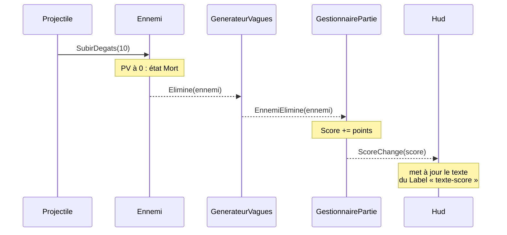

# 4. La partie et le HUD : Iterator et Observer

> 🎯 **À la fin de cette fiche, vous savez expliquer :**
> * comment une **coroutine** enchaîne les vagues dans le temps ;
> * comment les événements circulent de l’ennemi éliminé jusqu’au score affiché ;
> * pourquoi le HUD ne lit jamais l’état des autres objets à chaque frame ;
> * comment le constructeur de scène branche toutes les dépendances sans Singleton.
>
> ⏱️ 1 h · Prérequis : [7. Observer](<../Chapitre 2/Partie III — Patterns Comportementaux/7. Observer.md>), [17. Iterator](<../Chapitre 2/Partie IV — Patterns complémentaires/17. Iterator.md>)

---

## Les vagues : une coroutine

```csharp
using System;
using System.Collections;
using System.Collections.Generic;
using UnityEngine;

namespace ArenePatterns
{
    /// <summary>
    /// Fait apparaître les ennemis par vagues de plus en plus grandes. La boucle des vagues est une
    /// coroutine (pattern Iterator) : elle se met en pause entre deux apparitions, puis jusqu’à ce que
    /// la vague soit vaincue.
    /// </summary>
    public class GenerateurVagues : MonoBehaviour
    {
        [SerializeField] private FabriqueEnnemis fabrique;
        [SerializeField] private DonneesEnnemiSO ennemiRapide;
        [SerializeField] private DonneesEnnemiSO ennemiCostaud;
        [SerializeField] private float rayonApparition = 13f;
        [SerializeField] private float delaiEntreApparitions = 0.4f;
        [SerializeField] private float pauseEntreVagues = 2f;

        private readonly List<Ennemi> vivants = new();
        private Coroutine boucle;

        public int NumeroVague { get; private set; }
        public int NombreVivants => vivants.Count;

        public event Action<int> VagueCommence;
        public event Action<Ennemi> EnnemiElimine;

        public void Demarrer()
        {
            Arreter();
            NumeroVague = 0;
            boucle = StartCoroutine(BoucleDesVagues());
        }

        public void Arreter()
        {
            if (boucle != null)
                StopCoroutine(boucle);
            boucle = null;

            foreach (Ennemi ennemi in vivants)
            {
                ennemi.Elimine -= SurElimination;
                Destroy(ennemi.gameObject);
            }
            vivants.Clear();
        }

        private IEnumerator BoucleDesVagues()
        {
            while (true)
            {
                NumeroVague++;
                VagueCommence?.Invoke(NumeroVague);

                foreach (DonneesEnnemiSO donnees in CompositionDeLaVague(NumeroVague))
                {
                    FaireApparaitre(donnees);
                    yield return new WaitForSeconds(delaiEntreApparitions);
                }

                yield return new WaitUntil(() => vivants.Count == 0);
                yield return new WaitForSeconds(pauseEntreVagues);
            }
        }

        // Vague n : 2 + 2n ennemis, dont un costaud sur trois
        public IEnumerable<DonneesEnnemiSO> CompositionDeLaVague(int numero)
        {
            int total = 2 + 2 * numero;
            for (int i = 1; i <= total; i++)
                yield return i % 3 == 0 ? ennemiCostaud : ennemiRapide;
        }

        public Ennemi FaireApparaitre(DonneesEnnemiSO donnees)
        {
            float angle = UnityEngine.Random.Range(0f, 2f * Mathf.PI);
            Vector3 position = new Vector3(Mathf.Cos(angle), 0f, Mathf.Sin(angle)) * rayonApparition;

            Ennemi ennemi = fabrique.Creer(donnees, position);
            ennemi.Elimine += SurElimination;
            vivants.Add(ennemi);
            return ennemi;
        }

        private void SurElimination(Ennemi ennemi)
        {
            ennemi.Elimine -= SurElimination;
            vivants.Remove(ennemi);
            EnnemiElimine?.Invoke(ennemi);
        }
    }
}
```

Deux itérateurs travaillent ensemble :

* **`BoucleDesVagues()`** est une coroutine : chaque `yield return` met la boucle en pause (entre deux apparitions, jusqu’à ce que la vague soit vaincue, puis pendant la pause entre deux vagues). Unity reprend son exécution au bon moment.
* **`CompositionDeLaVague(numero)`** décrit le contenu d’une vague comme une séquence. Pour changer l’équilibrage (un costaud sur deux, un boss toutes les cinq vagues…), seule cette méthode change.

> [!TIP]
> `CompositionDeLaVague` et `FaireApparaitre` sont publiques : les tests s’en servent pour faire apparaître un ennemi précis, sans attendre la logique des vagues.

---

## Le gestionnaire de partie

```csharp
using System;
using UnityEngine;
using UnityEngine.InputSystem;

namespace ArenePatterns
{
    /// <summary>
    /// Orchestre la partie : démarrage, score, fin de partie et relance.
    /// Il réagit aux événements du joueur et du générateur, et en publie à son tour pour le HUD.
    /// </summary>
    public class GestionnairePartie : MonoBehaviour
    {
        [SerializeField] private Joueur joueur;
        [SerializeField] private GenerateurVagues generateur;

        private InputAction relancer;

        public int Score { get; private set; }
        public bool EstTerminee { get; private set; }

        public event Action<int> ScoreChange;
        public event Action<int> PartieTerminee;       // score final
        public event Action PartieRelancee;

        private void Awake()
        {
            relancer = new InputAction("Relancer", InputActionType.Button, "<Keyboard>/r");
            relancer.AddBinding("<Gamepad>/start");
        }

        private void OnEnable()
        {
            relancer.Enable();
            joueur.Mort += SurMortDuJoueur;
            generateur.EnnemiElimine += SurEnnemiElimine;
        }

        private void OnDisable()
        {
            relancer.Disable();
            joueur.Mort -= SurMortDuJoueur;
            generateur.EnnemiElimine -= SurEnnemiElimine;
        }

        private void OnDestroy() => relancer.Dispose();

        private void Start() => NouvellePartie();

        private void Update()
        {
            if (EstTerminee && relancer.WasPressedThisFrame())
                NouvellePartie();
        }

        public void NouvellePartie()
        {
            EstTerminee = false;
            Score = 0;
            ScoreChange?.Invoke(Score);

            joueur.Reinitialiser();
            generateur.Demarrer();
            PartieRelancee?.Invoke();
        }

        private void SurEnnemiElimine(Ennemi ennemi)
        {
            if (EstTerminee)
                return;

            Score += ennemi.Donnees.Points;
            ScoreChange?.Invoke(Score);
        }

        private void SurMortDuJoueur()
        {
            EstTerminee = true;
            generateur.Arreter();
            PartieTerminee?.Invoke(Score);
        }
    }
}
```

Le gestionnaire est à la fois **observateur** (il écoute la mort du joueur et les éliminations d’ennemis) et **sujet** (il annonce le score, la fin et la relance de la partie). Il ne connaît pas le HUD.



Aucun de ces objets ne connaît le suivant de la chaîne : l’ennemi ignore l’existence du score, et le générateur ignore celle du HUD.

---

## Le HUD, en UI Toolkit

L’interface est construite avec **UI Toolkit**, le système d’interface recommandé par Unity. Il reprend les idées du web en séparant trois rôles :

| Fichier | Rôle | Équivalent web |
|:--|:--|:--|
| `Interface/Hud.uxml` | la **structure** : quels éléments, dans quel ordre | HTML |
| `Interface/Hud.uss` | l’**apparence** : couleurs, tailles, animations | CSS |
| `Scripts/Interface/Hud.cs` | le **comportement** : relier les événements du jeu aux éléments | JavaScript |

Dans la scène, l’objet **HUD** porte un composant `UIDocument` qui affiche `Hud.uxml` à l’aide d’un `PanelSettings` (`Interface/PanneauHud.asset`). Ce dernier règle la mise à l’échelle de l’interface selon la résolution de l’écran.

### La structure

```xml
<ui:UXML xmlns:ui="UnityEngine.UIElements" editor-extension-mode="False">
    <Style src="Hud.uss" />

    <!-- picking-mode="Ignore" : l’interface ne capture jamais la souris, qui sert à viser -->
    <ui:VisualElement name="hud" class="hud" picking-mode="Ignore">

        <!-- En haut à gauche : vie et arme -->
        <ui:VisualElement class="panneau panneau--gauche" picking-mode="Ignore">
            <ui:Label text="POINTS DE VIE" class="intitule" picking-mode="Ignore" />
            <ui:VisualElement name="barre-pv" class="barre" picking-mode="Ignore">
                <ui:VisualElement name="barre-pv-remplissage" class="barre__remplissage" picking-mode="Ignore" />
                <ui:Label name="texte-pv" text="100 / 100" class="barre__texte" picking-mode="Ignore" />
            </ui:VisualElement>
            <ui:Label name="texte-arme" text="Tir simple" class="arme" picking-mode="Ignore" />
        </ui:VisualElement>

        <!-- En haut à droite : score et vague -->
        <ui:VisualElement class="panneau panneau--droite" picking-mode="Ignore">
            <ui:Label text="SCORE" class="intitule" picking-mode="Ignore" />
            <ui:Label name="texte-score" text="0" class="score" picking-mode="Ignore" />
            <ui:Label name="texte-vague" text="Vague 1" class="vague" picking-mode="Ignore" />
        </ui:VisualElement>

        <!-- Au centre : annonce animée de chaque nouvelle vague -->
        <ui:Label name="annonce-vague" text="Vague 1" class="annonce" picking-mode="Ignore" />

        <!-- En bas : rappel des commandes -->
        <ui:Label text="ZQSD  se déplacer   ·   Souris  viser   ·   Clic / Espace  tirer   ·   1 / 2  changer d’arme" class="aide" picking-mode="Ignore" />

        <!-- Écran de fin, affiché en fondu -->
        <ui:VisualElement name="ecran-fin" class="ecran-fin" picking-mode="Ignore">
            <ui:Label text="PARTIE TERMINÉE" class="ecran-fin__titre" picking-mode="Ignore" />
            <ui:Label name="texte-score-final" text="Score : 0" class="ecran-fin__score" picking-mode="Ignore" />
            <ui:Label text="Appuyez sur R pour rejouer" class="ecran-fin__aide" picking-mode="Ignore" />
        </ui:VisualElement>
    </ui:VisualElement>
</ui:UXML>
```

Chaque élément que le code doit retrouver porte un `name` (`texte-pv`, `barre-pv-remplissage`…). L’apparence, elle, passe uniquement par des `class`.

### L’apparence

```css
/* ---------- Couleurs et dimensions communes ---------- */
:root {
    --fond-panneau: rgba(12, 14, 22, 0.72);
    --bordure-panneau: rgba(255, 255, 255, 0.10);
    --texte-principal: rgb(240, 242, 248);
    --texte-secondaire: rgb(150, 160, 182);
    --vie: rgb(78, 205, 130);
    --vie-critique: rgb(240, 82, 82);
    --accent: rgb(255, 205, 90);
}

.hud {
    flex-grow: 1;
}

/* ---------- Panneaux du haut ---------- */
.panneau {
    position: absolute;
    top: 28px;
    padding: 14px 18px;
    background-color: var(--fond-panneau);
    border-width: 1px;
    border-color: var(--bordure-panneau);
    border-radius: 12px;
}

.panneau--gauche {
    left: 28px;
    width: 360px;
}

.panneau--droite {
    right: 28px;
    min-width: 180px;
    align-items: flex-end;
}

.intitule {
    margin: 0 0 6px 0;
    padding: 0;
    font-size: 13px;
    letter-spacing: 2px;
    color: var(--texte-secondaire);
    -unity-font-style: bold;
}

/* ---------- Barre de vie ---------- */
.barre {
    height: 26px;
    background-color: rgba(255, 255, 255, 0.08);
    border-radius: 7px;
    overflow: hidden;
}

.barre__remplissage {
    position: absolute;
    left: 0;
    top: 0;
    bottom: 0;
    width: 100%;
    background-color: var(--vie);
    border-radius: 7px;
    transition-property: width, background-color;
    transition-duration: 0.25s, 0.3s;
    transition-timing-function: ease-out;
}

.barre__remplissage--critique {
    background-color: var(--vie-critique);
}

.barre__texte {
    position: absolute;
    left: 0;
    right: 0;
    top: 0;
    bottom: 0;
    margin: 0;
    padding: 0;
    -unity-text-align: middle-center;
    font-size: 15px;
    color: var(--texte-principal);
    -unity-font-style: bold;
    -unity-text-outline-width: 0.5px;
    -unity-text-outline-color: rgba(0, 0, 0, 0.6);
}

.arme {
    margin: 10px 0 0 0;
    padding: 0;
    font-size: 16px;
    color: var(--accent);
    -unity-font-style: bold;
}

/* ---------- Score et vague ---------- */
.score {
    margin: 0;
    padding: 0;
    font-size: 44px;
    color: var(--texte-principal);
    -unity-font-style: bold;
}

.vague {
    margin: 2px 0 0 0;
    padding: 0;
    font-size: 16px;
    color: var(--texte-secondaire);
}

/* ---------- Annonce de vague : apparaît en grandissant, puis s’efface ---------- */
.annonce {
    position: absolute;
    left: 0;
    right: 0;
    top: 34%;
    -unity-text-align: middle-center;
    font-size: 72px;
    color: var(--texte-principal);
    -unity-font-style: bold;
    -unity-text-outline-width: 1px;
    -unity-text-outline-color: rgba(0, 0, 0, 0.5);
    opacity: 0;
    scale: 0.8 0.8;
    transition-property: opacity, scale;
    transition-duration: 0.35s;
    transition-timing-function: ease-out-back;
}

.annonce--visible {
    opacity: 1;
    scale: 1 1;
}

/* ---------- Aide en bas d’écran ---------- */
.aide {
    position: absolute;
    left: 0;
    right: 0;
    bottom: 20px;
    -unity-text-align: middle-center;
    font-size: 14px;
    color: rgba(255, 255, 255, 0.45);
}

/* ---------- Écran de fin ---------- */
.ecran-fin {
    position: absolute;
    left: 0;
    right: 0;
    top: 0;
    bottom: 0;
    align-items: center;
    justify-content: center;
    background-color: rgba(6, 7, 12, 0.78);
    opacity: 0;
    transition-property: opacity;
    transition-duration: 0.5s;
}

.ecran-fin--visible {
    opacity: 1;
}

.ecran-fin__titre {
    font-size: 64px;
    color: var(--vie-critique);
    -unity-font-style: bold;
    letter-spacing: 4px;
}

.ecran-fin__score {
    margin-top: 8px;
    font-size: 36px;
    color: var(--texte-principal);
}

.ecran-fin__aide {
    margin-top: 28px;
    font-size: 18px;
    color: var(--texte-secondaire);
}
```

Trois points méritent l’attention :

* les **variables** (`--vie`, `--accent`…) déclarées dans `:root` centralisent la palette ;
* les **transitions** animent la barre de vie, l’annonce de vague et l’écran de fin sans une ligne de code d’animation ;
* les classes **modificatrices** (`--critique`, `--visible`) décrivent un *état* de l’interface. Le script ne touche jamais aux couleurs : il ajoute ou retire une classe, et la feuille de style fait le reste.

### Le comportement

```csharp
using UnityEngine;
using UnityEngine.UIElements;

namespace ArenePatterns
{
    /// <summary>
    /// L’interface de jeu, en UI Toolkit (pattern Observer). La structure est décrite dans Hud.uxml,
    /// l’apparence dans Hud.uss : ce script ne fait que relier les événements du jeu aux éléments
    /// de l’interface. Il ne lit jamais l’état des autres objets à chaque frame.
    /// </summary>
    [RequireComponent(typeof(UIDocument))]
    public class Hud : MonoBehaviour
    {
        [SerializeField] private Joueur joueur;
        [SerializeField] private GestionnairePartie partie;
        [SerializeField] private GenerateurVagues generateur;
        [SerializeField, Range(0f, 1f)] private float seuilVieCritique = 0.3f;
        [SerializeField, Min(0.1f)] private float dureeAnnonceVague = 1.5f;

        private VisualElement remplissagePv;
        private VisualElement ecranFin;
        private Label textePv, texteArme, texteScore, texteVague, annonceVague, texteScoreFinal;
        private IVisualElementScheduledItem masquageAnnonce;

        private void OnEnable()
        {
            // UIDocument construit l’arbre visuel dans son propre OnEnable, exécuté avant celui-ci
            VisualElement racine = GetComponent<UIDocument>().rootVisualElement;
            remplissagePv = racine.Q<VisualElement>("barre-pv-remplissage");
            textePv = racine.Q<Label>("texte-pv");
            texteArme = racine.Q<Label>("texte-arme");
            texteScore = racine.Q<Label>("texte-score");
            texteVague = racine.Q<Label>("texte-vague");
            annonceVague = racine.Q<Label>("annonce-vague");
            ecranFin = racine.Q<VisualElement>("ecran-fin");
            texteScoreFinal = racine.Q<Label>("texte-score-final");

            joueur.PvChange += SurPvChange;
            joueur.ModeDeTirChange += SurModeDeTirChange;
            partie.ScoreChange += SurScoreChange;
            partie.PartieTerminee += SurPartieTerminee;
            partie.PartieRelancee += SurPartieRelancee;
            generateur.VagueCommence += SurVagueCommence;
        }

        private void OnDisable()
        {
            joueur.PvChange -= SurPvChange;
            joueur.ModeDeTirChange -= SurModeDeTirChange;
            partie.ScoreChange -= SurScoreChange;
            partie.PartieTerminee -= SurPartieTerminee;
            partie.PartieRelancee -= SurPartieRelancee;
            generateur.VagueCommence -= SurVagueCommence;
        }

        private void SurPvChange(int pv, int pvMax)
        {
            float proportion = pvMax > 0 ? (float)pv / pvMax : 0f;

            textePv.text = $"{pv} / {pvMax}";
            remplissagePv.style.width = Length.Percent(proportion * 100f);       // animé par la transition USS
            remplissagePv.EnableInClassList("barre__remplissage--critique", proportion <= seuilVieCritique);
        }

        private void SurModeDeTirChange(ModeDeTirSO mode) => texteArme.text = mode.NomAffiche;

        private void SurScoreChange(int score) => texteScore.text = score.ToString();

        private void SurVagueCommence(int numero)
        {
            texteVague.text = $"Vague {numero}";
            annonceVague.text = $"Vague {numero}";
            annonceVague.AddToClassList("annonce--visible");

            // Masque l’annonce un peu plus tard ; une nouvelle vague annule le masquage précédent
            masquageAnnonce?.Pause();
            masquageAnnonce = annonceVague.schedule
                .Execute(() => annonceVague.RemoveFromClassList("annonce--visible"))
                .StartingIn((long)(dureeAnnonceVague * 1000));
        }

        private void SurPartieTerminee(int scoreFinal)
        {
            texteScoreFinal.text = $"Score : {scoreFinal}";
            ecranFin.AddToClassList("ecran-fin--visible");
        }

        private void SurPartieRelancee() => ecranFin.RemoveFromClassList("ecran-fin--visible");
    }
}
```

Le HUD retrouve ses éléments une seule fois, dans `OnEnable()`, avec la requête `Q<T>(nom)`. Il s’abonne aux événements du jeu au même endroit et se désabonne dans `OnDisable()`, comme recommandé dans la fiche [7. Observer](<../Chapitre 2/Partie III — Patterns Comportementaux/7. Observer.md>). Ensuite, il ne fait que réagir : rien ne s’exécute à chaque frame.

> [!TIP]
> Comme le HUD ne fait qu’écouter, on peut remplacer entièrement l’interface (autre mise en page, autre système d’UI) sans modifier une seule ligne du joueur, du générateur ou du gestionnaire de partie. C’est tout l’intérêt de l’Observer.

> [!WARNING]
> Par défaut, un élément UI Toolkit intercepte les clics de la souris. Ici, la souris sert à viser et le clic à tirer : tous les éléments sont donc marqués `picking-mode="Ignore"`, pour que l’interface ne bloque jamais le jeu.

---

## Qui branche tout ça ?

Puisqu’il n’y a pas de Singleton, quelqu’un doit donner à chaque objet les références dont il a besoin. Dans ce projet, c’est le **constructeur de scène** (`Editor/ConstructeurArene.cs`, menu **Arène › Construire la scène**). Il remplit les champs `[SerializeField]` privés à l’aide de `SerializedObject`, exactement comme on le ferait à la main dans l’Inspector :

```csharp
Brancher(partie, so =>
{
    so.FindProperty("joueur").objectReferenceValue = composantJoueur;
    so.FindProperty("generateur").objectReferenceValue = generateur;
});
Brancher(hud, so =>
{
    so.FindProperty("joueur").objectReferenceValue = composantJoueur;
    so.FindProperty("partie").objectReferenceValue = partie;
    so.FindProperty("generateur").objectReferenceValue = generateur;
});
```

Ce script a un autre mérite : il **documente** l’assemblage de la scène. En lisant son code, on sait exactement quels objets existent et qui dépend de qui.

> [!WARNING]
> **Un piège rencontré en écrivant ce script.** Ouvrir une nouvelle scène (`EditorSceneManager.NewScene`) décharge les assets qui ne sont plus utilisés. Les références C# vers des prefabs ou des ScriptableObjects chargés *avant* deviennent alors invalides, et la scène est enregistrée avec des champs vides. La solution : créer la scène **en premier**, puis créer ou charger les assets.

---

## ⚠️ Pièges courants

* **Oublier de se désabonner** : après une destruction, l’émetteur garde une référence vers un objet détruit (`MissingReferenceException`).
* **Supposer un ordre entre les `Start()`** : rien ne garantit que le `Start()` du joueur passe avant celui du gestionnaire. D’où le choix de s’abonner dans `OnEnable()` (qui passe avant tous les `Start()`) et de rediffuser l’état initial dans `Start()`.
* **Désactiver le GameObject qui porte une coroutine** : la coroutine s’arrête, et ne repart pas toute seule à la réactivation.
* **Compter les points après la fin de partie** : le gestionnaire ignore les éliminations une fois la partie terminée (`if (EstTerminee) return;`).

---

## 🧪 Défi : le meilleur score

Mémorisez le **meilleur score** entre deux lancements du jeu (avec `PlayerPrefs`) et annoncez chaque nouveau record par un événement `NouveauRecord`.

**Contrainte :** aucune modification de `GestionnairePartie`.

<details>
<summary>Voir la solution</summary>

Un nouveau composant, dans `Scripts/Partie/MeilleurScore.cs`, qui **observe** la fin de partie :

```csharp
using System;
using UnityEngine;

namespace ArenePatterns
{
    /// <summary>
    /// Mémorise le meilleur score entre deux sessions. Il s’abonne à la fin de partie :
    /// aucune ligne de GestionnairePartie n’a besoin de changer (principe ouvert/fermé).
    /// </summary>
    public class MeilleurScore : MonoBehaviour
    {
        private const string Cle = "Arene.MeilleurScore";

        [SerializeField] private GestionnairePartie partie;

        public int Valeur { get; private set; }
        public event Action<int> NouveauRecord;

        private void Awake() => Valeur = PlayerPrefs.GetInt(Cle, 0);

        private void OnEnable() => partie.PartieTerminee += SurPartieTerminee;
        private void OnDisable() => partie.PartieTerminee -= SurPartieTerminee;

        private void SurPartieTerminee(int score)
        {
            if (score <= Valeur)
                return;

            Valeur = score;
            PlayerPrefs.SetInt(Cle, score);
            PlayerPrefs.Save();
            NouveauRecord?.Invoke(score);
        }
    }
}
```

Ajoutez-le à un GameObject de la scène et branchez son champ **Partie** dans l’Inspector. Pour afficher le record, le HUD peut s’abonner à `NouveauRecord` exactement comme aux autres événements.

Le gestionnaire de partie n’a pas changé d’une ligne : il annonçait déjà la fin de partie, et n’a pas besoin de savoir qui l’écoute.

</details>

---

[← Précédent : 3. Les ennemis](<3. Les ennemis.md>) · [Sommaire](<../README.md>) · [Suivant : Conclusion du chapitre 3 →](<Conclusion du chapitre 3.md>)
