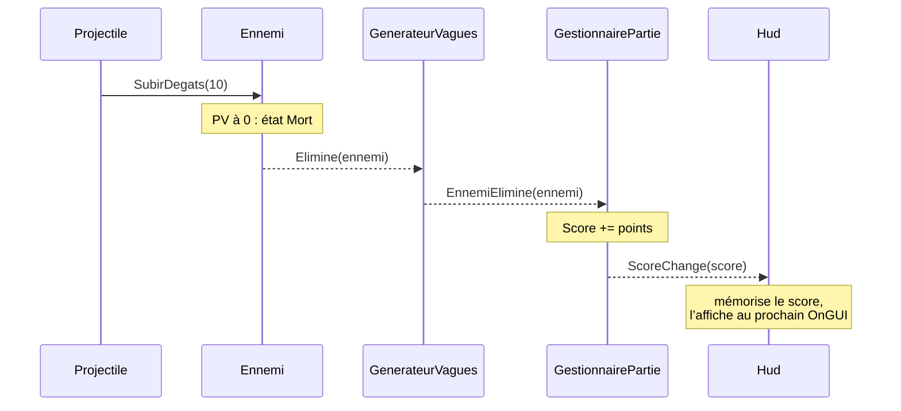

# 4. La partie et le HUD : Iterator et Observer

> 🎯 **À la fin de cette fiche, vous savez expliquer :**
> * comment une **coroutine** enchaîne les vagues dans le temps ;
> * comment les événements circulent de l’ennemi éliminé jusqu’au score affiché ;
> * pourquoi le HUD ne lit jamais l’état des autres objets à chaque frame ;
> * comment le constructeur de scène branche toutes les dépendances sans Singleton.
>
> ⏱️ 1 h · Prérequis : [7. Observer](<../Chapitre 2/Partie III — Patterns Comportementaux/7. Observer.md>), [17. Iterator](<../Chapitre 2/Partie IV — Patterns complémentaires/17. Iterator.md>)

---

## Les vagues : une coroutine

```csharp
using System;
using System.Collections;
using System.Collections.Generic;
using UnityEngine;

namespace ArenePatterns
{
    /// <summary>
    /// Fait apparaître les ennemis par vagues de plus en plus grandes. La boucle des vagues est une
    /// coroutine (pattern Iterator) : elle se met en pause entre deux apparitions, puis jusqu’à ce que
    /// la vague soit vaincue.
    /// </summary>
    public class GenerateurVagues : MonoBehaviour
    {
        [SerializeField] private FabriqueEnnemis fabrique;
        [SerializeField] private DonneesEnnemiSO ennemiRapide;
        [SerializeField] private DonneesEnnemiSO ennemiCostaud;
        [SerializeField] private float rayonApparition = 13f;
        [SerializeField] private float delaiEntreApparitions = 0.4f;
        [SerializeField] private float pauseEntreVagues = 2f;

        private readonly List<Ennemi> vivants = new();
        private Coroutine boucle;

        public int NumeroVague { get; private set; }
        public int NombreVivants => vivants.Count;

        public event Action<int> VagueCommence;
        public event Action<Ennemi> EnnemiElimine;

        public void Demarrer()
        {
            Arreter();
            NumeroVague = 0;
            boucle = StartCoroutine(BoucleDesVagues());
        }

        public void Arreter()
        {
            if (boucle != null)
                StopCoroutine(boucle);
            boucle = null;

            foreach (Ennemi ennemi in vivants)
            {
                ennemi.Elimine -= SurElimination;
                Destroy(ennemi.gameObject);
            }
            vivants.Clear();
        }

        private IEnumerator BoucleDesVagues()
        {
            while (true)
            {
                NumeroVague++;
                VagueCommence?.Invoke(NumeroVague);

                foreach (DonneesEnnemiSO donnees in CompositionDeLaVague(NumeroVague))
                {
                    FaireApparaitre(donnees);
                    yield return new WaitForSeconds(delaiEntreApparitions);
                }

                yield return new WaitUntil(() => vivants.Count == 0);
                yield return new WaitForSeconds(pauseEntreVagues);
            }
        }

        // Vague n : 2 + 2n ennemis, dont un costaud sur trois
        public IEnumerable<DonneesEnnemiSO> CompositionDeLaVague(int numero)
        {
            int total = 2 + 2 * numero;
            for (int i = 1; i <= total; i++)
                yield return i % 3 == 0 ? ennemiCostaud : ennemiRapide;
        }

        public Ennemi FaireApparaitre(DonneesEnnemiSO donnees)
        {
            float angle = UnityEngine.Random.Range(0f, 2f * Mathf.PI);
            Vector3 position = new Vector3(Mathf.Cos(angle), 0f, Mathf.Sin(angle)) * rayonApparition;

            Ennemi ennemi = fabrique.Creer(donnees, position);
            ennemi.Elimine += SurElimination;
            vivants.Add(ennemi);
            return ennemi;
        }

        private void SurElimination(Ennemi ennemi)
        {
            ennemi.Elimine -= SurElimination;
            vivants.Remove(ennemi);
            EnnemiElimine?.Invoke(ennemi);
        }
    }
}
```

Deux itérateurs travaillent ensemble :

* **`BoucleDesVagues()`** est une coroutine : chaque `yield return` met la boucle en pause (entre deux apparitions, jusqu’à ce que la vague soit vaincue, puis pendant la pause entre deux vagues). Unity reprend son exécution au bon moment.
* **`CompositionDeLaVague(numero)`** décrit le contenu d’une vague comme une séquence. Pour changer l’équilibrage (un costaud sur deux, un boss toutes les cinq vagues…), seule cette méthode change.

> [!TIP]
> `CompositionDeLaVague` et `FaireApparaitre` sont publiques : les tests s’en servent pour faire apparaître un ennemi précis, sans attendre la logique des vagues.

---

## Le gestionnaire de partie

```csharp
using System;
using UnityEngine;
using UnityEngine.InputSystem;

namespace ArenePatterns
{
    /// <summary>
    /// Orchestre la partie : démarrage, score, fin de partie et relance.
    /// Il réagit aux événements du joueur et du générateur, et en publie à son tour pour le HUD.
    /// </summary>
    public class GestionnairePartie : MonoBehaviour
    {
        [SerializeField] private Joueur joueur;
        [SerializeField] private GenerateurVagues generateur;

        private InputAction relancer;

        public int Score { get; private set; }
        public bool EstTerminee { get; private set; }

        public event Action<int> ScoreChange;
        public event Action<int> PartieTerminee;       // score final
        public event Action PartieRelancee;

        private void Awake()
        {
            relancer = new InputAction("Relancer", InputActionType.Button, "<Keyboard>/r");
            relancer.AddBinding("<Gamepad>/start");
        }

        private void OnEnable()
        {
            relancer.Enable();
            joueur.Mort += SurMortDuJoueur;
            generateur.EnnemiElimine += SurEnnemiElimine;
        }

        private void OnDisable()
        {
            relancer.Disable();
            joueur.Mort -= SurMortDuJoueur;
            generateur.EnnemiElimine -= SurEnnemiElimine;
        }

        private void OnDestroy() => relancer.Dispose();

        private void Start() => NouvellePartie();

        private void Update()
        {
            if (EstTerminee && relancer.WasPressedThisFrame())
                NouvellePartie();
        }

        public void NouvellePartie()
        {
            EstTerminee = false;
            Score = 0;
            ScoreChange?.Invoke(Score);

            joueur.Reinitialiser();
            generateur.Demarrer();
            PartieRelancee?.Invoke();
        }

        private void SurEnnemiElimine(Ennemi ennemi)
        {
            if (EstTerminee)
                return;

            Score += ennemi.Donnees.Points;
            ScoreChange?.Invoke(Score);
        }

        private void SurMortDuJoueur()
        {
            EstTerminee = true;
            generateur.Arreter();
            PartieTerminee?.Invoke(Score);
        }
    }
}
```

Le gestionnaire est à la fois **observateur** (il écoute la mort du joueur et les éliminations d’ennemis) et **sujet** (il annonce le score, la fin et la relance de la partie). Il ne connaît pas le HUD.



Aucun de ces objets ne connaît le suivant de la chaîne : l’ennemi ignore l’existence du score, et le générateur ignore celle du HUD.

---

## Le HUD

```csharp
using UnityEngine;

namespace ArenePatterns
{
    /// <summary>
    /// L’interface de jeu (pattern Observer) : elle ne lit jamais l’état des autres objets à chaque frame,
    /// elle mémorise ce que les événements lui apprennent. Elle utilise l’IMGUI (OnGUI) pour rester
    /// autonome ; un vrai jeu utiliserait uGUI ou UI Toolkit, avec exactement les mêmes abonnements.
    /// </summary>
    public class Hud : MonoBehaviour
    {
        [SerializeField] private Joueur joueur;
        [SerializeField] private GestionnairePartie partie;
        [SerializeField] private GenerateurVagues generateur;

        private int pv, pvMax, score, vague;
        private string modeDeTir = "";
        private bool partieTerminee;
        private GUIStyle style, styleTitre;

        private void OnEnable()
        {
            joueur.PvChange += SurPvChange;
            joueur.ModeDeTirChange += SurModeDeTirChange;
            partie.ScoreChange += SurScoreChange;
            partie.PartieTerminee += SurPartieTerminee;
            partie.PartieRelancee += SurPartieRelancee;
            generateur.VagueCommence += SurVagueCommence;
        }

        private void OnDisable()
        {
            joueur.PvChange -= SurPvChange;
            joueur.ModeDeTirChange -= SurModeDeTirChange;
            partie.ScoreChange -= SurScoreChange;
            partie.PartieTerminee -= SurPartieTerminee;
            partie.PartieRelancee -= SurPartieRelancee;
            generateur.VagueCommence -= SurVagueCommence;
        }

        private void SurPvChange(int pv, int pvMax) { this.pv = pv; this.pvMax = pvMax; }
        private void SurModeDeTirChange(ModeDeTirSO mode) => modeDeTir = mode.NomAffiche;
        private void SurScoreChange(int score) => this.score = score;
        private void SurPartieTerminee(int scoreFinal) => partieTerminee = true;
        private void SurPartieRelancee() => partieTerminee = false;
        private void SurVagueCommence(int numero) => vague = numero;

        private void OnGUI()
        {
            style ??= new GUIStyle(GUI.skin.label) { fontSize = 22 };
            styleTitre ??= new GUIStyle(GUI.skin.label) { fontSize = 40, alignment = TextAnchor.MiddleCenter };

            GUI.Label(new Rect(20, 15, 400, 30), $"PV : {pv} / {pvMax}", style);
            GUI.Label(new Rect(20, 45, 400, 30), $"Score : {score}", style);
            GUI.Label(new Rect(20, 75, 400, 30), $"Vague : {vague}", style);
            GUI.Label(new Rect(20, 105, 600, 30), $"Arme : {modeDeTir}   (touches 1 et 2)", style);

            if (partieTerminee)
                GUI.Label(new Rect(0, Screen.height / 2f - 60, Screen.width, 120),
                          $"Partie terminée — score : {score}\nAppuyez sur R pour rejouer", styleTitre);
        }
    }
}
```

Le HUD ne fait que **mémoriser** ce que les événements lui apprennent, puis l’afficher. Il s’abonne dans `OnEnable()` et se désabonne dans `OnDisable()`, comme recommandé dans la fiche [7. Observer](<../Chapitre 2/Partie III — Patterns Comportementaux/7. Observer.md>).

> [!NOTE]
> Le HUD utilise `OnGUI` (IMGUI) pour que le projet reste autonome, sans canvas ni police à configurer. Un vrai jeu utiliserait **uGUI** ou **UI Toolkit**. Les abonnements, eux, seraient strictement identiques : c’est tout l’intérêt de l’Observer.

---

## Qui branche tout ça ?

Puisqu’il n’y a pas de Singleton, quelqu’un doit donner à chaque objet les références dont il a besoin. Dans ce projet, c’est le **constructeur de scène** (`Editor/ConstructeurArene.cs`, menu **Arène › Construire la scène**). Il remplit les champs `[SerializeField]` privés à l’aide de `SerializedObject`, exactement comme on le ferait à la main dans l’Inspector :

```csharp
Brancher(partie, so =>
{
    so.FindProperty("joueur").objectReferenceValue = composantJoueur;
    so.FindProperty("generateur").objectReferenceValue = generateur;
});
Brancher(hud, so =>
{
    so.FindProperty("joueur").objectReferenceValue = composantJoueur;
    so.FindProperty("partie").objectReferenceValue = partie;
    so.FindProperty("generateur").objectReferenceValue = generateur;
});
```

Ce script a un autre mérite : il **documente** l’assemblage de la scène. En lisant son code, on sait exactement quels objets existent et qui dépend de qui.

> [!WARNING]
> **Un piège rencontré en écrivant ce script.** Ouvrir une nouvelle scène (`EditorSceneManager.NewScene`) décharge les assets qui ne sont plus utilisés. Les références C# vers des prefabs ou des ScriptableObjects chargés *avant* deviennent alors invalides, et la scène est enregistrée avec des champs vides. La solution : créer la scène **en premier**, puis créer ou charger les assets.

---

## ⚠️ Pièges courants

* **Oublier de se désabonner** : après une destruction, l’émetteur garde une référence vers un objet détruit (`MissingReferenceException`).
* **Supposer un ordre entre les `Start()`** : rien ne garantit que le `Start()` du joueur passe avant celui du gestionnaire. D’où le choix de s’abonner dans `OnEnable()` (qui passe avant tous les `Start()`) et de rediffuser l’état initial dans `Start()`.
* **Désactiver le GameObject qui porte une coroutine** : la coroutine s’arrête, et ne repart pas toute seule à la réactivation.
* **Compter les points après la fin de partie** : le gestionnaire ignore les éliminations une fois la partie terminée (`if (EstTerminee) return;`).

---

## 🧪 Défi : le meilleur score

Mémorisez le **meilleur score** entre deux lancements du jeu (avec `PlayerPrefs`) et annoncez chaque nouveau record par un événement `NouveauRecord`.

**Contrainte :** aucune modification de `GestionnairePartie`.

<details>
<summary>Voir la solution</summary>

Un nouveau composant, dans `Scripts/Partie/MeilleurScore.cs`, qui **observe** la fin de partie :

```csharp
using System;
using UnityEngine;

namespace ArenePatterns
{
    /// <summary>
    /// Mémorise le meilleur score entre deux sessions. Il s’abonne à la fin de partie :
    /// aucune ligne de GestionnairePartie n’a besoin de changer (principe ouvert/fermé).
    /// </summary>
    public class MeilleurScore : MonoBehaviour
    {
        private const string Cle = "Arene.MeilleurScore";

        [SerializeField] private GestionnairePartie partie;

        public int Valeur { get; private set; }
        public event Action<int> NouveauRecord;

        private void Awake() => Valeur = PlayerPrefs.GetInt(Cle, 0);

        private void OnEnable() => partie.PartieTerminee += SurPartieTerminee;
        private void OnDisable() => partie.PartieTerminee -= SurPartieTerminee;

        private void SurPartieTerminee(int score)
        {
            if (score <= Valeur)
                return;

            Valeur = score;
            PlayerPrefs.SetInt(Cle, score);
            PlayerPrefs.Save();
            NouveauRecord?.Invoke(score);
        }
    }
}
```

Ajoutez-le à un GameObject de la scène et branchez son champ **Partie** dans l’Inspector. Pour afficher le record, le HUD peut s’abonner à `NouveauRecord` exactement comme aux autres événements.

Le gestionnaire de partie n’a pas changé d’une ligne : il annonçait déjà la fin de partie, et n’a pas besoin de savoir qui l’écoute.

</details>

---

[← Précédent : 3. Les ennemis](<3. Les ennemis.md>) · [Sommaire](<../README.md>) · [Suivant : Conclusion du chapitre 3 →](<Conclusion du chapitre 3.md>)
