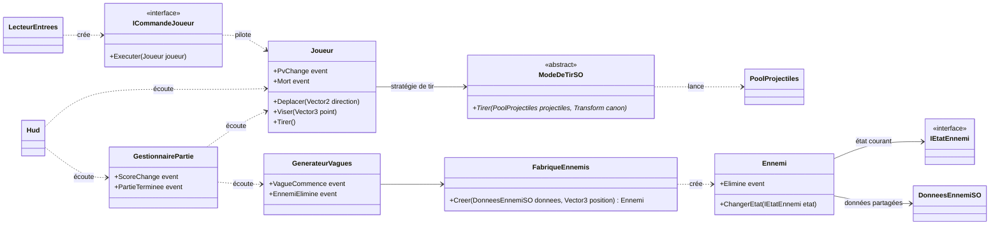

# Chapitre 3 — Mise en pratique : l’arène des patterns

> 🎯 **Dans ce chapitre, vous allez :**
> * explorer un vrai petit jeu Unity, construit uniquement avec les notions des chapitres 1 et 2 ;
> * voir comment **huit patterns** coopèrent dans un même projet, sans se marcher dessus ;
> * comprendre comment se passer de Singleton en injectant les dépendances par l’Inspector ;
> * étendre le jeu au fil de quatre **défis**.
>
> ⏱️ 4 à 6 h · Prérequis : les chapitres 1 et 2 · Unity 6.3 LTS

---

## Le jeu


*L’arène des patterns* est un jeu de tir vu de dessus. Le joueur (la capsule bleue) se déplace dans une arène et affronte des **vagues d’ennemis** de plus en plus nombreuses : des ennemis **rapides** (rouges) et des ennemis **costauds** (violets), qui le poursuivent et l’attaquent au contact. Il dispose de deux modes de tir. La partie s’arrête quand ses points de vie tombent à zéro.

Le jeu est volontairement simple et n’utilise que des formes de base (capsule, cubes, sphères) : tout l’intérêt est dans l’**architecture du code**.

---

## Ouvrir et lancer le projet

1. Installez **Unity 6.3 LTS** (version `6000.3.24f1` ou une version 6.3 plus récente) depuis Unity Hub.
2. Dans Unity Hub : **Add › Add project from disk**, puis choisissez le dossier [`Chapitre 3/ArenePatterns`](<ArenePatterns/>).
3. Ouvrez la scène `Assets/_Arene/Scenes/Arene.unity`, puis cliquez sur **Play**.

| Action | Clavier et souris | Manette |
| --- | --- | --- |
| Se déplacer | Z Q S D (W A S D en QWERTY) | Stick gauche |
| Viser | Souris | — |
| Tirer | Clic gauche ou Espace | Gâchette droite |
| Changer de mode de tir | 1 et 2 | — |
| Rejouer après une défaite | R | Start |

> [!TIP]
> La scène, les prefabs, les matériaux et les données sont **générés par un script d’éditeur** : le menu **Arène › Construire la scène** reconstruit tout en un clic. C’est pratique si vous cassez quelque chose en expérimentant… et c’est un bon exemple de code qui documente la façon dont la scène est assemblée.

---

## L’architecture

Chaque besoin du jeu est résolu par un pattern vu dans le cours :

| Besoin du jeu | Pattern | Scripts | Fiche |
| --- | --- | --- | --- |
| Transformer les entrées en actions du joueur | **Command** (+ Iterator) | `LecteurEntrees`, `CommandesJoueur` | [1. Le joueur et ses commandes](<1. Le joueur et ses commandes.md>) |
| Plusieurs façons de tirer, réglables dans l’éditeur | **Strategy** (ScriptableObject) | `ModeDeTirSO`, `TirSimpleSO`, `TirEnEventailSO` | [2. Les armes](<2. Les armes.md>) |
| Des centaines de projectiles sans saccades | **Object Pool** | `PoolProjectiles`, `Projectile` | [2. Les armes](<2. Les armes.md>) |
| Des caractéristiques partagées par type d’ennemi | **Flyweight** | `DonneesEnnemiSO` | [3. Les ennemis](<3. Les ennemis.md>) |
| Un comportement d’IA qui dépend de la situation | **State** | `Ennemi`, `EtatsEnnemi` | [3. Les ennemis](<3. Les ennemis.md>) |
| Assembler un ennemi complet en un appel | **Factory** | `FabriqueEnnemis` | [3. Les ennemis](<3. Les ennemis.md>) |
| Enchaîner les vagues dans le temps | **Iterator** (coroutine) | `GenerateurVagues` | [4. La partie et le HUD](<4. La partie et le HUD.md>) |
| Mettre à jour l’interface et le score | **Observer** | `Hud`, `GestionnairePartie` | [4. La partie et le HUD](<4. La partie et le HUD.md>) |



### Aucun Singleton

Vous ne trouverez **aucun** `Instance` statique dans ce projet. Chaque script déclare ce dont il a besoin dans des champs `[SerializeField] private`, et ces références sont branchées **dans l’Inspector** (ici, par le constructeur de scène). C’est de l’**injection de dépendances** faite à la main :

* chaque dépendance est **visible** dans l’Inspector, au lieu d’être cachée dans un appel `GestionnaireJeu.Instance` au milieu du code ;
* on peut remplacer une pièce (un autre générateur de vagues, un HUD de test) sans toucher au code des autres ;
* les tests chargent la scène et récupèrent les objets dont ils ont besoin, sans état global à réinitialiser.

### Organisation des fichiers

```
Assets/_Arene/
├── Scripts/                   ← le jeu (assembly ArenePatterns)
│   ├── Commun/                IEndommageable
│   ├── Joueur/                Joueur, CommandesJoueur, LecteurEntrees
│   ├── Armes/                 ModeDeTirSO, TirSimpleSO, TirEnEventailSO, PoolProjectiles, Projectile
│   ├── Ennemis/               DonneesEnnemiSO, Ennemi, EtatsEnnemi, FabriqueEnnemis
│   ├── Partie/                GenerateurVagues, GestionnairePartie
│   └── Interface/             Hud
├── Editor/                    ConstructeurArene, CaptureIllustration
├── Tests/                     TestsArene (tests PlayMode)
├── Donnees/                   assets des modes de tir et des types d’ennemis
├── Materiaux/, Prefabs/, Scenes/
```

Les scripts sont regroupés dans des **assembly definitions** (`.asmdef`) : le code de jeu, l’éditeur et les tests sont compilés séparément, et le code de jeu ne peut pas dépendre par erreur de l’éditeur.

---

## Le parcours

Les quatre fiches suivent le chemin d’une partie : le joueur appuie sur une touche, tire, les ennemis apparaissent et le poursuivent, la partie se termine. Chaque fiche présente le code réel du projet, explique les choix faits, signale les pièges, et se termine par un **défi** pour étendre le jeu.

---

[← Précédent : Conclusion du chapitre 2](<../Chapitre 2/Conclusion du chapitre 2.md>) · [Sommaire](<../README.md>) · [Suivant : 1. Le joueur et ses commandes →](<1. Le joueur et ses commandes.md>)
